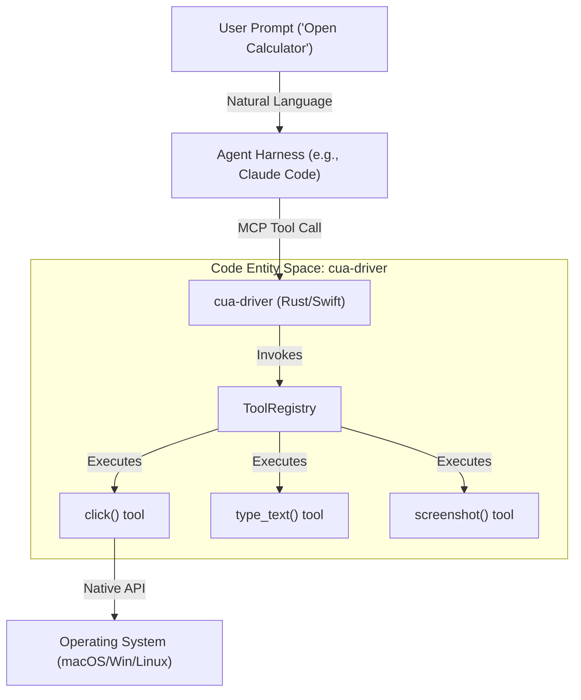
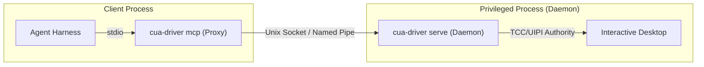

<!-- source: DeepWiki mcp.deepwiki.com · repo trycua/cua · page 15 Integrating with Model Providers and Agent Harnesses · fetched 2026-10-29 -->

# Integrating with Model Providers and Agent Harnesses

<details>
<summary>Relevant source files</summary>

The following files were used as context for generating this wiki page:

- [.github/workflows/clawhub-cua-driver.yml](.github/workflows/clawhub-cua-driver.yml)
- [docs/content/docs/cua-driver/guides/connect-your-agent.mdx](docs/content/docs/cua-driver/guides/connect-your-agent.mdx)
- [libs/cua-driver/README.md](libs/cua-driver/README.md)
- [libs/cua-driver/rust/Skills/cua-driver/LINUX.md](libs/cua-driver/rust/Skills/cua-driver/LINUX.md)
- [libs/cua-driver/rust/Skills/cua-driver/README.md](libs/cua-driver/rust/Skills/cua-driver/README.md)
- [libs/cua-driver/rust/Skills/cua-driver/WINDOWS.md](libs/cua-driver/rust/Skills/cua-driver/WINDOWS.md)
- [libs/cua-driver/rust/crates/cua-driver/src/skills.rs](libs/cua-driver/rust/crates/cua-driver/src/skills.rs)
- [libs/cua-driver/scripts/post-install-hints.txt](libs/cua-driver/scripts/post-install-hints.txt)

</details>


Cua is designed to be model-agnostic, acting as the bridge between high-level reasoning and low-level operating system control. This section covers how to connect **cua-driver** and **Cua sandboxes** to various model providers and agent harnesses.

The integration architecture follows a clear separation of concerns:
```text
Model -> Agent Harness -> Cua Driver -> Operating System
```
Sources: [docs/content/docs/concepts/what-is-computer-use.mdx:25-27]()

## High-Level Integration Model

Cua integrates with external systems primarily through the **Model Context Protocol (MCP)**. This allows any MCP-capable agent harness (like Claude Code, Codex, or Cursor) to discover and invoke Cua's computer-use tools.

### The MCP Bridge
The `cua-driver mcp` command starts a server that exposes Cua's capabilities as tools. This server handles the translation between MCP tool calls and native OS actions like clicking, typing, and screen capture.
Sources: [libs/cua-driver/README.md:36-37]()

### Permission Modes
When connecting an agent, you must select an appropriate permission mode:
*   **Standard Mode:** Default mode for local automation, which is promptless.
*   **Bounded Mode:** Restricted mode where the agent can only interact with tools and resources defined in a reviewed manifest.
*   **Unrestricted Mode:** Requires explicit risk acceptance via `--dangerously-bypass-approvals`.

The permission mode is fixed at `cua-driver` launch and can be set via flags for `cua-driver serve` or environment variables (`CUA_DRIVER_PERMISSION_MODE`, `CUA_DRIVER_CAPABILITY_MANIFEST_FILE`, `CUA_DRIVER_CAPABILITY_MANIFEST_APPROVED`) for `cua-driver mcp` and embedding hosts.
Sources: [libs/cua-driver/README.md:67-79]()

For details on selecting and configuring these modes, see [Connecting Agents via MCP](#15.1).

### System Component Mapping
The following diagram illustrates how natural language requests from a user are transformed into code-level tool executions within the Cua ecosystem.

**Diagram: Request Flow from Natural Language to Code Entities**

Sources: [docs/content/docs/index.mdx:6-16](), [docs/content/docs/reference/cua-driver/process-model.mdx:6-16]()

## Supported Providers and Harnesses

Cua supports a wide range of model providers and the harnesses built on top of them.

### Commercial Providers
*   **Anthropic:** Integration with Claude models via **Claude Code** and the Anthropic Computer Use API.
*   **OpenAI:** Support for GPT-4o and o1 models via **Codex** and **Cursor**.
*   **Google:** Integration with Gemini models using the **Antigravity CLI**.
*   **xAI:** Connectivity for **Grok Bot**.

### Local and Open Models
*   **Meta/Muse:** Optimized support for **Muse Code**.
*   **Qwen & Kimi:** Integration paths for specialized coding and VL models.
*   **Local Runtimes:** Guidance for running models via **Ollama**, **llama.cpp**, and **Unsloth**.

### Agent Harnesses
Cua is verified to work with several popular agent frameworks:
*   **Claude Code:** Turnkey integration via `cua-driver skills install` or `cua-driver mcp-config --client claude`.
*   **Codex:** Direct skill-based integration for persistent environments via `cua-driver skills install` or `cua-driver mcp-config --client codex`.
*   **Prime Agent:** Supported directly, discovering skills from `~/.prime/agent/skills/` or `~/.agents/skills/`.
*   **OpenClaw:** Integration via `clawhub install @cua/driver` or `cua-driver mcp-config --client openclaw`.
*   **Cursor / OpenCode / Hermes:** MCP-based connectivity, with configuration generated by `cua-driver mcp-config`.
*   **Muse Code:** Can use Cua Driver as a local stdio MCP server on macOS and Linux.
*   **GitHub Copilot CLI:** Configurable via `~/.copilot/mcp-config.json`.
*   **ZCode (Z.ai):** Configurable via its GUI app.

Sources: [libs/cua-driver/scripts/post-install-hints.txt:23-88](), [libs/cua-driver/README.md:134-136](), [docs/content/docs/cua-driver/guides/connect-your-agent.mdx:27-40]()

For detailed configuration steps for each provider and harness, see [Provider-Specific Integration Guides](#15.2).

## Architecture: Daemon-Proxy Pattern

Cua uses a **daemon-proxy pattern** to manage permissions and session identity across different platforms. This is critical for maintaining "Computer-Use 2.0" capabilities like background execution without stealing focus.

**Diagram: Daemon-Proxy Relationship**

Sources: [docs/content/docs/reference/cua-driver/process-model.mdx:48-76]()

## Child Pages

*   [Connecting Agents via MCP](#15.1) — Detailed guide on generating MCP configurations, choosing permission modes (Standard vs. Bounded), and the "no-foreground" contract.
*   [Provider-Specific Integration Guides](#15.2) — Step-by-step setup for Claude, OpenAI, Gemini, Grok, and local model providers. Includes verified harness configurations and local serving patterns.

Sources: [docs/content/docs/cua-driver/guides/connect-your-agent.mdx:8-12]()

---

