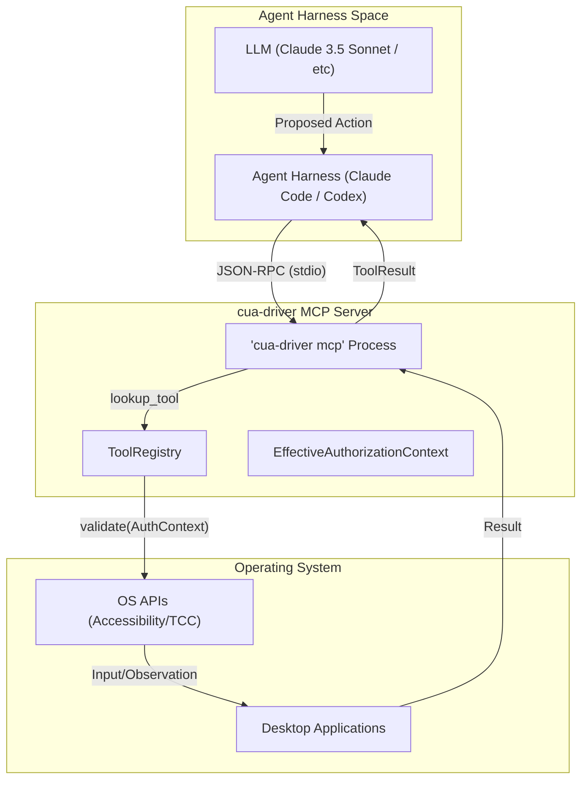
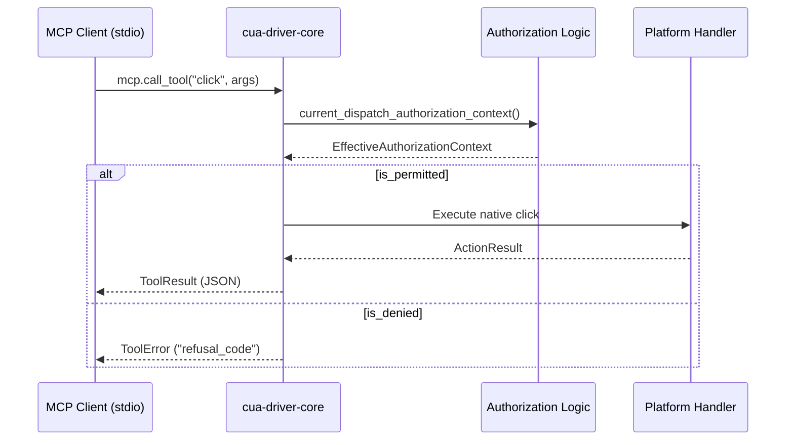

<!-- source: DeepWiki mcp.deepwiki.com · repo trycua/cua · page 15.1 Connecting Agents via MCP · fetched 2026-10-29 -->

# Connecting Agents via MCP

<details>
<summary>Relevant source files</summary>

The following files were used as context for generating this wiki page:

- [.github/scripts/tests/test_documented_cargo_targets.py](.github/scripts/tests/test_documented_cargo_targets.py)
- [.github/workflows/clawhub-cua-driver.yml](.github/workflows/clawhub-cua-driver.yml)
- [TESTING.md](TESTING.md)
- [docs/content/docs/cua-driver/guides/connect-your-agent.mdx](docs/content/docs/cua-driver/guides/connect-your-agent.mdx)
- [libs/cua-driver/README.md](libs/cua-driver/README.md)
- [libs/cua-driver/contract/manifest.json](libs/cua-driver/contract/manifest.json)
- [libs/cua-driver/python/src/cua_driver/_native_contract.py](libs/cua-driver/python/src/cua_driver/_native_contract.py)
- [libs/cua-driver/rust/README.md](libs/cua-driver/rust/README.md)
- [libs/cua-driver/rust/Skills/cua-driver/LINUX.md](libs/cua-driver/rust/Skills/cua-driver/LINUX.md)
- [libs/cua-driver/rust/Skills/cua-driver/README.md](libs/cua-driver/rust/Skills/cua-driver/README.md)
- [libs/cua-driver/rust/Skills/cua-driver/WINDOWS.md](libs/cua-driver/rust/Skills/cua-driver/WINDOWS.md)
- [libs/cua-driver/rust/crates/cua-driver-contract/src/bin/cua-contract-gen.rs](libs/cua-driver/rust/crates/cua-driver-contract/src/bin/cua-contract-gen.rs)
- [libs/cua-driver/rust/crates/cua-driver-contract/src/compatibility.rs](libs/cua-driver/rust/crates/cua-driver-contract/src/compatibility.rs)
- [libs/cua-driver/rust/crates/cua-driver-contract/src/desktop.rs](libs/cua-driver/rust/crates/cua-driver-contract/src/desktop.rs)
- [libs/cua-driver/rust/crates/cua-driver-contract/src/inputs.rs](libs/cua-driver/rust/crates/cua-driver-contract/src/inputs.rs)
- [libs/cua-driver/rust/crates/cua-driver-contract/src/lib.rs](libs/cua-driver/rust/crates/cua-driver-contract/src/lib.rs)
- [libs/cua-driver/rust/crates/cua-driver-contract/src/outputs.rs](libs/cua-driver/rust/crates/cua-driver-contract/src/outputs.rs)
- [libs/cua-driver/rust/crates/cua-driver-contract/src/verification.rs](libs/cua-driver/rust/crates/cua-driver-contract/src/verification.rs)
- [libs/cua-driver/rust/crates/cua-driver-core/src/cursor_shape.rs](libs/cua-driver/rust/crates/cua-driver-core/src/cursor_shape.rs)
- [libs/cua-driver/rust/crates/cua-driver-core/src/element_token.rs](libs/cua-driver/rust/crates/cua-driver-core/src/element_token.rs)
- [libs/cua-driver/rust/crates/cua-driver-core/src/snapshot_store.rs](libs/cua-driver/rust/crates/cua-driver-core/src/snapshot_store.rs)
- [libs/cua-driver/rust/crates/cua-driver-core/src/tool_schema.rs](libs/cua-driver/rust/crates/cua-driver-core/src/tool_schema.rs)
- [libs/cua-driver/rust/crates/cua-driver-core/tests/contract_parity.rs](libs/cua-driver/rust/crates/cua-driver-core/tests/contract_parity.rs)
- [libs/cua-driver/rust/crates/cua-driver-core/tests/snapshot_invariants.rs](libs/cua-driver/rust/crates/cua-driver-core/tests/snapshot_invariants.rs)
- [libs/cua-driver/rust/crates/cua-driver/src/skills.rs](libs/cua-driver/rust/crates/cua-driver/src/skills.rs)
- [libs/cua-driver/rust/crates/cua-driver/tests/protocol_schema_test.rs](libs/cua-driver/rust/crates/cua-driver/tests/protocol_schema_test.rs)
- [libs/cua-driver/rust/crates/cua-driver/tests/schema_consistency_test.rs](libs/cua-driver/rust/crates/cua-driver/tests/schema_consistency_test.rs)
- [libs/cua-driver/rust/crates/platform-macos/src/tools/invoke_menu.rs](libs/cua-driver/rust/crates/platform-macos/src/tools/invoke_menu.rs)
- [libs/cua-driver/scripts/post-install-hints.txt](libs/cua-driver/scripts/post-install-hints.txt)
- [libs/cua-driver/typescript/src/native/cua_driver_contract.ts](libs/cua-driver/typescript/src/native/cua_driver_contract.ts)
- [libs/python/agent/tests/conftest.py](libs/python/agent/tests/conftest.py)
- [libs/python/agent/tests/test_computer_agent.py](libs/python/agent/tests/test_computer_agent.py)
- [libs/python/agent/tests/test_telemetry_events.py](libs/python/agent/tests/test_telemetry_events.py)
- [libs/python/core/tests/conftest.py](libs/python/core/tests/conftest.py)
- [libs/python/core/tests/test_telemetry.py](libs/python/core/tests/test_telemetry.py)
- [scripts/docs-generators/cli-specs/cua-driver-mcp-linux.json](scripts/docs-generators/cli-specs/cua-driver-mcp-linux.json)
- [scripts/docs-generators/cli-specs/cua-driver-mcp-macos.json](scripts/docs-generators/cli-specs/cua-driver-mcp-macos.json)
- [scripts/docs-generators/cli-specs/cua-driver-mcp-windows.json](scripts/docs-generators/cli-specs/cua-driver-mcp-windows.json)
- [scripts/docs-generators/python-sdk.ts](scripts/docs-generators/python-sdk.ts)
- [skills/gui-automation/SKILL.md](skills/gui-automation/SKILL.md)
- [skills/gui-automation/references/command-reference.md](skills/gui-automation/references/command-reference.md)

</details>


This page describes how to connect any Model Context Protocol (MCP) capable agent harness to `cua-driver`. It covers the generation of MCP configurations, the selection of permission modes (standard vs. bounded), the role of capability manifests, and the "no-foreground" contract that governs background computer-use.

## Overview of MCP Connection

`cua-driver` acts as an MCP server that exposes a suite of computer-use tools (e.g., `screenshot`, `click`, `type_text`, `list_apps`) to AI agents [libs/cua-driver/README.md:44-45](). The connection is typically established via `stdio`, where the agent harness spawns the `cua-driver` binary with the `mcp` argument [libs/cua-driver/README.md:44-45]().

### Connection Data Flow

The following diagram illustrates how an agent harness interacts with the `cua-driver` MCP server to operate the host OS.

**Diagram: MCP Agent to Cua Driver Data Flow**

Sources: [libs/cua-driver/README.md:44-45]()

## Generating MCP Config

To simplify the integration with various clients, `cua-driver` provides a built-in configuration generator: `mcp-config`.

| Client | Command to Generate | Output Description |
| :--- | :--- | :--- |
| **Claude Code** | `cua-driver mcp-config --client claude` | A `claude mcp add` command for the `cua-computer-use` skill. |
| **Codex** | `cua-driver mcp-config --client codex` | An absolute path registration command: `codex mcp add cua-driver -- ...`. |
| **Pi** | `cua-driver mcp-config --client pi` | Pi also reads `~/.pi/agent/skills/` [libs/cua-driver/rust/crates/cua-driver/src/skills.rs:43-43](). |
| **Prime Agent** | `cua-driver mcp-config --client prime-agent` | Prime Agent uses the Cua Driver agent skill and does not need a local MCP registration. |
| **OpenClaw** | `cua-driver mcp-config --client openclaw` | Configuration for OpenClaw [libs/cua-driver/rust/crates/cua-driver/src/skills.rs:44-44](). |
| **OpenCode** | `cua-driver mcp-config --client opencode` | Configuration for OpenCode [libs/cua-driver/rust/crates/cua-driver/src/skills.rs:45-46](). |
| **Antigravity** | `cua-driver mcp-config --client antigravity` | Configuration for Antigravity [libs/cua-driver/rust/crates/cua-driver/src/skills.rs:47-50](). |
| **Hermes** | `cua-driver mcp-config --client hermes` | Configuration for Hermes [libs/cua-driver/rust/crates/cua-driver/src/skills.rs:50-57](). |

Sources: [libs/cua-driver/rust/crates/cua-driver/src/skills.rs:41-57]()

## Permission Modes and Authorization

Authorization is enforced inside the `cua-driver` runtime at startup. The mode cannot be changed via tool calls once the session has started [libs/cua-driver/README.md:79-80]().

### Mode Comparison

| Mode | Trigger | Use Case |
| :--- | :--- | :--- |
| `standard` | Default | Interactive use. Allows most inputs without prompts but denies foreign process termination [libs/cua-driver/README.md:75-75](). |
| `bounded` | `--permission-mode bounded` | Unattended agents. Requires a **Capability Manifest** [libs/cua-driver/README.md:75-76](). |
| `unrestricted` | `--dangerously-bypass-approvals` | Fully trusted/disposable environments. Bypasses all Cua-internal approval checks [libs/cua-driver/README.md:76-77](). |

Sources: [libs/cua-driver/README.md:75-77]()

### Capability Manifests
In `bounded` mode, the driver requires a manifest (YAML) that defines the "ceiling" of allowed operations. This manifest must be explicitly approved via the `--approve-capability-manifest` flag or `CUA_DRIVER_CAPABILITY_MANIFEST_APPROVED=1` environment variable [libs/cua-driver/README.md:80-83](). The `manifest.json` file defines the structure of the tools, their capabilities, and annotations [libs/cua-driver/contract/manifest.json:1-5](). The `capability_version` is `1` [libs/cua-driver/contract/manifest.json:6-6]().

Sources: [libs/cua-driver/README.md:80-83](), [libs/cua-driver/contract/manifest.json:1-6]()

## The No-Foreground Contract

A key technical requirement for `cua-driver` is operating applications without "stealing" the user's active focus. This is referred to as the "no-foreground" contract.

1.  **Background Interaction:** Tools like `click` and `type_text` are designed to target window handles or accessibility elements directly where possible, rather than moving the system-wide physical cursor.
2.  **Platform-Specific Delivery Modes:** The `delivery_mode` field in input tools (`click`, `type_text`, etc.) allows agents to specify `"background"` (default, strict no-foreground) or `"foreground"` (explicitly allows fronting for occluded targets or specific UI elements). The driver will return a `background_unavailable` error if a background action cannot be performed without violating the contract [libs/cua-driver/rust/Skills/cua-driver/WINDOWS.md:25-70](). The `manifest.json` for the `click` tool explicitly defines `delivery_mode` as an enum with `"background"` and `"foreground"` options [libs/cua-driver/contract/manifest.json:94-99]().
3.  **macOS TCC Attribution:** On macOS, the driver must be launched via the `CuaDriver.app` bundle to ensure permissions for Screen Recording and Accessibility stay attached to the signed application identity [libs/cua-driver/rust/Skills/cua-driver/README.md:116-118]().

Sources: [libs/cua-driver/rust/Skills/cua-driver/WINDOWS.md:25-70](), [libs/cua-driver/contract/manifest.json:94-99](), [libs/cua-driver/rust/Skills/cua-driver/README.md:116-118]()

## Skills Packs

`cua-driver` provides skill packs that can be installed into agent directories to provide agents with detailed documentation and guidance on using the driver's capabilities. These skill packs include `README.md`, `SKILL.md`, `WORKFLOW.md`, `RUNTIME.md`, and platform-specific guides like `MACOS.md`, `WINDOWS.md`, and `LINUX.md` [libs/cua-driver/rust/Skills/cua-driver/README.md:60-74]().

To install the skill pack for detected agent directories:
```bash
cua-driver skills install
```
This command symlinks the versioned skill pack into agent-specific skill directories such as `~/.claude/skills/` for Claude Code or `~/.prime/agent/skills/` for Prime Agent [libs/cua-driver/rust/crates/cua-driver/src/skills.rs:41-57](). The `cua-driver skills` subcommand manages these skill packs, allowing installation, updates, uninstallation, and status checks [libs/cua-driver/rust/crates/cua-driver/src/skills.rs:1-20](). The skill pack name is `cua-driver` [libs/cua-driver/rust/crates/cua-driver/src/skills.rs:70-70]().

Sources: [libs/cua-driver/rust/Skills/cua-driver/README.md:60-74](), [libs/cua-driver/rust/crates/cua-driver/src/skills.rs:41-57](), [libs/cua-driver/rust/crates/cua-driver/src/skills.rs:1-20](), [libs/cua-driver/rust/crates/cua-driver/src/skills.rs:70-70]()

## Connect-Your-Agent How-To Guide Pattern

When integrating a new agent harness, follow this standard pattern:

### 1. Verification
Ensure the driver is installed and can see the desktop before connecting the MCP layer:
```bash
cua-driver doctor
cua-driver call list_apps
```
Sources: [libs/cua-driver/rust/Skills/cua-driver/README.md:30-32]()

### 2. Implementation Logic
The driver manages tool definitions and risk metadata in `ToolContract` [libs/cua-driver/rust/crates/cua-driver-contract/src/lib.rs:183-188](). Each tool advertises its capabilities and risk class to the MCP client. The `ToolInput` and `ToolOutput` traits define the typed inputs and outputs for these tools, ensuring transport-free contract declarations [libs/cua-driver/rust/crates/cua-driver-contract/src/inputs.rs:14-29](), [libs/cua-driver/rust/crates/cua-driver-contract/src/outputs.rs:11-19](). The `tools/list` schema shape is asserted to be compatible with clients like Gemini, ensuring string-only enums [libs/cua-driver/rust/crates/cua-driver/tests/protocol_schema_test.rs:17-45]().

**Diagram: Tool Invocation Logic**

Sources: [libs/cua-driver/rust/crates/cua-driver-contract/src/lib.rs:183-188](), [libs/cua-driver/rust/crates/cua-driver-contract/src/inputs.rs:14-29](), [libs/cua-driver/rust/crates/cua-driver-contract/src/outputs.rs:11-19](), [libs/cua-driver/rust/crates/cua-driver/tests/protocol_schema_test.rs:17-45]()

### 3. macOS Permission Gate
For macOS integrations, the SDK provides a specific `MacOsPermissionStatus` check to ensure the host has granted `accessibility` and `screen_recording`. Agents connecting via MCP typically expect the driver to have handled these gates during its own installation [libs/cua-driver/rust/Skills/cua-driver/README.md:35-38](). For example, the `invoke_menu` tool on macOS uses `AXUIElementRef` and requires Accessibility permissions [libs/cua-driver/rust/crates/platform-macos/src/tools/invoke_menu.rs:23-27]().

Sources: [libs/cua-driver/rust/Skills/cua-driver/README.md:35-38](), [libs/cua-driver/rust/crates/platform-macos/src/tools/invoke_menu.rs:23-27]()

---

