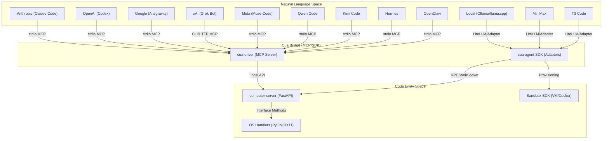
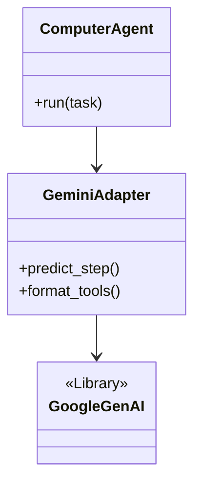

<!-- source: DeepWiki mcp.deepwiki.com · repo trycua/cua · page 15.2 Provider-Specific Integration Guides · fetched 2026-10-29 -->

# Provider-Specific Integration Guides

<details>
<summary>Relevant source files</summary>

The following files were used as context for generating this wiki page:

- [.github/workflows/clawhub-cua-driver.yml](.github/workflows/clawhub-cua-driver.yml)
- [docs/content/docs/cua-driver/guides/connect-your-agent.mdx](docs/content/docs/cua-driver/guides/connect-your-agent.mdx)
- [docs/content/docs/cua-sdk/index.mdx](docs/content/docs/cua-sdk/index.mdx)
- [docs/content/docs/index.mdx](docs/content/docs/index.mdx)
- [docs/content/docs/meta.json](docs/content/docs/meta.json)
- [docs/content/docs/spaces/index.mdx](docs/content/docs/spaces/index.mdx)
- [libs/cua-driver/README.md](libs/cua-driver/README.md)
- [libs/cua-driver/rust/Skills/cua-driver/LINUX.md](libs/cua-driver/rust/Skills/cua-driver/LINUX.md)
- [libs/cua-driver/rust/Skills/cua-driver/README.md](libs/cua-driver/rust/Skills/cua-driver/README.md)
- [libs/cua-driver/rust/Skills/cua-driver/WINDOWS.md](libs/cua-driver/rust/Skills/cua-driver/WINDOWS.md)
- [libs/cua-driver/rust/crates/cua-driver/src/skills.rs](libs/cua-driver/rust/crates/cua-driver/src/skills.rs)
- [libs/cua-driver/scripts/post-install-hints.txt](libs/cua-driver/scripts/post-install-hints.txt)

</details>


This page provides technical details for integrating Cua with various Model Providers and Agent Harnesses. Cua is designed to be provider-agnostic, supporting a wide range of models from frontier providers like Anthropic and OpenAI to local runtimes like Ollama and llama.cpp. Integration typically occurs through the **Model Context Protocol (MCP)** or via native SDK adapters.

## Provider Integration Architecture

Cua bridges "Natural Language Space" (the agent's intent) to "Code Entity Space" (the execution of tools on a computer) by exposing the `cua-driver` or `computer-server` as a set of tools.

### Data Flow: Agent to Computer

The following diagram illustrates how different providers interact with the Cua ecosystem:

**Cua Provider Integration Flow**

Sources: [docs/content/docs/cua-sdk/index.mdx:107-114](), [docs/content/docs/spaces/index.mdx:9-12]()

---

## Anthropic: Claude and Claude Code

Anthropic's Claude models, particularly through the **Claude Code** CLI, are primary targets for Cua. Integration is handled via `cua-driver` acting as an MCP server.

### Verified Configuration
- **Harness**: Claude Code (Anthropic CLI).
- **Connection**: `stdio` MCP.
- **Tools**: `screenshot`, `click`, `type_text`, `get_window_state`.

Claude Code can be configured to use Cua by adding the `cua-driver` MCP config. The `cua-driver` provides a "no-foreground" contract, allowing Claude to drive applications without stealing the user's focus.

To register `cua-driver` with Claude Code, use the following command:
```bash
cua-driver mcp-config --client claude
```
This command prints the exact `claude mcp add-json` command to use [libs/cua-driver/scripts/post-install-hints.txt:34-39](). This mode grounds Claude Code's vision/computer-use-style flow on CuaDriver window screenshots, keeping the normal CuaDriver tools and changing only the screenshot tool.

For explicit skill activation, install the filesystem skill:
```bash
cua-driver skills install
```
This fetches and links the `cua-driver` skill pack into detected agent directories like `~/.claude/skills/` [libs/cua-driver/scripts/post-install-hints.txt:18-22]().

Sources: [libs/cua-driver/scripts/post-install-hints.txt:34-39](), [libs/cua-driver/scripts/post-install-hints.txt:18-22]()

---

## OpenAI and Codex

OpenAI models (o1, GPT-4o) are integrated via the standard OpenAI API or the **Codex** harness.

### Verified Configuration
- **Harness**: Codex.
- **Connection**: `stdio` MCP.
- **Tools**: `screenshot`, `click`, `type_text`, `get_window_state`.

To register `cua-driver` with Codex, use the following command:
```bash
codex mcp add cua-driver -- $(command -v cua-driver) mcp
```
This command uses the absolute installed binary path to avoid `PATH` issues in app-launched Codex sessions [libs/cua-driver/scripts/post-install-hints.txt:41-42](). Restart Codex or open a fresh session after adding the server.

For richer agent guidance, install the Cua Driver skill:
```bash
cua-driver skills install
cua-driver skills status
```
This installs the skill pack into `~/.agents/skills/` for Codex [libs/cua-driver/rust/crates/cua-driver/src/skills.rs:43]().

### SDK Integration
`cua-agent` uses `litellm` to provide a unified interface for OpenAI-compatible endpoints.

Sources: [libs/cua-driver/scripts/post-install-hints.txt:41-42](), [libs/cua-driver/rust/crates/cua-driver/src/skills.rs:43]()

---

## Google: Gemini and Antigravity CLI

Google's Gemini models are supported via the `google-genai` SDK and the `Antigravity CLI` harness.

### Implementation Details
The `cua-driver` skill pack includes support for Antigravity CLI (Gemini). The `cua-driver skills install` command will link the skill pack into `~/.gemini/skills/` [libs/cua-driver/rust/crates/cua-driver/src/skills.rs:50-52]().

To register `cua-driver` with Antigravity CLI, use the following command:
```bash
cua-driver mcp-config --client antigravity
```
This command generates the JSON to merge into `~/.gemini/config/mcp_config.json` [docs/content/docs/cua-driver/guides/connect-your-agent.mdx:32]().

**Gemini Adapter Components**

Sources: [libs/cua-driver/rust/crates/cua-driver/src/skills.rs:50-52](), [docs/content/docs/cua-driver/guides/connect-your-agent.mdx:32]()

---

## xAI: Grok Build and Grok Bot

Cua supports both the **Grok Build** (coding CLI) and **Grok Bot** (persistent cloud agent).

### Grok Bot Integration Patterns
Grok Bot can drive either a local computer or its own cloud-based Linux environment.

1.  **Local Execution**: Grok Bot uses the `cua-driver call` CLI command on the local machine.
2.  **Cloud Execution**: `cua-driver` is installed directly on the Grok Bot cloud instance.

| Feature | Grok Build | Grok Bot |
| :--- | :--- | :--- |
| **Transport** | stdio MCP | Local Command / HTTP MCP |
| **Permission** | Bounded/Standard | Approval-based |
| **Context** | Local Workspace | Persistent Cloud VM |

Sources: [libs/cua-driver/README.md:43-44]()

---

## Meta: Muse Code

**Muse Code** can use Cua Driver as a local stdio MCP server on macOS and Linux.

### Verified Configuration
- **Harness**: Muse Code.
- **Connection**: `stdio` MCP.
- **Tools**: `screenshot`, `click`, `type_text`, `get_window_state`.

To integrate `cua-driver` with Muse Code, merge the following JSON configuration into `$XDG_CONFIG_HOME/muse/settings.json` (or `~/.config/muse/settings.json`):
```json
{
  "mcp_servers": {
    "cua-driver": {
      "enabled": true,
      "transport": "stdio",
      "command": "{{BINARY}}",
      "args": ["mcp"]
    }
  }
}
```
Replace `{{BINARY}}` with the actual path to your `cua-driver` executable. Start a new Muse session after saving, as MCP servers load at startup [libs/cua-driver/scripts/post-install-hints.txt:69-80]().

Sources: [libs/cua-driver/scripts/post-install-hints.txt:69-80]()

---

## Qwen, Kimi, MiniMax, Hermes, OpenClaw, T3 Code

Cua provides verified support for several specialized code and UI models. These typically integrate via MCP or through `litellm` adapters.

### Qwen Code
- **Harness**: Qwen Code.
- **Connection**: `stdio` MCP.
- **Tools**: `screenshot`, `click`, `type_text`, `get_window_state`.

To register `cua-driver` with Qwen Code:
```bash
qwen mcp add cua-driver $(command -v cua-driver) mcp
```
This command is printed by `cua-driver mcp-config --client qwen` [docs/content/docs/cua-driver/guides/connect-your-agent.mdx:37]().

Sources: [docs/content/docs/cua-driver/guides/connect-your-agent.mdx:37]()

### Kimi Code
Kimi Code is integrated via standard MCP patterns. To register `cua-driver` with Kimi Code:
```bash
kimi mcp add cua-driver -- $(command -v cua-driver) mcp
```
This is a generic MCP registration, as there is no specific preset for Kimi Code in `cua-driver mcp-config` [docs/content/docs/cua-driver/guides/connect-your-agent.mdx:38]().

Sources: [docs/content/docs/cua-driver/guides/connect-your-agent.mdx:38]()

### MiniMax
MiniMax models are typically integrated via `litellm` adapters within the `cua-agent` framework. MiniMax provides documentation for setting up Claude Code and Codex with their platform [docs/content/docs/cua-driver/guides/connect-your-agent.mdx:60-61]().

Sources: [docs/content/docs/cua-driver/guides/connect-your-agent.mdx:60-61]()

### Hermes
- **Harness**: Hermes.
- **Connection**: Built-in `computer_use` tool.
- **Tools**: `screenshot`, `click`, `type_text`, `get_window_state`.

Hermes has built-in support for `computer_use` tools. It is recommended to enable this tool directly rather than adding a raw MCP server. If issues arise, `hermes computer-use install` and `hermes doctor` can help repair the setup [docs/content/docs/cua-driver/guides/connect-your-agent.mdx:34](). The `cua-driver skills install` command will link the skill pack into `$HERMES_HOME/skills/` or `~/.hermes/skills/` [libs/cua-driver/rust/crates/cua-driver/src/skills.rs:53-58]().

Sources: [docs/content/docs/cua-driver/guides/connect-your-agent.mdx:34](), [libs/cua-driver/rust/crates/cua-driver/src/skills.rs:53-58]()

### OpenClaw
- **Harness**: OpenClaw.
- **Connection**: `stdio` MCP.
- **Tools**: `screenshot`, `click`, `type_text`, `get_window_state`.

To register `cua-driver` with OpenClaw:
```bash
cua-driver mcp-config --client openclaw
```
This command prints the `openclaw mcp set` command [docs/content/docs/cua-driver/guides/connect-your-agent.mdx:33](). On macOS, a gateway-spawned server might not inherit OpenClaw.app's grants. OpenClaw also supports skill installation via ClawHub:
```bash
clawhub install @cua/driver
```
This installs the skill into the workspace's `skills` directory [libs/cua-driver/README.md:45](). The `cua-driver skills install` command will link the skill pack into `~/.openclaw/skills/` [libs/cua-driver/rust/crates/cua-driver/src/skills.rs:48]().

Sources: [docs/content/docs/cua-driver/guides/connect-your-agent.mdx:33](), [libs/cua-driver/README.md:45](), [libs/cua-driver/rust/crates/cua-driver/src/skills.rs:48]()

### T3 Code
T3 Code models are typically integrated by registering Cua Driver in the harness that T3 Code launches [docs/content/docs/cua-driver/guides/connect-your-agent.mdx:39]().

Sources: [docs/content/docs/cua-driver/guides/connect-your-agent.mdx:39]()

---

## Local Runtimes: Ollama and llama.cpp

For privacy-conscious or offline workflows, Cua supports local model serving.

### Local Model Adapters
The `cua-driver` skill pack includes a `cua-mcp-filter` script to hide unused tools, reducing context size for local models [docs/content/docs/cua-driver/guides/connect-your-agent.mdx:107-112]().

**Local Model MCP Configuration Example**
```json
{
  "mcpServers": {
    "cua-computer-use": {
      "command": "cua-mcp-filter",
      "args": [
        "--allow",
        "start_session,end_session,launch_app,list_apps,list_windows,get_window_state,get_accessibility_tree,move_cursor,click,type_text,press_key,hotkey,invoke_menu"
      ]
    }
  }
}
```
This configuration uses `cua-mcp-filter` to expose a limited set of tools to the local model [docs/content/docs/cua-driver/guides/connect-your-agent.mdx:113-125]().

### Unified Local Serving
Local runtimes like **Ollama** or **llama.cpp** are typically accessed via their OpenAI-compatible APIs.

**Ollama Integration Example**
```bash
ollama pull muse-glimmer:30b-mlx
CLAUDE_CODE_MAX_CONTEXT_TOKENS=131072 \
ollama launch claude --model muse-glimmer:30b-mlx --yes -- \
  --bare --strict-mcp-config --mcp-config ./muse-cua-mcp.json --tools ""
```
This example shows running Claude Code with a local Ollama model, using the filtered MCP configuration [docs/content/docs/cua-driver/guides/connect-your-agent.mdx:131-135]().

**llama.cpp Integration Example**
```bash
llama-server --hf-repo "unsloth/Muse-Glimmer-30B-GGUF:UD-Q4_K_XL" \
  --alias "muse-glimmer-local" --host 127.0.0.1 --port 8001 \
  --ctx-size 131072 --parallel 1 --temp 1.0 --top-p 0.95 --top-k 64 \
  --jinja --mmproj-auto --fit on --no-webui

# In another terminal, once http://127.0.0.1:8001/health responds:
ANTHROPIC_BASE_URL=http://127.0.0.1:8001 \
ANTHROPIC_API_KEY=local-no-key-required \
CLAUDE_CODE_MAX_CONTEXT_TOKENS=131072 \
claude --bare --strict-mcp-config --mcp-config ./muse-cua-mcp.json \
  --tools "" --model muse-glimmer-local
```
This example demonstrates running `llama-server` and then connecting Claude Code to it, again using the filtered MCP configuration [docs/content/docs/cua-driver/guides/connect-your-agent.mdx:139-154]().

Sources: [docs/content/docs/cua-driver/guides/connect-your-agent.mdx:107-154]()

---

## Summary of Package Dependencies for Providers

The following table maps model providers to the required Python extras in `cua-agent`:

| Provider/Model | `cua-agent` Extra | Key Dependencies |
| :--- | :--- | :--- |
| **Anthropic** | `anthropic` | `litellm` |
| **OpenAI** | `openai` | `litellm` |
| **Google Gemini** | `gemini` | `google-genai` |
| **Qwen VL** | `qwen` | `qwen-vl-utils`, `qwen-agent` |
| **Local MLX** | `uitars-mlx` | `mlx-vlm` |
| **Local HF** | `uitars-hf` | `torch`, `transformers`, `accelerate` |
| **UI Grounding** | `omni` | `cua-som` |

Sources: [docs/content/docs/cua-sdk/index.mdx:107-114]()

---

