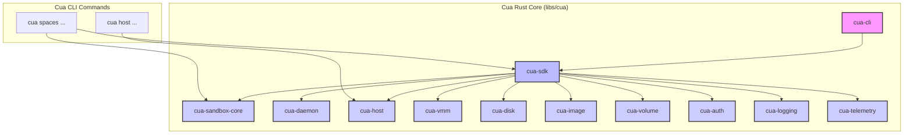

<!-- source: DeepWiki mcp.deepwiki.com · repo trycua/cua · page 16 cua Rust SDK and CLI Core · fetched 2026-10-29 -->

# cua Rust SDK and CLI Core

<details>
<summary>Relevant source files</summary>

The following files were used as context for generating this wiki page:

- [apps/cua-spaces-macos/Sources/CuaSpacesMacKit/Views/ThisMachineView.swift](apps/cua-spaces-macos/Sources/CuaSpacesMacKit/Views/ThisMachineView.swift)
- [apps/cua-spaces-macos/Tests/CuaSpacesMacTests/Snapshots/this-machine.png](apps/cua-spaces-macos/Tests/CuaSpacesMacTests/Snapshots/this-machine.png)
- [apps/cua-spaces-macos/Tests/CuaSpacesMacTests/ViewModelTests.swift](apps/cua-spaces-macos/Tests/CuaSpacesMacTests/ViewModelTests.swift)
- [libs/cua-spacesd/crates/cua-spacesd-desktop/src/grpc/computer.rs](libs/cua-spacesd/crates/cua-spacesd-desktop/src/grpc/computer.rs)
- [libs/cua-spacesd/crates/cua-spacesd-server/src/access_log.rs](libs/cua-spacesd/crates/cua-spacesd-server/src/access_log.rs)
- [libs/cua-spacesd/crates/cua-spacesd-server/src/auth.rs](libs/cua-spacesd/crates/cua-spacesd-server/src/auth.rs)
- [libs/cua-spacesd/crates/cua-spacesd-server/tests/access_log.rs](libs/cua-spacesd/crates/cua-spacesd-server/tests/access_log.rs)
- [libs/cua/CHANGELOG.md](libs/cua/CHANGELOG.md)
- [libs/cua/VERSION](libs/cua/VERSION)
- [libs/cua/crates/cua-cli/src/host.rs](libs/cua/crates/cua-cli/src/host.rs)
- [libs/cua/crates/cua-host/src/access.rs](libs/cua/crates/cua-host/src/access.rs)
- [libs/cua/crates/cua-host/src/host.rs](libs/cua/crates/cua-host/src/host.rs)
- [libs/cua/crates/cua-host/src/tests.rs](libs/cua/crates/cua-host/src/tests.rs)
- [libs/cua/crates/cua-spaces-app-core/src/host.rs](libs/cua/crates/cua-spaces-app-core/src/host.rs)
- [libs/cua/crates/cua-spaces-ffi/src/app_core_types.rs](libs/cua/crates/cua-spaces-ffi/src/app_core_types.rs)
- [libs/cua/crates/cua-spaces/src/spaces.rs](libs/cua/crates/cua-spaces/src/spaces.rs)
- [libs/cua/crates/cua-spaces/src/thumbnails.rs](libs/cua/crates/cua-spaces/src/thumbnails.rs)
- [libs/cua/crates/cua-spaces/tests/relay.rs](libs/cua/crates/cua-spaces/tests/relay.rs)
- [libs/cua/python/pyproject.toml](libs/cua/python/pyproject.toml)
- [libs/cua/python/src/cua/__init__.py](libs/cua/python/src/cua/__init__.py)
- [libs/cua/typescript/package-lock.json](libs/cua/typescript/package-lock.json)
- [libs/cua/typescript/package.json](libs/cua/typescript/package.json)
- [libs/spaces-app-swift/Sources/CuaSpacesFFI/CuaSpacesFFI.swift](libs/spaces-app-swift/Sources/CuaSpacesFFI/CuaSpacesFFI.swift)

</details>


This page provides a high-level overview of the core Rust components within the `libs/cua` directory, which power the `cua` CLI, sandbox and Space management, language bindings, media streaming, and the teleport functionality. For detailed information on each sub-topic, please refer to the linked child pages.

## Core Crates and the cua CLI

The `libs/cua` directory contains the foundational Rust crates that form the backbone of the Cua platform. These crates are organized into a workspace, each serving a specific purpose in managing Spaces, handling host interactions, and providing core utilities. The `cua-cli` crate provides the command-line interface for interacting with these functionalities, allowing users to manage Spaces, configure hosts, and perform other operations.

Key crates include:
- `cua-cli`: The command-line interface for Cua.
- `cua-sdk`: The core Rust SDK, providing programmatic access to Cua functionalities.
- `cua-sandbox-core`: Handles the core logic for sandbox and Space creation and management.
- `cua-daemon`: The background service for Cua operations.
- `cua-host`: Manages the setup and configuration of a machine as a Cua host.
- `cua-vmm`: Virtual machine management components.
- `cua-disk`, `cua-image`, `cua-volume`: Handle disk, image, and volume management for Spaces.
- `cua-auth`: Provides authentication mechanisms.
- `cua-logging`, `cua-telemetry`: For logging and telemetry data collection.

The `cua-cli` offers a rich command surface, particularly for `host` and `spaces` management. For instance, `cua host setup` allows configuring a machine to join the Cua relay or serve directly, enabling it to share its desktop or provide Spaces for other devices. The `cua spaces` commands facilitate listing, adding, and removing registered Spaces.


**Diagram: Core Rust Crates and their Relationship to the Cua CLI**

The `cua host` command, defined in `libs/cua/crates/cua-cli/src/host.rs` [libs/cua/crates/cua-cli/src/host.rs:18-165](), allows users to set up their machine as a Cua host. This involves installing `cua-spacesd` as a service and configuring it to join the Cua relay or serve directly. The `SetupOptions` struct in `libs/cua/crates/cua-host/src/host.rs` [libs/cua/crates/cua-host/src/host.rs:59-129]() defines the various parameters for host setup, such as `HostMode` (Relay or Direct), `name`, `allow` list, and whether to `share_desktop` or `provide_spaces`.

For details, see [Core Crates and the cua CLI](#16.1).

Sources:
- `libs/cua/crates/cua-cli/src/host.rs`
- `libs/cua/crates/cua-host/src/host.rs`
- `libs/cua/crates/cua-spaces/src/spaces.rs`

## Language Bindings for the cua SDK

The `cua` Rust SDK is designed to be accessible from various programming languages through automatically generated language bindings. These bindings are created using UniFFI and bindgen, enabling developers to leverage the power of the Rust core in Python, TypeScript, Swift, and Kotlin applications.

The generated bindings are located under `libs/cua/{python,typescript,swift,kotlin}` and `libs/spaces-sdk-swift`. These directories contain the necessary code and build artifacts to integrate the Cua SDK into projects written in these languages. Generation scripts automate the process, ensuring consistency and up-to-date bindings.

For example, the TypeScript SDK, defined in `libs/cua/typescript/package.json` [libs/cua/typescript/package.json:1-97](), provides modules for `spaces`, `teleport`, and `browser` functionalities, allowing TypeScript developers to interact with Cua Spaces, manage teleported applications, and integrate with browser features. Similarly, the Swift bindings, as seen in `libs/spaces-app-swift/Sources/CuaSpacesFFI/CuaSpacesFFI.swift` [libs/spaces-app-swift/Sources/CuaSpacesFFI/CuaSpacesFFI.swift:1-186](), expose core types like `AppSpaceOs`, `AppSpaceStatus`, and `AppSpace` for native iOS/macOS development.

For details, see [Language Bindings for the cua SDK](#16.2).

Sources:
- `libs/cua/typescript/package.json`
- `libs/spaces-app-swift/Sources/CuaSpacesFFI/CuaSpacesFFI.swift`
- `libs/cua/crates/cua-spaces-ffi/src/app_core_types.rs`

## Media Streaming Stack

The Cua platform includes a robust media streaming stack for low-latency desktop video and audio. This stack is built on Rust components and supports various clients across different languages. The core components include `cua-media-protocol`, `cua-codec`, `cua-transport`, and `cua-client`, which work together to capture, encode, transmit, and display media streams from Cua Spaces.

The `cua-viewer` and `cua-spacesd-html5` projects provide client-side implementations for viewing these streams. Example clients in Rust, Swift, Kotlin, Python, and TypeScript demonstrate how to integrate with the media streaming capabilities. The `cua-spacesd-server` handles authentication for media streams using tickets, as described in `libs/cua-spacesd/crates/cua-spacesd-server/src/auth.rs` [libs/cua-spacesd/crates/cua-spacesd-server/src/auth.rs:45-50](), ensuring secure access to the media content.

```mermaid
graph TD
    subgraph "Cua Media Streaming Stack"
        A[Desktop Capture] --> B(cua-media-protocol)
        B --> C(cua-codec)
        C --> D(cua-transport)
        D --> E[cua-spacesd-server]
        E -- "Ticket-based Auth" --> F[cua-client (Rust, Swift, Kotlin, Python, TS)]
        E -- "Ticket-based Auth" --> G[cua-viewer]
        E -- "Ticket-based Auth" --> H[cua-spacesd-html5]
    end

    style A fill:#f9f,stroke:#333,stroke-width:2px
    style B fill:#bbf,stroke:#333,stroke-width:2px
    style C fill:#bbf,stroke:#333,stroke-width:2px
    style D fill:#bbf,stroke:#333,stroke-width:2px
    style E fill:#ccf,stroke:#333,stroke-width:2px
    style F fill:#ddf,stroke:#333,stroke-width:2px
    style G fill:#ddf,stroke:#333,stroke-width:2px
    style H fill:#ddf,stroke:#333,stroke-width:2px
```
**Diagram: Cua Media Streaming Architecture**

For details, see [Media Streaming Stack](#16.3).

Sources:
- `libs/cua-spacesd/crates/cua-spacesd-server/src/auth.rs`

## Teleport and Keyvault

The `cua-teleport` and `cua-keyvault` components are crucial for moving signed-in applications into Cua Spaces and securely managing credentials. Teleport functionality allows users to seamlessly transfer their authenticated browser sessions and other application data into a Space, providing a consistent and secure environment.

The `cua-keyvault` handles the extraction of browser cookies and safe-storage data, as well as accessing platform-specific keychains (like macOS Keychain or Windows DPAPI). This data is then encrypted and managed, facilitating the import flow into a Space. The `cua-chromium-storage` component specifically deals with Chromium-based browser data.

The `KeyvaultClientProtocol` and `KeyvaultOverview` in `apps/cua-spaces-macos/Tests/CuaSpacesMacTests/ViewModelTests.swift` [apps/cua-spaces-macos/Tests/CuaSpacesMacTests/ViewModelTests.swift:12-18]() illustrate how the Keyvault client interacts with the system to manage and display credential information, including pending approvals and delivery status.

For details, see [Teleport and Keyvault](#16.4).

Sources:
- `apps/cua-spaces-macos/Tests/CuaSpacesMacTests/ViewModelTests.swift`
- `libs/cua/CHANGELOG.md`

---

