<!-- source: DeepWiki mcp.deepwiki.com · repo trycua/cua · page 16.1 Core Crates and the cua CLI · fetched 2026-10-29 -->

# Core Crates and the cua CLI

<details>
<summary>Relevant source files</summary>

The following files were used as context for generating this wiki page:

- [apps/cua-spaces-macos/Sources/CuaSpacesMacKit/Views/ThisMachineView.swift](apps/cua-spaces-macos/Sources/CuaSpacesMacKit/Views/ThisMachineView.swift)
- [apps/cua-spaces-macos/Tests/CuaSpacesMacTests/Snapshots/this-machine.png](apps/cua-spaces-macos/Tests/CuaSpacesMacTests/Snapshots/this-machine.png)
- [apps/cua-spaces-macos/Tests/CuaSpacesMacTests/ViewModelTests.swift](apps/cua-spaces-macos/Tests/CuaSpacesMacTests/ViewModelTests.swift)
- [docs/content/docs/cua-sdk/reference/rust/cua-spaces.mdx](docs/content/docs/cua-sdk/reference/rust/cua-spaces.mdx)
- [docs/content/docs/cua-sdk/reference/rust/cua-spacesd-client.mdx](docs/content/docs/cua-sdk/reference/rust/cua-spacesd-client.mdx)
- [libs/cua-spacesd/crates/cua-spacesd-desktop/src/grpc/computer.rs](libs/cua-spacesd/crates/cua-spacesd-desktop/src/grpc/computer.rs)
- [libs/cua-spacesd/crates/cua-spacesd-doctor/src/checks/capabilities.rs](libs/cua-spacesd/crates/cua-spacesd-doctor/src/checks/capabilities.rs)
- [libs/cua-spacesd/crates/cua-spacesd-doctor/src/checks/volume.rs](libs/cua-spacesd/crates/cua-spacesd-doctor/src/checks/volume.rs)
- [libs/cua-spacesd/crates/cua-spacesd-server/src/access_log.rs](libs/cua-spacesd/crates/cua-spacesd-server/src/access_log.rs)
- [libs/cua-spacesd/crates/cua-spacesd-server/src/auth.rs](libs/cua-spacesd/crates/cua-spacesd-server/src/auth.rs)
- [libs/cua-spacesd/crates/cua-spacesd-server/tests/access_log.rs](libs/cua-spacesd/crates/cua-spacesd-server/tests/access_log.rs)
- [libs/cua/CHANGELOG.md](libs/cua/CHANGELOG.md)
- [libs/cua/VERSION](libs/cua/VERSION)
- [libs/cua/crates/cua-cli/src/host.rs](libs/cua/crates/cua-cli/src/host.rs)
- [libs/cua/crates/cua-host/src/access.rs](libs/cua/crates/cua-host/src/access.rs)
- [libs/cua/crates/cua-host/src/host.rs](libs/cua/crates/cua-host/src/host.rs)
- [libs/cua/crates/cua-host/src/tests.rs](libs/cua/crates/cua-host/src/tests.rs)
- [libs/cua/crates/cua-spaces-app-core/src/host.rs](libs/cua/crates/cua-spaces-app-core/src/host.rs)
- [libs/cua/crates/cua-spaces-ffi/src/app_core_types.rs](libs/cua/crates/cua-spaces-ffi/src/app_core_types.rs)
- [libs/cua/crates/cua-spaces/src/spaces.rs](libs/cua/crates/cua-spaces/src/spaces.rs)
- [libs/cua/crates/cua-spaces/src/thumbnails.rs](libs/cua/crates/cua-spaces/src/thumbnails.rs)
- [libs/cua/crates/cua-spaces/tests/relay.rs](libs/cua/crates/cua-spaces/tests/relay.rs)
- [libs/cua/crates/cua-spacesd-client/src/manifest.rs](libs/cua/crates/cua-spacesd-client/src/manifest.rs)
- [libs/cua/python/pyproject.toml](libs/cua/python/pyproject.toml)
- [libs/cua/python/src/cua/__init__.py](libs/cua/python/src/cua/__init__.py)
- [libs/cua/typescript/package-lock.json](libs/cua/typescript/package-lock.json)
- [libs/cua/typescript/package.json](libs/cua/typescript/package.json)
- [libs/images/bench/osworld/image.json](libs/images/bench/osworld/image.json)
- [libs/images/bench/web/image.json](libs/images/bench/web/image.json)
- [libs/images/common/tools/cua-image-manifest](libs/images/common/tools/cua-image-manifest)
- [libs/images/common/tools/tests/fixtures/manifest.linux.json](libs/images/common/tools/tests/fixtures/manifest.linux.json)
- [libs/images/common/tools/tests/test_cua_image_manifest.py](libs/images/common/tools/tests/test_cua_image_manifest.py)
- [libs/spaces-app-swift/Sources/CuaSpacesFFI/CuaSpacesFFI.swift](libs/spaces-app-swift/Sources/CuaSpacesFFI/CuaSpacesFFI.swift)

</details>


This page details the workspace layout of the core Rust crates within `libs/cua`, which form the foundation for the `cua` CLI and various SDKs. It covers the purpose of each crate, the command surface exposed by the CLI, and the setup flow for host and relay configurations.

## Core Crates Overview

The `libs/cua/crates` directory contains several Rust crates that provide the core functionalities of the Cua platform. These crates are designed to be modular and reusable, supporting various components like the CLI, SDKs, and daemon services.

The key crates include:

*   `cua-cli`: The command-line interface for interacting with Cua.
*   `cua-sdk`: The core Rust SDK, providing foundational types and functionalities.
*   `cua-sandbox-core`: Core logic for managing sandboxes.
*   `cua-daemon`: The background service for Cua operations.
*   `cua-host`: Manages the local machine as a Cua host.
*   `cua-vmm`: Virtual Machine Monitor functionalities.
*   `cua-disk`: Disk image management.
*   `cua-image`: Image catalog and manipulation.
*   `cua-volume`: Volume management for sandboxes.
*   `cua-auth`: Authentication and authorization mechanisms.
*   `cua-logging`: Logging utilities.
*   `cua-telemetry`: Telemetry collection.
*   `cua-spaces`: Registry and primitives for Cua Spaces.
*   `cua-spaces-ffi`: Foreign Function Interface (FFI) bindings for `cua-spaces`.

The `cua-sdk` is a unified SDK that provides bindings for Python, TypeScript, and Swift, enabling cross-language interaction with the Rust core [libs/cua/CHANGELOG.md:57-63]().

### `cua-cli`

The `cua-cli` crate provides the command-line interface for Cua. It allows users to manage hosts, spaces, and other Cua resources.

The `HostCmd` enum [libs/cua/crates/cua-cli/src/host.rs:17-165]() defines the subcommands available under `cua host`, such as `setup`, `config`, `status`, `stop`, `start`, `share`, `unshare`, and `remove`. Similarly, `SpacesCmd` [libs/cua/crates/cua-cli/src/host.rs:167-168]() defines commands for managing Spaces.

**`cua host setup` Command Surface**

The `cua host setup` command is used to configure the current machine as a Cua host. It supports various options for different deployment scenarios:

*   **`--relay <URL>`**: Joins a Cua relay for unattended access. The default is `https://relay.cua.ai`.
*   **`--direct <IP:PORT>`**: Serves directly on a specified IP and port, bypassing the relay.
*   **`--name <NAME>`**: Sets a display name for the host.
*   **`--allow <ACCOUNT>`**: Specifies additional accounts (by ID or email) allowed to access the host.
*   **`--driver-bin <PATH>`**: Path to the `cua-spacesd` binary.
*   **`--runner <KIND>`**: Specifies how the service should run (e.g., `auto`, `systemd`, `launchd`, `windows-task`, `process`).
*   **`--profile <PROFILE>`**: Defines the host's role, either `desktop` (shares the desktop) or `spare` (does not share desktop, provides Spaces).
*   **`--desktop` / `--no-desktop`**: Explicitly enables or disables desktop sharing.
*   **`--provide-spaces` / `--no-provide-spaces`**: Enables or disables the host's ability to create Spaces for other devices.
*   **`--max-spaces <COUNT>`**: Sets the maximum number of Spaces the host can provide concurrently.
*   **`--allow-any-address`**: (Used with `--direct`) Allows host calls and forwarded Space connections from any address, not just loopback or private LANs.

The `SetupOptions` struct [libs/cua/crates/cua-host/src/host.rs:58-89]() encapsulates these configuration parameters.

**`cua host config` Command Surface**

The `cua host config` command allows modifying the host's sharing settings after initial setup:

*   **`--desktop <on|off>`**: Toggles desktop sharing.
*   **`--provide-spaces <on|off>`**: Toggles the ability to provide Spaces.
*   **`--max-spaces <COUNT>`**: Adjusts the maximum number of provided Spaces.
*   **`--max-macos-vms <COUNT>`**: Sets the maximum number of macOS VMs (0 to 2, due to Apple's license).

**`cua host status` Command Surface**

The `cua host status` command displays the current setup status of the host, including service information and connected clients.

**`cua host stop` / `cua host start` Command Surface**

These commands control the `cua-spacesd` service, stopping or starting sharing functionality.

**`cua host share` / `cua host unshare` Command Surface**

These commands manage sharing a relay machine with other Cua accounts. They require an enrolled device and update the owner's audit log.

**`cua host remove` Command Surface**

The `cua host remove` command unregisters the machine from the relay, uninstalls the service, and deletes the host configuration. It requires a `--force` flag for non-interactive removal.

Sources:
* [libs/cua/crates/cua-cli/src/host.rs:1-168]()
* [libs/cua/crates/cua-host/src/host.rs:58-89]()

### `cua-sdk`

The `cua-sdk` crate serves as the core Rust SDK, defining fundamental types and interfaces used across the Cua ecosystem. It is the base for language bindings to Python, TypeScript, and Swift.

Sources:
* [libs/cua/CHANGELOG.md:57-63]()

### `cua-sandbox-core`

This crate provides the core logic for managing sandboxes. It defines concepts like `Kind` (type of machine), `Runtime` (execution engine), and `On` (location where a sandbox runs) [libs/cua/crates/cua-spaces/src/spaces.rs:36-37](). It also includes structures for `CreateOptions` and `ProgressSink` for tracking sandbox creation [libs/cua/crates/cua-spaces/src/spaces.rs:30-107]().

Sources:
* [libs/cua/crates/cua-spaces/src/spaces.rs:30-107]()
* [libs/cua/crates/cua-spaces/src/spaces.rs:36-37]()

### `cua-daemon`

The `cua-daemon` crate is responsible for the background service that runs Cua operations. This daemon interacts with various system components and manages the lifecycle of Spaces and other resources.

### `cua-host`

The `cua-host` crate manages the local machine as a Cua host. It handles the setup, status, and control of the `cua-spacesd` service. Key components include:

*   **`SetupStage`**: An enum representing the different stages of host setup (Preflight, Token, Register, Download, Service) [libs/cua/crates/cua-host/src/host.rs:15-39]().
*   **`HostMode`**: Defines how clients connect to the host, either via `Relay` or `Direct` connection [libs/cua/crates/cua-host/src/host.rs:42-55]().
*   **`SetupOptions`**: Configuration for setting up the host [libs/cua/crates/cua-host/src/host.rs:58-89]().
*   **`HostPolicy`**: Defines the access policy for a host, including owner, allowed accounts, viewers, and sharing settings [libs/cua/crates/cua-host/src/host.rs:133-175]().

The `Host` struct provides methods for `setup`, `status`, `stop`, `start`, and `remove` the host service [libs/cua/crates/cua-host/src/host.rs:1-1]().

Sources:
* [libs/cua/crates/cua-host/src/host.rs:1-1]()
* [libs/cua/crates/cua-host/src/host.rs:15-39]()
* [libs/cua/crates/cua-host/src/host.rs:42-55]()
* [libs/cua/crates/cua-host/src/host.rs:58-89]()
* [libs/cua/crates/cua-host/src/host.rs:133-175]()

### `cua-vmm`, `cua-disk`, `cua-image`, `cua-volume`

These crates handle low-level virtualization and storage concerns:

*   **`cua-vmm`**: Likely deals with Virtual Machine Monitor interactions, abstracting different virtualization technologies.
*   **`cua-disk`**: Manages disk images and virtual disk operations.
*   **`cua-image`**: Handles the Cua image catalog, including image manifests and build pipelines. For example, `libs/images/bench/web/image.json` and `libs/images/bench/osworld/image.json` are image definitions. The `cua-image-manifest` tool [libs/images/common/tools/cua-image-manifest]() is used for manifest tooling.
*   **`cua-volume`**: Manages volumes mounted within a Space, served from the host [docs/content/docs/cua-sdk/reference/rust/cua-spaces.mdx:53-54]().

Sources:
* [docs/content/docs/cua-sdk/reference/rust/cua-spaces.mdx:53-54]()
* [libs/images/bench/osworld/image.json]()
* [libs/images/bench/web/image.json]()
* [libs/images/common/tools/cua-image-manifest]()

### `cua-auth`

The `cua-auth` crate provides authentication and authorization functionalities. This includes handling root tokens, short-lived tickets, and the gRPC authentication layer [libs/cua-spacesd/crates/cua-spacesd-server/src/auth.rs:4-19](). It defines `TicketScope` [libs/cua-spacesd/crates/cua-spacesd-server/src/auth.rs:46-59]() for different ticket purposes (Media, Tunnel, Hotspot, Volume, Files, Viewer) and `TicketClaims` [libs/cua-spacesd/crates/cua-spacesd-server/src/auth.rs:90-100]() for verified ticket contents. The `ExternalGrant` struct [libs/cua-spacesd/crates/cua-spacesd-server/src/auth.rs:180-193]() represents what an external credential authorized.

Sources:
* [libs/cua-spacesd/crates/cua-spacesd-server/src/auth.rs:4-19]()
* [libs/cua-spacesd/crates/cua-spacesd-server/src/auth.rs:46-59]()
* [libs/cua-spacesd/crates/cua-spacesd-server/src/auth.rs:90-100]()
* [libs/cua-spacesd/crates/cua-spacesd-server/src/auth.rs:180-193]()

### `cua-logging` and `cua-telemetry`

These crates are responsible for logging and telemetry:

*   **`cua-logging`**: Provides logging utilities for the Cua ecosystem.
*   **`cua-telemetry`**: Handles the collection and reporting of telemetry data [libs/cua/CHANGELOG.md:25-26](). This includes recording agent runs from various entry points.

Sources:
* [libs/cua/CHANGELOG.md:25-26]()

### `cua-spaces`

The `cua-spaces` crate is central to managing Cua Spaces. It provides the registry for Spaces, and primitives for interacting with them, such as file transfers, execution, streaming, presence, and teleportation [docs/content/docs/cua-sdk/reference/rust/cua-spaces.mdx:15-17]().

Key modules and types within `cua-spaces` include:

*   **`Spaces`**: The main entry point for managing Spaces, allowing creation, addition, deletion, and removal of Spaces [libs/cua/crates/cua-spaces/src/spaces.rs:1-4]().
*   **`SpaceCreate`**: Options for creating a new Space, including image, location (`on`), kind, runtime, name, CPU, memory, disk, and services [libs/cua/crates/cua-spaces/src/spaces.rs:29-88]().
*   **`SpaceCreated`**: The result of a Space creation operation, indicating if the Space is `Ready` or `Starting` [libs/cua/crates/cua-spaces/src/spaces.rs:111-123]().
*   **`ProgressSink`**: A mechanism to report progress during Space creation [libs/cua/crates/cua-spaces/src/spaces.rs:90-105]().
*   **`Error`**: Defines various error types specific to Spaces operations [docs/content/docs/cua-sdk/reference/rust/cua-spaces.mdx:155-184]().
*   **`exec`**: Provides primitives for shell execution (`BashOutput`) and file writing (`WriteReport`) within a Space [docs/content/docs/cua-sdk/reference/rust/cua-spaces.mdx:194-223]().
*   **`registry`**: Manages the persisted Spaces registry [docs/content/docs/cua-sdk/reference/rust/cua-spaces.mdx:42-42]().
*   **`relay`**: Handles interactions with the Cua relay for machine management [docs/content/docs/cua-sdk/reference/rust/cua-spaces.mdx:43-43]().
*   **`volume`**: Manages volumes mounted in a Space [docs/content/docs/cua-sdk/reference/rust/cua-spaces.mdx:53-54]().

Sources:
* [docs/content/docs/cua-sdk/reference/rust/cua-spaces.mdx:15-17]()
* [docs/content/docs/cua-sdk/reference/rust/cua-spaces.mdx:42-43]()
* [docs/content/docs/cua-sdk/reference/rust/cua-spaces.mdx:53-54]()
* [docs/content/docs/cua-sdk/reference/rust/cua-spaces.mdx:155-184]()
* [docs/content/docs/cua-sdk/reference/rust/cua-spaces.mdx:194-223]()
* [libs/cua/crates/cua-spaces/src/spaces.rs:1-4]()
* [libs/cua/crates/cua-spaces/src/spaces.rs:29-88]()
* [libs/cua/crates/cua-spaces/src/spaces.rs:90-105]()
* [libs/cua/crates/cua-spaces/src/spaces.rs:111-123]()

### `cua-spaces-ffi`

This crate provides Foreign Function Interface (FFI) bindings for the `cua-spaces` crate, enabling other languages like Swift, Python, and TypeScript to interact with the Rust core. It uses UniFFI for generation [libs/cua/crates/cua-spaces-ffi/src/app_core_types.rs:4-6]().

It mirrors core types like `AppSpaceOs`, `AppSpaceStatus`, `AppThumbnailScene`, `AppSpaceProvider`, `AppSpaceSdkRef`, `AppSpaceProgress`, `AppPowerControl`, and `AppSpacePower` for FFI compatibility [libs/cua/crates/cua-spaces-ffi/src/app_core_types.rs:12-199]().

Sources:
* [libs/cua/crates/cua-spaces-ffi/src/app_core_types.rs:4-6]()
* [libs/cua/crates/cua-spaces-ffi/src/app_core_types.rs:12-199]()
* [libs/spaces-app-swift/Sources/CuaSpacesFFI/CuaSpacesFFI.swift:1-10]()

## Workspace Layout

The `libs/cua` directory is structured as a Rust workspace, containing multiple crates. This modular design allows for clear separation of concerns and efficient development.

```mermaid
graph TD
    subgraph "libs/cua"
        A[cua-cli] --> B(cua-sdk)
        B --> C(cua-sandbox-core)
        B --> D(cua-daemon)
        B --> E(cua-host)
        B --> F(cua-vmm)
        B --> G(cua-disk)
        B --> H(cua-image)
        B --> I(cua-volume)
        B --> J(cua-auth)
        B --> K(cua-logging)
        B --> L(cua-telemetry)
        B --> M(cua-spaces)
        M --> N(cua-spaces-ffi)
    end

    subgraph "External Components"
        O[Python SDK] --> B
        P[TypeScript SDK] --> B
        Q[Swift SDK] --> B
        R[cua-spacesd] --> D
        S[cua-spacesd-server] --> J
        S --> K
        S --> L
        S --> M
    end

    style A fill:#f9f,stroke:#333,stroke-width:2px
    style B fill:#bbf,stroke:#333,stroke-width:2px
    style C fill:#ccf,stroke:#333,stroke-width:2px
    style D fill:#cfc,stroke:#333,stroke-width:2px
    style E fill:#fcc,stroke:#333,stroke-width:2px
    style F fill:#ffc,stroke:#333,stroke-width:2px
    style G fill:#cff,stroke:#333,stroke-width:2px
    style H fill:#fcf,stroke:#333,stroke-width:2px
    style I fill:#fcc,stroke:#333,stroke-width:2px
    style J fill:#ccf,stroke:#333,stroke-width:2px
    style K fill:#cfc,stroke:#333,stroke-width:2px
    style L fill:#ffc,stroke:#333,stroke-width:2px
    style M fill:#f9f,stroke:#333,stroke-width:2px
    style N fill:#bbf,stroke:#333,stroke-width:2px
    style O fill:#eee,stroke:#333,stroke-width:2px
    style P fill:#eee,stroke:#333,stroke-width:2px
    style Q fill:#eee,stroke:#333,stroke-width:2px
    style R fill:#eee,stroke:#333,stroke-width:2px
    style S fill:#eee,stroke:#333,stroke-width:2px
```


**Diagram: Core Cua Crates and their Relationships**

This diagram illustrates the dependencies and relationships between the core Rust crates in the `libs/cua` workspace and how they connect to external components like language SDKs and the `cua-spacesd` server.

Sources:
* [libs/cua/crates/cua-spaces-ffi/src/app_core_types.rs:4-6]()
* [libs/cua/typescript/package.json:1-97]()

## Host and Relay Setup Flow

The `cua host setup` command orchestrates the process of configuring a machine as a Cua host, either connecting to a relay or operating in direct mode.

```mermaid
graph TD
    User[User executes "cua host setup"] --> CLI[cua-cli HostCmd::Setup]

    subgraph "Host Setup Process (cua-host)"
        CLI --> SO[SetupOptions]
        SO --> PS[SetupStage::Preflight]
        PS -- Checks GUI session, address --> PS_OK{Preflight OK?}
        PS_OK -- No --> Error[Error: Preflight failed]
        PS_OK -- Yes --> Token[SetupStage::Token]

        Token -- If Relay mode --> GetAccountTokens[Get Account Tokens (RelayClient)]
        Token -- If Direct mode --> SkipToken[Skip Token Acquisition]

        GetAccountTokens --> Register[SetupStage::Register]
        SkipToken --> Register

        Register -- If Relay mode --> RelayRegister[Register with cua-relay (RelayClient::register)]
        RelayRegister -- MachinePatch --> RelayRegister_OK{Registration OK?}
        RelayRegister_OK -- No --> Error
        RelayRegister_OK -- Yes --> Download[SetupStage::Download]
        Register -- If Direct mode --> Download

        Download --> GetSpacesdBin[Get cua-spacesd binary]
        GetSpacesdBin -- Download or local copy --> Service[SetupStage::Service]

        Service --> InstallService[Install and start host service (ServiceManager)]
        InstallService -- RunnerKind --> Service_OK{Service Started?}
        Service_OK -- No --> Error
        Service_OK -- Yes --> HostReady[Host Ready]
    end

    subgraph "cua-spacesd (on Host)"
        HostReady --> Daemon[cua-spacesd daemon]
        Daemon -- If Relay mode --> ConnectRelay[Connect to cua-relay]
        Daemon -- If Direct mode --> ListenDirect[Listen on direct IP:Port]
        Daemon --> ProvideServices[Provide Spaces and Desktop Services]
        ProvideServices --> AccessLog[Record Access (access_log)]
    end

    style User fill:#add8e6,stroke:#333,stroke-width:2px
    style CLI fill:#90ee90,stroke:#333,stroke-width:2px
    style SO fill:#ffb6c1,stroke:#333,stroke-width:2px
    style PS fill:#f0e68c,stroke:#333,stroke-width:2px
    style PS_OK fill:#98fb98,stroke:#333,stroke-width:2px
    style Token fill:#f0e68c,stroke:#333,stroke-width:2px
    style GetAccountTokens fill:#ffb6c1,stroke:#333,stroke-width:2px
    style SkipToken fill:#d3d3d3,stroke:#333,stroke-width:2px
    style Register fill:#f0e68c,stroke:#333,stroke-width:2px
    style RelayRegister fill:#ffb6c1,stroke:#333,stroke-width:2px
    style RelayRegister_OK fill:#98fb98,stroke:#333,stroke-width:2px
    style Download fill:#f0e68c,stroke:#333,stroke-width:2px
    style GetSpacesdBin fill:#ffb6c1,stroke:#333,stroke-width:2px
    style Service fill:#f0e68c,stroke:#333,stroke-width:2px
    style InstallService fill:#ffb6c1,stroke:#333,stroke-width:2px
    style Service_OK fill:#98fb98,stroke:#333,stroke-width:2px
    style HostReady fill:#aaffaa,stroke:#333,stroke-width:2px
    style Daemon fill:#add8e6,stroke:#333,stroke-width:2px
    style ConnectRelay fill:#ffb6c1,stroke:#333,stroke-width:2px
    style ListenDirect fill:#d3d3d3,stroke:#333,stroke-width:2px
    style ProvideServices fill:#90ee90,stroke:#333,stroke-width:2px
    style AccessLog fill:#f0e68c,stroke:#333,stroke-width:2px
    style Error fill:#ff4500,stroke:#333,stroke-width:2px
```
**Diagram: `cua host setup` Flow**

This diagram illustrates the step-by-step process of setting up a Cua host using the `cua host setup` command, including preflight checks, token acquisition, registration with the relay (if applicable), `cua-spacesd` download, service installation, and the daemon's operation.

The `Host::setup_staged` function [libs/cua/crates/cua-host/src/host.rs:15-39]() defines the stages of the setup process: `Preflight`, `Token`, `Register`, `Download`, and `Service`.

1.  **Preflight**: Initial checks are performed, such as verifying the GUI session and network address.
2.  **Token**: If in relay mode, account tokens are acquired using `RelayClient`. In direct mode, this step is skipped.
3.  **Register**: The host registers with the Cua relay using `RelayClient::register` [libs/cua/crates/cua-host/src/relay.rs:1-1]() and sends a `MachinePatch` [libs/cua/crates/cua-host/src/relay.rs:1-1]() to update its status.
4.  **Download**: The `cua-spacesd` binary is obtained, either by downloading it or using a local copy.
5.  **Service**: The `cua-spacesd` service is installed and started using `ServiceManager` [libs/cua/crates/cua-host/src/service.rs:1-1]() with the specified `RunnerKind` [libs/cua/crates/cua-host/src/service.rs:1-1]().

Once the host is set up, the `cua-spacesd` daemon runs in the background. It either connects to the Cua relay or listens directly on a specified IP and port. The daemon then provides Spaces and desktop services, and all authorized remote access is recorded in a hash-chained access log [libs/cua-spacesd/crates/cua-spacesd-server/src/access_log.rs:4-6]().

Sources:
* [libs/cua/crates/cua-host/src/host.rs:15-39]()
* [libs/cua/crates/cua-host/src/relay.rs:1-1]()
* [libs/cua/crates/cua-host/src/service.rs:1-1]()
* [libs/cua-spacesd/crates/cua-spacesd-server/src/access_log.rs:4-6]()

---

