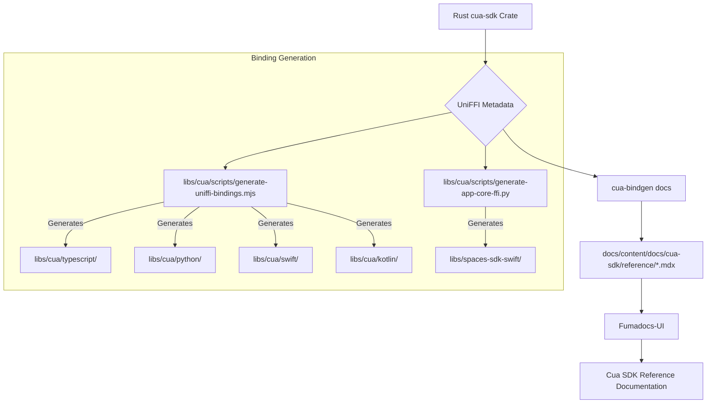

<!-- source: DeepWiki mcp.deepwiki.com · repo trycua/cua · page 16.2 Language Bindings for the cua SDK · fetched 2026-10-29 -->

# Language Bindings for the cua SDK

<details>
<summary>Relevant source files</summary>

The following files were used as context for generating this wiki page:

- [apps/cua-spaces-macos/Sources/CuaSpacesMacKit/Models/AppModel.swift](apps/cua-spaces-macos/Sources/CuaSpacesMacKit/Models/AppModel.swift)
- [apps/cua-spaces-macos/Sources/CuaSpacesMacKit/Models/SpacesBackend.swift](apps/cua-spaces-macos/Sources/CuaSpacesMacKit/Models/SpacesBackend.swift)
- [apps/cua-spaces-macos/Sources/CuaSpacesMacKit/Views/SpaceDetailView.swift](apps/cua-spaces-macos/Sources/CuaSpacesMacKit/Views/SpaceDetailView.swift)
- [apps/cua-spaces-macos/Tests/CuaSpacesMacTests/MachineAccessTests.swift](apps/cua-spaces-macos/Tests/CuaSpacesMacTests/MachineAccessTests.swift)
- [apps/cua-spaces-macos/Tests/CuaSpacesMacTests/SnapshotTests.swift](apps/cua-spaces-macos/Tests/CuaSpacesMacTests/SnapshotTests.swift)
- [apps/cua-spaces-macos/Tests/CuaSpacesMacTests/Snapshots/machine-connect-enrolled.png](apps/cua-spaces-macos/Tests/CuaSpacesMacTests/Snapshots/machine-connect-enrolled.png)
- [apps/cua-spaces-macos/Tests/CuaSpacesMacTests/Snapshots/machine-connect-expired.png](apps/cua-spaces-macos/Tests/CuaSpacesMacTests/Snapshots/machine-connect-expired.png)
- [apps/cua-spaces-macos/Tests/CuaSpacesMacTests/Snapshots/machine-connect-not-enrolled.png](apps/cua-spaces-macos/Tests/CuaSpacesMacTests/Snapshots/machine-connect-not-enrolled.png)
- [apps/cua-spaces-macos/Tests/CuaSpacesMacTests/Snapshots/machine-desktop-not-shared.png](apps/cua-spaces-macos/Tests/CuaSpacesMacTests/Snapshots/machine-desktop-not-shared.png)
- [apps/cua-spaces-macos/Tests/CuaSpacesMacTests/Snapshots/settings-keyvault.png](apps/cua-spaces-macos/Tests/CuaSpacesMacTests/Snapshots/settings-keyvault.png)
- [docs/content/docs/cua-sdk/reference/index.mdx](docs/content/docs/cua-sdk/reference/index.mdx)
- [docs/content/docs/cua-sdk/reference/rust/cua-sdk.mdx](docs/content/docs/cua-sdk/reference/rust/cua-sdk.mdx)
- [docs/content/docs/cua-sdk/reference/spaces/app-core/devices.mdx](docs/content/docs/cua-sdk/reference/spaces/app-core/devices.mdx)
- [docs/content/docs/cua-sdk/reference/spaces/app-core/index.mdx](docs/content/docs/cua-sdk/reference/spaces/app-core/index.mdx)
- [docs/content/docs/cua-sdk/reference/spaces/app-core/new-space.mdx](docs/content/docs/cua-sdk/reference/spaces/app-core/new-space.mdx)
- [docs/content/docs/cua-sdk/reference/spaces/app-core/onboarding-settings.mdx](docs/content/docs/cua-sdk/reference/spaces/app-core/onboarding-settings.mdx)
- [docs/content/docs/cua-sdk/reference/spaces/app-core/spaces.mdx](docs/content/docs/cua-sdk/reference/spaces/app-core/spaces.mdx)
- [docs/content/docs/cua-sdk/reference/spaces/app-core/stream.mdx](docs/content/docs/cua-sdk/reference/spaces/app-core/stream.mdx)
- [docs/content/docs/cua-sdk/reference/spaces/app-core/this-machine.mdx](docs/content/docs/cua-sdk/reference/spaces/app-core/this-machine.mdx)
- [docs/content/docs/cua-sdk/reference/spaces/app-core/window.mdx](docs/content/docs/cua-sdk/reference/spaces/app-core/window.mdx)
- [docs/content/docs/cua-sdk/reference/spaces/host.mdx](docs/content/docs/cua-sdk/reference/spaces/host.mdx)
- [docs/content/docs/cua-sdk/reference/spaces/space.mdx](docs/content/docs/cua-sdk/reference/spaces/space.mdx)
- [docs/content/docs/cua-sdk/reference/spaces/windows.mdx](docs/content/docs/cua-sdk/reference/spaces/windows.mdx)
- [docs/content/docs/cua-sdk/reference/types.mdx](docs/content/docs/cua-sdk/reference/types.mdx)
- [libs/cua/CHANGELOG.md](libs/cua/CHANGELOG.md)
- [libs/cua/VERSION](libs/cua/VERSION)
- [libs/cua/crates/cua-cli/src/auth.rs](libs/cua/crates/cua-cli/src/auth.rs)
- [libs/cua/crates/cua-spaces-app-core/src/settings.rs](libs/cua/crates/cua-spaces-app-core/src/settings.rs)
- [libs/cua/crates/cua-spaces-ffi/src/app_core.rs](libs/cua/crates/cua-spaces-ffi/src/app_core.rs)
- [libs/cua/python/pyproject.toml](libs/cua/python/pyproject.toml)
- [libs/cua/python/src/cua/__init__.py](libs/cua/python/src/cua/__init__.py)
- [libs/cua/scripts/generate-app-core-ffi.py](libs/cua/scripts/generate-app-core-ffi.py)
- [libs/cua/typescript/package-lock.json](libs/cua/typescript/package-lock.json)
- [libs/cua/typescript/package.json](libs/cua/typescript/package.json)
- [libs/spaces-app-swift/Sources/cua_spaces_ffiFFI/include/cua_spaces_ffiFFI.h](libs/spaces-app-swift/Sources/cua_spaces_ffiFFI/include/cua_spaces_ffiFFI.h)

</details>


This page details the UniFFI/bindgen-generated language bindings for the `cua` SDK, specifically for Python, TypeScript, Swift, and Kotlin. These bindings are located under `libs/cua/{python,typescript,swift,kotlin}` and `libs/spaces-sdk-swift`. It covers the generation scripts and provides an overview of the reference documentation for these bindings. The core `cua` SDK is written in Rust, and these bindings expose its functionality to other programming languages, enabling developers to integrate `cua` features into their applications.

The `cua` SDK provides a unified interface across different languages, allowing for consistent interaction with `cua` sandboxes, `cua-spacesd`, media streaming, and the `cua` daemon. The bindings are designed to be idiomatic for each target language while maintaining a common underlying Rust core.

Sources:
* [libs/cua/python/pyproject.toml]()
* [libs/cua/typescript/package.json]()
* [docs/content/docs/cua-sdk/reference/index.mdx:17-24]()
* [docs/content/docs/cua-sdk/reference/types.mdx:1-11]()

## UniFFI and Bindgen Overview

The `cua` SDK leverages UniFFI (Universal Foreign Function Interface) and custom bindgen scripts to automatically generate language bindings from its Rust core. This approach ensures that the bindings are always up-to-date with the Rust implementation and reduces the manual effort and potential for errors associated with maintaining multiple language-specific SDKs.

UniFFI is a tool developed by Mozilla that allows Rust crates to expose a C-compatible API, which can then be consumed by other languages. It generates the necessary FFI (Foreign Function Interface) glue code and language-specific wrappers.

The generation process involves:
1.  Defining the API in Rust using UniFFI-compatible types and functions.
2.  Running `uniffi-bindgen` to generate the FFI layer and initial language-specific code.
3.  Applying custom scripts to further refine the generated code, add idiomatic wrappers, and integrate with package management systems.

### UniFFI Type Mapping

UniFFI handles the translation of Rust types to their equivalents in the target languages. The following table illustrates how common Rust types are mapped:

| Notation | Python | TypeScript | Swift | Kotlin | Rust |
|---|---|---|---|---|---|
| `String` | `str` | `string` | `String` | `String` | `String` |
| `bool` | `bool` | `boolean` | `Bool` | `Boolean` | `bool` |
| `u32` | `int` | `number` | `UInt32` | `UInt` | `u32` |
| `i64` | `int` | `bigint` | `Int64` | `Long` | `i64` |
| `u64` | `int` | `bigint` | `UInt64` | `ULong` | `u64` |
| `f64` | `float` | `number` | `Double` | `Double` | `f64` |
| `Vec<u8>` | `bytes` | `ArrayBuffer` | `Data` | `ByteArray` | `Vec<u8>` |
| `Vec<T>` | `List[T]` | `Array<T>` | `[T]` | `List<T>` | `Vec<T>` |
| `Option<T>` | `Optional[T]` | `T \| undefined` | `T?` | `T?` | `Option<T>` |
| `HashMap<K, V>` | `dict[K, V]` | `Map<K, V>` | `[K: V]` | `Map<K, V>` | `HashMap<K, V>` |
| `SystemTime` | `datetime.datetime` | `Date` | `Date` | `java.time.Instant` | `SystemTime` |
| `Duration` | `datetime.timedelta` | `number` | `TimeInterval` | `java.time.Duration` | `Duration` |
| `Sandbox (an object)` | `Sandbox` | `SandboxLike` | `Sandbox` | `Sandbox` | `Arc<Sandbox>` |

`Option<T>` in Rust maps to `None`, `undefined`, `nil`, or `null` in the respective languages.

Sources:
* [docs/content/docs/cua-sdk/reference/types.mdx:17-31]()

### Naming Conventions

The generated bindings follow idiomatic naming conventions for each language:

| | Python | TypeScript | Swift | Kotlin | Rust |
|---|---|---|---|---|---|
| Import | `import cua` | `import { ... } from '@trycua/cua'` | `import Cua` | `import ai.cua.sdk.*` | `use cua_sdk::*;` |
| Methods, arguments, fields | `snake_case` | `camelCase` | `camelCase` | `camelCase` | `snake_case` |
| Enum variants | `UPPER_SNAKE` | `PascalCase` | `lowerCamel` | `UPPER_SNAKE` (plain), `PascalCase` (with fields) | `PascalCase` |
| Async methods | `async def`, awaited | return a `Promise`, optional `{ signal }` | `async` | `suspend` | `async fn` |
| Errors | `CuaError.<Variant>` | `CuaError.<Variant>` | `CuaError.<Variant>(message:)` | `CuaException.<Variant>` | `CuaError::<Variant>(String)` |
| Object handles | the class | the class; arguments and results use the `<Name>Like` interface | the class | the class | `Arc<T>` |
| Optional arguments | positional (`sb.spacesd(None)`) | `undefined` | `nil` | `null` | `None` |

Some members are renamed to avoid conflicts with reserved words or to improve idiomatic usage. For example, in Kotlin, objects implement `AutoCloseable` with a `close()` method, so the async `close` method from Rust is renamed (e.g., `McpClient.closeClient`). In TypeScript, reserved words like `delete` are suffixed with an underscore (e.g., `Sandbox.delete_()`).

Sources:
* [docs/content/docs/cua-sdk/reference/types.mdx:37-47]()

## Python Bindings

The Python bindings for the `cua` SDK are located under `libs/cua/python/`. The primary package is `cua`, available via `pip install cua`.

The `cua` Python package provides:
*   A core `Cua` object, which can be embedded directly in the process or connected to a running `cua daemon` [libs/cua/python/src/cua/__init__.py:8-9]().
*   Modules for sandboxes, `cua-spacesd` (with `call_json` for RPCs), media sessions, fleet management, local runtimes, and Spaces [libs/cua/python/src/cua/__init__.py:17-24]().
*   High-level APIs for `Sandbox`, `Image`, and `ComputerAgent` are available as optional extras (e.g., `pip install "cua[sandbox]"` or `pip install "cua[agent]"`) [libs/cua/python/src/cua/__init__.py:34-41]().

The `cua.embedded()` function initializes an SDK runtime within the current Python process, while `cua.connect()` establishes a client connection to a running `cua daemon` [libs/cua/python/src/cua/__init__.py:114-115, 170-171]().

The `pyproject.toml` file defines the package metadata, dependencies, and build system [libs/cua/python/pyproject.toml:1-28](). It also specifies how the Rust `cua` CLI binary is bundled into the Python wheel [libs/cua/python/pyproject.toml:48-57]().

### Python Binding Architecture

The Python bindings are generated from the Rust `cua-sdk` crate using UniFFI. The `cua._native` module contains the raw UniFFI-generated code [libs/cua/python/src/cua/__init__.py:62-65](). The `cua/__init__.py` file then adds convenience wrappers and integrates with the `cua daemon` for local public URLs [libs/cua/python/src/cua/__init__.py:53-58]().

For example, the `CuaError.AmbiguousSandbox` exception is extended to provide a `candidates` property for easier access to ambiguous sandbox names [libs/cua/python/src/cua/__init__.py:86-88](). Similarly, `CuaError` instances gain a `doc_url` property linking to relevant documentation [libs/cua/python/src/cua/__init__.py:94-96]().

The `AgentRun` object's `stream` method is augmented with an asynchronous generator for normalized events, allowing for polling and idle detection [libs/cua/python/src/cua/__init__.py:142-166]().

```mermaid
graph TD
    A[Rust cua-sdk Crate] --> B{UniFFI Bindgen}
    B --> C[cua._native Python Module]
    C --> D[libs/cua/python/src/cua/__init__.py]
    D -- "Adds convenience wrappers, daemon integration" --> E[cua Python Package]
    E -- "Optional extras: cua[sandbox], cua[agent]" --> F[High-level APIs: Sandbox, ComputerAgent]

    subgraph Python Package Structure
        D -- "Bundles" --> G[Rust cua CLI Binary]
        D -- "Extends" --> H[CuaError.AmbiguousSandbox]
        D -- "Extends" --> I[CuaError.doc_url]
        D -- "Adds async generator" --> J[AgentRun.stream()]
    end
```
**Diagram: Python Binding Generation and Structure**

Sources:
* [libs/cua/python/src/cua/__init__.py:8-41]()
* [libs/cua/python/src/cua/__init__.py:53-65]()
* [libs/cua/python/src/cua/__init__.py:86-88]()
* [libs/cua/python/src/cua/__init__.py:94-96]()
* [libs/cua/python/src/cua/__init__.py:142-166]()
* [libs/cua/python/src/cua/__init__.py:114-115]()
* [libs/cua/python/src/cua/__init__.py:170-171]()
* [libs/cua/python/pyproject.toml:1-57]()

## TypeScript Bindings

The TypeScript bindings are located under `libs/cua/typescript/`. The package `@trycua/cua` is published to npm and can be installed via `npm install @trycua/cua` [libs/cua/typescript/package.json:2-3]().

The TypeScript SDK supports both Node.js and browser environments. The `package.json` defines various entry points for different modules, such as `spaces`, `teleport`, and `browser` [libs/cua/typescript/package.json:18-53](). The browser version is a WebAssembly subset [docs/content/docs/cua-sdk/reference/index.mdx:21]().

The `scripts` section in `package.json` includes commands for building, testing, and generating UniFFI bindings:
*   `npm run build`: Compiles TypeScript to JavaScript [libs/cua/typescript/package.json:70]().
*   `npm run generate:uniffi`: Generates TypeScript bindings from the Rust core [libs/cua/typescript/package.json:74]().
*   `npm run stage:uniffi`: Stages the UniFFI library for Node.js [libs/cua/typescript/package.json:76]().
*   `npm run build:browser`: Builds the WebAssembly module for the browser [libs/cua/typescript/package.json:77]().

Sources:
* [libs/cua/typescript/package.json:2-53]()
* [libs/cua/typescript/package.json:70-77]()
* [docs/content/docs/cua-sdk/reference/index.mdx:21]()

## Swift Bindings

The Swift bindings are provided as a SwiftPM package named `Cua`, targeting macOS 12+ and iOS 15+ [docs/content/docs/cua-sdk/reference/index.mdx:22](). The primary import is `import Cua`.

Additionally, there's a separate set of Swift APIs for building Cua Spaces UIs, known as the "Cua Spaces app export." These are source-available under FSL-1.1-MIT and ship for Swift only (`import CuaSpacesFFI`) [docs/content/docs/cua-sdk/reference/spaces/app-core/index.mdx:17-18](). The Rust tab in the documentation shows the `cua-spaces-ffi` crate they originate from [docs/content/docs/cua-sdk/reference/spaces/app-core/index.mdx:18]().

The `AppModel` in `apps/cua-spaces-macos/Sources/CuaSpacesMacKit/Models/AppModel.swift` demonstrates the usage of `CuaSDK` and `CuaSpacesFFI` [apps/cua-spaces-macos/Sources/CuaSpacesMacKit/Models/AppModel.swift:5-6](). This model serves as the root for the macOS Spaces application, managing the core's Space list state and forwarding decisions to the app core [apps/cua-spaces-macos/Sources/CuaSpacesMacKit/Models/AppModel.swift:37-40]().

The `cuaSpacesRegister()` function, part of `CuaSpacesFFI`, registers Cua Spaces extensions like teleport, Cua Volume, persistent agents, and Keyvault for every runtime the SDK builds [docs/content/docs/cua-sdk/reference/spaces/app-core/index.mdx:23-26]().

Sources:
* [docs/content/docs/cua-sdk/reference/index.mdx:22]()
* [docs/content/docs/cua-sdk/reference/spaces/app-core/index.mdx:17-18]()
* [apps/cua-spaces-macos/Sources/CuaSpacesMacKit/Models/AppModel.swift:5-6]()
* [apps/cua-spaces-macos/Sources/CuaSpacesMacKit/Models/AppModel.swift:37-40]()
* [docs/content/docs/cua-sdk/reference/spaces/app-core/index.mdx:23-26]()

## Kotlin Bindings

The Kotlin bindings are available under the `ai.cua.sdk` package. They use JNA (Java Native Access) and are compile-checked, though not yet officially published [docs/content/docs/cua-sdk/reference/index.mdx:23](). The import statement is `import ai.cua.sdk.*`.

The Kotlin bindings follow `camelCase` for methods, arguments, and fields, and `UPPER_SNAKE` or `PascalCase` for enum variants, similar to Java conventions [docs/content/docs/cua-sdk/reference/types.mdx:40-41](). Asynchronous methods are marked with `suspend` [docs/content/docs/cua-sdk/reference/types.mdx:42]().

Sources:
* [docs/content/docs/cua-sdk/reference/index.mdx:23]()
* [docs/content/docs/cua-sdk/reference/types.mdx:40-42]()

## Generation Scripts and Reference Documentation

The generation of these language bindings is orchestrated by scripts within the `libs/cua/scripts` directory. For instance, `generate-uniffi-bindings.mjs` is used to generate the UniFFI bindings for TypeScript [libs/cua/typescript/package.json:74](). There's also `generate-app-core-ffi.py` which likely handles the generation for the `cua-spaces-ffi` components.

The reference documentation for the SDK is automatically generated and available on the `cua` website. The `docs/content/docs/cua-sdk/reference/index.mdx` file serves as the entry point for this documentation, listing all available objects, methods, and types across Python, TypeScript, Swift, Kotlin, and Rust [docs/content/docs/cua-sdk/reference/index.mdx:1-11]().

The documentation is generated by `pnpm --dir docs docs:generate:cua-sdk`, which uses `cua-bindgen docs` to process UniFFI metadata [docs/content/docs/cua-sdk/reference/index.mdx:8-9](). This ensures that the documentation accurately reflects the current state of the generated bindings.


**Diagram: Documentation and Binding Generation Workflow**

Sources:
* [libs/cua/typescript/package.json:74]()
* [docs/content/docs/cua-sdk/reference/index.mdx:1-11]()
* [docs/content/docs/cua-sdk/reference/index.mdx:8-9]()
* [docs/content/docs/cua-sdk/reference/types.mdx:8-9]()
* [docs/content/docs/cua-sdk/reference/spaces/app-core/index.mdx:8-9]()

## Versioning

The version of the `cua` SDK and its language bindings are synchronized. The `libs/cua/VERSION` file contains the current version number, e.g., `0.3.1` [libs/cua/VERSION:1](). This version is reflected in the `package.json` for TypeScript [libs/cua/typescript/package.json:3]() and `pyproject.toml` for Python [libs/cua/python/pyproject.toml:7](), as well as in the generated documentation [docs/content/docs/cua-sdk/reference/index.mdx:10]().

Sources:
* [libs/cua/VERSION:1]()
* [libs/cua/typescript/package.json:3]()
* [libs/cua/python/pyproject.toml:7]()
* [docs/content/docs/cua-sdk/reference/index.mdx:10]()

---

