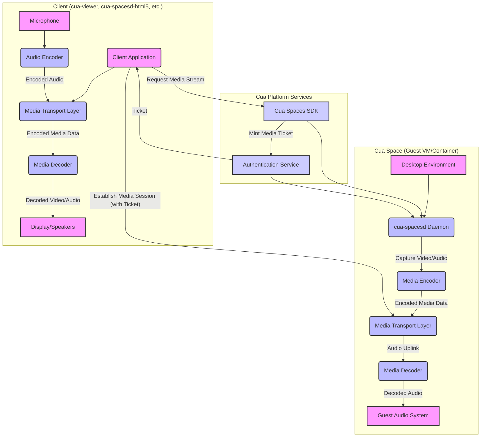

<!-- source: DeepWiki mcp.deepwiki.com · repo trycua/cua · page 16.3 Media Streaming Stack · fetched 2026-10-29 -->

# Media Streaming Stack

<details>
<summary>Relevant source files</summary>

The following files were used as context for generating this wiki page:

- [apps/cua-spaces-macos/Sources/CuaSpacesMacKit/Views/ThisMachineView.swift](apps/cua-spaces-macos/Sources/CuaSpacesMacKit/Views/ThisMachineView.swift)
- [apps/cua-spaces-macos/Tests/CuaSpacesMacTests/Snapshots/this-machine.png](apps/cua-spaces-macos/Tests/CuaSpacesMacTests/Snapshots/this-machine.png)
- [apps/cua-spaces-macos/Tests/CuaSpacesMacTests/ViewModelTests.swift](apps/cua-spaces-macos/Tests/CuaSpacesMacTests/ViewModelTests.swift)
- [docs/content/docs/cua-sdk/reference/rust/cua-spaces.mdx](docs/content/docs/cua-sdk/reference/rust/cua-spaces.mdx)
- [docs/content/docs/cua-sdk/reference/rust/cua-spacesd-client.mdx](docs/content/docs/cua-sdk/reference/rust/cua-spacesd-client.mdx)
- [libs/cua-spacesd/crates/cua-spacesd-desktop/src/grpc/computer.rs](libs/cua-spacesd/crates/cua-spacesd-desktop/src/grpc/computer.rs)
- [libs/cua-spacesd/crates/cua-spacesd-doctor/src/checks/capabilities.rs](libs/cua-spacesd/crates/cua-spacesd-doctor/src/checks/capabilities.rs)
- [libs/cua-spacesd/crates/cua-spacesd-doctor/src/checks/volume.rs](libs/cua-spacesd/crates/cua-spacesd-doctor/src/checks/volume.rs)
- [libs/cua-spacesd/crates/cua-spacesd-server/src/access_log.rs](libs/cua-spacesd/crates/cua-spacesd-server/src/access_log.rs)
- [libs/cua-spacesd/crates/cua-spacesd-server/src/auth.rs](libs/cua-spacesd/crates/cua-spacesd-server/src/auth.rs)
- [libs/cua-spacesd/crates/cua-spacesd-server/tests/access_log.rs](libs/cua-spacesd/crates/cua-spacesd-server/tests/access_log.rs)
- [libs/cua/crates/cua-cli/src/host.rs](libs/cua/crates/cua-cli/src/host.rs)
- [libs/cua/crates/cua-host/src/access.rs](libs/cua/crates/cua-host/src/access.rs)
- [libs/cua/crates/cua-host/src/host.rs](libs/cua/crates/cua-host/src/host.rs)
- [libs/cua/crates/cua-host/src/tests.rs](libs/cua/crates/cua-host/src/tests.rs)
- [libs/cua/crates/cua-spaces-app-core/src/host.rs](libs/cua/crates/cua-spaces-app-core/src/host.rs)
- [libs/cua/crates/cua-spaces-ffi/src/app_core_types.rs](libs/cua/crates/cua-spaces-ffi/src/app_core_types.rs)
- [libs/cua/crates/cua-spaces/src/spaces.rs](libs/cua/crates/cua-spaces/src/spaces.rs)
- [libs/cua/crates/cua-spaces/src/thumbnails.rs](libs/cua/crates/cua-spaces/src/thumbnails.rs)
- [libs/cua/crates/cua-spaces/tests/relay.rs](libs/cua/crates/cua-spaces/tests/relay.rs)
- [libs/cua/crates/cua-spacesd-client/src/manifest.rs](libs/cua/crates/cua-spacesd-client/src/manifest.rs)
- [libs/images/bench/osworld/image.json](libs/images/bench/osworld/image.json)
- [libs/images/bench/web/image.json](libs/images/bench/web/image.json)
- [libs/images/common/tools/cua-image-manifest](libs/images/common/tools/cua-image-manifest)
- [libs/images/common/tools/tests/fixtures/manifest.linux.json](libs/images/common/tools/tests/fixtures/manifest.linux.json)
- [libs/images/common/tools/tests/test_cua_image_manifest.py](libs/images/common/tools/tests/test_cua_image_manifest.py)
- [libs/spaces-app-swift/Sources/CuaSpacesFFI/CuaSpacesFFI.swift](libs/spaces-app-swift/Sources/CuaSpacesFFI/CuaSpacesFFI.swift)

</details>


This page details the media streaming stack within the Cua platform, focusing on low-latency desktop video and audio streaming. It covers the core components like `cua-media-protocol`, codecs, transports, and client implementations, as well as the `cua-viewer` and `cua-spacesd-html5` applications. The stack enables interactive sandboxes and remote desktop experiences with real-time media delivery.

Sources:
- [libs/cua/crates/cua-spaces/src/spaces.rs:1-160]()
- [apps/cua-spaces-macos/Tests/CuaSpacesMacTests/ViewModelTests.swift:1-143]()
- [docs/content/docs/cua-sdk/reference/rust/cua-spaces.mdx:1-230]()
- [libs/cua/crates/cua-host/src/host.rs:1-181]()
- [libs/cua/crates/cua-cli/src/host.rs:1-168]()
- [apps/cua-spaces-macos/Sources/CuaSpacesMacKit/Views/ThisMachineView.swift:1-138]()
- [libs/cua/crates/cua-spaces-ffi/src/app_core_types.rs:1-199]()
- [libs/spaces-app-swift/Sources/CuaSpacesFFI/CuaSpacesFFI.swift:1-186]()
- [libs/cua-spacesd/crates/cua-spacesd-server/src/auth.rs:1-200]()
- [libs/cua-spacesd/crates/cua-spacesd-server/tests/access_log.rs:1-179]()
- [libs/cua/crates/cua-host/src/tests.rs:1-196]()
- [libs/cua/crates/cua-spaces-app-core/src/host.rs:1-202]()

## Overview of Media Streaming

The Cua platform provides a robust media streaming solution for its "Spaces" – interactive sandboxes that can be full desktop environments. This allows users and agents to interact with remote desktops with minimal latency. The core of this functionality relies on `cua-spacesd`, a daemon running within the Space, which provides desktop, shell, files, streaming, and teleport primitives [docs/content/docs/cua-sdk/reference/rust/cua-spaces.mdx:15-17]().

The media streaming stack is designed to handle video and audio from the remote Space to the client, and audio from the client (microphone uplink) back to the Space. This is facilitated by a ticket-based authentication system to secure media sessions [libs/cua-spacesd/crates/cua-spacesd-server/src/auth.rs:9-14]().

## Core Components

The media streaming stack involves several key components:

*   **`cua-media-protocol`**: Defines the communication protocol for media streams.
*   **Codecs**: Handle encoding and decoding of video and audio data.
*   **Transports**: Manage the underlying network communication for media data.
*   **`cua-spacesd`**: The daemon running inside the Space, responsible for capturing desktop output and streaming it.
*   **`cua-viewer`**: A client-side application for viewing and interacting with Spaces.
*   **`cua-spacesd-html5`**: A web-based viewer for Spaces.
*   **Streaming Clients**: Examples and implementations in various languages (Rust, Swift, Kotlin, Python, TypeScript) demonstrating how to consume the media streams.

### `cua-spacesd` and Media Tickets

The `cua-spacesd` daemon plays a central role in media streaming. When a client requests a media stream, `cua-spacesd` mints a short-lived, scope-bound ticket. This ticket is HMAC-SHA256-signed and includes claims such as the scope (`TicketScope::Media`), a resource ID, the principal ID of the caller, and an expiry time [libs/cua-spacesd/crates/cua-spacesd-server/src/auth.rs:9-100]().

The `ViewerGrant` structure defines what a viewer ticket allows, including the highest `SessionPolicy` for media, clipboard access, filesystem root, audio uplink, and principal information [libs/cua-spacesd/crates/cua-spacesd-server/src/auth.rs:103-133](). This grant is serialized into the ticket's resource field.

**Ticket Scopes:**

| Scope        | Description                                                              |
| :----------- | :----------------------------------------------------------------------- |
| `Media`      | The media WebSocket / QUIC session (`/media`) [libs/cua-spacesd/crates/cua-spacesd-server/src/auth.rs:48]() |
| `Tunnel`     | TCP forwarding (`/tunnel`) [libs/cua-spacesd/crates/cua-spacesd-server/src/auth.rs:49]()     |
| `Hotspot`    | Reverse-SOCKS egress (`/hotspot`) [libs/cua-spacesd/crates/cua-spacesd-server/src/auth.rs:50]()  |
| `Volume`     | The Cua Volume mount's client socket (`/volume`) [libs/cua-spacesd/crates/cua-spacesd-server/src/auth.rs:51]() |
| `Files`      | File transfer side channels [libs/cua-spacesd/crates/cua-spacesd-server/src/auth.rs:52]()    |
| `Viewer`     | The web viewer's scoped bearer (`SystemService.CreateViewerTicket`) [libs/cua-spacesd/crates/cua-spacesd-server/src/auth.rs:53]() |

Sources:
- [docs/content/docs/cua-sdk/reference/rust/cua-spaces.mdx:15-17]()
- [libs/cua-spacesd/crates/cua-spacesd-server/src/auth.rs:9-100]()
- [libs/cua-spacesd/crates/cua-spacesd-server/src/auth.rs:103-133]()
- [libs/cua-spacesd/crates/cua-spacesd-server/src/auth.rs:48]()
- [libs/cua-spacesd/crates/cua-spacesd-server/src/auth.rs:49]()
- [libs/cua-spacesd/crates/cua-spacesd-server/src/auth.rs:50]()
- [libs/cua-spacesd/crates/cua-spacesd-server/src/auth.rs:51]()
- [libs/cua-spacesd/crates/cua-spacesd-server/src/auth.rs:52]()
- [libs/cua-spacesd/crates/cua-spacesd-server/src/auth.rs:53]()

### Data Flow for Media Streaming

The following diagram illustrates the high-level data flow for media streaming from a Cua Space to a client.


Title: Media Streaming Data Flow
Sources:
- [libs/cua-spacesd/crates/cua-spacesd-server/src/auth.rs:9-100]()
- [libs/cua-spacesd/crates/cua-spacesd-server/src/auth.rs:103-133]()
- [docs/content/docs/cua-sdk/reference/rust/cua-spaces.mdx:15-17]()

## `cua-spaces` Crate and Streaming

The `cua-spaces` Rust crate provides the core logic for managing Spaces, including the `stream` module which handles targets, media tickets, and the Rust media client [docs/content/docs/cua-sdk/reference/rust/cua-spaces.mdx:50]().

The `Spaces` struct in `libs/cua/crates/cua-spaces/src/spaces.rs` manages the registry of Spaces, allowing creation, addition, and deletion. It interacts with `cua-sandbox-core` for placement and runtime management of sandboxes [libs/cua/crates/cua-spaces/src/spaces.rs:1-16]().

### `SpaceCreate` Options

When creating a Space, the `SpaceCreate` struct defines various options, including:
*   `image`: The base image for the Space.
*   `on`: Where the Space runs (e.g., `local`, `cloud`).
*   `kind`: Type of machine (e.g., `Auto`).
*   `runtime`: Execution engine.
*   `spacesd`: Whether the image runs `cua-spacesd` [libs/cua/crates/cua-spaces/src/spaces.rs:33-69](). This is crucial for media streaming capabilities.
*   `gpu`: GPU options for the runtime, which can impact video encoding performance [libs/cua/crates/cua-spaces/src/spaces.rs:87-88]().

Sources:
- [docs/content/docs/cua-sdk/reference/rust/cua-spaces.mdx:50]()
- [libs/cua/crates/cua-spaces/src/spaces.rs:1-16]()
- [libs/cua/crates/cua-spaces/src/spaces.rs:33-69]()
- [libs/cua/crates/cua-spaces/src/spaces.rs:87-88]()

## `cua-host` and `cua-spacesd` Integration

The `cua-host` crate manages the setup and status of a machine acting as a Cua host, which can provide Spaces and stream its own desktop. The `HostMode` enum defines how clients reach the machine, either via a `Relay` or `Direct` connection [libs/cua/crates/cua-host/src/host.rs:43-55]().

The `SetupOptions` for `cua-host` include parameters like `share_desktop` (whether to expose the host's desktop as a Space) and `provide_spaces` (whether to accept Space creation requests) [libs/cua/crates/cua-host/src/host.rs:73-77](). When `share_desktop` is enabled, `cua-spacesd` runs with its desktop services, enabling media streaming of the host's desktop [libs/cua/crates/cua-host/src/host.rs:153-157]().

The `HostPolicy` defines access control for the host, including who can view or interact with the shared desktop or provided Spaces [libs/cua/crates/cua-host/src/host.rs:133-175](). This policy is enforced by `cua-spacesd` and impacts who can access media streams.

### `cua-spacesd` Access Logging

`cua-spacesd` maintains an access log that records every authorized remote access, including those via tokens, relay identities, and viewer tickets. Refused calls are not logged. This log helps in auditing and understanding access patterns [libs/cua-spacesd/crates/cua-spacesd-server/tests/access_log.rs:4-6]().

The access log entries include details such as the authentication method (`via`), the principal (`who`), and the service accessed (`what`) [libs/cua-spacesd/crates/cua-spacesd-server/tests/access_log.rs:62-63](). For example, a viewer ticket access would be recorded with `via: "viewer"` and the principal's display name [libs/cua-spacesd/crates/cua-spacesd-server/tests/access_log.rs:156-159]().

Sources:
- [libs/cua/crates/cua-host/src/host.rs:43-55]()
- [libs/cua/crates/cua-host/src/host.rs:73-77]()
- [libs/cua/crates/cua-host/src/host.rs:153-157]()
- [libs/cua/crates/cua-host/src/host.rs:133-175]()
- [libs/cua-spacesd/crates/cua-spacesd-server/tests/access_log.rs:4-6]()
- [libs/cua-spacesd/crates/cua-spacesd-server/tests/access_log.rs:62-63]()
- [libs/cua-spacesd/crates/cua-spacesd-server/tests/access_log.rs:156-159]()

## Client Implementations

The Cua platform provides various client implementations for interacting with Spaces and their media streams:

*   **`cua-viewer`**: A dedicated application for viewing and interacting with Spaces.
*   **`cua-spacesd-html5`**: A web-based client, likely leveraging WebSockets for media streaming, authenticated by viewer tickets.
*   **Examples/Streaming Clients**: The `examples/streaming` directory contains client implementations in Rust, Swift, Kotlin, Python, and TypeScript. These examples demonstrate how to connect to a Space, authenticate with a media ticket, and consume the video/audio streams.

### Swift/Kotlin/Python/TypeScript Bindings

The `cua-spaces` Rust crate provides language bindings for Swift, Kotlin, Python, and TypeScript through UniFFI [libs/spaces-app-swift/Sources/CuaSpacesFFI/CuaSpacesFFI.swift:4-5](). These bindings expose the core `cua-spaces` functionality, including Space management and potentially media stream initiation, to applications written in these languages.

For example, the `CuaSpacesFFI.swift` file defines the Swift bindings, allowing Swift applications like `cua-spaces-macos` to interact with the Rust core [libs/spaces-app-swift/Sources/CuaSpacesFFI/CuaSpacesFFI.swift:1-186](). The `AppSpace` struct, mirrored from the Rust core, contains information about a Space, including its status, OS, and progress during creation [libs/cua/crates/cua-spaces-ffi/src/app_core_types.rs:139-199]().

```mermaid
graph TD
    subgraph "Cua Spaces Rust Core"
        A[cua-spaces Crate] --> B(cua-media-protocol);
        A --> C(Space Management Logic);
    end

    subgraph "Language Bindings (UniFFI)"
        D[Swift Bindings] --> A;
        E[Kotlin Bindings] --> A;
        F[Python Bindings] --> A;
        G[TypeScript Bindings] --> A;
    end

    subgraph "Client Applications"
        H[apps/cua-spaces-macos] --> D;
        I[cua-viewer (Rust)] --> A;
        J[cua-spacesd-html5 (TypeScript)] --> G;
        K[examples/streaming (Python)] --> F;
        L[examples/streaming (Kotlin)] --> E;
        M[examples/streaming (Swift)] --> D;
    end

    style A fill:#bbf,stroke:#333,stroke-width:2px
    style B fill:#bbf,stroke:#333,stroke-width:2px
    style C fill:#bbf,stroke:#333,stroke-width:2px
    style D fill:#ccf,stroke:#333,stroke-width:2px
    style E fill:#ccf,stroke:#333,stroke-width:2px
    style F fill:#ccf,stroke:#333,stroke-width:2px
    style G fill:#ccf,stroke:#333,stroke-width:2px
    style H fill:#f9f,stroke:#333,stroke-width:2px
    style I fill:#f9f,stroke:#333,stroke-width:2px
    style J fill:#f9f,stroke:#333,stroke-width:2px
    style K fill:#f9f,stroke:#333,stroke-width:2px
    style L fill:#f9f,stroke:#333,stroke-width:2px
    style M fill:#f9f,stroke:#333,stroke-width:2px
```
Title: Media Streaming Client Architecture
Sources:
- [libs/spaces-app-swift/Sources/CuaSpacesFFI/CuaSpacesFFI.swift:4-5]()
- [libs/spaces-app-swift/Sources/CuaSpacesFFI/CuaSpacesFFI.swift:1-186]()
- [libs/cua/crates/cua-spaces-ffi/src/app_core_types.rs:139-199]()

---

