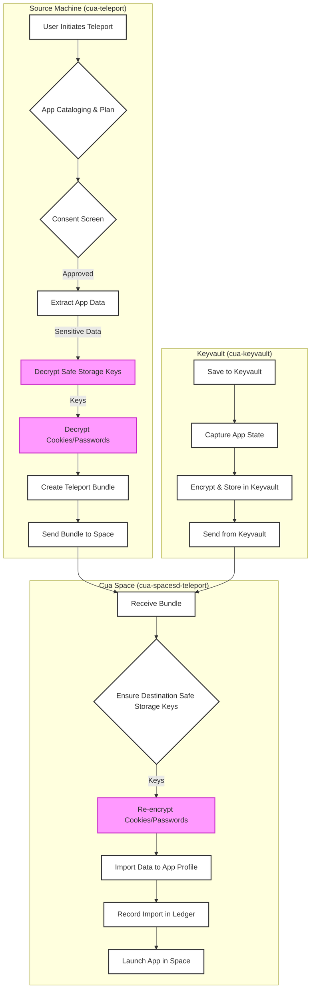
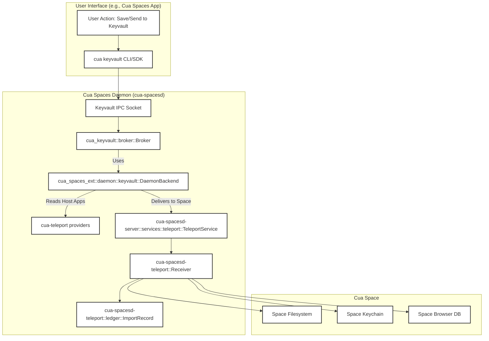

<!-- source: DeepWiki mcp.deepwiki.com · repo trycua/cua · page 16.4 Teleport and Keyvault · fetched 2026-10-29 -->

# Teleport and Keyvault

Relevant source files

The following files were used as context for generating this wiki page:

- [docs/content/docs/spaces/guides/teleport-an-app.mdx](docs/content/docs/spaces/guides/teleport-an-app.mdx)
- [libs/cua-spacesd/crates/cua-spacesd-server/src/server.rs](libs/cua-spacesd/crates/cua-spacesd-server/src/server.rs)
- [libs/cua-spacesd/crates/cua-spacesd-server/src/services/teleport.rs](libs/cua-spacesd/crates/cua-spacesd-server/src/services/teleport.rs)
- [libs/cua-spacesd/crates/cua-spacesd-server/tests/common/mod.rs](libs/cua-spacesd/crates/cua-spacesd-server/tests/common/mod.rs)
- [libs/cua-spacesd/crates/cua-spacesd-teleport/src/cookies.rs](libs/cua-spacesd/crates/cua-spacesd-teleport/src/cookies.rs)
- [libs/cua-spacesd/crates/cua-spacesd-teleport/src/importers/chrome.rs](libs/cua-spacesd/crates/cua-spacesd-teleport/src/importers/chrome.rs)
- [libs/cua-spacesd/crates/cua-spacesd-teleport/src/importers/electron.rs](libs/cua-spacesd/crates/cua-spacesd-teleport/src/importers/electron.rs)
- [libs/cua-spacesd/crates/cua-spacesd-teleport/src/importers/mod.rs](libs/cua-spacesd/crates/cua-spacesd-teleport/src/importers/mod.rs)
- [libs/cua-spacesd/crates/cua-spacesd-teleport/src/keychain.rs](libs/cua-spacesd/crates/cua-spacesd-teleport/src/keychain.rs)
- [libs/cua-spacesd/crates/cua-spacesd-teleport/src/ledger.rs](libs/cua-spacesd/crates/cua-spacesd-teleport/src/ledger.rs)
- [libs/cua-spacesd/crates/cua-spacesd-teleport/src/receiver.rs](libs/cua-spacesd/crates/cua-spacesd-teleport/src/receiver.rs)
- [libs/cua-spacesd/crates/cua-spacesd-teleport/tests/import.rs](libs/cua-spacesd/crates/cua-spacesd-teleport/tests/import.rs)
- [libs/cua-spacesd/tests/teleport-e2e/examples/send_synthetic_chrome.rs](libs/cua-spacesd/tests/teleport-e2e/examples/send_synthetic_chrome.rs)
- [libs/cua-spacesd/tests/teleport-e2e/tests/send_import.rs](libs/cua-spacesd/tests/teleport-e2e/tests/send_import.rs)
- [libs/cua/crates/cua-keyvault/src/broker.rs](libs/cua/crates/cua-keyvault/src/broker.rs)
- [libs/cua/crates/cua-keyvault/src/ipc.rs](libs/cua/crates/cua-keyvault/src/ipc.rs)
- [libs/cua/crates/cua-keyvault/tests/broker.rs](libs/cua/crates/cua-keyvault/tests/broker.rs)
- [libs/cua/crates/cua-spaces-ext/src/daemon/keyvault.rs](libs/cua/crates/cua-spaces-ext/src/daemon/keyvault.rs)
- [libs/cua/crates/cua-spaces-ext/src/teleport.rs](libs/cua/crates/cua-spaces-ext/src/teleport.rs)
- [libs/cua/crates/cua-teleport-bundle/src/layout.rs](libs/cua/crates/cua-teleport-bundle/src/layout.rs)
- [libs/cua/crates/cua-teleport/src/browser_cookies.rs](libs/cua/crates/cua-teleport/src/browser_cookies.rs)
- [libs/cua/crates/cua-teleport/src/providers/chrome.rs](libs/cua/crates/cua-teleport/src/providers/chrome.rs)
- [libs/cua/crates/cua-teleport/src/safe_storage.rs](libs/cua/crates/cua-teleport/src/safe_storage.rs)

This page details the `cua-teleport` and `cua-keyvault` components, which are crucial for moving signed-in application states into Cua Spaces. It covers the extraction of browser cookies and safe storage, access to platform-specific keychain/DPAPI mechanisms, and the encrypted ledger and import flow that ensures secure and auditable transfer of sensitive data.

## Teleport: Moving Signed-in Apps into Spaces

Teleport is the mechanism for transferring application states, including signed-in sessions, from a user's local machine into a Cua Space. This process involves extracting sensitive data like cookies and passwords, decrypting them on the source machine, and re-encrypting them for the destination Space's environment.

The core `cua-teleport` crate handles the sender-side operations, including cataloging available applications, planning the transfer, and executing the export. The `cua-spacesd-teleport` crate manages the receiver-side, handling the import and re-encryption of data within the Space.

### Teleport Process Overview

The teleport process can be summarized as follows:
1.  **App Cataloging**: `cua-teleport` identifies installed applications and their supported transfer capabilities (e.g., `FullProfile`, `TabsOnly`).
2.  **Transfer Planning**: A `TeleportPlan` is generated, outlining what data will be moved, including sensitive groups like cookies and saved passwords.
3.  **Consent**: The user is presented with a consent screen, especially for sensitive data, requiring explicit approval (e.g., Touch ID on macOS).
4.  **Data Extraction**: On the source machine, `cua-teleport` extracts the specified application data. For sensitive items like browser cookies and passwords, this involves decrypting them using the source machine's platform-specific safe storage keys (Keychain on macOS, DPAPI on Windows, or fixed keys on Linux).
5.  **Bundle Creation**: The extracted data is packaged into a `cua-teleport-bundle`, which is a canonical representation of the application's state.
6.  **Transfer**: The bundle is sent to the Cua Space.
7.  **Data Import**: Inside the Space, `cua-spacesd-teleport` receives the bundle. It then ensures the destination Space has its own safe storage keys (generating them if necessary) and re-encrypts the sensitive data using these new keys.
8.  **Application Relaunch**: The application is launched within the Space, picking up the newly imported and re-encrypted state.
9.  **Ledger Recording**: The `cua-spacesd-teleport` component records all imported items in an encrypted ledger, enabling auditing and controlled rollback (`WipeImport`).

### Application Providers

`cua-teleport` uses `ExportProvider` implementations for different applications. For example, `ChromeProvider` [libs/cua/crates/cua-teleport/src/providers/chrome.rs:34-50]() handles Chrome/Chromium sessions, and `ElectronProvider` [libs/cua-spacesd/crates/cua-spacesd-teleport/src/importers/electron.rs]() handles Electron-based apps like Slack and VSCode. These providers define:
*   `APP_IDS`: Identifiers used to match applications [libs/cua/crates/cua-teleport-bundle/src/layout.rs:65-78]().
*   `PROFILE_FILES` and `PROFILE_DIRS`: Lists of files and directories to include in a full profile transfer, along with sensitivity flags [libs/cua/crates/cua-teleport-bundle/src/layout.rs:82-100]().
*   `user_data_dir_for`: Logic to determine the application's user data directory based on the platform [libs/cua/crates/cua-teleport-bundle/src/layout.rs:117-127]().
*   `LaunchSpec`: How to launch the application on the destination [libs/cua/crates/cua-teleport-bundle/src/layout.rs:37-47]().

The bundle always uses a canonical (Linux) user-data layout, and the receiver remaps it to the destination platform's real user-data directory [libs/cua/crates/cua-teleport-bundle/src/layout.rs:50-54]().

Sources:
* [docs/content/docs/spaces/guides/teleport-an-app.mdx:1-131]()
* [libs/cua/crates/cua-teleport/src/providers/chrome.rs:34-50]()
* [libs/cua/crates/cua-teleport-bundle/src/layout.rs:37-47]()
* [libs/cua/crates/cua-teleport-bundle/src/layout.rs:50-54]()
* [libs/cua/crates/cua-teleport-bundle/src/layout.rs:65-78]()
* [libs/cua/crates/cua-teleport-bundle/src/layout.rs:82-100]()
* [libs/cua/crates/cua-teleport-bundle/src/layout.rs:117-127]()
* [libs/cua-spacesd/crates/cua-spacesd-teleport/src/importers/electron.rs]()

### Browser Cookie and Safe Storage Extraction

Chromium-based browsers (Chrome, Electron apps) encrypt sensitive data like cookies and saved passwords using a "Safe Storage" key. This key is stored in the platform's keychain (macOS) or protected by DPAPI (Windows).

The `cua-teleport` crate includes modules for handling these extractions:
*   `browser_cookies.rs`: Decrypts Chromium-family cookies [libs/cua/crates/cua-teleport/src/browser_cookies.rs:1-29]().
*   `safe_storage.rs`: Resolves and caches the Chromium-family browser's Safe Storage key(s) [libs/cua/crates/cua-teleport/src/safe_storage.rs:1-13]().

On the source machine, when a user approves the transfer of "Keep me signed in" (cookies) or "Saved passwords":
1.  `SafeStorageKeys::v10()` [libs/cua/crates/cua-teleport/src/safe_storage.rs:100-131]() is called to retrieve the decryption key.
    *   On macOS, this involves reading the "Safe Storage" item from the Keychain [libs/cua/crates/cua-teleport/src/safe_storage.rs:107-119](). This operation requires user consent (e.g., Touch ID).
    *   On Linux, a fixed "peanuts" password is used for `v10` keys [libs/cua/crates/cua-teleport/src/safe_storage.rs:103-106](). For `v11` keys, `secret-tool` is used to retrieve the key from `libsecret` [libs/cua/crates/cua-teleport/src/safe_storage.rs:142-162]().
    *   On Windows, `windows_key()` [libs/cua/crates/cua-teleport/src/safe_storage.rs:81-95]() uses DPAPI to unwrap the key from the browser's `Local State` file.
2.  The `ChromeCookies::read()` function [libs/cua/crates/cua-teleport/src/browser_cookies.rs:1-29]() uses this key to decrypt the `encrypted_value` column in the browser's `Cookies` SQLite database.
3.  The decrypted cookies are then included in the teleport bundle as `DecryptedCookie` objects [libs/cua/crates/cua-teleport/src/browser_cookies.rs:43-71]().

On the destination Space, the `cua-spacesd-teleport` component handles re-encryption:
1.  `ensure_safe_storage_secret()` [libs/cua-spacesd/crates/cua-spacesd-teleport/src/cookies.rs:64-103]() is called to obtain the destination's Safe Storage secret for the target browser. If one doesn't exist, a new random secret is generated and installed into the Space's keychain (or equivalent).
2.  The AES key is derived from this secret using `chromium_crypto::derive_key` [libs/cua-spacesd/crates/cua-spacesd-teleport/src/cookies.rs:108-113]().
3.  `install_cookies()` [libs/cua-spacesd/crates/cua-spacesd-teleport/src/cookies.rs:18-19]() re-encrypts each cookie value under the destination's key and writes the row into the browser's `Cookies` SQLite database within the Space.

Sources:
* [libs/cua/crates/cua-teleport/src/browser_cookies.rs:1-29]()
* [libs/cua/crates/cua-teleport/src/browser_cookies.rs:43-71]()
* [libs/cua/crates/cua-teleport/src/safe_storage.rs:1-13]()
* [libs/cua/crates/cua-teleport/src/safe_storage.rs:81-95]()
* [libs/cua/crates/cua-teleport/src/safe_storage.rs:100-131]()
* [libs/cua/crates/cua-teleport/src/safe_storage.rs:103-106]()
* [libs/cua/crates/cua-teleport/src/safe_storage.rs:107-119]()
* [libs/cua/crates/cua-teleport/src/safe_storage.rs:142-162]()
* [libs/cua-spacesd/crates/cua-spacesd-teleport/src/cookies.rs:18-19]()
* [libs/cua-spacesd/crates/cua-spacesd-teleport/src/cookies.rs:64-103]()
* [libs/cua-spacesd/crates/cua-spacesd-teleport/src/cookies.rs:108-113]()

### Platform Keychain and DPAPI Access

The `cua-teleport` and `cua-spacesd-teleport` crates abstract platform-specific secure storage mechanisms through the `HostEffects` trait.

#### macOS Keychain
On macOS, `cua-teleport` interacts with the Keychain to read "Safe Storage" keys.
*   `cua_teleport::keychain::read_generic()` [libs/cua/crates/cua-teleport/src/safe_storage.rs:107-119]() is used to read generic password items.
*   `cua-spacesd-teleport` manages its own keychain (`cua.keychain-db`) to avoid user prompts in an unattended Space [libs/cua-spacesd/crates/cua-spacesd-teleport/src/keychain.rs:23-37]().
*   `install_generic_noted()` [libs/cua-spacesd/crates/cua-spacesd-teleport/src/cookies.rs:91-99]() installs new Keychain items, ensuring they are trusted by the target application to prevent prompts.
*   `forbid_keychain_prompts()` [libs/cua-spacesd/crates/cua-spacesd-teleport/src/keychain.rs:70-75]() is called by `cua-spacesd` to prevent any SecurityAgent dialogs.
*   `security()` [libs/cua-spacesd/crates/cua-spacesd-teleport/src/keychain.rs:83-120]() wraps `security` command-line calls with a timeout to prevent hangs.

#### Windows DPAPI
On Windows, `cua-teleport` uses the Data Protection API (DPAPI) to decrypt browser keys.
*   `cua_chromium_storage::dpapi::local_state_key()` [libs/cua/crates/cua-teleport/src/safe_storage.rs:90-91]() is responsible for unwrapping the encrypted key found in the browser's `Local State` file.

#### Linux
On Linux, `cua-teleport` uses `libsecret` via `secret-tool` for `v11` keys [libs/cua/crates/cua-teleport/src/safe_storage.rs:142-162]() and a fixed password for `v10` keys [libs/cua/crates/cua-teleport/src/safe_storage.rs:103-106]().

Sources:
* [libs/cua/crates/cua-teleport/src/safe_storage.rs:90-91]()
* [libs/cua/crates/cua-teleport/src/safe_storage.rs:103-106]()
* [libs/cua/crates/cua-teleport/src/safe_storage.rs:107-119]()
* [libs/cua/crates/cua-teleport/src/safe_storage.rs:142-162]()
* [libs/cua-spacesd/crates/cua-spacesd-teleport/src/cookies.rs:91-99]()
* [libs/cua-spacesd/crates/cua-spacesd-teleport/src/keychain.rs:23-37]()
* [libs/cua-spacesd/crates/cua-spacesd-teleport/src/keychain.rs:70-75]()
* [libs/cua-spacesd/crates/cua-spacesd-teleport/src/keychain.rs:83-120]()

### Encrypted Ledger and Import Flow

The `cua-spacesd-teleport` crate maintains an encrypted ledger of all imported items. This ledger, represented by `ImportRecord` [libs/cua-spacesd/crates/cua-spacesd-teleport/src/ledger.rs:90-110](), tracks:
*   Files written
*   Directories created
*   Keychain items installed
*   Cookie rows merged into existing databases
*   Local storage keys written
*   Saved login rows written

This record is persisted as a `Ledger` in a `LedgerStore` (one JSON file per import) [libs/cua-spacesd/crates/cua-spacesd-teleport/src/ledger.rs:14-18](). The ledger enables the `wipe()` function to undo an import by removing all ledgered items [libs/cua-spacesd/crates/cua-spacesd-teleport/src/ledger.rs:19-22]().

The import flow within `cua-spacesd` is handled by the `Receiver` struct [libs/cua-spacesd/crates/cua-spacesd-teleport/src/receiver.rs]().
1.  The `TeleportService` in `cua-spacesd-server` [libs/cua-spacesd/crates/cua-spacesd-server/src/services/teleport.rs]() receives the teleport bundle.
2.  It passes the bundle to the `Receiver::import_bytes()` method [libs/cua-spacesd/crates/cua-spacesd-teleport/tests/import.rs:62-64]().
3.  The `Receiver` unpacks the bundle and uses platform-specific importers (e.g., `importers::chrome` [libs/cua-spacesd/crates/cua-spacesd-teleport/src/importers/chrome.rs](), `importers::electron` [libs/cua-spacesd/crates/cua-spacesd-teleport/src/importers/electron.rs]()) to write the data to the correct locations within the Space's file system and secure storage.
4.  During this process, the `ImportRecord` is populated.
5.  After a successful import, the record is saved to the ledger.

**Diagram: Teleport and Keyvault Data Flow**

Sources:
* [libs/cua-spacesd/crates/cua-spacesd-teleport/src/importers/chrome.rs]()
* [libs/cua-spacesd/crates/cua-spacesd-teleport/src/importers/electron.rs]()
* [libs/cua-spacesd/crates/cua-spacesd-teleport/src/ledger.rs:14-18]()
* [libs/cua-spacesd/crates/cua-spacesd-teleport/src/ledger.rs:19-22]()
* [libs/cua-spacesd/crates/cua-spacesd-teleport/src/ledger.rs:90-110]()
* [libs/cua-spacesd/crates/cua-spacesd-teleport/src/receiver.rs]()
* [libs/cua-spacesd/crates/cua-spacesd-teleport/tests/import.rs:62-64]()
* [libs/cua-spacesd/crates/cua-spacesd-server/src/services/teleport.rs]()

## Keyvault: Secure Storage and Import

The Cua Keyvault (`cua-keyvault`) provides a secure broker for managing sensitive application data, such as login credentials and cookies. It allows users to save application states to a vault and then send them to Spaces, offering a more controlled and auditable alternative to direct teleport.

The Keyvault is hosted within the `cua-spacesd` daemon's hardened process [libs/cua/crates/cua-spaces-ext/src/daemon/keyvault.rs:4-7](). It never mints its own approval or returns raw secret values [libs/cua/crates/cua-spaces-ext/src/daemon/keyvault.rs:23-24]().

### Keyvault Architecture

**Diagram: Keyvault Integration with Cua Spaces Daemon**

Sources:
* [libs/cua/crates/cua-spaces-ext/src/daemon/keyvault.rs:4-7]()
* [libs/cua/crates/cua-spaces-ext/src/daemon/keyvault.rs:23-24]()

### Keyvault Operations

1.  **Save to Keyvault**:
    *   The `DaemonBackend` [libs/cua/crates/cua-spaces-ext/src/daemon/keyvault.rs:71-81]() acts as the broker's capture backend.
    *   It uses `cua-teleport` providers (e.g., `ChromePasswords` [libs/cua/crates/cua-spaces-ext/src/daemon/keyvault.rs:116-120](), `ChromeCookies` [libs/cua/crates/cua-spaces-ext/src/daemon/keyvault.rs:123-128]()) to read sensitive data from the host machine.
    *   This data is then encrypted and stored within the Keyvault.

2.  **Send from Keyvault**:
    *   When a user chooses to "send from the Keyvault," the `DaemonBackend` retrieves the encrypted items.
    *   It then delivers these items to the target Space via the daemon's authenticated `TeleportService.ImportSession` channel [libs/cua/crates/cua-spaces-ext/src/daemon/keyvault.rs:10-12]().
    *   The `DaemonBackend` resolves the target Space name to its immutable ID to ensure grants are bound correctly [libs/cua/crates/cua-spaces-ext/src/daemon/keyvault.rs:133-151]().
    *   The `open_target()` method [libs/cua/crates/cua-spaces-ext/src/daemon/keyvault.rs:156-169]() verifies the Space ID before proceeding with the transfer.

The Keyvault ensures that sensitive data is handled securely, with explicit user consent and a clear audit trail through the import ledger.

Sources:
* [libs/cua/crates/cua-spaces-ext/src/daemon/keyvault.rs:10-12]()
* [libs/cua/crates/cua-spaces-ext/src/daemon/keyvault.rs:71-81]()
* [libs/cua/crates/cua-spaces-ext/src/daemon/keyvault.rs:116-120]()
* [libs/cua/crates/cua-spaces-ext/src/daemon/keyvault.rs:123-128]()
* [libs/cua/crates/cua-spaces-ext/src/daemon/keyvault.rs:133-151]()
* [libs/cua/crates/cua-spaces-ext/src/daemon/keyvault.rs:156-169]()

---

