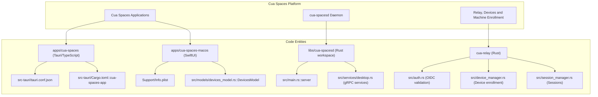

<!-- source: DeepWiki mcp.deepwiki.com · repo trycua/cua · page 17 Cua Spaces Platform · fetched 2026-10-29 -->

# Cua Spaces Platform

<details>
<summary>Relevant source files</summary>

The following files were used as context for generating this wiki page:

- [README.md](README.md)
- [apps/cua-spaces-macos/CHANGELOG.md](apps/cua-spaces-macos/CHANGELOG.md)
- [apps/cua-spaces-macos/Support/Info.plist](apps/cua-spaces-macos/Support/Info.plist)
- [apps/cua-spaces-macos/VERSION](apps/cua-spaces-macos/VERSION)
- [apps/cua-spaces/package.json](apps/cua-spaces/package.json)
- [apps/cua-spaces/src-tauri/Cargo.lock](apps/cua-spaces/src-tauri/Cargo.lock)
- [apps/cua-spaces/src-tauri/Cargo.toml](apps/cua-spaces/src-tauri/Cargo.toml)
- [apps/cua-spaces/src-tauri/tauri.conf.json](apps/cua-spaces/src-tauri/tauri.conf.json)
- [img/card-cua-bench.gif](img/card-cua-bench.gif)
- [img/card-cua-bench.png](img/card-cua-bench.png)
- [img/card-cua-driver.gif](img/card-cua-driver.gif)
- [img/card-cua-driver.png](img/card-cua-driver.png)
- [img/card-cua-fleets.gif](img/card-cua-fleets.gif)
- [img/card-cua-fleets.png](img/card-cua-fleets.png)
- [img/card-cua-lume.gif](img/card-cua-lume.gif)
- [img/card-cua-lume.png](img/card-cua-lume.png)
- [img/card-cua-products.gif](img/card-cua-products.gif)
- [img/card-cua-products.png](img/card-cua-products.png)
- [img/card-cua-s1.gif](img/card-cua-s1.gif)
- [img/card-cua-spaces-wide.gif](img/card-cua-spaces-wide.gif)
- [img/cua-spaces-demo.mp4](img/cua-spaces-demo.mp4)
- [samples/openkoalabot-example-tauri/src-tauri/Cargo.lock](samples/openkoalabot-example-tauri/src-tauri/Cargo.lock)

</details>


Cua Spaces provides full desktop environments for both human users and AI agents. This platform encompasses desktop applications for user interaction, a daemon running within the virtual machines (VMs) to expose desktop functionalities, and a relay service for secure device enrollment and communication. This page offers a high-level overview of these components, with detailed technical information available in their respective child pages.

## Cua Spaces Applications

The Cua Spaces applications are the primary user-facing interfaces for managing and interacting with Spaces. These applications are built for different operating systems to provide a native and intuitive experience.

The Tauri/TypeScript application, located at `apps/cua-spaces` [apps/cua-spaces/src-tauri/tauri.conf.json:1-121](), serves as a cross-platform prototype, offering a notch fleet portal and viewers. It integrates with the core Cua SDK to manage Spaces, streams, files, and agents [apps/cua-spaces/src-tauri/Cargo.toml:48-57](). The application also includes features like Teleport for moving signed-in apps into a Space [apps/cua-spaces/src-tauri/Cargo.toml:66-67]() and Keyvault integration for secure credential management [apps/cua-spaces/src-tauri/Cargo.toml:72-73]().

For macOS users, a dedicated SwiftUI application, `apps/cua-spaces-macos`, provides a highly optimized native experience. This application shares core view models and state machines with the Tauri app, covering functionalities such as Spaces listing, new Space creation, Teleport, Keyvault, onboarding, and the notch interface [apps/cua-spaces/src-tauri/Cargo.toml:69-71](). It also handles host setup, including service installation and relay registration [apps/cua-spaces/src-tauri/Cargo.toml:77-78](). The macOS app is responsible for driving Cua Spaces releases and manages its own versioning [apps/cua-spaces-macos/CHANGELOG.md:107-111]().

For details on the application architecture, UI components, and release workflows, see [Cua Spaces Applications](#17.1).

Sources:
- [apps/cua-spaces/src-tauri/tauri.conf.json:1-121]()
- [apps/cua-spaces/src-tauri/Cargo.toml:48-57]()
- [apps/cua-spaces/src-tauri/Cargo.toml:66-67]()
- [apps/cua-spaces/src-tauri/Cargo.toml:69-71]()
- [apps/cua-spaces/src-tauri/Cargo.toml:72-73]()
- [apps/cua-spaces/src-tauri/Cargo.toml:77-78]()
- [apps/cua-spaces-macos/CHANGELOG.md:107-111]()
- [apps/cua-spaces-macos/Support/Info.plist:1-46]()
- [apps/cua-spaces/package.json:1-41]()
- [apps/cua-spaces-macos/VERSION:1]()

## cua-spacesd Daemon

The `cua-spacesd` daemon is a critical component that runs within each Cua Space VM. Its primary role is to expose the desktop environment's functionalities to external clients, including the Cua Spaces applications and AI agents. This daemon is implemented in Rust and provides a gRPC service for various desktop interactions.

Key services offered by `cua-spacesd` include process management, file system access, screenshot capture, input injection, and low-latency desktop video/audio streaming over port 3211 [libs/cua/crates/cua-spacesd/src/main.rs](). It also manages sessions, handles SOCKS proxy functionality, and provides a provider-agnostic API for VM interactions. The daemon incorporates "doctor" checks for diagnostics and supports the Teleport import mechanism for migrating application sessions into a Space.

For a comprehensive understanding of the daemon's architecture, gRPC services, and operational details, see [cua-spacesd Daemon](#17.2).

Sources:
- [libs/cua/crates/cua-spacesd/src/main.rs]()

## Relay, Devices, and Machine Enrollment

The Cua Spaces platform leverages a relay service, `cua-relay`, to facilitate secure communication and management of devices and machines. This service is essential for enabling Spaces to run on various hosts, including local Macs and other machines owned by the user.

The `cua-relay` handles OpenID Connect (OIDC) validation for user authentication and manages the enrollment process for devices. This includes tracking device approval states, issuing machine tokens, and managing re-registration workflows. It also maintains sessions and logs audit and authentication events for security and compliance. The macOS Cua Spaces application integrates with this system through its `DevicesModel` to provide a user-friendly enrollment experience [apps/cua-spaces-macos/src/models/devices_model.rs](). This allows users to designate their Macs as hosts for Spaces, enabling remote access and management.

For in-depth information on the relay's role, device management, and machine enrollment processes, see [Relay, Devices and Machine Enrollment](#17.3).

Sources:
- [apps/cua-spaces-macos/src/models/devices_model.rs]()

## Cua Spaces Platform Architecture

The following diagram illustrates the high-level architecture of the Cua Spaces Platform, showing the interaction between the user applications, the in-VM daemon, and the relay service.

```mermaid
graph TD
    subgraph "User Interface Layer"
        A[apps/cua-spaces-macos: "macOS App (SwiftUI)"]
        B[apps/cua-spaces: "Cross-Platform App (Tauri/TS)"]
    end

    subgraph "Cua Spaces Platform Core"
        C[cua-relay: "Relay Service"]
        D[libs/cua/crates/cua-spaces-app-core: "App Core (Rust)"]
        E[libs/cua/crates/cua-host: "Host Setup (Rust)"]
        F[libs/cua/crates/cua-teleport: "Teleport Core (Rust)"]
        G[libs/cua/crates/cua-keyvault: "Keyvault (Rust)"]
        H[libs/cua/crates/cua-auth: "Auth (Rust)"]
    end

    subgraph "Cua Space VM"
        I[libs/cua-spacesd: "cua-spacesd Daemon (Rust)"]
        J[DesktopEnvironment: "Full Desktop Environment"]
        K[gRPC_Services: "gRPC Services (Process, Files, Screenshot, Input, Streaming)"]
    end

    subgraph "External Services"
        L[OIDC_Provider: "OIDC Provider"]
    end

    A --> D
    B --> D
    D --> F
    D --> G
    D --> H
    D --> E
    E --> C
    A -- "DevicesModel" --> C
    C -- "OIDC Validation" --> L
    C -- "Machine Tokens, Sessions" --> I
    I -- "Desktop Functionality" --> J
    I -- "gRPC API" --> K
    K -- "Streaming (Port 3211)" --> A
    K -- "Streaming (Port 3211)" --> B
    F -- "Teleport Import" --> I
    G -- "Credential Management" --> I
    H -- "User Authentication" --> C
```
Sources:
- [apps/cua-spaces/src-tauri/Cargo.toml:48-86]()
- [apps/cua-spaces-macos/src/models/devices_model.rs]()
- [libs/cua/crates/cua-spacesd/src/main.rs]()
- [README.md:72-79]()

## Code Entity to System Name Mapping

This diagram illustrates how the high-level system components of the Cua Spaces Platform map to specific code entities within the codebase.


Sources:
- [apps/cua-spaces/src-tauri/tauri.conf.json:1-121]()
- [apps/cua-spaces/src-tauri/Cargo.toml:1-164]()
- [apps/cua-spaces-macos/Support/Info.plist:1-46]()
- [apps/cua-spaces-macos/src/models/devices_model.rs]()
- [libs/cua/crates/cua-spacesd/src/main.rs]()
- [libs/cua/crates/cua-spacesd/src/services/desktop.rs]()
- [libs/cua/crates/cua-relay/src/auth.rs]()
- [libs/cua/crates/cua-relay/src/device_manager.rs]()
- [libs/cua/crates/cua-relay/src/session_manager.rs]()

---

