<!-- source: DeepWiki mcp.deepwiki.com · repo trycua/cua · page 17.1 Cua Spaces Applications · fetched 2026-10-29 -->

# Cua Spaces Applications

<details>
<summary>Relevant source files</summary>

The following files were used as context for generating this wiki page:

- [.github/scripts/check_spacesd_published.sh](.github/scripts/check_spacesd_published.sh)
- [.github/workflows/cd-cua-sdk.yml](.github/workflows/cd-cua-sdk.yml)
- [.github/workflows/cd-cua-spaces.yml](.github/workflows/cd-cua-spaces.yml)
- [.github/workflows/ci-release-spacesd-pin.yml](.github/workflows/ci-release-spacesd-pin.yml)
- [apps/cua-spaces-macos/CHANGELOG.md](apps/cua-spaces-macos/CHANGELOG.md)
- [apps/cua-spaces-macos/Sources/CuaSpacesMacKit/Models/AppModel.swift](apps/cua-spaces-macos/Sources/CuaSpacesMacKit/Models/AppModel.swift)
- [apps/cua-spaces-macos/Sources/CuaSpacesMacKit/Models/HostModel.swift](apps/cua-spaces-macos/Sources/CuaSpacesMacKit/Models/HostModel.swift)
- [apps/cua-spaces-macos/Sources/CuaSpacesMacKit/Models/HostSetupFailure.swift](apps/cua-spaces-macos/Sources/CuaSpacesMacKit/Models/HostSetupFailure.swift)
- [apps/cua-spaces-macos/Sources/CuaSpacesMacKit/Views/OnboardingView.swift](apps/cua-spaces-macos/Sources/CuaSpacesMacKit/Views/OnboardingView.swift)
- [apps/cua-spaces-macos/Sources/CuaSpacesMacKit/Views/SpaceDetailView.swift](apps/cua-spaces-macos/Sources/CuaSpacesMacKit/Views/SpaceDetailView.swift)
- [apps/cua-spaces-macos/Support/Info.plist](apps/cua-spaces-macos/Support/Info.plist)
- [apps/cua-spaces-macos/Tests/CuaSpacesMacTests/HostSetupFailureTests.swift](apps/cua-spaces-macos/Tests/CuaSpacesMacTests/HostSetupFailureTests.swift)
- [apps/cua-spaces-macos/Tests/CuaSpacesMacTests/MachineAccessTests.swift](apps/cua-spaces-macos/Tests/CuaSpacesMacTests/MachineAccessTests.swift)
- [apps/cua-spaces-macos/Tests/CuaSpacesMacTests/SnapshotTests.swift](apps/cua-spaces-macos/Tests/CuaSpacesMacTests/SnapshotTests.swift)
- [apps/cua-spaces-macos/Tests/CuaSpacesMacTests/Snapshots/machine-connect-enrolled.png](apps/cua-spaces-macos/Tests/CuaSpacesMacTests/Snapshots/machine-connect-enrolled.png)
- [apps/cua-spaces-macos/Tests/CuaSpacesMacTests/Snapshots/machine-connect-expired.png](apps/cua-spaces-macos/Tests/CuaSpacesMacTests/Snapshots/machine-connect-expired.png)
- [apps/cua-spaces-macos/Tests/CuaSpacesMacTests/Snapshots/machine-connect-not-enrolled.png](apps/cua-spaces-macos/Tests/CuaSpacesMacTests/Snapshots/machine-connect-not-enrolled.png)
- [apps/cua-spaces-macos/Tests/CuaSpacesMacTests/Snapshots/machine-desktop-not-shared.png](apps/cua-spaces-macos/Tests/CuaSpacesMacTests/Snapshots/machine-desktop-not-shared.png)
- [apps/cua-spaces-macos/VERSION](apps/cua-spaces-macos/VERSION)
- [apps/cua-spaces/package.json](apps/cua-spaces/package.json)
- [apps/cua-spaces/src-tauri/Cargo.lock](apps/cua-spaces/src-tauri/Cargo.lock)
- [apps/cua-spaces/src-tauri/Cargo.toml](apps/cua-spaces/src-tauri/Cargo.toml)
- [apps/cua-spaces/src-tauri/tauri.conf.json](apps/cua-spaces/src-tauri/tauri.conf.json)
- [libs/cua-spacesd/README.md](libs/cua-spacesd/README.md)
- [libs/cua/crates/cua-cli/src/auth.rs](libs/cua/crates/cua-cli/src/auth.rs)
- [libs/cua/crates/cua-host/src/driver.rs](libs/cua/crates/cua-host/src/driver.rs)
- [libs/cua/crates/cua-spaces-ffi/src/app_core.rs](libs/cua/crates/cua-spaces-ffi/src/app_core.rs)
- [libs/cua/scripts/generate-app-core-ffi.py](libs/cua/scripts/generate-app-core-ffi.py)
- [libs/spaces-app-swift/Sources/cua_spaces_ffiFFI/include/cua_spaces_ffiFFI.h](libs/spaces-app-swift/Sources/cua_spaces_ffiFFI/include/cua_spaces_ffiFFI.h)
- [samples/openkoalabot-example-tauri/src-tauri/Cargo.lock](samples/openkoalabot-example-tauri/src-tauri/Cargo.lock)

</details>


This page details the implementation of the Cua Spaces desktop applications: `apps/cua-spaces` (a Tauri/TypeScript application) and `apps/cua-spaces-macos` (a SwiftUI application with `CuaSpacesMacKit`). These applications provide user interfaces for managing Cua Spaces, including listing available Spaces, creating new ones, configuring host machines for unattended access, and handling user authentication and telemetry.

## Architecture Overview

The Cua Spaces applications serve as the primary user-facing interfaces for interacting with the Cua platform. They leverage the underlying Rust SDK (`libs/cua`) for core functionalities like Space management, host setup, and authentication.

There are two main application implementations:
1.  **Tauri/TypeScript Application (`apps/cua-spaces`)**: This is a cross-platform application built with Tauri, using TypeScript and React for the frontend. It targets Windows and Linux, and historically macOS (though the macOS version is now primarily SwiftUI).
2.  **SwiftUI Application (`apps/cua-spaces-macos`)**: This is a native macOS application built with SwiftUI, leveraging `CuaSpacesMacKit` for shared logic and FFI bindings to the Rust SDK.

Both applications share a common conceptual model for managing Spaces, hosts, and user interactions, often implemented through shared Rust crates like `cua-spaces-app-core` [libs/cua/crates/cua-spaces-app-core]().

### Application Components

The applications are structured around several key models and components:

*   **`AppModel`**: The root model for the SwiftUI application, managing the overall application state, including the list of Spaces, user settings, and various sub-models. [apps/cua-spaces-macos/Sources/CuaSpacesMacKit/Models/AppModel.swift:42-43]()
*   **`SpacesBackend`**: An abstraction representing the core Cua SDK functionalities for Space management.
*   **`HostModel`**: Manages the state and interactions related to configuring the local machine as a Cua host. [apps/cua-spaces-macos/Sources/CuaSpacesMacKit/Models/HostModel.swift:147-148]()
*   **Views**: The UI components responsible for rendering the application state and handling user input.
*   **Onboarding**: Guides users through initial setup, including signing in and configuring host access.
*   **Snapshot Tests**: Used for UI testing and ensuring consistent rendering.
*   **Packaging and Release Workflows**: Automated processes for building, signing, and distributing the applications.

### Tauri Application (`apps/cua-spaces`)

The Tauri application is defined in `apps/cua-spaces`. It uses `tauri.conf.json` for its configuration, specifying product name, version, build commands, and window properties. [apps/cua-spaces/src-tauri/tauri.conf.json:1-121]()

The `package.json` defines the scripts for development, building, and testing, including `pnpm dev`, `pnpm build`, and `tauri build`. [apps/cua-spaces/package.json:8-20]() It uses React for the frontend and `@tauri-apps/api` for interacting with the Tauri backend. [apps/cua-spaces/package.json:21-27]()

The Rust backend for the Tauri app is configured in `src-tauri/Cargo.toml`. It links to various `cua` crates, including `cua-spaces`, `cua-daemon`, `cua-fleet`, `cua-teleport`, and `cua-spaces-app-core`. [apps/cua-spaces/src-tauri/Cargo.toml:48-85]() This allows the Tauri app to host the Spaces core in-process and interact with the `cua daemon` for webview media bridge and shared Spaces. [apps/cua-spaces/src-tauri/Cargo.toml:45-48]()

### SwiftUI Application (`apps/cua-spaces-macos`)

The SwiftUI application is located in `apps/cua-spaces-macos`. It uses `CuaSpacesMacKit` for shared logic and FFI bindings to the Rust SDK. The `Info.plist` file defines application metadata, including the bundle identifier `com.trycua.spaces.macos` and Sparkle update feed URL. [apps/cua-spaces-macos/Support/Info.plist:11-12](), [apps/cua-spaces-macos/Support/Info.plist:37-38]()

The version of the macOS app is managed in `apps/cua-spaces-macos/VERSION` [apps/cua-spaces-macos/VERSION:1]() and reflected in `CFBundleShortVersionString` in `Info.plist`. [apps/cua-spaces-macos/Support/Info.plist:21-22]()

Sources:
- [apps/cua-spaces/src-tauri/tauri.conf.json:1-121]()
- [apps/cua-spaces/package.json:8-20]()
- [apps/cua-spaces/package.json:21-27]()
- [apps/cua-spaces/src-tauri/Cargo.toml:45-48]()
- [apps/cua-spaces/src-tauri/Cargo.toml:48-85]()
- [apps/cua-spaces-macos/Support/Info.plist:11-12]()
- [apps/cua-spaces-macos/Support/Info.plist:21-22]()
- [apps/cua-spaces-macos/Support/Info.plist:37-38]()
- [apps/cua-spaces-macos/VERSION:1]()
- [apps/cua-spaces-macos/Sources/CuaSpacesMacKit/Models/AppModel.swift:42-43]()
- [apps/cua-spaces-macos/Sources/CuaSpacesMacKit/Models/HostModel.swift:147-148]()

## AppModel and Data Flow

The `AppModel` [apps/cua-spaces-macos/Sources/CuaSpacesMacKit/Models/AppModel.swift:42-43]() in the SwiftUI application is the central observable object that holds the application's state. It exposes properties like `roster` (list of Spaces), `selection` (current view), `banner`, `showingNewSpace`, `pendingTeleport`, and various sub-models.

```mermaid
graph TD
    subgraph "Cua Spaces macOS App"
        AppModel["AppModel (Observable)"] --> roster["roster: AppRosterState"]
        AppModel --> selection["selection: MainSelection?"]
        AppModel --> banner["banner: String?"]
        AppModel --> showingNewSpace["showingNewSpace: Bool"]
        AppModel --> pendingTeleport["pendingTeleport: PendingTeleport?"]
        AppModel --> loaded["loaded: Bool"]
        AppModel --> wizard["wizard: WizardModel"]
        AppModel --> keyvault["keyvault: KeyvaultModel"]
        AppModel --> onboarding["onboarding: OnboardingModel"]
        AppModel --> notch["notch: NotchModel"]
        AppModel --> host["host: HostModel"]
        AppModel --> devices["devices: DevicesModel"]
        AppModel --> persistent["persistent: PersistentModel"]
        AppModel --> storage["storage: StorageModel"]
        AppModel --> cloud["cloud: CloudModel"]
        AppModel --> settings["settings: AppSettings"]
        AppModel --> updates["updates: UpdatesModel"]
    end

    subgraph "Rust SDK (CuaSDK)"
        SpacesBackend["SpacesBackend (Protocol)"]
        HostRunning["HostRunning (Protocol)"]
        AccountRunning["AccountRunning (Protocol)"]
        TelemetryRunning["TelemetryRunning (Protocol)"]
        AgentSetupRunning["AgentSetupRunning (Protocol)"]
        BillingRunning["BillingRunning (Protocol)"]
        DevicesRunning["DevicesRunning (Protocol)"]
        LoginItemControlling["LoginItemControlling (Protocol)"]
    end

    AppModel -- "Uses" --> SpacesBackend
    AppModel -- "Uses" --> HostRunning
    AppModel -- "Uses" --> AccountRunning
    AppModel -- "Uses" --> TelemetryRunning
    AppModel -- "Uses" --> AgentSetupRunning
    AppModel -- "Uses" --> BillingRunning
    AppModel -- "Uses" --> DevicesRunning
    AppModel -- "Uses" --> LoginItemControlling

    SpacesBackend -- "Provides thumbnail" --> notch
    onboarding -- "Sends events" --> TelemetryRunning
    storage -- "Sends events" --> TelemetryRunning
    devices -- "Sends events" --> TelemetryRunning
```


**Diagram: AppModel and its Dependencies**

The `AppModel` is initialized with various backend services, which are protocols defined in `CuaSDK` and `CuaSpacesFFI`. These protocols allow for dependency injection and testing with fixture implementations. [apps/cua-spaces-macos/Sources/CuaSpacesMacKit/Models/AppModel.swift:115-120]()

Key sub-models managed by `AppModel`:
*   **`WizardModel`**: Handles the "New Space" wizard flow. [apps/cua-spaces-macos/Sources/CuaSpacesMacKit/Models/AppModel.swift:138-144]()
*   **`KeyvaultModel`**: Manages Keyvault interactions.
*   **`OnboardingModel`**: Manages the onboarding process. [apps/cua-spaces-macos/Sources/CuaSpacesMacKit/Models/AppModel.swift:134-135]()
*   **`NotchModel`**: Manages the notch UI element and Space thumbnails. [apps/cua-spaces-macos/Sources/CuaSpacesMacKit/Models/AppModel.swift:144-145]()
*   **`HostModel`**: Manages the local machine's host status and configuration. [apps/cua-spaces-macos/Sources/CuaSpacesMacKit/Models/AppModel.swift:128-129]()
*   **`DevicesModel`**: Manages device enrollment and approvals. [apps/cua-spaces-macos/Sources/CuaSpacesMacKit/Models/AppModel.swift:122-123]()
*   **`PersistentModel`**: Manages persistent agents and the Cua Volume. [apps/cua-spaces-macos/Sources/CuaSpacesMacKit/Models/AppModel.swift:123-124]()
*   **`StorageModel`**: Manages Cua Volume storage, Finder volume, and cache. [apps/cua-spaces-macos/Sources/CuaSpacesMacKit/Models/AppModel.swift:125-126]()
*   **`CloudModel`**: Manages Cua Cloud interactions. [apps/cua-spaces-macos/Sources/CuaSpacesMacKit/Models/AppModel.swift:126-127]()
*   **`UpdatesModel`**: Handles in-app updates. [apps/cua-spaces-macos/Sources/CuaSpacesMacKit/Models/AppModel.swift:113-114]()

Sources:
- [apps/cua-spaces-macos/Sources/CuaSpacesMacKit/Models/AppModel.swift:42-43]()
- [apps/cua-spaces-macos/Sources/CuaSpacesMacKit/Models/AppModel.swift:113-114]()
- [apps/cua-spaces-macos/Sources/CuaSpacesMacKit/Models/AppModel.swift:115-120]()
- [apps/cua-spaces-macos/Sources/CuaSpacesMacKit/Models/AppModel.swift:122-123]()
- [apps/cua-spaces-macos/Sources/CuaSpacesMacKit/Models/AppModel.swift:123-124]()
- [apps/cua-spaces-macos/Sources/CuaSpacesMacKit/Models/AppModel.swift:125-126]()
- [apps/cua-spaces-macos/Sources/CuaSpacesMacKit/Models/AppModel.swift:126-127]()
- [apps/cua-spaces-macos/Sources/CuaSpacesMacKit/Models/AppModel.swift:128-129]()
- [apps/cua-spaces-macos/Sources/CuaSpacesMacKit/Models/AppModel.swift:134-135]()
- [apps/cua-spaces-macos/Sources/CuaSpacesMacKit/Models/AppModel.swift:138-144]()
- [apps/cua-spaces-macos/Sources/CuaSpacesMacKit/Models/AppModel.swift:144-145]()

## SpacesBackend and HostModel

The `SpacesBackend` protocol defines the interface for interacting with the core Cua SDK functionalities related to Spaces. For example, it provides a `thumbnail` function to fetch Space thumbnails. [apps/cua-spaces-macos/Sources/CuaSpacesMacKit/Models/AppModel.swift:147-148]()

The `HostModel` [apps/cua-spaces-macos/Sources/CuaSpacesMacKit/Models/HostModel.swift:147-148]() manages the state and actions for configuring the local machine as a Cua host. It interacts with the `HostRunning` protocol, which is implemented by `CuaSDK.Host` for live operations and `FixtureHost` for testing. [apps/cua-spaces-macos/Sources/CuaSpacesMacKit/Models/HostModel.swift:12-13](), [apps/cua-spaces-macos/Sources/CuaSpacesMacKit/Models/HostModel.swift:29]()

The `HostRunning` protocol defines methods such as `status()`, `setupRequest()`, `stopSharing()`, `startSharing()`, `pauseSignedOut()`, `resumeSignedIn()`, and `remove()`. [apps/cua-spaces-macos/Sources/CuaSpacesMacKit/Models/HostModel.swift:12-27]()

```mermaid
graph TD
    AppModel --> HostModel["HostModel (Observable)"]
    HostModel -- "Uses" --> HostRunning["HostRunning (Protocol)"]

    subgraph "HostRunning Implementations"
        CuaSDKHost["CuaSDK.Host"]
        FixtureHost["FixtureHost"]
    end

    HostRunning <|-- CuaSDKHost
    HostRunning <|-- FixtureHost

    HostModel -- "Calls status()" --> HostRunning
    HostModel -- "Calls setupRequest()" --> HostRunning
    HostModel -- "Calls configure()" --> HostRunning
    HostModel -- "Calls stopSharing()" --> HostRunning
    HostModel -- "Calls startSharing()" --> HostRunning
    HostModel -- "Calls pauseSignedOut()" --> HostRunning
    HostModel -- "Calls resumeSignedIn()" --> HostRunning
    HostModel -- "Calls remove()" --> HostRunning

    FixtureHost -- "Simulates host behavior" --> current["current: HostStatus"]
    FixtureHost -- "Records calls" --> calls["calls: [String]"]
    FixtureHost -- "Simulates setup failure" --> failSetup["failSetup: String?"]
    FixtureHost -- "Simulates configure failure" --> failConfigure["failConfigure: String?"]

    HostSetupFailure["HostSetupFailure"] -- "Presents errors" --> HostModel
```
**Diagram: HostModel and HostRunning Interaction**

The `HostModel` handles various host states, including `configured`, `sharing`, `serviceInstalled`, and `serviceRunning`. [apps/cua-spaces-macos/Sources/CuaSpacesMacKit/Models/HostModel.swift:61-64]() It also manages `HostSetupFailure` [apps/cua-spaces-macos/Sources/CuaSpacesMacKit/Models/HostSetupFailure.swift]() to present user-friendly error messages during host setup. [apps/cua-spaces-macos/Tests/CuaSpacesMacTests/HostSetupFailureTests.swift:17-24]()

Sources:
- [apps/cua-spaces-macos/Sources/CuaSpacesMacKit/Models/AppModel.swift:147-148]()
- [apps/cua-spaces-macos/Sources/CuaSpacesMacKit/Models/HostModel.swift:12-13]()
- [apps/cua-spaces-macos/Sources/CuaSpacesMacKit/Models/HostModel.swift:12-27]()
- [apps/cua-spaces-macos/Sources/CuaSpacesMacKit/Models/HostModel.swift:29]()
- [apps/cua-spaces-macos/Sources/CuaSpacesMacKit/Models/HostModel.swift:61-64]()
- [apps/cua-spaces-macos/Sources/CuaSpacesMacKit/Models/HostModel.swift:147-148]()
- [apps/cua-spaces-macos/Sources/CuaSpacesMacKit/Models/HostSetupFailure.swift]()
- [apps/cua-spaces-macos/Tests/CuaSpacesMacTests/HostSetupFailureTests.swift:17-24]()

## Onboarding

The `OnboardingModel` [apps/cua-spaces-macos/Sources/CuaSpacesMacKit/Models/AppModel.swift:134-135]() guides the user through the initial setup process. This includes signing in, configuring the local machine as a host, and setting up agents. The onboarding process leverages the `HostModel` for host setup.

For example, the `setUpHost()` function in `OnboardingModel` initiates the host setup process. If it fails, the `HostSetupFailure` is captured and presented to the user. [apps/cua-spaces-macos/Tests/CuaSpacesMacTests/HostSetupFailureTests.swift:103-114]()

Sources:
- [apps/cua-spaces-macos/Sources/CuaSpacesMacKit/Models/AppModel.swift:134-135]()
- [apps/cua-spaces-macos/Tests/CuaSpacesMacTests/HostSetupFailureTests.swift:103-114]()

## Snapshot Tests

Snapshot tests are used to ensure the UI remains consistent across changes. For the SwiftUI application, these tests are located in `apps/cua-spaces-macos/Tests/CuaSpacesMacTests/SnapshotTests.swift`. They capture images of UI components under various states and compare them against baseline snapshots. Examples include `machine-desktop-not-shared.png`, `machine-connect-not-enrolled.png`, `machine-connect-enrolled.png`, and `machine-connect-expired.png`.

Sources:
- [apps/cua-spaces-macos/Tests/CuaSpacesMacTests/SnapshotTests.swift]()
- [apps/cua-spaces-macos/Tests/CuaSpacesMacTests/Snapshots/machine-desktop-not-shared.png]()
- [apps/cua-spaces-macos/Tests/CuaSpacesMacTests/Snapshots/machine-connect-not-enrolled.png]()
- [apps/cua-spaces-macos/Tests/CuaSpacesMacTests/Snapshots/machine-connect-enrolled.png]()
- [apps/cua-spaces-macos/Tests/CuaSpacesMacTests/Snapshots/machine-connect-expired.png]()

## Packaging and Release Workflows

The release process for Cua Spaces applications is automated using GitHub Actions workflows.

### macOS Application Release

The `cd-cua-spaces.yml` workflow [apps/cua-spaces-macos/CHANGELOG.md:105-106]() handles the continuous deployment of the macOS SwiftUI application.
It performs the following steps:
1.  **Build**: The macOS app is built as a universal binary (arm64 + x86_64) using `apps/cua-spaces-macos/scripts/build-release.sh`. This script also bundles `libcua_sdk.dylib` (from `cua-spaces-ffi`) and `cua` CLI (from `cua-spaces-cli`). [apps/cua-spaces-macos/CHANGELOG.md:105-106]()
2.  **Signing and Notarization**: The app is Developer ID signed with a hardened runtime, notarized, and stapled. [apps/cua-spaces-macos/CHANGELOG.md:105-106]()
3.  **Packaging**: The signed app is packaged into a DMG using `scripts/package-dmg.sh` and a `.pkg` for MDM. The DMG is also signed, notarized, and stapled. [apps/cua-spaces-macos/CHANGELOG.md:105-106]()
4.  **Sparkle Updates**: The app embeds Sparkle for in-app updates. The update feed (`cua-spaces-appcast.xml`) is generated and published to the `cua-spaces-latest` GitHub release. [apps/cua-spaces-macos/CHANGELOG.md:105-106]()
5.  **Release Please**: The `cua-spaces` component, driven by `apps/cua-spaces-macos/VERSION` and `CHANGELOG.md`, uses Release Please to create draft releases and tags. [apps/cua-spaces-macos/CHANGELOG.md:105-106]()

The `VERSION` file [apps/cua-spaces-macos/VERSION:1]() and `CHANGELOG.md` [apps/cua-spaces-macos/CHANGELOG.md:1-111]() in `apps/cua-spaces-macos` are crucial for driving the release process and versioning.

### Tauri Application Release (Linux/Windows)

While currently disabled for Linux and Windows, the `cd-cua-spaces.yml` workflow [apps/cua-spaces-macos/CHANGELOG.md:105-106]() also contains provisions for building and releasing the Tauri application. This would involve:
1.  **Tauri Build**: Building the Tauri app using `tauri build`. [apps/cua-spaces/package.json:16]()
2.  **Sidecar Bundling**: Bundling the Cua Spaces build of the `cua` CLI as a sidecar.
3.  **Tauri Auto-updater**: Generating auto-updater artifacts (`.sig`) and a `latest.json` update feed. [apps/cua-spaces/src-tauri/tauri.conf.json:114-119]()
4.  **Signing**: Windows builds would use Azure Artifact Signing for Authenticode.

The `tauri.conf.json` [apps/cua-spaces/src-tauri/tauri.conf.json:1-121]() specifies the updater endpoint and public key for the Tauri auto-updater.

Sources:
- [apps/cua-spaces/package.json:16]()
- [apps/cua-spaces/src-tauri/tauri.conf.json:1-121]()
- [apps/cua-spaces/src-tauri/tauri.conf.json:114-119]()
- [apps/cua-spaces-macos/CHANGELOG.md:1-111]()
- [apps/cua-spaces-macos/CHANGELOG.md:105-106]()
- [apps/cua-spaces-macos/VERSION:1]()
- [.github/workflows/cd-cua-spaces.yml:1-130]()
- [.github/workflows/cd-cua-sdk.yml:1-147]()

```mermaid
graph TD
    subgraph "Release Process"
        A[Tag Push: cua-spaces-v*] --> B{GitHub Actions Workflow: cd-cua-spaces.yml}
        B --> C[Build macOS App (SwiftUI)]
        C --> D[Bundle libcua_sdk.dylib & cua CLI]
        C --> E[Developer ID Sign & Notarize App]
        E --> F[Package DMG & PKG]
        F --> G[Sign & Notarize DMG]
        G --> H[Generate Sparkle Appcast (cua-spaces-appcast.xml)]
        H --> I[Publish to GitHub Release]
        I --> J[Update cua-spaces-latest rolling release]
    end

    subgraph "Tauri Release (Currently Disabled for Linux/Windows)"
        K[Build Tauri App (apps/cua-spaces)]
        K --> L[Bundle cua CLI as Sidecar]
        K --> M[Generate Tauri Updater Artifacts (.sig)]
        M --> N[Generate latest.json update feed]
        N --> I
    end

    style A fill:#f9f,stroke:#333,stroke-width:2px
    style B fill:#bbf,stroke:#333,stroke-width:2px
    style I fill:#afa,stroke:#333,stroke-width:2px
```
**Diagram: Cua Spaces Release Workflow**

---

