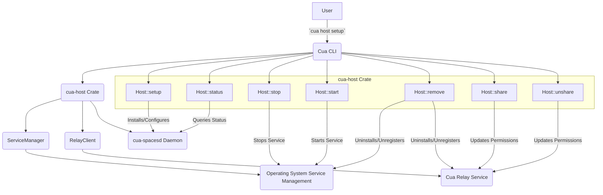

<!-- source: DeepWiki mcp.deepwiki.com · repo trycua/cua · page 17.2 cua-spacesd Daemon · fetched 2026-10-29 -->

# cua-spacesd Daemon

<details>
<summary>Relevant source files</summary>

The following files were used as context for generating this wiki page:

- [apps/cua-spaces-macos/Sources/CuaSpacesMacKit/Models/DevicesModel.swift](apps/cua-spaces-macos/Sources/CuaSpacesMacKit/Models/DevicesModel.swift)
- [apps/cua-spaces-macos/Sources/CuaSpacesMacKit/Views/ThisMachineView.swift](apps/cua-spaces-macos/Sources/CuaSpacesMacKit/Views/ThisMachineView.swift)
- [apps/cua-spaces-macos/Tests/CuaSpacesMacTests/Snapshots/this-machine.png](apps/cua-spaces-macos/Tests/CuaSpacesMacTests/Snapshots/this-machine.png)
- [apps/cua-spaces-macos/Tests/CuaSpacesMacTests/ViewModelTests.swift](apps/cua-spaces-macos/Tests/CuaSpacesMacTests/ViewModelTests.swift)
- [libs/cua-spacesd/CHANGELOG.md](libs/cua-spacesd/CHANGELOG.md)
- [libs/cua-spacesd/Cargo.lock](libs/cua-spacesd/Cargo.lock)
- [libs/cua-spacesd/Cargo.toml](libs/cua-spacesd/Cargo.toml)
- [libs/cua-spacesd/VERSION](libs/cua-spacesd/VERSION)
- [libs/cua-spacesd/crates/cua-spacesd-desktop/src/grpc/computer.rs](libs/cua-spacesd/crates/cua-spacesd-desktop/src/grpc/computer.rs)
- [libs/cua-spacesd/crates/cua-spacesd-server/src/access_log.rs](libs/cua-spacesd/crates/cua-spacesd-server/src/access_log.rs)
- [libs/cua-spacesd/crates/cua-spacesd-server/src/auth.rs](libs/cua-spacesd/crates/cua-spacesd-server/src/auth.rs)
- [libs/cua-spacesd/crates/cua-spacesd-server/tests/access_log.rs](libs/cua-spacesd/crates/cua-spacesd-server/tests/access_log.rs)
- [libs/cua-spacesd/tests/spaces-e2e/Cargo.lock](libs/cua-spacesd/tests/spaces-e2e/Cargo.lock)
- [libs/cua-spacesd/tests/spaces-e2e/Cargo.toml](libs/cua-spacesd/tests/spaces-e2e/Cargo.toml)
- [libs/cua-spacesd/tests/spaces-e2e/tests/relay_devices.rs](libs/cua-spacesd/tests/spaces-e2e/tests/relay_devices.rs)
- [libs/cua-spacesd/tests/teleport-e2e/Cargo.lock](libs/cua-spacesd/tests/teleport-e2e/Cargo.lock)
- [libs/cua/crates/cua-cli/src/host.rs](libs/cua/crates/cua-cli/src/host.rs)
- [libs/cua/crates/cua-host/src/access.rs](libs/cua/crates/cua-host/src/access.rs)
- [libs/cua/crates/cua-host/src/host.rs](libs/cua/crates/cua-host/src/host.rs)
- [libs/cua/crates/cua-host/src/tests.rs](libs/cua/crates/cua-host/src/tests.rs)
- [libs/cua/crates/cua-spaces-app-core/src/host.rs](libs/cua/crates/cua-spaces-app-core/src/host.rs)
- [libs/cua/crates/cua-spaces-ffi/src/app_core_types.rs](libs/cua/crates/cua-spaces-ffi/src/app_core_types.rs)
- [libs/cua/crates/cua-spaces/src/spaces.rs](libs/cua/crates/cua-spaces/src/spaces.rs)
- [libs/cua/crates/cua-spaces/src/thumbnails.rs](libs/cua/crates/cua-spaces/src/thumbnails.rs)
- [libs/cua/crates/cua-spaces/tests/relay.rs](libs/cua/crates/cua-spaces/tests/relay.rs)
- [libs/spaces-app-swift/Sources/CuaSpacesFFI/CuaSpacesFFI.swift](libs/spaces-app-swift/Sources/CuaSpacesFFI/CuaSpacesFFI.swift)

</details>


The `cua-spacesd` daemon is a core component of the Cua Spaces platform, primarily residing in the `libs/cua-spacesd` workspace. It acts as the in-VM server for Cua Spaces, providing a suite of gRPC services that enable desktop interaction, file management, screen streaming, and other essential functionalities. This daemon is crucial for both agent-driven automation and human interaction with Cua Spaces.

## Purpose and Scope

The `cua-spacesd` daemon serves as the interface between the Cua SDK/applications and the underlying operating system of a Cua Space (VM desktop). It exposes gRPC services for:
*   **Process Management**: Starting, stopping, and managing applications within the Space.
*   **File System Operations**: Accessing and manipulating files.
*   **Screenshot and Input**: Capturing screenshots and injecting input events.
*   **Desktop Streaming**: Providing low-latency video and audio streaming of the desktop environment on port 3211.
*   **Session Management**: Handling user sessions and authentication.
*   **SOCKS Proxy**: Facilitating network connectivity.
*   **Provider API**: Interacting with the underlying virtualization or containerization provider.
*   **Doctor Checks**: Performing diagnostic checks on the Space's health.
*   **Teleport Import**: Securely importing user data (e.g., browser cookies, keyvault items) into the Space.

The `libs/cua-spacesd` workspace also includes components for packaging and end-to-end testing, ensuring the daemon's reliability and functionality across different operating systems (Linux, macOS, Windows).

Sources:
- [libs/cua-spacesd/Cargo.toml:3-14]()
- [libs/cua-spacesd/CHANGELOG.md:130-132]()

## Architecture and Components

The `cua-spacesd` daemon is a Rust-based application structured as a Cargo workspace, containing several crates that handle specific functionalities.

### Workspace Structure

The `libs/cua-spacesd/Cargo.toml` defines the workspace members:
*   `crates/cua-spacesd-teleport`: Handles the secure import of user data.
*   `crates/cua-spacesd-desktop`: Provides desktop-specific gRPC services like screenshot and input.
*   `crates/cua-spacesd`: The main daemon executable.
*   `crates/cua-spacesd-doctor`: Implements diagnostic checks.
*   `crates/cua-spacesd-provider-api`: Defines the interface for interacting with virtualization providers.
*   `crates/cua-spacesd-session`: Manages user sessions.
*   `crates/cua-spacesd-socks`: Provides SOCKS proxy functionality.
*   `crates/cua-spacesd-test-apps`: Contains applications used for testing the daemon.
*   `crates/cua-spacesd-server`: Implements the core gRPC/HTTP server logic.
*   `crates/cua-relay`: Handles communication with the Cua relay service.

Sources:
- [libs/cua-spacesd/Cargo.toml:3-14]()

### Daemon Startup and Configuration

The `cua-spacesd` daemon can be set up in two primary modes:
1.  **Relay Mode**: The daemon connects to a `cua-relay` service (e.g., `https://relay.cua.ai`) via an outbound WSS connection. This is the default mode and allows the machine to be managed remotely through the Cua platform.
2.  **Direct Mode**: The daemon serves directly on a specified `ip:port` (e.g., `0.0.0.0:3211`). In this mode, a local environment token is used for authentication, and it's typically used for LAN or port-forwarded setups.

The `cua host setup` CLI command is used to configure and install `cua-spacesd` as a service. It allows specifying the mode, display name, allowed accounts, driver binary path, and whether to share the desktop or provide Spaces.

Sources:
- [libs/cua/crates/cua-host/src/host.rs:41-55]()
- [libs/cua/crates/cua-host/src/host.rs:56-60]()
- [libs/cua/crates/cua-cli/src/host.rs:20-40]()
- [libs/cua/crates/cua-cli/src/host.rs:41-52]()

### Host Policy

The `cua-spacesd` daemon enforces a `HostPolicy` defined in `cua_home/host/host.json`. This policy dictates access control and resource allocation for the host machine. Key aspects of the `HostPolicy` include:
*   `owner`: The ID of the owner account.
*   `allow`: A list of account IDs or emails allowed to access the host.
*   `viewers`: Accounts with view-only access.
*   `trust_relay_allowlist`: Whether to trust the relay's allowlist for access.
*   `sharing`: Overall toggle for accepting clients.
*   `share_desktop`: Whether the host's own desktop is exposed as a Space.
*   `provide_spaces`: Whether the host can create and manage Spaces for other devices.
*   `max_spaces`: The maximum number of Spaces that can be provided concurrently.
*   `max_macos_vms`: The maximum number of macOS VMs (limited to two by Apple's license).
*   `spaces_daemon`: Configuration for how the `cua` daemon (which creates provided Spaces) is reached and started.
*   `direct`: Configuration for direct hosting mode.

This policy is reloaded when it changes, allowing for dynamic updates to access rules.

Sources:
- [libs/cua/crates/cua-host/src/host.rs:134-175]()

## Core Functionalities

### gRPC Services

The `cua-spacesd` daemon exposes a variety of gRPC services, primarily through the `cua-spacesd-server` and `cua-spacesd-desktop` crates. These services enable rich interaction with the Space.

**Desktop Services (`cua-spacesd-desktop`)**:
The `cua-spacesd-desktop` crate provides the `Computer` gRPC service, which is the primary interface for interacting with the desktop environment. This includes:
*   **Screenshot Capture**: Capturing the current state of the desktop.
*   **Input Injection**: Sending keyboard and mouse events to the desktop.
*   **Process Management**: Listing, starting, and stopping processes.
*   **File System Access**: Reading, writing, and managing files.

Sources:
- [libs/cua-spacesd/crates/cua-spacesd-desktop/src/grpc/computer.rs]()

**Streaming Services**:
Desktop video and audio streaming is a critical feature, provided on port 3211. This enables low-latency remote viewing and interaction with the Space. The `libs/cua/crates/cua-spaces/src/thumbnails.rs` module, for example, uses these streaming capabilities to generate synthetic thumbnail scenes for Spaces, such as `MacDesktop`, `WindowsDesktop`, or `LinuxTerminal`.

Sources:
- [libs/cua/crates/cua-spaces/src/thumbnails.rs]()
- [libs/cua/crates/cua-spaces-ffi/src/app_core_types.rs:46-51]()

### Session and Authentication

The `cua-spacesd-session` crate manages user sessions and authentication. In relay mode, authentication is handled through the `cua-relay` service, which uses OIDC validation and device enrollment. In direct mode, an environment token is used. The `cua-spacesd-server` crate includes `auth.rs` for handling authentication logic.

Sources:
- [libs/cua-spacesd/crates/cua-spacesd-server/src/auth.rs]()

### Teleport Import

The `cua-spacesd-teleport` crate is responsible for securely importing user data into a Space. This includes:
*   **Browser Data**: Importing cookies and safe storage from browsers like Chrome, Firefox, and Electron.
*   **Keyvault Items**: Managing per-application secret items with features like unattended locks, search, and per-domain review.
*   **Windows DPAPI**: Accessing Windows Data Protection API for secrets.

The `teleport-e2e` tests in `libs/cua-spacesd/tests/teleport-e2e/Cargo.lock` confirm the functionality of this component, ensuring that data can be imported correctly, even into a Chrome instance that has never been launched.

Sources:
- [libs/cua-spacesd/CHANGELOG.md:49-50]()
- [libs/cua-spacesd/CHANGELOG.md:74-75]()
- [libs/cua-spacesd/CHANGELOG.md:88-89]()
- [libs/cua-spacesd/CHANGELOG.md:103-104]()
- [libs/cua-spacesd/CHANGELOG.md:110-111]()
- [libs/cua-spacesd/tests/teleport-e2e/Cargo.lock]()

### Doctor Checks

The `cua-spacesd-doctor` crate provides diagnostic capabilities to check the health and status of the daemon and the Space. This includes probing services and scaling probe waits with `CUA_DOCTOR_TIMEOUT_SCALE`.

Sources:
- [libs/cua-spacesd/CHANGELOG.md:95-96]()

## Data Flow and Interactions

The `cua-spacesd` daemon interacts with various internal and external components.

### Interaction with Cua SDK and Applications

Cua applications, such as `apps/cua-spaces-macos`, interact with `cua-spacesd` through the Cua SDK. The SDK provides an abstraction layer, allowing applications to create, manage, and interact with Spaces. For example, the `AppModel` in `CuaSpacesMacKit` uses a `SpacesBackend` to communicate with the daemon.

The `Spaces` struct in `libs/cua/crates/cua-spaces/src/spaces.rs` is a central component for managing Spaces. It provides methods like `Spaces::create` to provision new Spaces and `Spaces::add` to register existing machines. The `SpaceCreate` options allow specifying image, location (`on`), kind, runtime, and other parameters. Progress updates during Space creation are communicated via a `ProgressSink`.

**Diagram: Cua Spaces Daemon Data Flow**
```mermaid
graph TD
    A[Cua Spaces Applications] -->|gRPC/SDK Calls| B(Cua SDK)
    B -->|gRPC/HTTP| C(cua-spacesd Daemon)
    C -->|Desktop Services| D[Operating System / Desktop Environment]
    C -->|File System Access| E[File System]
    C -->|Streaming (Port 3211)| F[Video/Audio Output]
    C -->|Input Injection| G[Keyboard/Mouse Input]
    C -->|Teleport Import| H[Browser Data / Keyvault]
    C -->|Provider API| I[Virtualization/Containerization Provider]
    C -->|Relay Communication| J[Cua Relay Service]
    J --> K[Cua Cloud Infrastructure]

    subgraph "libs/cua-spacesd Workspace"
        C -- cua-spacesd-server --> C1(gRPC/HTTP Server)
        C -- cua-spacesd-desktop --> C2(Desktop Services)
        C -- cua-spacesd-teleport --> C3(Teleport Service)
        C -- cua-spacesd-session --> C4(Session Management)
        C -- cua-spacesd-socks --> C5(SOCKS Proxy)
        C -- cua-spacesd-doctor --> C6(Doctor Checks)
        C -- cua-spacesd-provider-api --> C7(Provider API)
        C -- cua-relay --> C8(Relay Client)
    end

    subgraph "Cua SDK (libs/cua/crates/cua-spaces)"
        B1[Spaces::create] --> C
        B2[Spaces::add] --> C
        B3[ProgressSink] --> B1
    end

    style C1 fill:#f9f,stroke:#333,stroke-width:2px
    style C2 fill:#f9f,stroke:#333,stroke-width:2px
    style C3 fill:#f9f,stroke:#333,stroke-width:2px
    style C4 fill:#f9f,stroke:#333,stroke-width:2px
    style C5 fill:#f9f,stroke:#333,stroke-width:2px
    style C6 fill:#f9f,stroke:#333,stroke-width:2px
    style C7 fill:#f9f,stroke:#333,stroke-width:2px
    style C8 fill:#f9f,stroke:#333,stroke-width:2px
```
Sources:
- [libs/cua/crates/cua-spaces/src/spaces.rs:1-5]()
- [libs/cua/crates/cua-spaces/src/spaces.rs:29-88]()
- [libs/cua/crates/cua-spaces/src/spaces.rs:91-98]()
- [apps/cua-spaces-macos/Tests/CuaSpacesMacTests/ViewModelTests.swift:104-115]()

### Host Management

The `cua-host` crate in `libs/cua/crates/cua-host` provides the logic for setting up, configuring, and managing the host machine where `cua-spacesd` runs. This includes:
*   `Host::setup`: Installs and configures `cua-spacesd`.
*   `Host::status`: Retrieves the current status of the host and connected clients.
*   `Host::stop`/`Host::start`: Controls the `cua-spacesd` service.
*   `Host::remove`: Unregisters the host and uninstalls the service.
*   `Host::share`/`Host::unshare`: Manages sharing permissions for relay machines.

The `HostCmd` enum in `libs/cua/crates/cua-cli/src/host.rs` defines the CLI commands for host management.

**Diagram: Host Management Workflow**

Sources:
- [libs/cua/crates/cua-host/src/host.rs:1-7]()
- [libs/cua/crates/cua-cli/src/host.rs:17-165]()
- [apps/cua-spaces-macos/Sources/CuaSpacesMacKit/Views/ThisMachineView.swift:12-14]()

## Packaging and Testing

The `libs/cua-spacesd` workspace includes mechanisms for packaging and end-to-end testing. The `CHANGELOG.md` indicates that `cua-spacesd` releases are built for Linux, macOS, and Windows, implying cross-platform packaging.

End-to-end tests, such as those found in `libs/cua-spacesd/tests/spaces-e2e` and `libs/cua-spacesd/tests/teleport-e2e`, validate the daemon's functionality in realistic scenarios, including relay interactions and teleport operations. The `Cargo.lock` files in these test directories list numerous dependencies, indicating comprehensive testing setups.

Sources:
- [libs/cua-spacesd/CHANGELOG.md:130-132]()
- [libs/cua-spacesd/tests/spaces-e2e/Cargo.lock]()
- [libs/cua-spacesd/tests/teleport-e2e/Cargo.lock]()

---

