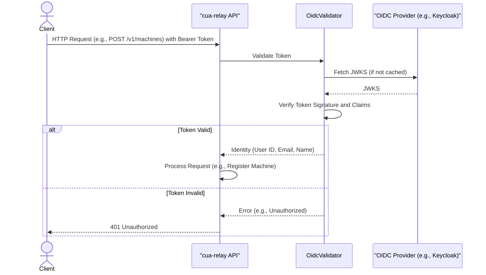
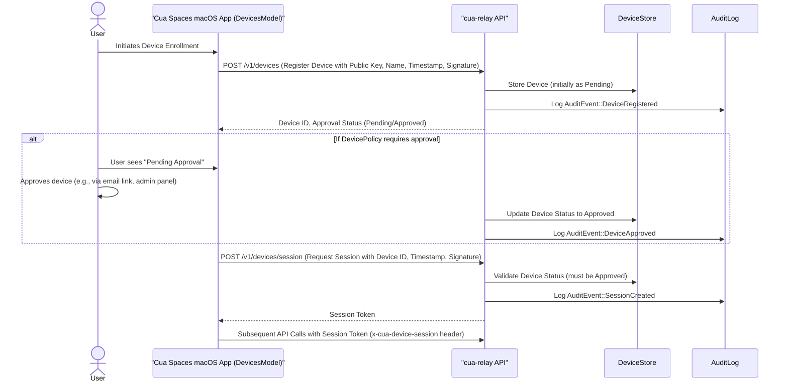

<!-- source: DeepWiki mcp.deepwiki.com · repo trycua/cua · page 17.3 Relay, Devices and Machine Enrollment · fetched 2026-10-29 -->

# Relay, Devices and Machine Enrollment

<details>
<summary>Relevant source files</summary>

The following files were used as context for generating this wiki page:

- [apps/cua-spaces-macos/Sources/CuaSpacesMacKit/Models/DevicesModel.swift](apps/cua-spaces-macos/Sources/CuaSpacesMacKit/Models/DevicesModel.swift)
- [libs/cua-spacesd/CHANGELOG.md](libs/cua-spacesd/CHANGELOG.md)
- [libs/cua-spacesd/Cargo.lock](libs/cua-spacesd/Cargo.lock)
- [libs/cua-spacesd/Cargo.toml](libs/cua-spacesd/Cargo.toml)
- [libs/cua-spacesd/VERSION](libs/cua-spacesd/VERSION)
- [libs/cua-spacesd/crates/cua-relay/src/api.rs](libs/cua-spacesd/crates/cua-relay/src/api.rs)
- [libs/cua-spacesd/crates/cua-relay/src/auth_log.rs](libs/cua-spacesd/crates/cua-relay/src/auth_log.rs)
- [libs/cua-spacesd/crates/cua-relay/src/device_api.rs](libs/cua-spacesd/crates/cua-relay/src/device_api.rs)
- [libs/cua-spacesd/crates/cua-relay/src/devices.rs](libs/cua-spacesd/crates/cua-relay/src/devices.rs)
- [libs/cua-spacesd/crates/cua-relay/src/lib.rs](libs/cua-spacesd/crates/cua-relay/src/lib.rs)
- [libs/cua-spacesd/crates/cua-relay/src/oidc.rs](libs/cua-spacesd/crates/cua-relay/src/oidc.rs)
- [libs/cua-spacesd/crates/cua-relay/src/server.rs](libs/cua-spacesd/crates/cua-relay/src/server.rs)
- [libs/cua-spacesd/crates/cua-relay/tests/auth_rejection_logs.rs](libs/cua-spacesd/crates/cua-relay/tests/auth_rejection_logs.rs)
- [libs/cua-spacesd/crates/cua-relay/tests/device_enrollment.rs](libs/cua-spacesd/crates/cua-relay/tests/device_enrollment.rs)
- [libs/cua-spacesd/crates/cua-relay/tests/reregister.rs](libs/cua-spacesd/crates/cua-relay/tests/reregister.rs)
- [libs/cua-spacesd/tests/spaces-e2e/Cargo.lock](libs/cua-spacesd/tests/spaces-e2e/Cargo.lock)
- [libs/cua-spacesd/tests/spaces-e2e/Cargo.toml](libs/cua-spacesd/tests/spaces-e2e/Cargo.toml)
- [libs/cua-spacesd/tests/spaces-e2e/tests/relay_devices.rs](libs/cua-spacesd/tests/spaces-e2e/tests/relay_devices.rs)
- [libs/cua-spacesd/tests/teleport-e2e/Cargo.lock](libs/cua-spacesd/tests/teleport-e2e/Cargo.lock)

</details>


This page details the `cua-relay` component, focusing on its role in OpenID Connect (OIDC) validation, device enrollment and approval states, machine token management, re-registration processes, session handling, audit/authentication logging, and the user experience for device enrollment within the macOS Cua Spaces application.

The `cua-relay` is a critical component for managing secure connections between Cua Spaces clients and the machines they control. It acts as a central point for authentication, authorization, and routing of traffic.

Sources:
- [libs/cua-spacesd/Cargo.toml:14]()
- [libs/cua-spacesd/crates/cua-relay/src/lib.rs]()

## cua-relay Architecture and Modes

The `cua-relay` supports two primary registration modes:

1.  **Static Relay Tokens (Self-hosting)**: In this mode, machines register using a shared secret. Clients present an environment token end-to-end. The relay forwards this token unmodified and does not store it, though it parses it in transit. This mode is typically used for self-hosted deployments.
2.  **Accounts (cua.ai)**: Machines are registered by a signed-in user via the `/v1/machines` API endpoint. They join the relay using a machine token received during registration. Clients present their account token, and the relay performs ownership, allowlist, and sharing checks. It then strips the client's credentials and forwards a short-lived, relay-signed principal assertion to the machine. The machine directory API is exposed via `crate::api`.

The relay handles client requests by establishing a yamux stream, which can carry HTTP/1.1 (including WebSocket upgrades) or h2 (gRPC) traffic to the machine's `cua-spacesd` instance.

Sources:
- [libs/cua-spacesd/crates/cua-relay/src/server.rs:4-23]()

## OIDC Validation and Authentication

`cua-relay` integrates with OIDC for user authentication in account mode. It uses an `OidcValidator` to verify account tokens. The `RelayConfig` struct holds the `oidc` field, which is an `Arc<OidcValidator>`, enabling OIDC validation.

When a client makes a request, the relay extracts the account token (from the `Authorization` header or `x-cua-relay-authorization` header) and validates it against the configured OIDC provider. This ensures that only authenticated users can interact with the machine directory API.

### OIDC Validation Flow



Sources:
- [libs/cua-spacesd/crates/cua-relay/src/server.rs:80-81]()
- [libs/cua-spacesd/crates/cua-relay/src/server.rs:50]()
- [libs/cua-spacesd/crates/cua-relay/src/server.rs:54-55]()

## Device Enrollment and Approval States

Device enrollment is a key security feature in `cua-relay`'s account mode. It ensures that client devices (e.g., a user's laptop running Cua Spaces) are explicitly registered and approved before they can access machines.

The `DevicePolicy` struct in `cua-relay::devices` defines the rules for device enrollment, including `grace_secs` (a grace period for new devices), `require_approval`, and `session_lifetime`.

A device's state can be:
*   **Pending**: A new device awaiting approval.
*   **Approved**: An approved device that can access machines.
*   **Revoked**: A device whose access has been explicitly removed.

The `DevicesModel` in `apps/cua-spaces-macos/Sources/CuaSpacesMacKit/Models/DevicesModel.swift` is responsible for the macOS client-side enrollment user experience. It interacts with the `cua-relay`'s device API (`/v1/devices`) to register new devices, request approval, and manage device sessions.

### Device Enrollment Flow



Sources:
- [libs/cua-spacesd/crates/cua-relay/src/devices.rs]()
- [libs/cua-spacesd/crates/cua-relay/src/device_api.rs]()
- [libs/cua-spacesd/crates/cua-relay/tests/device_enrollment.rs:28-32]()
- [libs/cua-spacesd/crates/cua-relay/tests/device_enrollment.rs:77-106]()
- [libs/cua-spacesd/crates/cua-relay/src/server.rs:48]()
- [apps/cua-spaces-macos/Sources/CuaSpacesMacKit/Models/DevicesModel.swift]()

## Machine Tokens and Re-registration

Each registered machine receives a unique `machine_token`. This token is crucial for the machine to authenticate itself with the relay and join the network.

The re-registration process handles scenarios where a machine needs to re-establish its connection or update its registration details. The `cua-relay` distinguishes between a live machine and an offline one during re-registration.

*   **Offline Machine Re-registration**: If a machine is offline (not actively heartbeating), its owner can re-register it using their account token alone. This action rotates the machine's token, invalidating the old one. This is useful if the host setup died or the machine token was lost.
*   **Live Machine Re-registration**: If a machine is currently online and heartbeating, re-registration requires either the machine's current `machine_token` (sent via the `x-cua-machine-authorization` header) or an enrolled device associated with the owner's account. This prevents unauthorized users from knocking a live machine offline by simply using an account token.

The `REGISTER_LOG_TARGET` constant (`"cua_relay::register"`) is used for logging re-registration decisions, providing audit trails for these critical operations.

### Machine Re-registration Logic

```mermaid
graph TD
    A[Machine Offline?] -->|Yes| B{Owner's Account Token?};
    B -->|Yes| C[Re-register: Rotate Machine Token];
    B -->|No| D[Refused: Not Owner];
    A -->|No (Machine is Live)| E{Machine Token or Enrolled Device?};
    E -->|Yes| C;
    E -->|No| F[Refused: Live Machine Requires Proof];

    style A fill:#f9f,stroke:#333,stroke-width:2px
    style B fill:#bbf,stroke:#333,stroke-width:2px
    style C fill:#bfb,stroke:#333,stroke-width:2px
    style D fill:#fbb,stroke:#333,stroke-width:2px
    style E fill:#bbf,stroke:#333,stroke-width:2px
    style F fill:#fbb,stroke:#333,stroke-width:2px
```

Sources:
- [libs/cua-spacesd/crates/cua-relay/src/api.rs:155-158]()
- [libs/cua-spacesd/crates/cua-relay/src/api.rs:163]()
- [libs/cua-spacesd/crates/cua-relay/tests/reregister.rs:4-7]()
- [libs/cua-spacesd/crates/cua-relay/tests/reregister.rs:139-147]()
- [libs/cua-spacesd/crates/cua-relay/tests/reregister.rs:166-178]()
- [libs/cua-spacesd/crates/cua-relay/tests/spaces-e2e/tests/relay_devices.rs:97-112]()
- [libs/cua-spacesd/crates/cua-relay/tests/spaces-e2e/tests/relay_devices.rs:113-124]()

## Sessions

Sessions in `cua-relay` refer to both client sessions (established by enrolled devices) and machine sessions (when a machine is connected and heartbeating).

*   **Client Sessions**: After a device is enrolled and approved, it can request a session token from the relay. This session token (`x-cua-device-session` header) is then used for subsequent API calls to prove the client's identity and authorized device. These sessions have a defined lifetime (`DevicePolicy::session_lifetime`).
*   **Machine Sessions**: A machine maintains a session with the relay by sending regular heartbeats. If a machine fails to heartbeat for a configured duration (`RelayConfig::machine_idle_timeout`), its session is considered expired, and it is dropped from the relay's active machine list.

The `ClientView` struct includes `streams` and `since` fields to track active connections and the duration of a client's presence on a machine.

Sources:
- [libs/cua-spacesd/crates/cua-relay/src/devices.rs]()
- [libs/cua-spacesd/crates/cua-relay/src/server.rs:48]()
- [libs/cua-spacesd/crates/cua-relay/src/server.rs:58-59]()
- [libs/cua-spacesd/crates/cua-relay/src/api.rs:42-56]()

## Audit and Authentication Logs

`cua-relay` maintains detailed audit and authentication logs to track significant events, especially those related to security and access control. The `auth_log` module is responsible for this.

Key events logged include:
*   Device registration and approval.
*   Session creation and revocation.
*   Machine registration and re-registration decisions.
*   Access attempts (both successful and failed) to machines or API endpoints.

These logs include information such as the `Reason` for an action (e.g., `stale_record`, `refused_live_machine`) and the `Route` being accessed. This provides transparency and aids in debugging and security auditing.

Sources:
- [libs/cua-spacesd/crates/cua-relay/src/auth_log.rs]()
- [libs/cua-spacesd/crates/cua-relay/src/api.rs:33]()
- [libs/cua-spacesd/crates/cua-relay/src/server.rs:47]()
- [libs/cua-spacesd/crates/cua-relay/tests/reregister.rs:50-56]()
- [libs/cua-spacesd/crates/cua-relay/tests/auth_rejection_logs.rs]()

## macOS DevicesModel Enrollment UX

The `DevicesModel` in `apps/cua-spaces-macos/Sources/CuaSpacesMacKit/Models/DevicesModel.swift` is the SwiftUI-based user interface component responsible for managing device enrollment on macOS. It provides the user experience for:

*   **Listing Machines**: Displaying owned and shared machines, indicating their online status and whether they are confirmed.
*   **Enrollment Flow**: Guiding the user through the process of enrolling a new macOS device. This typically involves generating a key pair, sending the public key to the relay, and potentially awaiting approval.
*   **Approval Status**: Showing the current approval state of the device (e.g., "new" for unconfirmed devices).
*   **Re-registration**: Facilitating the re-registration of a machine, especially when a host is offline or needs its token rotated. The UI would reflect the necessary steps, such as requiring the machine token if the host is live.

The `MachineView` struct, exposed by the `cua-relay` API, provides the data necessary for the `DevicesModel` to render machine information, including `id`, `name`, `owner`, `role`, `online`, `sharing`, `version`, `connected_at`, `url`, `allow`, `viewers`, `clients`, `host`, `confirmed`, and `meta`. The `confirmed` field is particularly relevant for the UX, as `false` indicates a "new" machine awaiting confirmation.

Sources:
- [apps/cua-spaces-macos/Sources/CuaSpacesMacKit/Models/DevicesModel.swift]()
- [libs/cua-spacesd/CHANGELOG.md:29]()
- [libs/cua-spacesd/crates/cua-relay/src/api.rs:59-97]()

---

