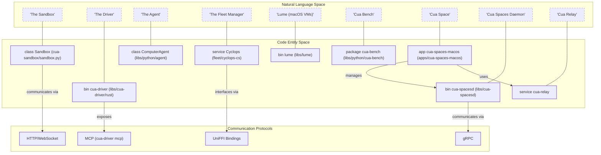
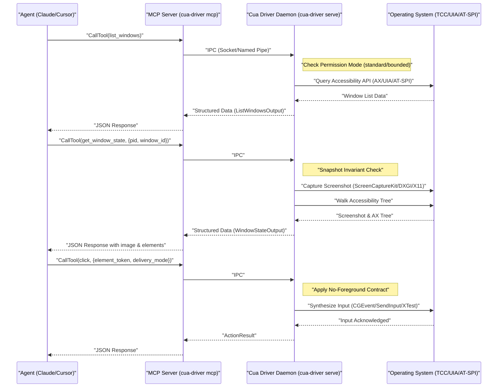

<!-- source: DeepWiki mcp.deepwiki.com · repo trycua/cua · page 18 Glossary · fetched 2026-10-29 -->

# Glossary

Relevant source files

The following files were used as context for generating this wiki page:

- [.release-please-manifest.json](.release-please-manifest.json)
- [README.md](README.md)
- [apps/cua-spaces-macos/Sources/CuaSpacesMacKit/Models/DevicesModel.swift](apps/cua-spaces-macos/Sources/CuaSpacesMacKit/Models/DevicesModel.swift)
- [img/card-cua-bench.gif](img/card-cua-bench.gif)
- [img/card-cua-bench.png](img/card-cua-bench.png)
- [img/card-cua-driver.gif](img/card-cua-driver.gif)
- [img/card-cua-driver.png](img/card-cua-driver.png)
- [img/card-cua-fleets.gif](img/card-cua-fleets.gif)
- [img/card-cua-fleets.png](img/card-cua-fleets.png)
- [img/card-cua-lume.gif](img/card-cua-lume.gif)
- [img/card-cua-lume.png](img/card-cua-lume.png)
- [img/card-cua-products.gif](img/card-cua-products.gif)
- [img/card-cua-products.png](img/card-cua-products.png)
- [img/card-cua-s1.gif](img/card-cua-s1.gif)
- [img/card-cua-spaces-wide.gif](img/card-cua-spaces-wide.gif)
- [img/cua-spaces-demo.mp4](img/cua-spaces-demo.mp4)
- [libs/cua-driver/python/pyproject.toml](libs/cua-driver/python/pyproject.toml)
- [libs/cua-driver/python/src/cua_driver/__init__.py](libs/cua-driver/python/src/cua_driver/__init__.py)
- [libs/cua-driver/rust/CHANGELOG.md](libs/cua-driver/rust/CHANGELOG.md)
- [libs/cua-driver/rust/Cargo.lock](libs/cua-driver/rust/Cargo.lock)
- [libs/cua-driver/rust/Cargo.toml](libs/cua-driver/rust/Cargo.toml)
- [libs/cua-driver/rust/Skills/cua-driver/SKILL.md](libs/cua-driver/rust/Skills/cua-driver/SKILL.md)
- [libs/cua-driver/rust/VERSION](libs/cua-driver/rust/VERSION)
- [libs/cua-driver/typescript/package-lock.json](libs/cua-driver/typescript/package-lock.json)
- [libs/cua-driver/typescript/package.json](libs/cua-driver/typescript/package.json)
- [libs/cua-spacesd/CHANGELOG.md](libs/cua-spacesd/CHANGELOG.md)
- [libs/cua-spacesd/Cargo.lock](libs/cua-spacesd/Cargo.lock)
- [libs/cua-spacesd/Cargo.toml](libs/cua-spacesd/Cargo.toml)
- [libs/cua-spacesd/VERSION](libs/cua-spacesd/VERSION)
- [libs/cua-spacesd/tests/spaces-e2e/Cargo.lock](libs/cua-spacesd/tests/spaces-e2e/Cargo.lock)
- [libs/cua-spacesd/tests/spaces-e2e/Cargo.toml](libs/cua-spacesd/tests/spaces-e2e/Cargo.toml)
- [libs/cua-spacesd/tests/spaces-e2e/tests/relay_devices.rs](libs/cua-spacesd/tests/spaces-e2e/tests/relay_devices.rs)
- [libs/cua-spacesd/tests/teleport-e2e/Cargo.lock](libs/cua-spacesd/tests/teleport-e2e/Cargo.lock)

This glossary provides technical definitions for codebase-specific terms, abbreviations, and domain concepts within the Cua ecosystem. It serves as a reference for onboarding engineers to bridge the gap between high-level architectural concepts and their implementations in code.

## Core Framework Concepts

### CUA (Computer-Use Agent)
The primary domain of the project. A CUA is an autonomous agent capable of interacting with a graphical user interface (GUI) or shell environment to complete tasks. The `cua-agent` package provides the high-level logic for these agents, while the `cua-computer` and `cua-sandbox` packages provide the interfaces to the execution environments.
- **Implementation**: The `cua-agent` Python package is defined in [libs/python/agent/pyproject.toml:6-8]().
- **Sources**: [libs/python/agent/pyproject.toml:6-8](), [README.md:67]()

### MCP (Model Context Protocol)
A protocol used to connect AI models to external tools and data sources. Cua implements MCP servers to expose computer-use capabilities (like clicking, typing, and screenshots) to models.
- **Implementation**: `cua-driver` exposes 58 MCP tools through a single stdio server (`cua-driver mcp`) [docs/content/docs/reference/cua-driver/mcp-tools.mdx:19-20]().
- **Sources**: [docs/content/docs/reference/cua-driver/mcp-tools.mdx:19-20]()

### SOM (Set-of-Mark)
A visual grounding technique where the agent is provided with a screenshot containing numbered overlays (marks) on interactive elements. This helps models accurately identify and target specific UI components.
- **Package**: `cua-som` is a Python package.
- **Sources**: [libs/python/agent/pyproject.toml:40-42]()

### Trajectory
A serialized recording of an agent's session, including the sequence of observations (screenshots), thoughts (reasoning), and actions (tool calls) taken to reach a goal.
- **Usage**: Used for debugging, evaluation in `cua-bench`, and RL training. `cua-driver` supports rendering these to MP4 via `cua-driver recording render` [docs/content/docs/reference/cua-driver/cli-reference.mdx:181-184]().
- **Sources**: [README.md:54](), [docs/content/docs/reference/cua-driver/cli-reference.mdx:181-184]()

### AppEntry
A schema definition within `cua-sandbox-apps` that defines how an application is discovered, installed, and launched within a sandbox environment.
- **Sources**: [README.md:154-162]()

### Action Ladder
The prioritized strategy for performing an action. Agents are instructed to start with the narrowest semantic route (e.g., a direct API or CLI call) before escalating to background accessibility actions, and finally foreground desktop fallbacks.
- **Sources**: [libs/cua-driver/rust/Skills/cua-driver/SKILL.md:37-49]()

---

## Execution & Virtualization

### Lume
A Swift-based virtualization manager for macOS (Apple Silicon). It uses Apple's `Virtualization.framework` to run macOS and Linux VMs with near-native performance.
- **Key Class**: `LumeController` manages the VM lifecycle.
- **Sources**: [README.md:48-50]()

### LUME_METAL_APPLE_FAMILY_MAX
An environment variable used with the Lume Metal capability shim to override the reported GPU family support inside a VM, enabling GPU-accelerated ML workloads.
- **Sources**: [README.md:154-162]()

### Lumier / KASM
Refers to Docker-based execution environments. `Lumier` is a specific container image setup used for Linux-based computer use, often utilizing KASM-based images for high-performance VNC/NoVNC desktop streaming.
- **Sources**: [libs/python/computer/pyproject.toml:27-28]()

### cua-sandbox
The Python SDK for managing ephemeral or persistent execution environments. It abstracts away whether the "sandbox" is a local Docker container, a QEMU VM, or a Cua Cloud instance.
- **Key Methods**: `Sandbox.ephemeral()` creates short-lived environments.
- **Sources**: [README.md:79-85](), [libs/python/cua-sandbox/pyproject.toml:2-4]()

### CloudTransport / FleetTransport
Communication layers used when a `Sandbox` instance connects to a remote environment. `FleetTransport` interfaces with the Cyclops infrastructure for managing pools of sandboxes.
- **Sources**: [libs/python/cua-sandbox/pyproject.toml:32-32](), [libs/python/cua-sandbox/cua_sandbox/transport/fleet_cloud.py:1-20]()

### VirtioFS
A shared file system for virtual machines that allows the guest OS to access a directory on the host with high performance. Used in Lume to share files between the host Mac and the guest VM.
- **Sources**: [README.md:133-135]()

### APFS Clonefile
A macOS-specific filesystem feature used by Lume to create "instant" copies of VM disk images without consuming additional disk space initially (copy-on-write).
- **Sources**: [README.md:133-135]()

---

## OS Drivers & Interaction

### cua-driver
A background computer-use driver. Unlike standard automation, `cua-driver` aims to interact with applications without stealing the user's active cursor or window focus.
- **Rust Implementation (`cua-driver-rs`)**: The cross-platform port (Linux, Windows, macOS) [libs/cua-driver/rust/Cargo.toml:1-17]().
- **Sources**: [README.md:89-91](), [libs/cua-driver/rust/Cargo.toml:1-17]()

### TCC (Transparency, Consent, and Control)
The macOS security framework that manages permissions for Accessibility, Screen Recording, and Full Disk Access. `cua-driver` must handle these permissions to drive native apps.
- **Sources**: [docs/content/docs/reference/cua-driver/cli-reference.mdx:21-21](), [docs/content/docs/reference/cua-driver/mcp-tools.mdx:25-27]()

### UIA (UI Automation)
The Microsoft UI Automation framework used by `cua-driver` on Windows for inspecting and interacting with UI elements.
- **Sources**: [libs/cua-driver/rust/Cargo.toml:9-9]()

### UIPI (User Interface Privilege Isolation)
A Windows security feature that prevents lower-privilege processes from sending messages to higher-privilege processes. `cua-driver-rs` handles this via specialized UIAccess workers (`cua-driver-uia`).
- **Sources**: [libs/cua-driver/rust/Cargo.toml:9-9]()

### AT-SPI (Assistive Technology Service Provider Interface)
The Linux accessibility framework used by `cua-driver` for inspecting and interacting with UI elements on Linux desktop environments.
- **Sources**: [libs/cua-driver/rust/Cargo.toml:12-12]()

### PTY (Pseudo-Terminal)
Used within `cua-computer-server` to wrap terminal engines, allowing agents to interact with interactive shell sessions as if they were in a real terminal.
- **Sources**: [libs/python/computer-server/pyproject.toml:28-29]()

### No-Foreground Contract
A design principle for `cua-driver` where agents click, type, and verify without stealing the cursor or focus from the human user.
- **Sources**: [README.md:91](), [libs/cua-driver/rust/Skills/cua-driver/SKILL.md:67-69]()

### Bounded Mode / Capability Manifest
A security configuration for `cua-driver` that limits the agent's tools and resource access to a pre-defined "ceiling" specified in a manifest.
- **Sources**: [docs/content/docs/reference/cua-driver/cli-reference.mdx:99-101]()

### Delivery Mode
Specifies how input actions (like clicks or key presses) are delivered to the target application. Options include `background` (non-intrusive) and `foreground` (takes focus).
- **Sources**: [libs/cua-driver/python/src/cua_driver/__init__.py:72]()

### Element Token
A unique identifier for an interactive UI element within a specific snapshot of an application's accessibility tree. These tokens are ephemeral and tied to a snapshot.
- **Sources**: [docs/content/docs/reference/cua-driver/mcp-tools.mdx:62-63]()

### Snapshot Invariant
The mandatory requirement for agents using `cua-driver` to call `get_window_state` once per turn before any element-indexed action to ensure the index map matches the current UI state.
- **Sources**: [docs/content/docs/reference/cua-driver/mcp-tools.mdx:62-63](), [libs/cua-driver/rust/Skills/cua-driver/SKILL.md:34-37]()

---

## Fleet & Infrastructure

### Cyclops
The Go-based backend (`cyclops-cs`) for managing fleets of sandboxes at scale. It handles pool lifecycle management and OSGymSandboxClaim resources.
- **Sources**: [libs/python/cua-sandbox/cua_sandbox/transport/cyclops_http_client.py:1-10]()

### OSGymSandboxClaim / OSGymWorkspacePool
Custom Resources (CRs) used in the Fleet infrastructure to manage and claim sandboxed environments for agent tasks. `OSGymSandboxClaim` represents a request for a sandbox, while `OSGymWorkspacePool` manages a collection of available sandboxes.
- **Sources**: [libs/fleet/sdk/src/pools.rs:1-15]()

### UniFFI
A tool used to generate multi-language bindings (Python, Kotlin, Swift, Ruby, TypeScript) from core logic (like the Cyclops SDK) written in Rust.
- **Sources**: [libs/cua-driver/rust/Cargo.toml:42-42](), [libs/fleet/scripts/generate-sdk-bindings.sh:1-10]()

---

## Benchmarking & Training

### cua-bench
A framework for evaluating CUAs. It supports standard benchmarks like OSWorld and ScreenSpot.
- **CLI**: `cb`
- **Sources**: [README.md:54]()

### cua-bench-s1
A closed-option GUI decision-making benchmark, part of the `libs/cua-bench-s1` research component. It defines `CuaTask` schemas with states, options, and expected outcomes for evaluating specialist models.
- **Sources**: [README.md:113-114]()

### CUA-S1
A family of small, specialized models for computer-use decisions, developed as part of the `libs/cua-s1` research component. Examples include `cua-s1-nano-0.1` (an option-attention classifier) and LoRA adapters on Qwen3.5-4B.
- **Sources**: [README.md:37-39](), [README.md:113-114]()

### Option-Attention Classifier
A type of model within the CUA-S1 family, specifically `cua-s1-nano-0.1`, designed to classify and select options in GUI decision-making tasks.
- **Sources**: [README.md:113-114]()

### GRPO (Group Relative Policy Optimization)
An RL training algorithm used within the Cua ecosystem to fine-tune agents for better computer-use performance.
- **Sources**: [README.md:119-122]()

---

## Other Terms

### OCI (Open Container Initiative)
A set of specifications for container image formats and runtimes. Used in Cua for defining and distributing VM/container images, particularly for Lume and Docker providers.
- **Sources**: [README.md:133-135]()

### XFCE image
A Docker image containing the XFCE desktop environment, often used as a base for sandboxed Linux environments in Cua.
- **Sources**: [README.md:154-162]()

### cua-auto
A cross-platform automation library used for low-level mouse, keyboard, and screen interactions. It's a dependency of `cua-sandbox`.
- **Sources**: [libs/python/cua-sandbox/pyproject.toml:31-31]()

### Metal capability shim
An experimental component for Lume that modifies the reported Metal capabilities within a macOS VM, potentially enabling more advanced GPU features for agents.
- **Sources**: [README.md:154-162]()

### Baked installer version
Refers to the version of `cua-driver` that is embedded or pre-packaged within an installer or host application.
- **Sources**: [libs/cua-driver/rust/Skills/cua-driver/SKILL.md:4-4]()

### Release-please component
A configuration entry in `.release-please-manifest.json` that defines a separate versioning and release process for a specific sub-project within the monorepo, such as `libs/cua-driver` or `libs/lume`.
- **Sources**: [.release-please-manifest.json:1-5]()

### Diorama
A specialized testing environment for visual agents, often implying a controlled, reproducible setup for evaluating visual perception and interaction.
- **Sources**: [libs/python/computer/pyproject.toml:27-28]()

### AppEntry
A schema definition within `cua-sandbox-apps` that defines how an application is discovered, installed, and launched within a sandbox environment.
- **Sources**: [README.md:154-162]()

### Sandbox.ephemeral
A method or context manager within the `cua-sandbox` SDK for creating and managing short-lived, temporary sandbox environments that are automatically cleaned up after use.
- **Sources**: [libs/python/cua-sandbox/cua_sandbox/sandbox.py:1-10]()

### CloudTransport
A transport mechanism in `cua-sandbox` for connecting to and interacting with cloud-hosted sandbox environments, typically managed by the Fleet infrastructure.
- **Sources**: [libs/python/cua-sandbox/cua_sandbox/transport/fleet_cloud.py:1-20]()

### FleetTransport
A specific implementation of `CloudTransport` that uses the Fleet API to manage and connect to sandboxes from a pool.
- **Sources**: [libs/python/cua-sandbox/cua_sandbox/transport/fleet_cloud.py:1-20]()

### cuabot
A command-line tool and daemon (`cuabotd`) designed for co-operative computer-use, allowing agents to operate within sandboxed GUI environments, often leveraging Xpra for remote display.
- **Sources**: [README.md:154-162]()

### Space
In the context of Cua Spaces, a "Space" refers to a full desktop environment, typically a macOS or Linux VM, provisioned for agents or human users. These can run locally or on remote machines.
- **Sources**: [README.md:74]()

### Teleport
A feature in Cua Spaces that allows moving a signed-in application (e.g., Chrome, Slack) from the host machine into a Space, preserving the user's session.
- **Sources**: [README.md:76]()

### Keyvault
A secure storage mechanism in Cua Spaces where user sessions (e.g., browser cookies) are encrypted and stored on the local machine, only being released to a Space after user approval.
- **Sources**: [README.md:76]()

### Relay
A component that facilitates communication and management of Spaces, especially when hosting Spaces on a spare Mac or other remote machines. It handles OIDC validation, device enrollment, and session management.
- **Sources**: [apps/cua-spaces-macos/Sources/CuaSpacesMacKit/Models/DevicesModel.swift:1-10]()

### Device Enrollment
The process by which a machine (e.g., a spare Mac) is registered with the Cua system to host Spaces. This involves OIDC validation and approval states.
- **Sources**: [apps/cua-spaces-macos/Sources/CuaSpacesMacKit/Models/DevicesModel.swift:1-10]()

### Machine Token
A token issued during device enrollment that identifies a registered machine and authorizes it to host Spaces and interact with the Cua relay.
- **Sources**: [apps/cua-spaces-macos/Sources/CuaSpacesMacKit/Models/DevicesModel.swift:1-10]()

### cua-spacesd
The daemon running inside a Cua Space (VM) that provides services to agents, such as process management, file access, screenshots, input handling, and streaming.
- **Sources**: [README.md:78]()

---

## Architectural Diagrams

### System Map: Natural Language to Code Entities
Mapping common terms to specific implementation entities.

"System Mapping"

**Sources**: [libs/python/agent/pyproject.toml:6-8](), [libs/cua-driver/rust/Cargo.toml:4-17](), [libs/python/cua-sandbox/pyproject.toml:32-32](), [docs/content/docs/reference/cua-driver/mcp-tools.mdx:19-20](), [libs/lume/README.md](), [libs/python/cua-bench/README.md](), [README.md:74](), [README.md:78](), [apps/cua-spaces-macos/Sources/CuaSpacesMacKit/Models/DevicesModel.swift:1-10]()

### Cua Driver Interaction Flow
How `cua-driver` interacts with the OS and MCP clients.

"Cua Driver Interaction"

**Sources**: [docs/content/docs/reference/cua-driver/mcp-tools.mdx:19-20](), [docs/content/docs/reference/cua-driver/cli-reference.mdx:87-91](), [libs/cua-driver/rust/Cargo.toml:10-13](), [libs/cua-driver/rust/Skills/cua-driver/SKILL.md:67-69](), [docs/content/docs/reference/cua-driver/mcp-tools.mdx:62-63](), [libs/cua-driver/python/src/cua_driver/__init__.py:72]()

---

## Domain Terms Table

| Term | Context | Definition | Code Pointer |
| :--- | :--- | :--- | :--- |
| **Diorama** | Sandbox | A specialized testing environment for visual agents, often implying a controlled, reproducible setup for evaluating visual perception and interaction. | `libs/python/computer` |
| **OCI** | Images | Open Container Initiative; standard for container image formats and runtimes, used for VM/Container images. | [README.md:133-135]() |
| **cuabot** | CLI | A co-op computer-use tool for running agents inside sandboxed GUI environments, often leveraging Xpra. | [README.md:154-162]() |
| **cua-core** | Shared | Common utilities for telemetry and logging, foundational for other Cua packages. | [libs/python/cua-sandbox/pyproject.toml:30-30]() |
| **cua-auto** | Automation | Cross-platform library for low-level mouse, keyboard, and screen automation. | [libs/python/cua-sandbox/pyproject.toml:31-31]()
| **PostHog** | Telemetry | An analytics platform used for tracking agent session and usage events across the Cua ecosystem. | [libs/python/cua-sandbox/pyproject.toml:30-30]() |
| **bump2version**| Dev | A command-line tool used for managing package versioning and releasing new versions. | [libs/python/cua-sandbox/.bumpversion.cfg:1-6]() |
| **Sandbox.ephemeral** | SDK | A method or context manager in `cua-sandbox` for creating and managing short-lived, temporary sandbox environments. | [libs/python/cua-sandbox/cua_sandbox/sandbox.py:1-10]() |
| **Metal capability shim**| Lume | An experimental component for Lume that modifies the reported Metal capabilities within a macOS VM. | [README.md:154-162]() |
| **no-foreground contract** | cua-driver | A design principle for `cua-driver` where agents interact with applications without stealing the user's cursor or window focus. | [libs/cua-driver/rust/Skills/cua-driver/SKILL.md:67-69]() |
| **bounded mode** | cua-driver | A security configuration for `cua-driver` that limits an agent's tools and resource access to a pre-defined ceiling. | [docs/content/docs/reference/cua-driver/cli-reference.mdx:99-101]() |
| **capability manifest** | cua-driver | A document specifying the allowed tools and resources for an agent operating in `bounded mode`. | [docs/content/docs/reference/cua-driver/cli-reference.mdx:101-101]() |
| **delivery mode** | cua-driver | Specifies how input actions are delivered to the target application (e.g., `background` or `foreground`). | [libs/cua-driver/python/src/cua_driver/__init__.py:72]() |
| **element token** | cua-driver | A unique, ephemeral identifier for an interactive UI element within a specific snapshot of an accessibility tree. | [docs/content/docs/reference/cua-driver/mcp-tools.mdx:62-63]() |
| **snapshot invariant** | cua-driver | The rule requiring `get_window_state` to be called before element-indexed actions to ensure UI state consistency. | [docs/content/docs/reference/cua-driver/mcp-tools.mdx:62-63]() |
| **baked installer version** | cua-driver | The version of `cua-driver` that is pre-packaged within an installer or host application. | [libs/cua-driver/rust/Skills/cua-driver/SKILL.md:4-4]() |
| **release-please component** | Dev | A configuration entry defining a separate versioning and release process for a sub-project in the monorepo. | [.release-please-manifest.json:1-5]() |
| **CloudTransport** | cua-sandbox | A transport mechanism for connecting to and interacting with cloud-hosted sandbox environments. | [libs/python/cua-sandbox/cua_sandbox/transport/fleet_cloud.py:1-20]() |
| **FleetTransport** | cua-sandbox | A specific `CloudTransport` implementation using the Fleet API for sandbox management. | [libs/python/cua-sandbox/cua_sandbox/transport/fleet_cloud.py:1-20]() |
| **Cyclops** | Fleet | The Go-based backend for managing fleets of sandboxes at scale. | [libs/python/cua-sandbox/cua_sandbox/transport/cyclops_http_client.py:1-10]() |
| **OSGymSandboxClaim** | Fleet | A Custom Resource (CR) in the Fleet infrastructure representing a request for a sandboxed environment. | [libs/fleet/sdk/src/pools.rs:1-15]() |
| **OSGymWorkspacePool** | Fleet | A Custom Resource (CR) in the Fleet infrastructure managing a collection of available sandboxes. | [libs/fleet/sdk/src/pools.rs:1-15]() |
| **UniFFI** | Cross-language | A tool generating multi-language bindings from Rust core logic. | [libs/cua-driver/rust/Cargo.toml:42-42]() |
| **cua-bench-s1** | Benchmarking | A closed-option GUI decision-making benchmark for specialist models. | [README.md:113-114]() |
| **CUA-S1** | Models | A family of small, specialized models for computer-use decisions. | [README.md:37-39]() |
| **option-attention classifier** | Models | A type of CUA-S1 model (`cua-s1-nano-0.1`) for classifying GUI options. | [README.md:113-114]() |
| **GRPO** | RL Training | Group Relative Policy Optimization, an RL algorithm for fine-tuning agents. | [README.md:119-122]() |
| **XFCE image** | Sandbox | A Docker image containing the XFCE desktop environment for sandboxed Linux GUIs. | [README.md:154-162]() |
| **PTY** | Computer Server | Pseudo-Terminal, used to wrap terminal engines for agent interaction with shell sessions. | [libs/python/computer-server/pyproject.toml:28-29]() |
| **Space** | Cua Spaces | A full desktop environment (macOS or Linux VM) provisioned for agents or human users. | [README.md:74]() |
| **Teleport** | Cua Spaces | Feature to move a signed-in application from the host into a Space, preserving the user's session. | [README.md:76]() |
| **Keyvault** | Cua Spaces | Secure storage for encrypted user sessions (e.g., browser cookies) on the local machine. | [README.md:76]() |
| **Relay** | Cua Spaces | Component facilitating communication and management of Spaces, handling device enrollment and session management. | [apps/cua-spaces-macos/Sources/CuaSpacesMacKit/Models/DevicesModel.swift:1-10]() |
| **Device Enrollment** | Cua Spaces | Process of registering a machine to host Spaces, involving OIDC validation and approval. | [apps/cua-spaces-macos/Sources/CuaSpacesMacKit/Models/DevicesModel.swift:1-10]() |
| **Machine Token** | Cua Spaces | Token issued during device enrollment, authorizing a registered machine to host Spaces. | [apps/cua-spaces-macos/Sources/CuaSpacesMacKit/Models/DevicesModel.swift:1-10]() |
| **cua-spacesd** | Cua Spaces | Daemon running inside a Cua Space (VM) providing services like process management, file access, screenshots, and input. | [README.md:78]() |

**Sources**: [libs/python/cua-sandbox/pyproject.toml:30-32](), [libs/python/cua-sandbox/.bumpversion.cfg:1-6](), [README.md:99-102](), [README.md:154-162](), [libs/python/cua-sandbox/cua_sandbox/sandbox.py:1-10](), [libs/python/cua-sandbox/cua_sandbox/transport/fleet_cloud.py:1-20](), [libs/fleet/sdk/src/pools.rs:1-15](), [libs/cua-driver/rust/Cargo.toml:42-42](), [README.md:113-114](), [README.md:37-39](), [README.md:119-122](), [libs/python/computer-server/pyproject.toml:28-29](), [libs/cua-driver/rust/Skills/cua-driver/SKILL.md:67-69](), [docs/content/docs/reference/cua-driver/cli-reference.mdx:99-101](), [libs/cua-driver/python/src/cua_driver/__init__.py:72](), [docs/content/docs/reference/cua-driver/mcp-tools.mdx:62-63](), [libs/cua-driver/rust/Skills/cua-driver/SKILL.md:4-4](), [.release-please-manifest.json:1-5](), [README.md:74](), [README.md:76](), [apps/cua-spaces-macos/Sources/CuaSpacesMacKit/Models/DevicesModel.swift:1-10](), [README.md:78]()