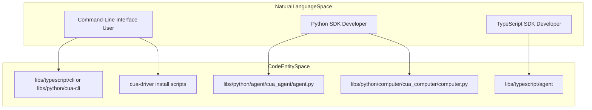
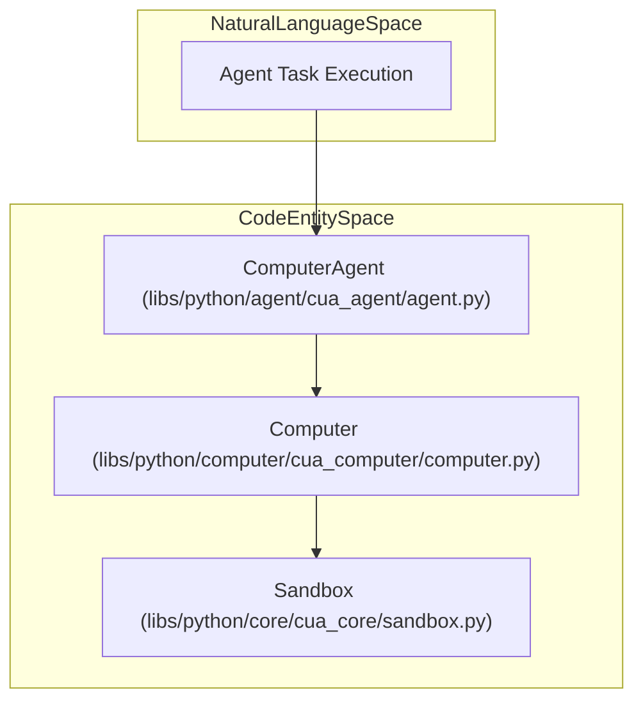

<!-- source: DeepWiki mcp.deepwiki.com · repo trycua/cua · page 2 Getting Started · fetched 2026-10-29 -->

# Getting Started

Relevant source files

The following files were used as context for generating this wiki page:

- [README.md](README.md)
- [img/card-cua-bench.gif](img/card-cua-bench.gif)
- [img/card-cua-bench.png](img/card-cua-bench.png)
- [img/card-cua-driver.gif](img/card-cua-driver.gif)
- [img/card-cua-driver.png](img/card-cua-driver.png)
- [img/card-cua-fleets.gif](img/card-cua-fleets.gif)
- [img/card-cua-fleets.png](img/card-cua-fleets.png)
- [img/card-cua-lume.gif](img/card-cua-lume.gif)
- [img/card-cua-lume.png](img/card-cua-lume.png)
- [img/card-cua-products.gif](img/card-cua-products.gif)
- [img/card-cua-products.png](img/card-cua-products.png)
- [img/card-cua-s1.gif](img/card-cua-s1.gif)
- [img/card-cua-spaces-wide.gif](img/card-cua-spaces-wide.gif)
- [img/cua-spaces-demo.mp4](img/cua-spaces-demo.mp4)

This page serves as the parent section for installation and quick-start guides across the various interfaces provided by the Cua framework. Cua supports multiple pathways for interacting with computer-use agents, including command-line interfaces, Python SDKs, and TypeScript SDKs [docs/content/docs/index.mdx:12-30]().

For deep technical details, installation manifests, and advanced environment configurations, please refer to the dedicated child pages linked below.

---

## Setup Overview

The Cua framework bridges natural language instructions with real or virtualized machine control interfaces. Users can choose between managing machines via CLI tools or building autonomous agent loops programmatically using the Python or TypeScript SDKs. The system also integrates core components like the background automation driver (`cua-driver`) for host platforms and sandbox VM management (via Lume). These components collaborate to provide a seamless experience for agent-driven computer use [docs/content/docs/index.mdx:6-30](), [README.md:10-66]().

### Diagram: User Interfaces to Code Entity Mapping

This diagram maps natural language user roles to their corresponding code artifacts, illustrating how users interact with core packages by interface type.

Sources: [docs/content/docs/index.mdx:12-30](), [README.md:10-66]()

---

## 2.1. Installation and Setup

Getting started with Cua involves configuring your local development environment and installing necessary dependencies across platforms (macOS, Windows, Linux). The setup process typically involves:

- Installing workspace managers and package managers: `uv` for Python, `pnpm` for TypeScript, and Rust toolchains via `cargo`
- Cloning the repository to get the full environment
- Setting environment variables to configure API keys such as `CUA_API_KEY`, `ANTHROPIC_API_KEY`, and `OPENAI_API_KEY`
- Following platform-specific installation scripts, e.g., `cua-driver` installers for background automation

For detailed instructions on dependency installation, environment variable configuration, and cross-platform setup, see the dedicated child page [Installation and Setup](#2.1) which walks through all steps comprehensively.

Sources: [docs/content/docs/tutorials/drive-your-first-app.mdx:32-117](), [docs/content/docs/how-to-guides/driver/install.mdx:1-50]()

---

## 2.2. Quick Start: CLI

The command-line interface (CLI) is often the fastest way to interact with Cua. The CLI tool (`cua-cli` for Python, `@trycua/cli` for TypeScript) enables users to:

- Authenticate with API keys or tokens
- Manage sandboxes and spaces: create, list, start, stop, attach via VNC streaming
- Operate background computer-use agents via the `cua-driver` daemon on the host machine

Getting your first sandbox running, managing your agent sessions, and connecting to live desktops are all supported directly in the CLI interfaces. The CLI abstracts much of the complexity involved with managing agent environments and sessions.

Refer to the child page [Quick Start: CLI](#2.2) for a step-by-step tutorial on installation, authentication, sandbox lifecycle commands, and first agent interactions.

Sources: [docs/content/docs/index.mdx:72](), [docs/content/docs/tutorials/drive-your-first-app.mdx:32-117]()

---

## 2.3. Quick Start: Python SDK

The Python SDK offers programmatic access to Cua’s agent and sandbox components, ideal for building autonomous agents and machine interaction workflows. Key SDK classes include:

- `ComputerAgent`: orchestrates agent loops and decision-making processes
- `Computer`: represents target machines or sandboxes where actions will be executed
- `Sandbox`: environment abstractions for ephemeral or persistent VM-based sandboxes

Developers use the Python SDK to initialize agent loops, interact with vision-language grounding models, and orchestrate sandbox lifecycle events with rich APIs.

### Diagram: Python SDK Agent Workflow

Users build tasks that map to agent invocation patterns, interacting with computers and sandboxes programmatically.

For detailed usage patterns, API references, and samples, refer to [Quick Start: Python SDK](#2.3).

Sources: [docs/content/docs/index.mdx:32-36](), [docs/content/docs/tutorials/drive-your-first-app.mdx:1-20]()

---

## 2.4. Quick Start: TypeScript SDK

The TypeScript SDK brings Cua’s computer and agent abstractions to Node.js and TypeScript development environments, wrapping Rust SDKs with UniFFI bindings for type safety and async operations. This SDK exposes:

- Agent primitives under `@trycua/agent`
- Computer control libraries via `@trycua/computer`
- CLI and transport integrations supporting sandbox management and streaming desktop control

The TypeScript SDK targets web-based and Node.js developers who need rich integration points to control Cua Sandboxes and interact with agents.

For instructions on package installation, configuration, and sample programs, see [Quick Start: TypeScript SDK](#2.4).

Sources: [docs/content/docs/index.mdx:12-30]()

---

# Summary

This "Getting Started" parent section provides the roadmap and high-level integration overview to begin working with Cua’s powerful computer-use automation technology. The CLI, Python SDK, and TypeScript SDK form the primary user-facing interfaces for authentication, sandbox lifecycle, and agent programming.

Each child page below maps directly to one interface or setup step:

| Section                     | Description                                                                                  |
|-----------------------------|----------------------------------------------------------------------------------------------|
| 2.1 Installation and Setup  | Full guides to set up development environments, install dependencies, and configure APIs      |
| 2.2 Quick Start: CLI        | Walkthrough on using the command-line interface, auth, sandbox management, and workflows      |
| 2.3 Quick Start: Python SDK | Agent and sandbox programming with Python classes `ComputerAgent`, `Computer`, and `Sandbox` |
| 2.4 Quick Start: TypeScript SDK | Using the TypeScript ecosystem to manage agents and sandbox interactions                         |

This layered approach lets users pick the best interface to fit their needs, whether via terminal commands or custom agent code.

Sources: [docs/content/docs/index.mdx:12-30](), [docs/content/docs/tutorials/drive-your-first-app.mdx:1-117](), [README.md:10-66]()

---

