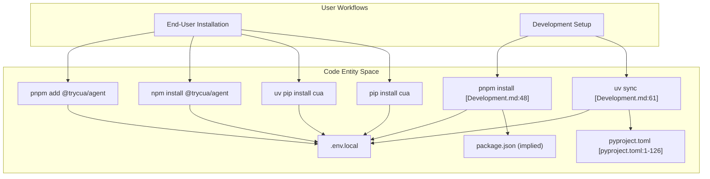
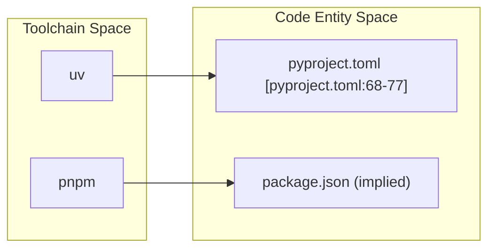
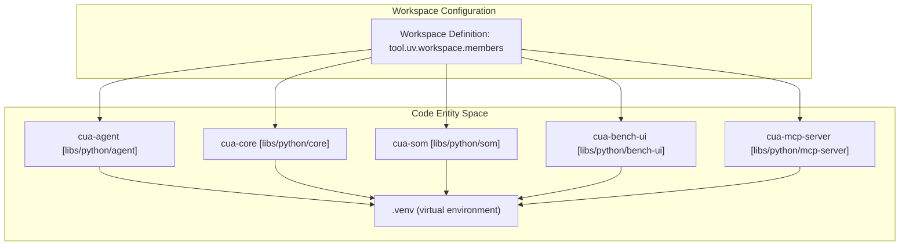
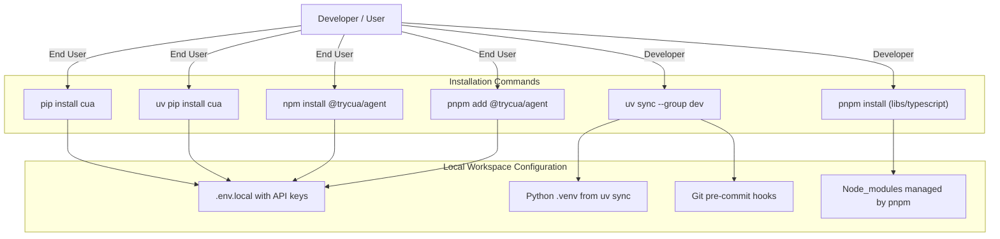

<!-- source: DeepWiki mcp.deepwiki.com · repo trycua/cua · page 2.1 Installation and Setup · fetched 2026-10-29 -->

# Installation and Setup

<details>
<summary>Relevant source files</summary>

The following files were used as context for generating this wiki page:

- [.editorconfig](.editorconfig)
- [.pre-commit-config.yaml](.pre-commit-config.yaml)
- [.prettierignore](.prettierignore)
- [.prettierrc.yaml](.prettierrc.yaml)
- [.vscode/extensions.json](.vscode/extensions.json)
- [.vscode/settings.json](.vscode/settings.json)
- [CONTRIBUTING.md](CONTRIBUTING.md)
- [Development.md](Development.md)
- [examples/streaming/typescript-node/package-lock.json](examples/streaming/typescript-node/package-lock.json)
- [examples/streaming/typescript-web/package-lock.json](examples/streaming/typescript-web/package-lock.json)
- [libs/cua-bench-rl/uv.lock](libs/cua-bench-rl/uv.lock)
- [libs/cua-bench/uv.lock](libs/cua-bench/uv.lock)
- [libs/cua/python/uv.lock](libs/cua/python/uv.lock)
- [libs/python/cua-sandbox-apps/uv.lock](libs/python/cua-sandbox-apps/uv.lock)
- [nix/cua-driver/compositor/cua_compositor_patch.py](nix/cua-driver/compositor/cua_compositor_patch.py)
- [package.json](package.json)
- [pnpm-lock.yaml](pnpm-lock.yaml)
- [pyproject.toml](pyproject.toml)
- [samples/openkoalabot-example-ts/package-lock.json](samples/openkoalabot-example-ts/package-lock.json)
- [uv.lock](uv.lock)

</details>


This page covers installing the Cua SDKs (Python and TypeScript), setting up the workspace environment using `uv` and `pnpm`, configuring environment variables, and establishing API keys. For detailed information on specific virtual machine or container providers, see [Provider Architecture](/docs/execution-environments).

---

## Overview

Cua is organized as a monorepo containing Python, TypeScript, Rust, and Swift packages [Development.md:3-24](). Setting up the codebase depends on your use case:

1. **End-User Installation**: Installing published packages directly via package managers like `pip`, `uv`, or `npm`.
2. **Development Workspace Setup**: Cloning the source repository and using workspace tools (`uv` for Python and `pnpm` for TypeScript) to build, test, and develop locally [Development.md:27-61]().

### Core Installation Requirements
* **Python Environment**: Python 3.12 or 3.13 is required for the core execution components, including `cua-computer` and `cua-agent` [pyproject.toml:11](), [uv.lock:3]().
* **Node.js Environment**: Node.js and `pnpm` are required for building TypeScript packages, `cuabot`, and documentation [Development.md:39](), [package.json:1-10]() (implied).
* **Package Management Tools**: `uv` manages the shared Python virtual environment and cross-package dependencies [Development.md:38, 60-61](), while `pnpm` handles the Node.js monorepo workspace [Development.md:48-50]().
* **Environment Variables**: API keys for LLM providers (e.g., Anthropic, OpenAI) and Cua Cloud are maintained via local configuration files [Development.md:52-54]().

### System Architecture Setup Flow

The following diagram maps the installation and configuration flow from high-level user choices to specific codebase entities and configuration files.

#### Diagram: Installation and Configuration Data Flow


Sources: [pyproject.toml:1-126](), [Development.md:1-85](), inferred package.json

---

## Prerequisites

### System Requirements

| Component    | Requirement          | Role in Ecosystem                                         |
|--------------|----------------------|-----------------------------------------------------------|
| **Python**   | `>=3.12, <3.14`      | Runs the Agent loops and computer abstraction layer [pyproject.toml:11](), [uv.lock:3](). |
| **Node.js**  | Required             | Powers the TypeScript SDK, CuaBot, and documentation [Development.md:39](). |
| **Rust**     | Required             | Needed for `cua-driver` development and core components [Development.md:40](). |
| **Swift/Xcode** | macOS only         | Required for Lume (macOS Virtualization) development [Development.md:41](). |

Sources: [pyproject.toml:11](), [uv.lock:3](), [Development.md:36-42]()

### Package Installation Tools

#### Python: uv

`uv` is used to manage the Python monorepo workspace and create its virtual environments. It offers fast resolution and manages multiple internal dependencies consistently across packages. The Python workspace members are defined in `pyproject.toml` under the `[tool.uv.workspace.members]` section.

#### TypeScript: pnpm

Node.js dependencies are orchestrated with `pnpm` (recommended version 9.0.4+). `pnpm` enables efficient caching and workspace management for TypeScript packages, CuaBot, and front-end components.

#### Rust Toolchain

Rust is required mainly for building `cua-driver` and Rust-based core crates. The required Rust version is pinned in `rust-toolchain.toml` (not shown here but referenced) [Development.md:40]().

#### Swift Toolchain

For macOS users developing or building Lume VM management tools, Swift and Xcode command-line tools are prerequisites [Development.md:41]().

#### Mapping Toolchains to Configuration Files

#### Diagram: Toolchain to Configuration Mapping


Sources: [Development.md:38-50](), [pyproject.toml:60-77](), inferred package.json

---

## Python SDK Installation

The Python SDK comprises several loosely coupled packages within `libs/python/*` managed by `uv` in a workspace environment. This setup supports both end-user installs and development workflows.

### Workspace Python Packages

| Package Name       | Location                | Responsibility                                          |
|--------------------|-------------------------|---------------------------------------------------------|
| `cua-agent`        | `libs/python/agent`     | AI interaction loops and model adapter logic             |
| `cua-core`         | `libs/python/core`      | Core utilities and telemetry                              |
| `cua-som`          | `libs/python/som`       | Set-of-Mark visual grounding utilities                   |
| `cua-bench-ui`     | `libs/python/bench-ui`  | Benchmark and UI libraries                                |
| `cua-mcp-server`   | `libs/python/mcp-server`| MCP server backend                                        |
| Other packages      | Various subdirectories  | See `pyproject.toml` and the workspace member list       |

These are listed as members in the `uv` workspace under `[tool.uv.workspace.members]` in `pyproject.toml` [pyproject.toml:64-70](), [Development.md:44-46]().

### End-User Installation

To install the unified Python package for runtime use:

```bash
pip install cua
# Or with uv for faster installs and workspace management
uv pip install cua
```

These commands install published packages from PyPI or the configured wheel repository.

### Development Setup

For development and local modification:

```bash
git clone https://github.com/trycua/cua.git
cd cua

# Install with dev dependencies
uv sync --group dev

# Optionally install pre-commit Git hooks
uv run pre-commit install
```

This creates a `.venv` virtual environment with all workspace members installed in editable mode. You can inspect or modify packages in `libs/python/*` and run tests locally [Development.md:27-32, 61]().

#### Diagram: Python Workspace Entity Mapping


Sources: [pyproject.toml:64-77](), [Development.md:44-46](), [uv.lock:13-25]()

---

## TypeScript SDK Installation

The TypeScript SDK modules are managed under `libs/typescript/`.

### End-User Installation

Install from npm or pnpm as follows:

```bash
# Using npm
npm install @trycua/agent @trycua/computer

# Using pnpm
pnpm add @trycua/agent @trycua/computer
```

### Development Setup

For local development and testing of the TypeScript packages:

```bash
# At repository root (installs prettier and root dependencies)
pnpm install

# Inside the TypeScript directory (install specific dependencies)
cd libs/typescript
pnpm install
```

This setup enables workspace-aware builds and testing for TypeScript packages [Development.md:48-50]().

Sources: [Development.md:48-50](), inferred package.json

---

## Environment Configuration

### API Key Setup

Cua uses environment variables for API keys and runtime configuration. Create a `.env.local` or `.env` file in your repository root to hold keys for LLM providers and Cua Cloud access.

Example `.env.local`:

```bash
# Anthropic LLM API key
ANTHROPIC_API_KEY=your_anthropic_api_key_here

# OpenAI LLM API key
OPENAI_API_KEY=your_openai_api_key_here

# Cua Cloud API key
CUA_API_KEY=your_cua_cloud_api_key_here
```

These variables are automatically loaded by the Python and TypeScript SDKs when running locally via `uv` or `pnpm` tooling [Development.md:52-54](). 

Never commit your API keys to public repositories.

Sources: [Development.md:52-54](), [pyproject.toml:4-6]()

---

## Formatting and Linting

Cua uses a comprehensive pre-commit hook system for code quality that handles Python and TypeScript formatting and linting [Development.md:58-74]().

### Installing Git Hooks

```bash
uv run pre-commit install
```

### Running All Hooks Manually

```bash
uv run pre-commit run --all-files
```

### Pre-Commit Hooks Overview

| Tool         | Purpose                                 | Source                             |
|--------------|-----------------------------------------|----------------------------------|
| Prettier     | TypeScript/JavaScript/JSON/Markdown formatting | `.pre-commit-config.yaml:2-10`   |
| TypeScript Type Check | Static typing with pnpm workspace   | `.pre-commit-config.yaml:14-18`  |
| isort        | Python import sorting                   | `.pre-commit-config.yaml:21-27`  |
| Black        | Python code formatting                  | `.pre-commit-config.yaml:29-34`  |
| Ruff         | Python linting and autofixing           | `.pre-commit-config.yaml:36-42`  |

Maintain consistent code style and quality by running pre-commit hooks before pushing changes.

Sources: [Development.md:58-74](), [.pre-commit-config.yaml:1-50](), [pyproject.toml:87-125]()

---

# Summary Diagram: User Installation and Setup Lifecycle



---

This completes the Installation and Setup instructions for the Cua codebase, providing end-user package installation, development workspace setup, environment variable configuration, and tooling integration.

Sources:  
- [Development.md:1-97]()  
- [pyproject.toml:1-126]()  
- [uv.lock:1-90]()  
- [.pre-commit-config.yaml:1-50]()  
- inferred: package.json and pnpm usage from project conventions

---

