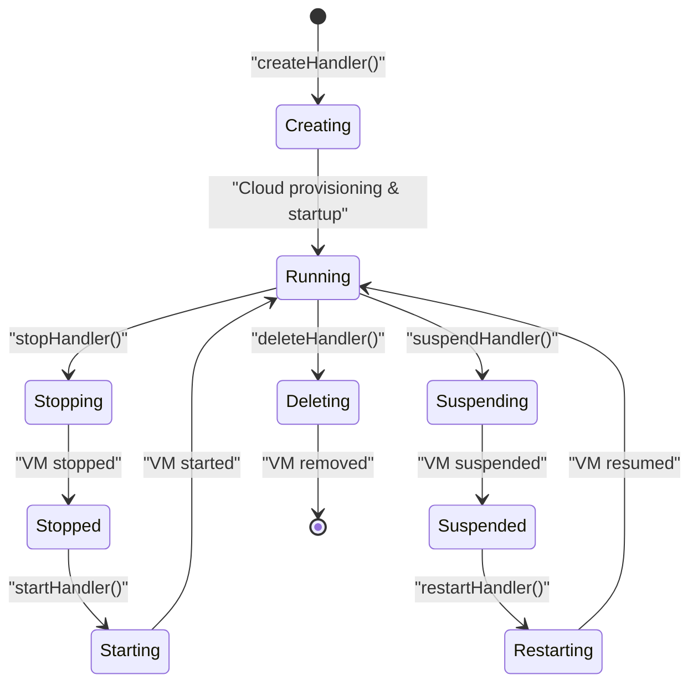
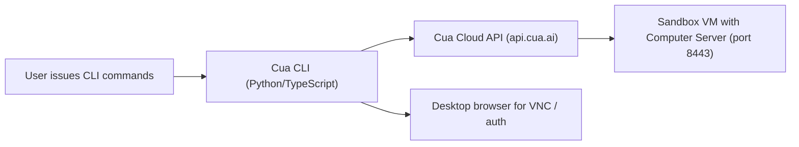
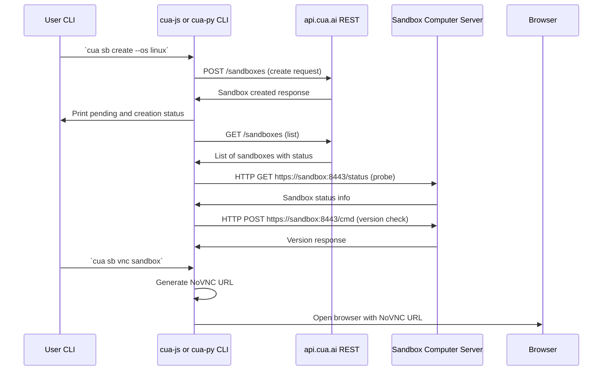

<!-- source: DeepWiki mcp.deepwiki.com · repo trycua/cua · page 2.2 Quick Start: CLI · fetched 2026-10-29 -->

# Quick Start: CLI

<details>
<summary>Relevant source files</summary>

The following files were used as context for generating this wiki page:

- [README.md](README.md)
- [img/card-cua-bench.gif](img/card-cua-bench.gif)
- [img/card-cua-bench.png](img/card-cua-bench.png)
- [img/card-cua-driver.gif](img/card-cua-driver.gif)
- [img/card-cua-driver.png](img/card-cua-driver.png)
- [img/card-cua-fleets.gif](img/card-cua-fleets.gif)
- [img/card-cua-fleets.png](img/card-cua-fleets.png)
- [img/card-cua-lume.gif](img/card-cua-lume.gif)
- [img/card-cua-lume.png](img/card-cua-lume.png)
- [img/card-cua-products.gif](img/card-cua-products.gif)
- [img/card-cua-products.png](img/card-cua-products.png)
- [img/card-cua-s1.gif](img/card-cua-s1.gif)
- [img/card-cua-spaces-wide.gif](img/card-cua-spaces-wide.gif)
- [img/cua-spaces-demo.mp4](img/cua-spaces-demo.mp4)
- [libs/cua/CHANGELOG.md](libs/cua/CHANGELOG.md)
- [libs/cua/VERSION](libs/cua/VERSION)
- [libs/cua/python/pyproject.toml](libs/cua/python/pyproject.toml)
- [libs/cua/python/src/cua/__init__.py](libs/cua/python/src/cua/__init__.py)
- [libs/cua/typescript/package-lock.json](libs/cua/typescript/package-lock.json)
- [libs/cua/typescript/package.json](libs/cua/typescript/package.json)

</details>


## Purpose and Scope

This page documents the Cua command-line interface (`cua`), the primary tool for managing authentication, cloud sandboxes, and agent workflows. The `cua` CLI is implemented in two versions: a Python-based CLI (`cua-cli`) and a TypeScript-based CLI (`@trycua/cli`).

> [!IMPORTANT]
> The TypeScript CLI package (`@trycua/cli`) is deprecated in favor of the Python CLI, which provides better integration and more frequent updates. Users should migrate to the Python CLI (`pip install cua-cli`) [libs/typescript/cua-cli/package.json:1-6](), [libs/typescript/cua-cli/README.md:1-10]().

Sources: [libs/python/cua-cli/pyproject.toml:1-5](), [libs/typescript/cua-cli/package.json:1-6](), [libs/typescript/cua-cli/README.md:1-10]()


## Installation

### Python CLI (Recommended)

The Python CLI is the recommended and primary interface to interact with Cua. It requires Python 3.12 or later [libs/python/cua-cli/pyproject.toml:27]().

```bash
pip install cua-cli
```

For full feature support including MCP server and skill recording, install with extras:

```bash
pip install "cua-cli[all]"
```

Sources: [libs/python/cua-cli/pyproject.toml:1-61]()

### TypeScript CLI (Deprecated)

The TypeScript CLI is deprecated but still available for use. It can be installed with Bun or npm [libs/typescript/cua-cli/README.md:12-28]():

```bash
bun add -g @trycua/cli
# OR
npm install -g @trycua/cli
```

Sources: [libs/typescript/cua-cli/README.md:12-28](), [scripts/install-cli.sh:58-91]()


## CLI Architecture and Command Structure

The `cua` CLI acts as an entry point integrating several core Cua subsystems such as sandbox management, authentication, image management, and skills demonstration.

### High-Level Command Groups

The CLI employs a modular, sub-command architecture organizing functionality into logical groups [libs/typescript/cua-cli/src/cli.ts:1-65]():

| Group        | Sub-commands                                         | Description                                       |
|--------------|-----------------------------------------------------|-------------------------------------------------|
| `auth`       | `login`, `logout`, `env`                            | Manage authentication tokens and environment    |
| `sandbox`/`sb` | `list`, `create`, `get`, `delete`, `start`, `stop`, `vnc` | Provision and control cloud sandboxes (VMs)     |
| `image`/`img` | `list`, `push`, `pull`, `delete`                   | Manage VM images in cloud registry                |
| `skills`     | `record`, `list`, `read`, `replay`, `delete`       | Manage recorded demonstration skills             |
| `serve-mcp`  | (no subcommands)                                     | Launch MCP server for agent integration           |

In the Python CLI, the main entry point is implemented in `cua_cli.main:main` [libs/python/cua-cli/pyproject.toml:77-78](), and in TypeScript in `src/index.ts` [libs/typescript/cua-cli/package.json:23-25]().

### Internal Architecture and Data Flow

```mermaid
graph TB
    subgraph "CLI_Entrypoint"
        PythonMain["cua_cli/main.py"]
        TSMain["src/index.ts"]
        Parser["argparse / yargs"]
    end

    subgraph "CommandModules"
        AuthCmd["src/commands/auth.ts"]
        SandboxCmd["src/commands/sandbox.ts"]
        ImageCmd["src/commands/image.ts"]
        SkillsCmd["src/commands/skills.ts"]
    end

    subgraph "UtilityAndState"
        ConfigStore["src/storage.ts (cli.sqlite)"]
        HTTPClient["src/http.ts -> api.cua.ai"]
        Config["src/config.ts"]
    end

    PythonMain --> Parser
    TSMain --> Parser
    Parser --> AuthCmd
    Parser --> SandboxCmd
    Parser --> ImageCmd
    Parser --> SkillsCmd

    AuthCmd --> ConfigStore
    AuthCmd --> Config
    SandboxCmd --> HTTPClient
    SkillsCmd --> ConfigStore
    ConfigStore --> "cli.sqlite DB"
```

**Explanation:**

- The CLI entrypoint (either Python or TypeScript) parses the command line and dispatches to the appropriate command module.
- Authentication commands interact with local storage and config for token persistence.
- Sandbox commands manage cloud VM provisioning through HTTP API calls to `api.cua.ai` and perform lifecycle actions.
- Image commands manipulate VM images cached/pulled from cloud registries.
- Skills commands record and replay agent demonstrations stored locally.

Sources: [libs/python/cua-cli/pyproject.toml:77-78](), [libs/typescript/cua-cli/src/cli.ts:1-65](), [libs/typescript/cua-cli/package.json:23-25]()


## Authentication

Authentication is essential for cloud sandbox interaction. The CLI supports user login via the browser and manual API key setting.

### Login Flow

1. Invoke `cua auth login`.
2. The CLI opens the default web browser to the Cua authentication portal.
3. Upon success, the CLI receives an access token and refresh token.
4. Tokens are saved securely in local storage (`cli.sqlite`) or environment variables.
5. Users can verify and export environment variables with `cua auth env` which writes `CUA_API_KEY` into a `.env` file for client SDK consumption.

```typescript
// writeEnvFile saves CUA_API_KEY to .env for SDK usage
async function writeEnvFile(apiKey: string) {
  // Write to .env file logic
}
```

Sources: [libs/typescript/cua-cli/src/commands/auth.ts:1-30](), [libs/typescript/cua-cli/src/util.ts:1-13]()


## Sandbox (Space) Management

Sandboxes represent the virtual machines where the agents run. `sandbox` (or shorthand `sb`) commands manage their lifecycle remotely.

### Sandbox State Model



This state machine governs sandbox lifecycle commands and corresponds to the handlers managing VM creation, stopping, starting, suspending, restarting, and deletion [libs/typescript/cua-cli/src/util.ts:15-28](), [libs/typescript/cua-cli/src/commands/sandbox.ts:160-226]().

### Sandbox Probing and Health Checks

When fetching details about a sandbox, the CLI performs active health probes to verify VM status [libs/typescript/cua-cli/src/commands/sandbox.ts:9-141]():

- **Status Probe:** Queries `https://{host}:8443/status` to retrieve OS type, version, and feature flags [libs/typescript/cua-cli/src/commands/sandbox.ts:66-88]().
- **Version Probe:** Executes a POST command `version` at `https://{host}:8443/cmd` to validate compatibility with the Cua protocol [libs/typescript/cua-cli/src/commands/sandbox.ts:91-129]().

### Remote Desktop (VNC) Access

The `vnc` command generates a NoVNC web URL embedding sandbox-specific credentials (password and host) [libs/typescript/cua-cli/src/commands/sandbox.ts:50-53](). It launches the default desktop browser with environment-specific commands (`open` on macOS, `start` on Windows, `xdg-open` on Linux) [libs/typescript/cua-cli/src/util.ts:60-80]().

Sources: [libs/typescript/cua-cli/src/commands/sandbox.ts:50-53](), [libs/typescript/cua-cli/src/util.ts:60-80]()


## Basic CLI Workflow

A typical workflow to start using the CLI for remote sandbox management and automation is:

| Step              | Command                                      | Description                                               |
|-------------------|----------------------------------------------|-----------------------------------------------------------|
| Authentication    | `cua auth login`                              | Login and acquire API credentials for cloud operations    |
| Create Sandbox    | `cua sb create --os linux --size small --region north-america` | Provision a new sandbox VM with specified parameters       |
| List Sandboxes    | `cua sb list`                                | Monitor sandbox status, waiting for `running` state       |
| Open Sandbox GUI  | `cua sb vnc <sandbox-name>`                   | Open the sandbox desktop environment via browser          |
| Export Environment| `cua auth env`                               | Export environment variables for SDK and scripts           |
| Cleanup          | `cua sb delete <sandbox-name>`                | Delete the sandbox when finished                            |

Below diagram illustrates the interaction between user commands, the CLI, cloud API, and the sandbox VM environment.



Sources: [blog/introducing-cua-cli.md:66-183](), [libs/typescript/cua-cli/src/commands/sandbox.ts:9-141]()


## Bridging the Natural Language and Code Entity Spaces

The command-line interface abstractly translates user intent expressed as natural language commands into concrete API calls and system operations within the codebase.

### Diagram 1: From Natural Language "Space" Concepts to Code Commands and Modules

```mermaid
graph TB
    NL["Natural Language Space"]
    Code["Code Entity Space"]

    NL -->|"Create a Space" | CmdCreate["`cua sb create` command"]
    NL -->|"Start/Stop a Space" | CmdLifecycle["`cua sb start` / `cua sb stop` commands"]
    NL -->|"View Space VNC" | CmdVNC["`cua sb vnc` command"]
    NL -->|"Authenticate" | CmdAuth["`cua auth login` command"]

    CmdCreate -->|uses| HandlerCreate["createHandler()"]
    CmdLifecycle -->|uses| HandlerLifecycle["stopHandler()/startHandler()"]
    CmdVNC -->|calls| UtilOpenBrowser["openInBrowser()"]
    CmdAuth -->|calls| AuthStorage["Auth storage & token management"]

    HandlerCreate -->|in| SandboxCmd["sandbox.ts module"]
    HandlerLifecycle -->|in| SandboxCmd
    UtilOpenBrowser -->|in| UtilModule["util.ts utilities"]
    AuthStorage -->|in| AuthModule["auth.ts module"]

    NL -.->|User command input| Code
```

### Diagram 2: Detailed Data Flow in Sandbox Management Command



---

This completes the full technical detail and practical guide to using the Cua CLI for managing authentication, sandboxes, and basic agent workflows.

Sources:  
[libs/python/cua-cli/pyproject.toml:1-61]()  
[libs/typescript/cua-cli/package.json:1-25]()  
[libs/typescript/cua-cli/src/cli.ts:1-65]()  
[libs/typescript/cua-cli/src/commands/auth.ts:1-30]()  
[libs/typescript/cua-cli/src/util.ts:1-80]()  
[libs/typescript/cua-cli/src/commands/sandbox.ts:9-141]()  
[libs/typescript/cua-cli/src/commands/sandbox.ts:160-226]()  
[blog/introducing-cua-cli.md:66-183]()

---

