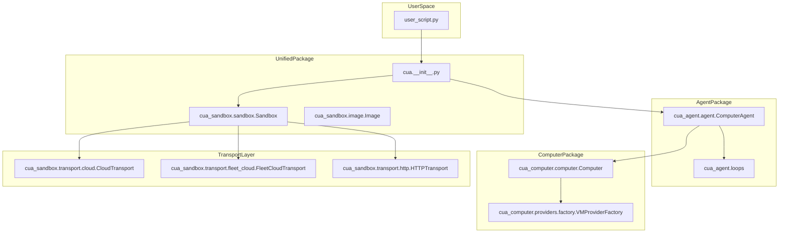

<!-- source: DeepWiki mcp.deepwiki.com · repo trycua/cua · page 2.3 Quick Start: Python SDK · fetched 2026-10-29 -->

# Quick Start: Python SDK

<details>
<summary>Relevant source files</summary>

The following files were used as context for generating this wiki page:

- [Makefile](Makefile)
- [docs/content/docs/cua-sdk/reference/runtime-support.mdx](docs/content/docs/cua-sdk/reference/runtime-support.mdx)
- [libs/python/agent/.bumpversion.cfg](libs/python/agent/.bumpversion.cfg)
- [libs/python/agent/README.md](libs/python/agent/README.md)
- [libs/python/agent/pyproject.toml](libs/python/agent/pyproject.toml)
- [libs/python/core/.bumpversion.cfg](libs/python/core/.bumpversion.cfg)
- [libs/python/core/README.md](libs/python/core/README.md)
- [libs/python/core/pyproject.toml](libs/python/core/pyproject.toml)
- [libs/python/cua-sandbox/CHANGELOG.md](libs/python/cua-sandbox/CHANGELOG.md)
- [libs/python/cua-sandbox/README.md](libs/python/cua-sandbox/README.md)
- [libs/python/cua-sandbox/VERSION](libs/python/cua-sandbox/VERSION)
- [libs/python/cua-sandbox/cua_sandbox/__init__.py](libs/python/cua-sandbox/cua_sandbox/__init__.py)
- [libs/python/cua-sandbox/cua_sandbox/pool.py](libs/python/cua-sandbox/cua_sandbox/pool.py)
- [libs/python/cua-sandbox/cua_sandbox/sandbox.py](libs/python/cua-sandbox/cua_sandbox/sandbox.py)
- [libs/python/cua-sandbox/cua_sandbox/sync/__init__.py](libs/python/cua-sandbox/cua_sandbox/sync/__init__.py)
- [libs/python/cua-sandbox/cua_sandbox/transport/fleet.py](libs/python/cua-sandbox/cua_sandbox/transport/fleet.py)
- [libs/python/cua-sandbox/cua_sandbox/transport/fleet_cloud.py](libs/python/cua-sandbox/cua_sandbox/transport/fleet_cloud.py)
- [libs/python/cua-sandbox/pyproject.toml](libs/python/cua-sandbox/pyproject.toml)
- [libs/python/cua-sandbox/tests/test_fleet_cloud_client.py](libs/python/cua-sandbox/tests/test_fleet_cloud_client.py)
- [libs/python/cua-sandbox/tests/test_fleet_cloud_transport.py](libs/python/cua-sandbox/tests/test_fleet_cloud_transport.py)
- [libs/python/cua-sandbox/tests/test_fleet_sdk_distribution.py](libs/python/cua-sandbox/tests/test_fleet_sdk_distribution.py)
- [libs/python/cua-sandbox/tests/test_fleet_sdk_packaging.py](libs/python/cua-sandbox/tests/test_fleet_sdk_packaging.py)
- [libs/python/cua-sandbox/tests/test_fleet_transport.py](libs/python/cua-sandbox/tests/test_fleet_transport.py)
- [libs/python/cua-sandbox/tests/test_pool.py](libs/python/cua-sandbox/tests/test_pool.py)
- [libs/python/cua-sandbox/tests/test_sandbox_fleet_lifecycle.py](libs/python/cua-sandbox/tests/test_sandbox_fleet_lifecycle.py)
- [libs/python/cua-sandbox/tests/test_vm_cleanup.py](libs/python/cua-sandbox/tests/test_vm_cleanup.py)
- [libs/python/cua-sandbox/uv.lock](libs/python/cua-sandbox/uv.lock)
- [libs/python/som/.bumpversion.cfg](libs/python/som/.bumpversion.cfg)
- [libs/python/som/README.md](libs/python/som/README.md)
- [libs/python/som/pyproject.toml](libs/python/som/pyproject.toml)

</details>


## Purpose and Scope

This page provides practical technical guidance for initializing and using the Cua Python SDK. It covers dependency installation across the core component packages, environment provisioning via the `Sandbox` class, configuring and running a `ComputerAgent`, and understanding the underlying agentic execution loop.

For command-line usage, see [Quick Start: CLI](). For TypeScript environments, see [Quick Start: TypeScript SDK](). For full reference documentation, consult [Computer SDK](), [Sandbox SDK](), and [ComputerAgent SDK]().

Sources: `[libs/python/cua-sandbox/cua_sandbox/sandbox.py:1-28]()`, `[libs/python/agent/pyproject.toml:6-8]()`

---

## Installation & Package Structure

The Cua Python SDK is modular, separating core environment control, sandboxing, and agent orchestration into distinct packages managed through standard dependency tooling (`uv` or `pip`).

| Package        | Role                                                   | Pyproject Configuration                      |
|----------------|--------------------------------------------------------|----------------------------------------------|
| `cua`          | Unified meta-package bridging sandbox and agent layers | `[libs/python/cua/pyproject.toml]()`         |
| `cua-agent`    | AI orchestration, tool registration, and execution loops | `[libs/python/agent/pyproject.toml:6-25]()` |
| `cua-sandbox`  | Ephemeral and persistent sandbox runtimes and transports | `[libs/python/cua-sandbox/pyproject.toml:29-43]()` |
| `cua-computer` | Low-level OS control primitives and VM provider factory | `[libs/python/computer/pyproject.toml:13-21]()` |
| `cua-core`     | Shared utilities, telemetry, and metrics                | `[libs/python/core/pyproject.toml:13-15]()` |

### Recommended Installation Command

```bash
uv pip install cua "cua-agent[all]"
```
The `[all]` extra pulls in provider-specific runtimes for various model providers (Anthropic, OpenAI, Gemini, UI-TARS) and UI integrations.

Sources: `[libs/python/agent/pyproject.toml:13-25]`, `[libs/python/cua-sandbox/pyproject.toml:29-43]`, `[libs/python/core/pyproject.toml:13-15]()`

---

## Python SDK Architecture



**Diagram: Python SDK Package Architecture**

The unified meta-package exposes top-level accessors for both `Sandbox` environment management and `ComputerAgent` orchestration. Beneath the sandbox abstraction, transports (`CloudTransport`, `FleetCloudTransport`, and `HTTPTransport`) handle communication with remote or local execution containers.

Sources: `[libs/python/cua-sandbox/cua_sandbox/sandbox.py:81-90]()`, `[libs/python/cua-sandbox/cua_sandbox/transport/fleet_cloud.py:1-49]()`

---

## Working with Sandboxes and Runtimes

The `Sandbox` class serves as the primary entry point for managing isolated desktop or server environments. It exposes user interfaces such as `.mouse`, `.keyboard`, `.screen`, `.clipboard`, `.shell`, and `.terminal` backed by an active `Transport` instance to communicate with the guest environment [libs/python/cua-sandbox/cua_sandbox/sandbox.py:1-4]().

### Sandbox Provisioning Patterns

1. **Ephemeral Sandboxes:** Automatically provisioned and torn down using an async context manager.

2. **Persistent Sandboxes:** Created explicitly for longer-lived usage and can be connected to by name.

3. **Reconnection:** Connect to existing named sandbox sessions or by URL.

Example:

```python
from cua_sandbox import Image, Sandbox, http

async with Sandbox.ephemeral(
    Image.from_registry("python:3.12-slim"),
    command=["python", "-m", "http.server", "8000"],  # overrides container entrypoint
    services={"web": 8000},              # named guest ports
    wait_for=http("web", "/"),           # readiness probe on service and path
    on="cloud",                          # or "local"; defaults to your default setting
) as sb:
    # Perform requests through service interface
    r = await sb.service("web").request("GET", "/")
    print(r.status_code)

    # Get a public shareable URL (signed URL)
    url = await sb.public_url("web", ttl=3600)

    # Open an ephemeral port-forward tunnel
    async with sb.tunnel.forward(8000) as tunnel:
        print(tunnel.url)

    # Inspect sandbox info and state
    info = await sb.info()
    print(sb.id)
```

Sources: `[libs/python/cua-sandbox/cua_sandbox/sandbox.py:1-45]`, `[libs/python/cua-sandbox/README.md:67-101]()`

---

## ComputerAgent Orchestration and Execution Loop

The `ComputerAgent` class manages the execution of AI-driven instructions targeting a sandboxed or real computer environment. It orchestrates interaction with the language model and dispatches tool invocations (like keyboard input or mouse movement) [libs/python/agent/pyproject.toml:6-8]().

### Initializing and Running an Agent

You instantiate a `ComputerAgent` with the desired model identifier and a list of interface tools such as a `Sandbox` instance. Running the agent involves invoking its asynchronous `.run()` method with a natural language task description, which returns an async generator yielding responses or actions.

Example:

```python
from cua_agent.agent import ComputerAgent

# Assuming `sb` is a connected Sandbox instance
agent = ComputerAgent(
    model="anthropic/claude-3-5-sonnet",
    tools=[sb]
)

async for response in agent.run("Open the settings application"):
    print(response)
```

Sources: `[libs/python/agent/pyproject.toml:6-8]()`, `[libs/python/cua-sandbox/cua_sandbox/sandbox.py:1-28]()`

### Execution Flow and Data Mapping

```mermaid
sequenceDiagram
    participant User as "User Script"
    participant Agent as "ComputerAgent (cua_agent.agent)"
    participant Loop as "AsyncAgentConfig (cua_agent.loops)"
    participant Sandbox as "Sandbox (cua_sandbox.sandbox)"
    participant Server as "cua-spacesd (computer_server)"

    User->>Agent: run(task_prompt)
    Agent->>Loop: predict_step(message_history)
    Loop-->>Agent: Action: keyboard.type("hello")
    Agent->>Sandbox: keyboard.type("hello")
    Sandbox->>Server: HTTP/WebSocket /cmd
    Server-->>Sandbox: CommandResult, frame buffer
    Sandbox-->>Agent: Action result state
    Agent-->>User: yield AgentResponse
```

**Diagram: Agent-to-Sandbox Execution Loop**

This diagram illustrates how a user script drives the agent, which queries its reasoning loop for the next action. The action (e.g., typing) is dispatched through the `Sandbox` interface to the in-guest `cua-spacesd` daemon, which executes and returns command results and visual state. The agent yields responses back to the user script.

Sources: `[libs/python/agent/pyproject.toml:6-8]()`, `[libs/python/cua-sandbox/cua_sandbox/sandbox.py:66-90]()` 

---

## Summary of Key Classes

| Class Name      | File Path Reference                              | Core Responsibility                                                           |
|-----------------|-------------------------------------------------|-------------------------------------------------------------------------------|
| `Sandbox`       | `[libs/python/cua-sandbox/cua_sandbox/sandbox.py:1-28]()` | Manages sandbox lifecycle, environment interfaces, and transport abstraction. |
| `ComputerAgent` | `[libs/python/agent/pyproject.toml:6-8]()`      | Orchestrates model loops and tool call execution on sandbox/computer.         |
| `Image`         | `[libs/python/cua-sandbox/cua_sandbox/image.py:1-20]()` | Defines sandbox container or VM image specifications.                         |
| `CloudTransport` / `FleetCloudTransport` | `[libs/python/cua-sandbox/cua_sandbox/transport/fleet_cloud.py:1-49]()` | Implements cloud transport protocols for sandbox communication.               |

Sources: `[libs/python/cua-sandbox/cua_sandbox/sandbox.py:1-28]`, `[libs/python/agent/pyproject.toml:6-8]`, `[libs/python/cua-sandbox/cua_sandbox/transport/fleet_cloud.py:1-49]()`

---

This guide provides a concise, technical foundation for beginning development with the Cua Python SDK, facilitating environment provisioning, agent orchestration, and cloud/local sandbox integration. For deeper exploration see related package documentation and the full API references.

---

