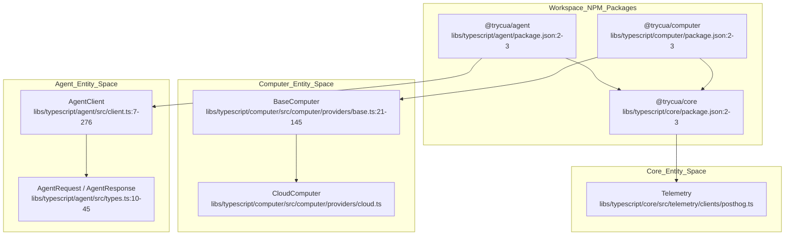
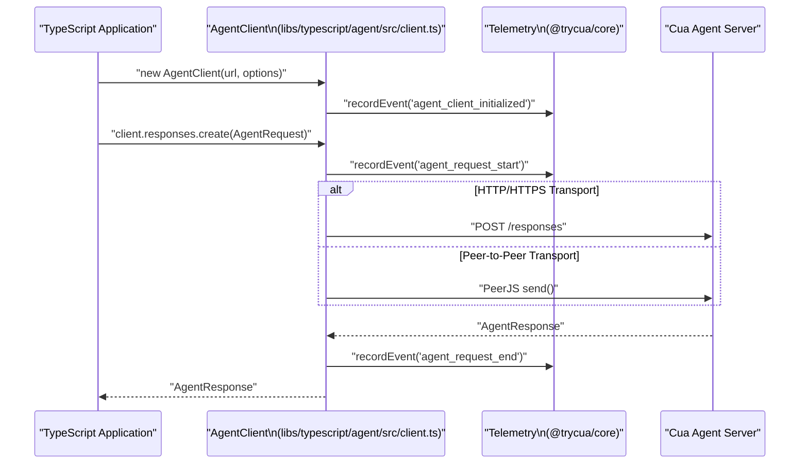

<!-- source: DeepWiki mcp.deepwiki.com · repo trycua/cua · page 2.4 Quick Start: TypeScript SDK · fetched 2026-10-29 -->

# Quick Start: TypeScript SDK

<details>
<summary>Relevant source files</summary>

The following files were used as context for generating this wiki page:

- [.github/workflows/ci-ts-fleet.yml](.github/workflows/ci-ts-fleet.yml)
- [.vscode/libs-ts.code-workspace](.vscode/libs-ts.code-workspace)
- [libs/typescript/.gitignore](libs/typescript/.gitignore)
- [libs/typescript/README.md](libs/typescript/README.md)
- [libs/typescript/agent/README.md](libs/typescript/agent/README.md)
- [libs/typescript/agent/examples/README.md](libs/typescript/agent/examples/README.md)
- [libs/typescript/agent/examples/playground-example.html](libs/typescript/agent/examples/playground-example.html)
- [libs/typescript/agent/package.json](libs/typescript/agent/package.json)
- [libs/typescript/agent/src/client.ts](libs/typescript/agent/src/client.ts)
- [libs/typescript/agent/src/index.ts](libs/typescript/agent/src/index.ts)
- [libs/typescript/agent/src/types.ts](libs/typescript/agent/src/types.ts)
- [libs/typescript/agent/tests/client.test.ts](libs/typescript/agent/tests/client.test.ts)
- [libs/typescript/agent/tsconfig.json](libs/typescript/agent/tsconfig.json)
- [libs/typescript/agent/tsdown.config.ts](libs/typescript/agent/tsdown.config.ts)
- [libs/typescript/agent/vitest.config.ts](libs/typescript/agent/vitest.config.ts)
- [libs/typescript/core/.bumpversion.cfg](libs/typescript/core/.bumpversion.cfg)
- [libs/typescript/core/README.md](libs/typescript/core/README.md)
- [libs/typescript/core/package.json](libs/typescript/core/package.json)
- [libs/typescript/package.json](libs/typescript/package.json)
- [libs/typescript/pnpm-lock.yaml](libs/typescript/pnpm-lock.yaml)
- [libs/typescript/pnpm-workspace.yaml](libs/typescript/pnpm-workspace.yaml)

</details>


This page serves as the complete technical guide for getting started with the Cua TypeScript SDK packages. It covers monorepo workspace configuration, installing `@trycua` packages (`@trycua/core`, `@trycua/computer`, `@trycua/agent`), initializing connections for computer control, interacting with the Agent SDK via `AgentClient`, and leveraging TypeScript-specific type definitions and telemetry.

For Python SDK usage, see [Quick Start: Python SDK](). For CLI usage, see [Quick Start: CLI]().

---

## Package Overview

The Cua TypeScript ecosystem is structured as a pnpm monorepo workspace containing modular packages under `libs/typescript/` [libs/typescript/pnpm-workspace.yaml:1-6]().

| Package               | Version | Path / Config                              | Purpose                                                     |
|-----------------------|---------|--------------------------------------------|-------------------------------------------------------------|
| `@trycua/core`        | 0.1.6   | `libs/typescript/core/package.json`       | Core utilities, privacy-focused telemetry, shared versioning headers. |
| `@trycua/computer`    | 0.2.x   | `libs/typescript/computer/package.json`   | SDK for interacting with the Computer Server (VM/Sandbox control). |
| `@trycua/agent`       | 0.1.0   | `libs/typescript/agent/package.json`      | Client SDK for Cua agent interaction over HTTP/HTTPS or Peer-to-Peer (WebRTC). |

### TypeScript Package Architecture (Code-Space Mapping)

The diagram below maps system-level concepts in the natural language space (e.g. Cua Agent, Cua Computer) to precise TypeScript code entities and packages within the monorepo workspace:



**Sources:** [libs/typescript/core/package.json:1-57](), [libs/typescript/computer/package.json:1-63](), [libs/typescript/agent/package.json:1-54](), [libs/typescript/agent/src/client.ts:7-275](), [libs/typescript/computer/src/computer/providers/base.ts:21-145]()

---

## Installation and Workspace Setup

### Prerequisites

- **Node.js**: Version 22.x or higher is required [libs/typescript/core/package.json:47]().
- **Package Manager**: `pnpm` (version 10.11.0 or higher) is configured as the workspace manager [libs/typescript/core/package.json:4]().
- Optional: Typescript tooling and test runners (`vitest`) are preconfigured within each package.

### Installing SDK Packages

Run these commands in your TypeScript project to add the primary Cua SDKs:

```bash
# Install the core utilities library
pnpm install @trycua/core

# Install the computer interaction SDK
pnpm install @trycua/computer

# Install the agent interaction SDK
pnpm install @trycua/agent
```

**Sources:** [libs/typescript/core/package.json:27-29](), [libs/typescript/computer/package.json:40-50](), [libs/typescript/agent/package.json:40-44]()

---

## Agent SDK Quick Start

The `@trycua/agent` package offers `AgentClient` as the primary class to interact with Cua agent services. It supports connecting via HTTP(S) endpoints or peer-to-peer WebRTC connections (using `peer://` URLs) [libs/typescript/agent/src/client.ts:30-65]().

### Overview of AgentClient Communication

- **Initialization**: Instantiating `AgentClient` with a remote URL and options (`apiKey`, `timeout`, etc.) determines the connection type (http, https, or peer).
- **Request**: Use `client.responses.create(request)` to send an `AgentRequest` containing model, input messages, and optional kwargs.
- **Response**: Receives an `AgentResponse` containing output messages, usage metrics, and status flags.
- **Telemetry**: Records detailed lifecycle events such as client initialization, request start/end, and error classification using the core telemetry system.

### Agent Request & Telemetry Flow



### Basic Usage Example

```typescript
import { AgentClient } from '@trycua/agent';

async function runAgentExample() {
  const client = new AgentClient('https://api.cua.ai', {
    apiKey: process.env.CUA_API_KEY,
    timeout: 30000,
  });

  const response = await client.responses.create({
    model: 'claude-3-5-sonnet-20241022',
    input: 'Open the browser and navigate to the dashboard',
    agent_kwargs: {
      save_trajectory: true,
      verbosity: 1,
    },
  });

  if (response.status === 'completed') {
    console.log('Agent Output:', response.output);
    console.log('Total Tokens Used:', response.usage.total_tokens);
  } else {
    console.error('Agent request failed:', response.error);
  }
}

runAgentExample();
```

The `AgentRequest` type supports detailed message formats, including user messages, function calls, and computer actions, as defined in the TypeScript types [libs/typescript/agent/src/types.ts:10-38]().

**Sources:** [libs/typescript/agent/src/client.ts:30-134](), [libs/typescript/agent/src/types.ts:10-38]()

---

## Computer SDK Usage

The `@trycua/computer` package provides the means to control virtual machines or sandboxed environments programmatically.

### BaseComputer Class

- Abstract base class offering initialization logic, parsing utilities for memory and display configuration, telemetry integration, and backend connection management.
- Shared helper functions parsing memory strings like `"8GB"` into numerical megabytes and display resolution strings like `"1920x1080"` into dimension objects [libs/typescript/computer/src/computer/providers/base.ts:21-145]().
- Telemetry tracks initialization with events labeled `ts_computer_init`.

### Using CloudComputer

The `CloudComputer` class extends `BaseComputer`, wrapping control for cloud VM instances.

Example usage:

```typescript
import { CloudComputer } from '@trycua/computer';
import { OSType } from '@trycua/computer/types';

async function startCloudComputer() {
  const computer = new CloudComputer({
    name: 'production-sandbox-01',
    osType: OSType.LINUX,
    apiKey: process.env.CUA_API_KEY,
  });

  // Utility methods inherited from BaseComputer
  const memoryMB = CloudComputer.parseMemoryString('8GB'); // 8192
  const display = CloudComputer.parseDisplayString('1920x1080'); // { width: 1920, height: 1080 }

  // TODO: Add further commands like start, stop, snapshot, etc.

  // Ensure disconnect when finished
  await computer.disconnect();
}
```

**Sources:** [libs/typescript/computer/src/computer/providers/base.ts:21-145]()

---

## Core Utilities and Telemetry

Both `@trycua/agent` and `@trycua/computer` depend on `@trycua/core` for privacy-focused telemetry and core utilities. The telemetry client records contextual events with minimal identifiable data, enabling insight into SDK usage and error classification [libs/typescript/core/package.json:1-57](), [libs/typescript/agent/src/client.ts:23-129](), [libs/typescript/computer/src/computer/providers/base.ts:27-63]().

### Key Telemetry Events

| Event Name              | Source Location                                 | Description                                 |
|-------------------------|------------------------------------------------|---------------------------------------------|
| `module_init`           | `libs/typescript/agent/src/index.ts:4-9` <br> and `base.ts:30-33` | Emitted upon SDK module load or initialization. |
| `agent_client_initialized` | `libs/typescript/agent/src/client.ts:36-64`  | Emitted when `AgentClient` is constructed. |
| `agent_request_start`   | `libs/typescript/agent/src/client.ts:78-86`    | Before dispatching an agent request.       |
| `agent_request_end`     | `libs/typescript/agent/src/client.ts:102-114`  | On successful request completion.          |
| `agent_request_error`   | `libs/typescript/agent/src/client.ts:118-129`  | On request failure, with error classification. |
| `ts_computer_init`      | `libs/typescript/computer/src/computer/providers/base.ts:60-63` | On computer SDK instance initialization.  |

### Core Helpers Provided by `@trycua/core`

- Telemetry client for event tracking.
- Standardized HTTP headers for version signaling.
- Common utilities such as UUID generation (via `uuid` package) included.

**Sources:** [libs/typescript/agent/src/index.ts:1-10](), [libs/typescript/agent/src/client.ts:23-129](), [libs/typescript/computer/src/computer/providers/base.ts:27-63]()

---

## Development Workflow and Workspace Scripts

The TypeScript SDK packages employ a monorepo workspace managed by `pnpm` with shared scripts and configurations [libs/typescript/package.json:8-43]().

### Common Development Commands

| Command          | Description                                                         |
|------------------|---------------------------------------------------------------------|
| `pnpm install`   | Installs dependencies across all workspace sub-packages.           |
| `pnpm build`     | Builds all packages, including `@trycua/core` first [order explicit]. |
| `pnpm test`      | Executes unit tests using `vitest` across applicable packages.      |
| `pnpm typecheck` | Runs the TypeScript compiler to verify type correctness.            |
| `pnpm lint`      | Runs Prettier code style checks.                                    |
| `pnpm lint:fix`  | Fixes formatting issues automatically with Prettier.               |

### Build & Release Notes

- `@trycua/core` uses `tsdown` for build and documentation generation.
- Version bumps and package releases are automated using `bumpp`.
- The agent and computer SDKs declare strict dependencies on `@trycua/core`.

**Sources:** [libs/typescript/package.json:8-43](), [libs/typescript/core/package.json:30-39](), [libs/typescript/agent/package.json:30-39]()

---

# Summary

This guide detailed the strategy and infrastructure for developing TypeScript applications against the Cua ecosystem by installing:

- `@trycua/core` for shared utilities and telemetry.
- `@trycua/computer` to manage and control Cua VM and sandbox computers.
- `@trycua/agent` to interact with Cua agents flexibly over HTTP/S or peer connections.

Together, these packages leverage a consistent, typesafe interface backed by robust telemetry and documentation. Using this SDK stack, developers can automate complex computer-use workflows, build agent-driven applications, and extend the Cua platform programmatically.

---

**Sources:**  
- [libs/typescript/core/package.json:1-57]()  
- [libs/typescript/pnpm-workspace.yaml:1-6]()  
- [libs/typescript/agent/src/client.ts:7-134]()  
- [libs/typescript/agent/src/types.ts:10-121]()  
- [libs/typescript/agent/package.json:1-54]()  
- [libs/typescript/core/README.md:19-53]()  
- [libs/typescript/computer/src/computer/providers/base.ts:21-145]()  
- [libs/typescript/package.json:8-43]()  
- [libs/typescript/agent/src/index.ts:1-39]()

---

