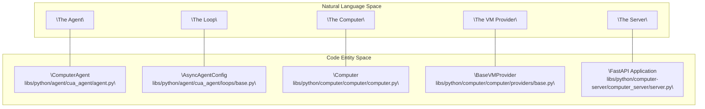

<!-- source: DeepWiki mcp.deepwiki.com · repo trycua/cua · page 3 Core SDK Components · fetched 2026-10-29 -->

# Core SDK Components

<details>
<summary>Relevant source files</summary>

The following files were used as context for generating this wiki page:

- [Makefile](Makefile)
- [libs/python/agent/.bumpversion.cfg](libs/python/agent/.bumpversion.cfg)
- [libs/python/agent/README.md](libs/python/agent/README.md)
- [libs/python/agent/pyproject.toml](libs/python/agent/pyproject.toml)
- [libs/python/core/.bumpversion.cfg](libs/python/core/.bumpversion.cfg)
- [libs/python/core/README.md](libs/python/core/README.md)
- [libs/python/core/pyproject.toml](libs/python/core/pyproject.toml)
- [libs/python/som/.bumpversion.cfg](libs/python/som/.bumpversion.cfg)
- [libs/python/som/README.md](libs/python/som/README.md)
- [libs/python/som/pyproject.toml](libs/python/som/pyproject.toml)

</details>


This document provides a high-level overview of the main architectural components of the Cua system. It covers the core SDKs, runtime environments, and integration points that enable AI agents to control virtual machines and orchestrate computer-use workflows.

For detailed technical specifications of individual components, see the child pages:
- [Computer SDK](#3.1) — Interface methods, provider abstraction, and cross-platform compatibility.
- [Sandbox SDK](#3.2) — Ephemeral and persistent sandbox lifecycle, image building, transports, and runtime backends.
- [ComputerAgent SDK](#3.3) — Agent initialization, asynchronous run loops, tools, messages, and callbacks.
- [Agent Loops](#3.4) — Agent registration, async config protocols, and provider-specific loop selection.
- [MCP Server](#3.5) — Model Context Protocol server managing agents and computers, session manager.
- [Core Utilities and SOM](#3.6) — Telemetry, logging, and the Set-Of-Mark visual grounding library.
- [Sandbox Apps Catalog](#3.7) — Universal app catalog, installer pipeline, and application schemas.

---

## System Architecture Overview

At a high level, the Cua platform consists of interconnected components that translate natural language inputs into automated computer control through VMs or containers. The key layers are:

- **Agent SDK layer:** Contains the AI logic, including agent orchestration, decision loops, and model provider integrations.
- **Computer SDK layer:** Abstracts VM lifecycle management and provider interactions, enabling uniform control over diverse environments.
- **Computer Server layer:** Runs inside the target VM/container, exposing OS automation interfaces over HTTP/WebSocket with platform-specific handlers.

Together, these enable the full chain from natural language commands to low-level OS actions.

### Bridge Diagram: Mapping System Concepts to Code Entities



This diagram shows core system concepts alongside the key code artifacts implementing them, enabling developers to quickly locate functionality in the codebase.

**Sources:**  
[libs/python/agent/pyproject.toml:6-8](), [libs/python/computer/pyproject.toml:6-8](), [libs/python/computer-server/pyproject.toml:6-9]()

---

## Core SDK Packages

The core functionalities are encapsulated in modular Python packages, each with specific responsibilities and well-defined dependencies.

| Package         | Purpose                                       | Key Code Entities / Features                       |
|-----------------|-----------------------------------------------|---------------------------------------------------|
| `cua-agent`     | AI orchestration, agent workflows, LLM loops | `ComputerAgent` class, `AsyncAgentConfig`, tools |
| `cua-computer`  | VM and sandbox lifecycle, interface abstraction | `Computer` class, provider abstraction            |
| `cua-computer-server` | In-VM OS-level control and automation    | FastAPI server, OS-specific input/output handlers |
| `cua-core`      | Shared utilities: telemetry, logging, common helpers | `PostHog` telemetry integration, OpenTelemetry    |
| `cua-mcp-server` | Model Context Protocol (MCP) server for agent/computer coordination | MCP Session Manager, API handlers                  |
| `cua-sandbox` (covered in child page) | High-level sandbox orchestration with persistent and ephemeral patterns | `Sandbox` class, image builder, transport layers |

These packages are designed for composability and separation of concerns, enabling flexible deployments and integrations.

**Sources:**  
[libs/python/agent/pyproject.toml:6-26](), [libs/python/computer/pyproject.toml:6-21](), [libs/python/core/pyproject.toml:6-30](), [libs/python/mcp-server/pyproject.toml:6-21]()

---

## Component Interaction Overview

The following sequence diagram illustrates how these components interact in a typical agent-driven computer-use session:

```mermaid
sequenceDiagram
    participant User
    participant Agent as "ComputerAgent"
    participant Loop as "AgentLoop (e.g. Anthropic)"
    participant Computer as "Computer"
    participant Provider as "VMProvider (e.g. Lume, Docker)"
    participant Server as "ComputerServer (FastAPI)"

    User->>Agent: run('Book a flight')
    Agent->>Computer: __aenter__ (initialize and connect)
    Computer->>Provider: run_vm(image)
    Provider-->>Computer: IP address, connection info
    Computer->>Server: Connect WebSocket API
    Agent->>Loop: predict_step(state)
    Loop->>Computer: screenshot()
    Computer->>Server: GET /computer_screenshot
    Server-->>Computer: Image bytes
    Loop-->>Agent: tool_call(click, x, y)
    Agent->>Computer: left_click(x, y)
    Computer->>Server: POST /computer_click
    Server-->>User: (OS action performed)
```

This flow shows the orchestration from user command through the agent’s think-act loop, VM provider interactions, and the in-VM server command execution.

**Sources:**  
[libs/python/agent/pyproject.toml:30-32]()

---

## Detailed Component Overviews

### Computer SDK

The `Computer` class encapsulates VM abstraction, managing VM creation, lifecycle, and interaction. It uses provider factories to select specific VM providers such as `LumeProvider` (macOS), `DockerProvider`, or others abstracting platform specifics. This allows uniform control over Windows, Linux, macOS, and Android sandboxes.

Capabilities include:
- Starting/stopping VMs or sandboxes
- Connecting to the in-VM FastAPI server
- Transparent OS platform abstractions for input/output

For implementation and patterns, see the [Computer SDK](#3.1) child page.

**Sources:** [libs/python/computer/pyproject.toml:24-33]()

---

### Agent SDK and Loops

The Agent SDK (`cua-agent` package) contains the main agent orchestration logic and the “Think-Act” loop. Key components include:

- `ComputerAgent` class: handles initialization, asynchronous running, and callbacks.
- Support for multiple language model providers: Anthropic, OpenAI, Gemini, Qwen, and local adapters (e.g., `mlx-vlm`).
- The asynchronous agent loops implementing `AsyncAgentConfig`, which define step prediction, tool selection, and response processing.

This package integrates tightly with the Computer SDK for sandbox control and the core utilities for logging and telemetry.

Details on agent loops and registrations are covered in child pages [ComputerAgent SDK](#3.3) and [Agent Loops](#3.4).

**Sources:** [libs/python/agent/pyproject.toml:33-89]()

---

### Sandbox SDK

The `cua-sandbox` package offers a higher-level abstraction around the VM lifecycle, enabling ephemeral and persistent sandbox patterns. It includes:

- The `Sandbox` class to manage sandbox state and lifecycle
- Image building and management utilities
- Multiple transport layers: Cloud transport, Fleet transport, HTTP and WebSocket backends
- Support for Android sandboxes via GRPC emulator transport and `EmulatorController`

It simplifies creating, running, and interacting with sandbox environments for AI agents.

See the detailed [Sandbox SDK](#3.2) child page for core classes and transport mechanisms.

**Sources:** [libs/python/computer-server/pyproject.toml:38-39]()

---

### Computer Server

The computer-server runs inside each sandbox or VM, exposing a FastAPI-based HTTP and WebSocket API for OS automation.

Key features:
- OS-specific handlers for macOS, Linux, Windows, and Android
- Input/output methods using platform APIs (e.g., `pyobjc` for macOS, `pywin32` for Windows)
- Integration with optional background driver (`cua-driver`) for no-foreground automation
- Endpoints for screenshots, input actions (mouse, keyboard), clipboard, and more

This server acts as the control endpoint for agents interacting with the hidden OS in their sandbox.

**Sources:** [libs/python/computer-server/pyproject.toml:31-36]()

---

### Core Utilities and SOM (Set-of-Mark Visual Grounding)

The `cua-core` package provides cross-cutting infrastructure used across Cua’s other packages, including:

- Privacy-aware telemetry integration via PostHog and OpenTelemetry libraries
- Shared utilities and logging frameworks
- Foundations for consistent error handling and event emission

Additionally, the `cua-som` package implements the SOM visual grounding library—used to detect and analyze UI elements in screenshots by combining icon detection and OCR.

While `cua-som` is an optional dependency (and deprecated in some flows), its functionality enables agents to visually ground their commands onto UI elements, improving interface interactions.

**Sources:** [libs/python/core/pyproject.toml:14-30](), [libs/python/agent/pyproject.toml:40-42]()

---

### Sandbox Apps Catalog

The `cua-sandbox-apps` package maintains a universal catalog of applications and installation methods, enabling agents to dynamically prepare and install software within sandboxes.

Features include:
- App catalog definitions and version pinning
- Installer pipeline abstraction
- Uniform `AppEntry` and `InstallMethod` schemas for diverse applications

This catalog provides essential tooling for sandbox setup and software lifecycle management.

See child page [Sandbox Apps Catalog](#3.7) for full details.

**Sources:** [libs/python/mcp-server/pyproject.toml:14-18]()

---

In summary, the core SDK components are designed as modular Python packages that integrate tightly to unify AI-driven agent orchestration, sandbox lifecycle, VM provider abstraction, and OS-level control. These form the foundation of the Cua platform’s extensible and cross-platform architecture.

For implementation detail, code references, and usage patterns, please follow the links to child pages in this section.

---

**Sources:**  
[libs/python/agent/pyproject.toml:6-26](), [libs/python/agent/pyproject.toml:30-42](), [libs/python/core/pyproject.toml:6-30](), [libs/python/computer/pyproject.toml:6-33](), [libs/python/computer-server/pyproject.toml:6-40](), [libs/python/mcp-server/pyproject.toml:6-21]()

---

