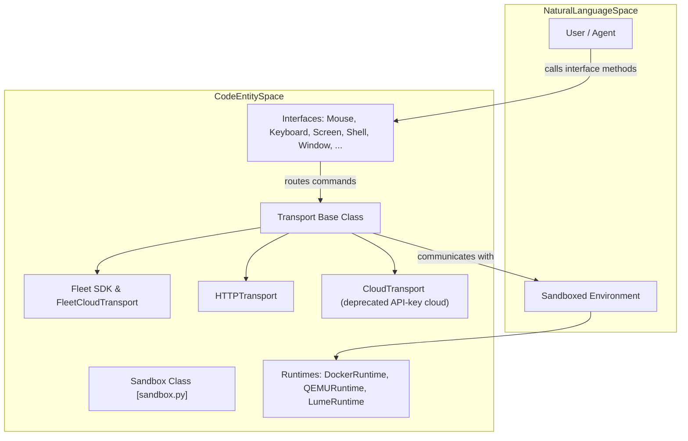
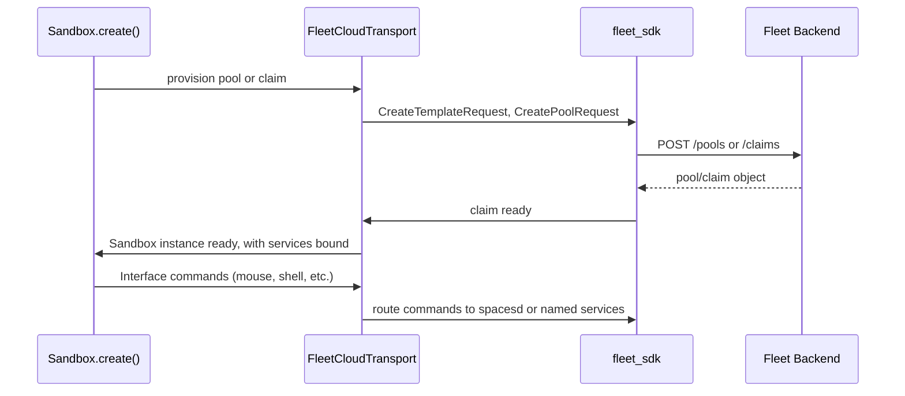
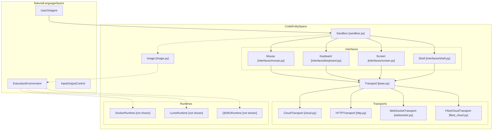
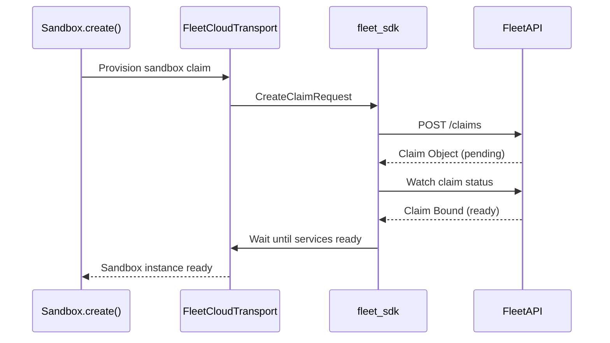

<!-- source: DeepWiki mcp.deepwiki.com · repo trycua/cua · page 3.2 Sandbox SDK · fetched 2026-10-29 -->

# Sandbox SDK

<details>
<summary>Relevant source files</summary>

The following files were used as context for generating this wiki page:

- [docs/content/docs/cua-sdk/reference/runtime-support.mdx](docs/content/docs/cua-sdk/reference/runtime-support.mdx)
- [libs/python/cua-sandbox/CHANGELOG.md](libs/python/cua-sandbox/CHANGELOG.md)
- [libs/python/cua-sandbox/README.md](libs/python/cua-sandbox/README.md)
- [libs/python/cua-sandbox/VERSION](libs/python/cua-sandbox/VERSION)
- [libs/python/cua-sandbox/cua_sandbox/__init__.py](libs/python/cua-sandbox/cua_sandbox/__init__.py)
- [libs/python/cua-sandbox/cua_sandbox/builder/executor.py](libs/python/cua-sandbox/cua_sandbox/builder/executor.py)
- [libs/python/cua-sandbox/cua_sandbox/builder/windows_unattend.py](libs/python/cua-sandbox/cua_sandbox/builder/windows_unattend.py)
- [libs/python/cua-sandbox/cua_sandbox/image.py](libs/python/cua-sandbox/cua_sandbox/image.py)
- [libs/python/cua-sandbox/cua_sandbox/pool.py](libs/python/cua-sandbox/cua_sandbox/pool.py)
- [libs/python/cua-sandbox/cua_sandbox/registry/qemu_builder.py](libs/python/cua-sandbox/cua_sandbox/registry/qemu_builder.py)
- [libs/python/cua-sandbox/cua_sandbox/runtime/_bw_init.js](libs/python/cua-sandbox/cua_sandbox/runtime/_bw_init.js)
- [libs/python/cua-sandbox/cua_sandbox/runtime/android_emulator.py](libs/python/cua-sandbox/cua_sandbox/runtime/android_emulator.py)
- [libs/python/cua-sandbox/cua_sandbox/sandbox.py](libs/python/cua-sandbox/cua_sandbox/sandbox.py)
- [libs/python/cua-sandbox/cua_sandbox/sync/__init__.py](libs/python/cua-sandbox/cua_sandbox/sync/__init__.py)
- [libs/python/cua-sandbox/cua_sandbox/transport/cloud.py](libs/python/cua-sandbox/cua_sandbox/transport/cloud.py)
- [libs/python/cua-sandbox/cua_sandbox/transport/fleet.py](libs/python/cua-sandbox/cua_sandbox/transport/fleet.py)
- [libs/python/cua-sandbox/cua_sandbox/transport/fleet_cloud.py](libs/python/cua-sandbox/cua_sandbox/transport/fleet_cloud.py)
- [libs/python/cua-sandbox/pyproject.toml](libs/python/cua-sandbox/pyproject.toml)
- [libs/python/cua-sandbox/tests/test_cloud.py](libs/python/cua-sandbox/tests/test_cloud.py)
- [libs/python/cua-sandbox/tests/test_fleet_cloud_client.py](libs/python/cua-sandbox/tests/test_fleet_cloud_client.py)
- [libs/python/cua-sandbox/tests/test_fleet_cloud_transport.py](libs/python/cua-sandbox/tests/test_fleet_cloud_transport.py)
- [libs/python/cua-sandbox/tests/test_fleet_sdk_distribution.py](libs/python/cua-sandbox/tests/test_fleet_sdk_distribution.py)
- [libs/python/cua-sandbox/tests/test_fleet_sdk_packaging.py](libs/python/cua-sandbox/tests/test_fleet_sdk_packaging.py)
- [libs/python/cua-sandbox/tests/test_fleet_transport.py](libs/python/cua-sandbox/tests/test_fleet_transport.py)
- [libs/python/cua-sandbox/tests/test_from_registry_ostype.py](libs/python/cua-sandbox/tests/test_from_registry_ostype.py)
- [libs/python/cua-sandbox/tests/test_pool.py](libs/python/cua-sandbox/tests/test_pool.py)
- [libs/python/cua-sandbox/tests/test_sandbox_fleet_lifecycle.py](libs/python/cua-sandbox/tests/test_sandbox_fleet_lifecycle.py)
- [libs/python/cua-sandbox/tests/test_vm_cleanup.py](libs/python/cua-sandbox/tests/test_vm_cleanup.py)
- [libs/python/cua-sandbox/tests/test_windows_cloud.py](libs/python/cua-sandbox/tests/test_windows_cloud.py)
- [libs/python/cua-sandbox/tests/test_windows_timing.py](libs/python/cua-sandbox/tests/test_windows_timing.py)
- [libs/python/cua-sandbox/uv.lock](libs/python/cua-sandbox/uv.lock)
- [tests/test_image_builder.py](tests/test_image_builder.py)
- [tests/test_image_builder_cloud.py](tests/test_image_builder_cloud.py)
- [tests/test_interfaces.py](tests/test_interfaces.py)

</details>


The `cua-sandbox` Python package provides ephemeral and persistent sandboxed environments for virtual machines and containers, abstracted through a unified `Sandbox` class. It is a thin wrapper over the Rust-based `cua` SDK, seamlessly integrating local runtimes (Docker, QEMU, Lume) and cloud Fleet-backed sandboxes via OAuth2 authentication. This page details its core implementation, image building capabilities, lifecycle patterns, transport layers—including Fleet and HTTP transports—runtime backends, and exposed interface objects, grounding system concepts extensively in code entities.

Sources: `[libs/python/cua-sandbox/pyproject.toml:1-44]`, `[libs/python/cua-sandbox/cua_sandbox/sandbox.py:1-213]`, `[libs/python/cua-sandbox/cua_sandbox/transport/fleet_cloud.py:1-189]`, `[libs/python/cua-sandbox/cua_sandbox/transport/fleet.py:1-175]`, `[libs/python/cua-sandbox/cua_sandbox/transport/cloud.py:1-183]`, `[libs/python/cua-sandbox/cua_sandbox/pool.py:1-211]`, `[libs/python/cua-sandbox/tests/test_fleet_cloud_transport.py:1-205]`

---

## Core Architecture

The heart of the `cua-sandbox` package is the `Sandbox` class, which represents a sandboxed computer environment abstracted across various backend runtimes and transport protocols. The class exposes a standardized set of interface objects for input/output control: mouse, keyboard, screen, clipboard, shell, terminal, window, and others.

### The `Sandbox` Class and Interfaces

- The `Sandbox` class aggregates multiple interface objects backed by a `Transport` layer. This transport abstracts the underlying communication protocol to the guest environment's control plane, which may be a `computer-server` daemon running inside the VM/container or a Fleet cloud claim.

- Interaction flow:
  1. Agent or user invokes commands on interfaces (`sb.mouse.move()`, `sb.shell.run()`).
  2. Calls are serialized and routed through the selected `Transport` (e.g., HTTP, Fleet).
  3. Transport communicates with the remote or local sandbox facility.
  4. Results/responses are returned via the transport to the calling agent.

- Interfaces include:
  - `Mouse`, `Keyboard` (input synthesis)
  - `Screen` (screenshot/frame capture)
  - `Clipboard` (clipboard manipulation)
  - `Shell`, `Terminal` (command execution, terminal control)
  - `Window` (window management)
  - `Services` (named services and network proxies)
  - `Driver` (optional typed windowing via the `cua-driver` interface)

The `Sandbox` class supports connecting, creating, and destroying sandbox instances across local and cloud. It offers:
- `Sandbox.create()` — create new or attach persistent environments.
- `Sandbox.connect()` — connect to existing sandboxes.
- `Sandbox.ephemeral()` — create ephemeral sandboxes auto-destroyed on exit.



Sources: `[libs/python/cua-sandbox/cua_sandbox/sandbox.py:1-213]`, `[libs/python/cua-sandbox/cua_sandbox/interfaces/__init__.py]`(implicit), `[libs/python/cua-sandbox/cua_sandbox/transport/base.py:1-20]`

---

## Image Builder

The `Image` class is a key component for defining the software and system configuration of a sandbox. It acts as an immutable, chainable builder that can specify OCI container images, disk images for VMs, and image overlays or layers.

### Image Construction and Exposure

- `Image.linux()`, `Image.windows()`, and `Image.macos()` provide canonical base images representing standard Linux, Windows, and macOS environments.

- `Image.from_registry(reference)` allows specifying images from any OCI-compliant container registry, optionally with pull secrets.

- The `.expose(port)` method declares ports and named services exposed by the image, facilitating network communication and service discovery in Fleet sandboxes.

- Images resolve automatically to their runtime-specific form (e.g., for VMs, a pinned `-disk` variant is selected).

```mermaid
graph LR
    Image["Image Class [image.py]"]
    FleetTransport["FleetCloudTransport [fleet_cloud.py]"]
    FleetSDK["fleet_sdk: VmTemplateBuilder, CreateTemplateRequest"]
    OCIRegistry["OCI Registry"]

    Image -->|expose() ports| FleetTransport
    Image -->|resolve image refs| OCIRegistry
    FleetTransport -->|build VmTemplate| FleetSDK
    FleetSDK -->|creates TemplateRequest| FleetSDK
```

Sources: `[libs/python/cua-sandbox/cua_sandbox/image.py]` (partial), `[libs/python/cua-sandbox/tests/test_fleet_cloud_transport.py:58-110]`, `[libs/python/cua-sandbox/cua_sandbox/transport/fleet_cloud.py:59-130]`

---

## Sandbox Lifecycle Patterns

`Sandbox` supports multiple lifecycle management patterns for sandboxed environments adapted to different use cases.

### 1. Ephemeral Sandboxes

- Created via `Sandbox.ephemeral(image, ...)`.
- Automatically created upon entering the async context.
- Destroyed when the context exits—ideal for short-lived test or script runs.

Example:

```python
async with Sandbox.ephemeral(Image.linux()) as sb:
    await sb.shell.run("echo 'hello'")
```

### 2. Persistent Sandboxes

- Created via `Sandbox.create(...)`, typically backed by a Fleet warm pool or explicitly named claim.
- The environment remains alive after disconnect, allowing persistent state across sessions.

Example:

```python
sb = await Sandbox.create(pool=pool, name="my-claim")
await sb.shell.run("uname -a")
await sb.disconnect()  # Sandbox keeps running in the background
```

### 3. Connect to Existing Sandboxes

- Attach to a running sandbox by name or URL.
- Useful for reconnecting to background sandboxes or externally provisioned environments.

Example:

```python
async with Sandbox.connect("my-sandbox") as sb:
    await sb.screenshot()
```

Sources: `[libs/python/cua-sandbox/cua_sandbox/sandbox.py:18-45]`, `[libs/python/cua-sandbox/README.md:67-100]`

---

## Transport Layer

The transport layer mediates commands and events between the `Sandbox` interfaces and the sandbox's control plane over the network or local IPC.

### Key Transport Implementations

| Transport Class         | Purpose                                                             | Reference File/Lines            |
|------------------------|---------------------------------------------------------------------|--------------------------------|
| `CloudTransport`        | Legacy API-key cloud VMs, which are deprecated and fail upon connect; only list/delete possible | `[cloud.py:1-183]`              |
| `HTTPTransport`         | Direct communication to `computer-server` over HTTP/REST            | `[http.py]` (not shown fully)   |
| `WebSocketTransport`    | Low-latency bidirectional control via WebSockets                    | `[websocket.py]` (not shown fully)  |
| `FleetCloudTransport`   | Main current cloud Fleet integration; manages Fleet claims/pools, OAuth2/GitHub OIDC; routes interfaces over `cua-spacesd` | `[fleet_cloud.py:1-189]`, `[fleet.py:1-175]` |

### FleetCloudTransport Details

- Uses the Fleet SDK to create and hold claims within named warm pools.
- Translates `Image` definitions to typed Fleet `CreateTemplateRequest`/`CreatePoolRequest`.
- Exposes both:
  - Named HTTP services of a sandbox via `service_request`.
  - Standard interfaces (`mouse`, `keyboard`, `screen`, `shell`) through a per-claim `cua-spacesd` environment (`env` service).
- Supports auto-renewal, readiness probes to wait for services, and public signed URLs.



Sources: `[libs/python/cua-sandbox/cua_sandbox/transport/fleet_cloud.py:20-150]`, `[libs/python/cua-sandbox/cua_sandbox/transport/fleet.py:20-160]`, `[libs/python/cua-sandbox/cua_sandbox/pool.py:135-211]`

### Legacy `CloudTransport`

- Stubs and an error class `LegacyCloudRemovedError` represent the removal of the old API-key cloud VM system.
- It raises explicit errors explaining the migration to Fleet-based cloud sandboxes.
- Still offers REST methods for listing or deleting legacy VMs.

Sources: `[libs/python/cua-sandbox/cua_sandbox/transport/cloud.py:10-183]`

---

## Runtime Backends

The runtime layer governs the sandbox's actual environment—VMs or containers—using different backends depending on the platform and configuration. The `Sandbox` class auto-selects the suitable runtime based on `image`, `on` (`local` or `cloud`), `kind` (`vm` or `container`), and `runtime` parameters.

### Supported Runtime Types

| Runtime                | Description                                                             | Notes/Code Reference           |
|------------------------|-------------------------------------------------------------------------|-------------------------------|
| DockerRuntime          | Runs sandbox containers locally via Docker or Podman, optionally with gVisor layer for isolation | Not shown fully in code        |
| QEMURuntime            | Runs VM sandboxes using QEMU, including special Windows or Linux images, usable with container or bare-metal backends | Not shown fully in code        |
| LumeRuntime            | Swift-based VM runtime on macOS hardware, leveraging Apple's virtualization | Indirectly mentioned           |

### Runtime selection

- The `_auto_runtime(image)` method predicates the runtime based on `kind` and `runtime` options and image OS type.
- Cloud runtimes use Kubernetes-based KubeVirt driver.
- Local runtimes use container engines or QEMU accordingly.

Sources: `[libs/python/cua-sandbox/cua_sandbox/sandbox.py:200-245]` (partial), `[libs/python/cua/cua/__init__.py]` (mentioned)

---

## Interface Objects Exposed by `Sandbox`

The `Sandbox` instance exposes a rich set of interfaces that wrap all user-facing controls on the sandboxed environment.

| Interface     | Description                              |
|---------------|------------------------------------------|
| `mouse`       | Cursor movement and click injection     |
| `keyboard`    | Keyboard event synthesis, text typing   |
| `screen`      | Screen captures and frame analysis       |
| `clipboard`   | Read and modify clipboard contents       |
| `shell`       | Run shell commands                        |
| `terminal`    | Terminal emulation and interactive commands |
| `window`      | Window management and focus manipulation |
| `services`    | Access to named network services exposed by the sandbox |
| `driver`      | Low-level typed window control via `cua-driver` (optional) |

All these interfaces send commands through the sandbox's assigned transport to the computer-server or equivalent control daemon inside the sandbox.

Sources: `[libs/python/cua-sandbox/cua_sandbox/sandbox.py:66-79]`, `[libs/python/cua-sandbox/cua_sandbox/interfaces/__init__.py]` (implicit) 

---

## Unified `cua` Python Package Exposure

The full Python package `cua` re-exports `cua-sandbox` and related packages, providing a one-stop import for Cua SDK components. This includes access to:

- `Sandbox`, `Image`, `Pool`, `Template` classes from `cua-sandbox`.
- Fleet resource builders and runtime support.
- Agent SDK components.
- Core telemetry and utilities.

Lazy loading is implemented to minimize startup overhead. This unification creates a seamless interface across multiple layers of the platform.

Sources: `[libs/python/cua-sandbox/cua_sandbox/__init__.py:1-147]`

---

# Summary

The `cua-sandbox` Python SDK wraps the underlying Rust-based `cua` platform SDK to provide a unified, easy-to-use sandbox abstraction:

- **Sandbox Class:** Central API surface exposing interfaces via a flexible transport layer.
- **Image Builder:** Immutable, chainable builder for images usable across local and cloud runtimes.
- **Lifecycle Patterns:** Ephemeral, persistent, and connected sandbox management.
- **Transports:** Legacy cloud (`CloudTransport`), HTTP/WebSocket, and modern Fleet integration with OAuth2.
- **Runtimes:** Local container and VM backends (Docker, QEMU, Lume).
- **Interfaces:** Rich input/output and control sets for UI automation and service interaction.
- **Fleet Integration:** Typed Fleet APIs drive scalable cloud sandbox pools and claims.
- **Unified Package:** `cua` provides a consistent import facade for all the core SDK components.

This architecture simplifies cross-platform sandbox automation with a clean and extensible Python API.

---

# Mermaid Diagrams Summary

### Sandbox SDK Component Mapping



### Fleet Claim Acquisition Flow



Sources: `[libs/python/cua-sandbox/cua_sandbox/sandbox.py]`, `[libs/python/cua-sandbox/cua_sandbox/transport/fleet_cloud.py]`, `[libs/python/cua-sandbox/cua_sandbox/pool.py]`

---

# References

- `libs/python/cua-sandbox/cua_sandbox/sandbox.py`
- `libs/python/cua-sandbox/cua_sandbox/transport/fleet_cloud.py`
- `libs/python/cua-sandbox/cua_sandbox/transport/fleet.py`
- `libs/python/cua-sandbox/cua_sandbox/transport/cloud.py`
- `libs/python/cua-sandbox/cua_sandbox/pool.py`
- `libs/python/cua-sandbox/cua_sandbox/__init__.py`
- `libs/python/cua-sandbox/cua_sandbox/image.py`
- `libs/python/cua-sandbox/pyproject.toml`
- `libs/python/cua-sandbox/tests/test_fleet_cloud_transport.py`

---

