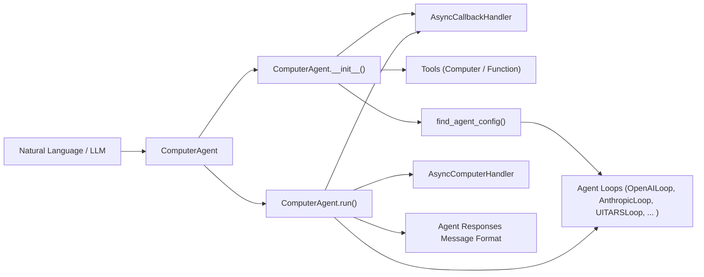

<!-- source: DeepWiki mcp.deepwiki.com · repo trycua/cua · page 3.3 ComputerAgent SDK · fetched 2026-10-29 -->

# ComputerAgent SDK

<details>
<summary>Relevant source files</summary>

The following files were used as context for generating this wiki page:

- [Makefile](Makefile)
- [libs/python/agent/.bumpversion.cfg](libs/python/agent/.bumpversion.cfg)
- [libs/python/agent/README.md](libs/python/agent/README.md)
- [libs/python/agent/pyproject.toml](libs/python/agent/pyproject.toml)
- [libs/python/core/.bumpversion.cfg](libs/python/core/.bumpversion.cfg)
- [libs/python/core/README.md](libs/python/core/README.md)
- [libs/python/core/pyproject.toml](libs/python/core/pyproject.toml)
- [libs/python/som/.bumpversion.cfg](libs/python/som/.bumpversion.cfg)
- [libs/python/som/README.md](libs/python/som/README.md)
- [libs/python/som/pyproject.toml](libs/python/som/pyproject.toml)

</details>


The **ComputerAgent SDK** provides a comprehensive Python interface for orchestrating AI-driven computer-use agents that integrate vision-language models with computer automation capabilities. This SDK plays a critical role in managing agent lifecycle, model loop selection, computer interface abstraction, tool handling, message formatting, and callback invocation — enabling robust, flexible, and extensible AI interaction with computers via both native computer tools and arbitrary Python functions.

This document details the core implementation, data flow, key classes and functions, message formats, and callback mechanisms enabling the `ComputerAgent` class and its supporting systems.

---

## Overview

The primary class is `ComputerAgent` located in `libs/python/agent/cua_agent/agent.py`. It serves as the orchestrator connecting:

- **Model Routing:** Dynamically determines the correct agent loop based on the model identifier.
- **Computer Interface Abstraction:** Wraps platform-specific computer interfaces into a uniform async protocol.
- **Tool Management:** Supports native computer automation and arbitrary Python functions, converting them into usable tools inside the agent's environment.
- **Run Loop Lifecycle:** Manages the main asynchronous run loop, which integrates model prediction, action dispatching, error handling, and execution flow control.
- **Callbacks:** Extensible lifecycle hooks for telemetry, logging, trajectory recording, image pruning, cost budgeting, and more.

This unified interface supports various underlying vision-language model backends and automatically manages complexity such as schema conversion, message streaming, and error recovery.

Sources: [libs/python/agent/cua_agent/agent.py:162-166](), [libs/python/agent/cua_agent/__init__.py:1-14]()

---

## Architecture Overview

The following diagram maps the key components inside the ComputerAgent SDK to their code locations and interactions:

```mermaid
graph TB
    subgraph "ComputerAgentCore [libs/python/agent/cua_agent/agent.py]"
        ComputerAgent["ComputerAgent"]
        find_agent_config["find_agent_config()"]
        agent_loop["agent_loop.predict_step()"]
        callback_system["Callback System"]
    end
    
    subgraph "AgentLoopDiscovery [libs/python/agent/cua_agent/loops/]"
        AnthropicLoop["AnthropicLoop"]
        OpenAILoop["OpenAILoop"] 
        UITARSLoop["UITARSLoop"]
        OmniLoop["OmniLoop"]
        ComposedLoop["ComposedLoop"]
        GeminiLoop["GeminiLoop"]
    end
    
    subgraph "ComputerHandlerProtocol [libs/python/agent/cua_agent/computers/]"
        AsyncComputerHandler["AsyncComputerHandler"]
        cuaComputerHandler["cuaComputerHandler"]
        CustomComputerHandler["CustomComputerHandler"]
        make_computer_handler["make_computer_handler()"]
    end
    
    subgraph "ModelIntegration [libs/python/agent/cua_agent/adapters/]"
        litellm["litellm.completion()"]
        HuggingFaceLocalAdapter["HuggingFaceLocalAdapter"]
        MLXVLMAdapter["MLXVLMAdapter"]
        HumanAdapter["HumanAdapter"]
        GoogleGenAI["google-genai"]
    end
    
    ComputerAgent --> find_agent_config
    ComputerAgent --> agent_loop
    ComputerAgent --> callback_system
    ComputerAgent --> make_computer_handler
    
    find_agent_config --> AnthropicLoop
    find_agent_config --> OpenAILoop
    find_agent_config --> UITARSLoop
    find_agent_config --> OmniLoop
    find_agent_config --> ComposedLoop
    find_agent_config --> GeminiLoop
    
    make_computer_handler --> AsyncComputerHandler
    make_computer_handler --> cuaComputerHandler
    make_computer_handler --> CustomComputerHandler
    
    agent_loop --> litellm
    agent_loop --> GoogleGenAI
    litellm --> HuggingFaceLocalAdapter
    litellm --> MLXVLMAdapter
    litellm --> HumanAdapter
```



- `ComputerAgent` is responsible for agent loop selection (`find_agent_config()`), computer interface handling (`make_computer_handler()`), and executing the main `run()` flow.
- Agent loops adapt to different providers and models such as OpenAI, Anthropic, Gemini, UITARS, Composed chains, or OmniParser-based loops.
- The computer handler protocol (`AsyncComputerHandler`) abstracts interactions with various computer interfaces, allowing seamless integration of native and custom computer action implementations.
- Model integrations leverage adapters for different LLM and vision-language backends, including `litellm`, HuggingFace models, Google GenAI, and local human-in-the-loop adapters.

Sources: [libs/python/agent/cua_agent/agent.py:152-270](), [libs/python/agent/cua_agent/decorators.py:13-62](), [libs/python/agent/cua_agent/computers/__init__.py:14-41]()

---

## Initialization and Parameters

### Core Initialization

The `ComputerAgent` constructor signature allows specifying key parameters related to model selection, tool integration, callback configuration, and execution options:

```python
def __init__(
    self,
    model: str,
    tools: Optional[List[Any]] = None,
    custom_loop: Optional[Callable] = None,
    callbacks: Optional[List[Any]] = None,
    instructions: Optional[str] = None,
    verbosity: Optional[int] = None,
    trajectory_dir: Optional[Union[str, Path, dict]] = None,
    only_n_most_recent_images: Optional[int] = None,
    max_trajectory_budget: Optional[Union[float, dict]] = None,
    telemetry_enabled: Optional[bool] = True,
)
```

| Parameter                 | Type                    | Default | Description                                                  |
|---------------------------|-------------------------|---------|--------------------------------------------------------------|
| `model`                   | `str`                   | -       | Model identifier string for selecting the agent loop.       |
| `tools`                   | `Optional[List[Any]]`   | `None`  | List of callable function tools or computer interface objects.|
| `custom_loop`             | `Optional[Callable]`    | `None`  | Override the automatic agent loop selection with a custom loop. |
| `callbacks`               | `Optional[List[Any]]`   | `None`  | List of callback handlers conforming to `AsyncCallbackHandler`. |
| `instructions`            | `Optional[str]`         | `None`  | Optional system prompt instructions prepended to messages.  |
| `verbosity`               | `Optional[int]`         | `None`  | Logging verbosity level (adds logging callbacks automatically). |
| `trajectory_dir`          | `Optional[str|Path|dict]` | `None` | Directory or configuration for saving agent trajectories.    |
| `only_n_most_recent_images` | `Optional[int]`        | `None`  | Limits number of saved images per trajectory.                |
| `max_trajectory_budget`   | `Optional[float|dict]`  | `None`  | Cost or token budget limits for the trajectory/run.          |
| `telemetry_enabled`       | `Optional[bool]`        | `True`  | Enable anonymous telemetry data collection via PostHog.      |

### Initialization Flow

Upon init, `ComputerAgent` performs these steps:

- Creates and automatically adds various callback handlers based on parameters:
  - `PromptInstructionsCallback` if `instructions` is provided.
  - `LoggingCallback` if `verbosity` is set.
  - `TrajectorySaverCallback` if `trajectory_dir` is specified.
  - Image retention and budget manager callbacks based on related params.
  - `TelemetryCallback` if telemetry is enabled.
- Registers known model adapters and function providers.
- Selects the appropriate agent loop class based on `model` string pattern using `find_agent_config()`.
- Processes the list of tools into either computer handlers or function tools with OpenAI-compatible schemas.
- Prepends `OperatorNormalizerCallback` to intercept and fix common action syntax errors before execution.

### Initialization Diagram

```mermaid
graph TB
    init["ComputerAgent.__init__() [libs/python/agent/cua_agent/agent.py:168]"]
    
    subgraph "CallbackSetup [libs/python/agent/cua_agent/agent.py:214-280]"
        instructions_check{"instructions?"}
        verbosity_check{"verbosity?"}
        trajectory_check{"trajectory_dir?"}
        image_check{"only_n_most_recent_images?"}
        budget_check{"max_trajectory_budget?"}
        telemetry_check{"telemetry_enabled?"}
        
        PromptInstructionsCallback["PromptInstructionsCallback"]
        LoggingCallback["LoggingCallback"]
        TrajectorySaverCallback["TrajectorySaverCallback"]
        ImageRetentionCallback["ImageRetentionCallback"]
        BudgetManagerCallback["BudgetManagerCallback"]
        TelemetryCallback["TelemetryCallback"]
        OperatorNormalizerCallback["OperatorNormalizerCallback (prepended)"]
    end
    
    subgraph "AgentLoopSelection [libs/python/agent/cua_agent/agent.py:286]"
        find_agent_config["find_agent_config(model)"]
        agent_loop["agent_loop = config.agent_class()"]
    end
    
    subgraph "ProviderRegistration [libs/python/agent/cua_agent/agent.py:258]"
        register_providers["litellm.custom_provider_map"]
        HuggingFaceLocalAdapter["HuggingFaceLocalAdapter"]
        MLXVLMAdapter["MLXVLMAdapter"]
        HumanAdapter["HumanAdapter"]
        CUAAdapter["CUAAdapter"]
    end
    
    init --> instructions_check
    init --> verbosity_check
    init --> trajectory_check
    init --> image_check
    init --> budget_check
    init --> telemetry_check
    
    instructions_check -->|Yes| PromptInstructionsCallback
    verbosity_check -->|Yes| LoggingCallback
    trajectory_check -->|Yes| TrajectorySaverCallback
    image_check -->|Yes| ImageRetentionCallback
    budget_check -->|Yes| BudgetManagerCallback
    telemetry_check -->|Yes| TelemetryCallback
    
    init --> OperatorNormalizerCallback
    
    init --> register_providers
    register_providers --> HuggingFaceLocalAdapter
    register_providers --> MLXVLMAdapter
    register_providers --> HumanAdapter
    register_providers --> CUAAdapter
    
    init --> find_agent_config
    find_agent_config --> agent_loop
```



Sources: [libs/python/agent/cua_agent/agent.py:168-299](), [libs/python/agent/cua_agent/callbacks/__init__.py:1-23]()

---

## Agent Loop Selection by Model

The `find_agent_config()` function performs regex pattern matching on the model string at initialization to return metadata about the agent loop to use. This supports extensibility and multiple model backends:

| Model Pattern             | Agent Loop       | Priority | Example Model Identifier               |
|--------------------------|------------------|----------|-------------------------------------|
| `^anthropic/.*`          | `AnthropicLoop`  | 0        | `anthropic/claude-3-5-sonnet-20241022` |
| `^openai/computer-use-preview` | `OpenAILoop`      | 0        | `openai/computer-use-preview`          |
| `^gemini/.*`             | `GeminiLoop`     | 0        | `gemini/gemini-2.0-flash-exp`           |
| `.*\+.*` (composed model chain) | `ComposedLoop`   | 100      | `openai/gpt-4o+human/human`              |
| `^omniparser\+.*`        | `OmniLoop`       | 200      | `omniparser+openai/gpt-4o-mini`         |
| `(huggingface-local|mlx)/.*UI-TARS.*` | `UITARSLoop`     | 0        | `mlx/mlx-community/UI-TARS-1.5-7B-6bit`   |

These mappings are populated with the decorator `@register_agent` in the agent loops submodules.

Sources: [libs/python/agent/cua_agent/agent.py:286-291](), [libs/python/agent/cua_agent/decorators.py:13-62](), [libs/python/agent/cua_agent/loops/gemini.py:1-10]()

---

## ComputerAgent Tools

`ComputerAgent` supports two categories of tools to facilitate computer interactions and extend agent capabilities:

### 1. Computer Tools

- Objects implementing the Computer SDK interface are recognized as computer tools.
- Identification is done via the `is_agent_computer()` helper.
- These are wrapped uniformly into `AsyncComputerHandler` objects for async action invocation.
- Supported actions include mouse events (click, double_click), keyboard input (type, keypress), scrolling, dragging, and automatic screenshot capture post-actions.

### 2. Function Tools

- Python callable functions with docstrings describing their interface.
- These are converted into OpenAI Function Call-compatible JSON schemas using `litellm.utils.function_to_dict()`.
- When the model emits a `function_call` item matching a tool's name, the agent dispatches to the underlying Python function.
- Argument validation is performed using `assert_callable_with()`.
- Synchronous functions run inside an executor (`asyncio.to_thread`) to maintain async interface.
- Function tools are useful for extending agents with arbitrary code for computation, API calls, or other logic.

### Tool Processing

The tools passed to `ComputerAgent` are processed in `_process_tools()` to:

- Identify and convert computer tools.
- Generate function schemas for callable tools.
- Prepare internal mappings of tool names to their execution handlers.

Sources: [libs/python/agent/cua_agent/agent.py:323-351](), [libs/python/agent/cua_agent/computers/__init__.py:14-53]()

---

## The run() Loop

`ComputerAgent.run()` is the core asynchronous method executing the agent's task workflow. It accepts input messages and returns an async generator that yields responses incrementally.

### Method Signature

```python
async def run(
    self,
    messages: Messages,
    stream: bool = False,
    api_key: Optional[str] = None,
    api_base: Optional[str] = None,
    **generation_kwargs,
) -> AsyncGenerator[Dict[str, Any], None]:
```

### Execution Lifecycle

1. **Initialization**:
   - Start all computer handlers (`start()`).
   - Preprocess input messages.
   - Invoke `on_run_start()` callbacks for setup.

2. **Main Agent Loop**:
   - Before each step, `on_run_continue()` callbacks determine whether to continue (e.g., budget exhaustion triggers early stop).
   - Calls `agent_loop.predict_step()` to generate model outputs.
   - Iterates over items such as messages, reasoning traces, computer calls, function calls.
   - Executes computer actions with `_handle_item()`.
   - Takes a screenshot automatically after computer calls.
   - Calls appropriate callbacks for usage, responses, and computer call lifecycle.

3. **Finalization**:
   - Runs `on_run_end()` callbacks signaling completion.
   - Stops computer interfaces cleanly.

### High-Level Flow Diagram

```mermaid
sequenceDiagram
    participant Agent as ComputerAgent
    participant Loop as agent_loop.predict_step()
    participant Computer as AsyncComputerHandler(s)
    participant Callbacks as CallbackHandlers
    
    Agent->>Callbacks: on_run_start(messages)
    Agent->>Computer: start()
    loop while on_run_continue()
        Agent->>Loop: predict_step(messages)
        Loop-->>Agent: items (message, computer_call, function_call, reasoning)
        Agent->>Callbacks: on_llm_start(current messages)
        loop for each item
            alt computer_call
                Agent->>Callbacks: on_computer_call_start()
                Agent->>Computer: execute action
                Agent->>Callbacks: on_computer_call_end()
            else function_call
                Agent->>Callbacks: on_function_call_start()
                Agent->>Function: execute function tool
                Agent->>Callbacks: on_function_call_end()
            end
        end
        Agent->>Callbacks: on_responses()
    end
    Agent->>Callbacks: on_run_end()
    Agent->>Computer: stop()
```

Sources: [libs/python/agent/cua_agent/agent.py:599-719](), [libs/python/agent/cua_agent/agent.py:472-593]()

---

## Message Format

The `ComputerAgent` uses the OpenAI Agent Responses API message format for both input and output, standardized in [libs/python/agent/cua_agent/responses/__init__.py].

### Supported Item Types

| Type                  | Key Fields                | Description                                      |
|-----------------------|---------------------------|-------------------------------------------------|
| `message`             | `role`, `content`         | Text messages, user or assistant role           |
| `reasoning`           | `summary`                 | Agent's internal reasoning or planning traces   |
| `computer_call`       | `action`, `call_id`, `status` | Requests to execute computer hardware actions    |
| `computer_call_output`| `output`, `call_id`       | Result of computer actions, often screenshots    |
| `function_call`       | `name`, `arguments`, `call_id` | Request to execute a function tool                |
| `function_call_output`| `output`, `call_id`       | Return data from function tool execution          |

The agent input and output streams use these structured items for precise, protocol-driven communication between model, agent runtime, and computer interfaces.

Sources: [libs/python/agent/cua_agent/responses/__init__.py:1-140](), [libs/python/agent/cua_agent/agent.py:693-717]()

---

## Callback System

`ComputerAgent` integrates a flexible callback system for lifecycle management and instrumentation. Callbacks implement `AsyncCallbackHandler` interfaces and are called at key points:

| Callback Hook         | Description                                                  |
|-----------------------|--------------------------------------------------------------|
| `on_run_start`         | Called once before the run loop begins                       |
| `on_run_continue`      | Called each iteration to check if execution should continue (e.g., budget limits) |
| `on_llm_start`         | Called before LLM invocation, allowing message mutation or logging |
| `on_usage`             | Reports token usage and costs                                 |
| `on_responses`         | Called after each full model response cycle                  |
| `on_computer_call_start`/`on_computer_call_end` | Wraps the execution of computer actions for telemetry and error handling |
| `on_run_end`           | Final callback upon termination of run                       |

Callbacks facilitate extensibility, logging, telemetry, trajectory recording, pruning, and cost control by hooking cleanly into the agent's lifecycle.

Sources: [libs/python/agent/cua_agent/agent.py:357-467](), [libs/python/agent/cua_agent/callbacks/__init__.py:1-23]()

---

## Predict Click Helper

The `predict_click()` method in `ComputerAgent` offers a streamlined interface to perform UI element grounding where the model directly predicts a screen coordinate (x, y) corresponding to a user instruction.

```python
async def predict_click(
        self,
        instruction: str,
        image_b64: Optional[str] = None
    ) -> Optional[Tuple[int, int]]:
```

Use cases include two-stage pipelines where a high-level planner decides the target element, and a grounding model converts that into actionable screen coordinates for automation.

This method supports models with the `"click"` capability, such as OmniParser or UI-TARS.

Sources: [libs/python/agent/cua_agent/agent.py:720-755](), [libs/python/agent/cua_agent/types.py:12-16]()

---

# Natural Language Space to Code Entity Mapping



This diagram bridges the conceptual space of natural language and AI models to the internal code entities managing the interaction lifecycle.

---

# Summary

The `ComputerAgent` SDK is a critical layer ensuring seamless and extensible integration between diverse AI models, standardized automation tools, and computer interfaces. It abstracts complexity in model selection, message formatting, tool invocation, and lifecycle handling. Combined with rich callbacks and strong typing, this SDK forms a powerful foundation for building advanced computer-use agents in Python.

Sources:  
- [libs/python/agent/cua_agent/agent.py:152-755]()  
- [libs/python/agent/cua_agent/decorators.py:13-62]()  
- [libs/python/agent/cua_agent/computers/__init__.py:14-53]()  
- [libs/python/agent/cua_agent/callbacks/__init__.py:1-23]()  
- [libs/python/agent/cua_agent/responses/__init__.py:1-140]()

---

