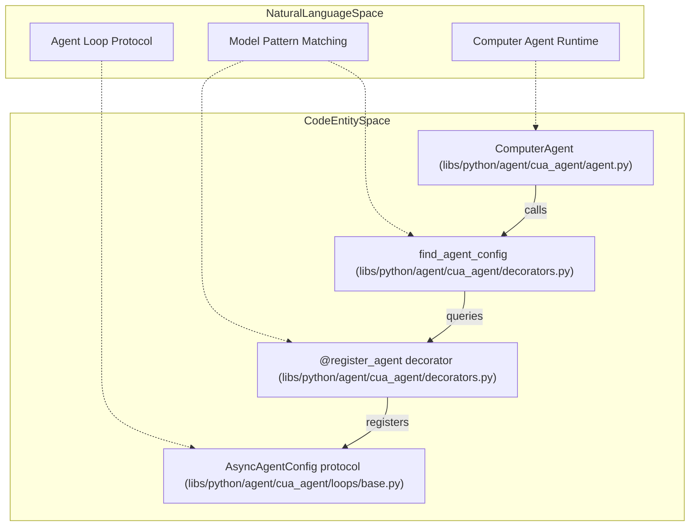
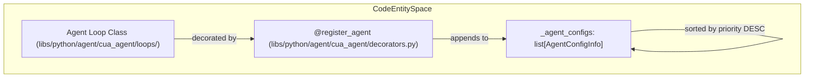
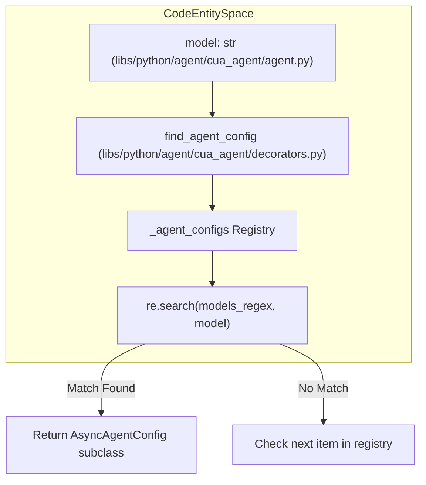
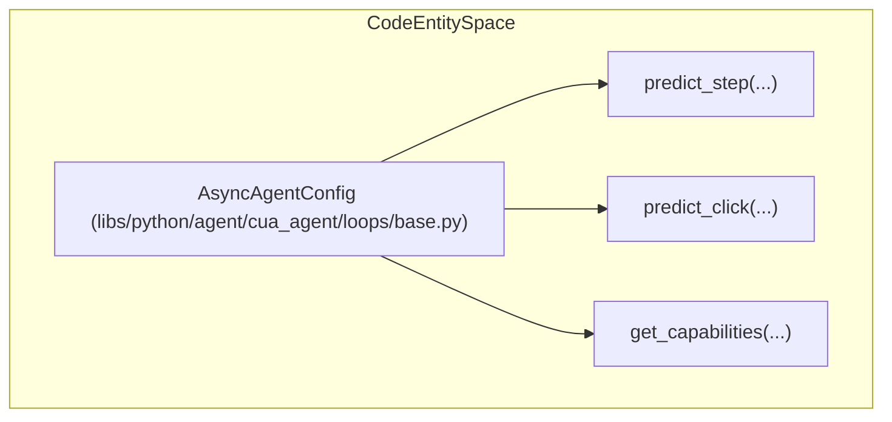
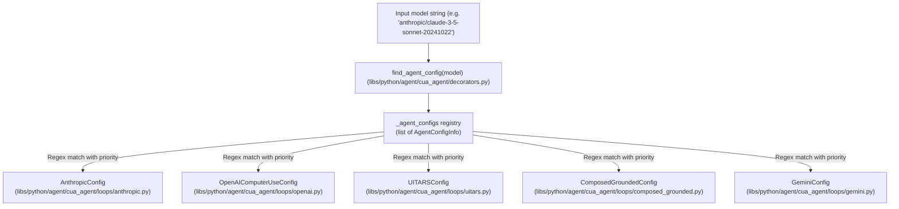

<!-- source: DeepWiki mcp.deepwiki.com · repo trycua/cua · page 3.4 Agent Loops · fetched 2026-10-29 -->

# Agent Loops

<details>
<summary>Relevant source files</summary>

The following files were used as context for generating this wiki page:

- [Makefile](Makefile)
- [libs/python/agent/.bumpversion.cfg](libs/python/agent/.bumpversion.cfg)
- [libs/python/agent/README.md](libs/python/agent/README.md)
- [libs/python/agent/pyproject.toml](libs/python/agent/pyproject.toml)
- [libs/python/core/.bumpversion.cfg](libs/python/core/.bumpversion.cfg)
- [libs/python/core/README.md](libs/python/core/README.md)
- [libs/python/core/pyproject.toml](libs/python/core/pyproject.toml)
- [libs/python/som/.bumpversion.cfg](libs/python/som/.bumpversion.cfg)
- [libs/python/som/README.md](libs/python/som/README.md)
- [libs/python/som/pyproject.toml](libs/python/som/pyproject.toml)

</details>


## Purpose and Scope
This page provides an in-depth technical explanation of how asynchronous agent loops are implemented within the Cua Python agent SDK (`cua-agent`). It covers the `AsyncAgentConfig` protocol that defines the interface for agent loops, the `@register_agent` decorator used to register provider-specific loops, the loop selection logic based on model identifiers, and a detailed overview of the provider-specific loop implementations and their message format conversions.

Sources: [libs/python/agent/cua_agent/agent.py:280-291](), [libs/python/agent/cua_agent/decorators.py:9-62](), [libs/python/agent/cua_agent/loops/base.py:11-80]()

---

## Overview

Agent loops encapsulate the core behavior of Cua agents interacting with various LLM backends for computer-use automation. The design relies on a modular protocol, `AsyncAgentConfig`, which all loops implement to standardize communication and prediction interfaces. Agent loops participate in a registry managed by the `@register_agent` decorator, which associates model string regex patterns with their implementation classes. 

The key runtime component, `ComputerAgent`, dynamically selects the appropriate loop configuration by matching the model string against the registry, then delegates all interaction methods to the selected agent loop implementation.

**System-to-Code Architecture Mapping**



This architecture allows adding new agent loop implementations transparently by decorating the loop class, with automatic discovery and selection at runtime through a priority and regex matching mechanism.

Sources: [libs/python/agent/cua_agent/agent.py:280-291](), [libs/python/agent/cua_agent/decorators.py:9-62](), [libs/python/agent/cua_agent/loops/base.py:11-80]()

---

## Agent Loop Registration

Agent loops are registered using the `@register_agent` decorator, which internally adds an `AgentConfigInfo` entry to a global registry `_agent_configs`. Each registration associates:

- A regular expression pattern to match model strings.
- A numeric priority (higher priority means earlier selection).
- The agent loop class implementing the protocol.

This registration metadata enables runtime selection logic to pick the most appropriate loop based on the requested model.

**Registration Pipeline**



### Registration Mechanism

The decorator factory function accepts a regex string `models` and `priority` int, then wraps the agent loop class:

```python
def register_agent(models: str, priority: int = 0):
    def decorator(agent_class: type):
        config_info = AgentConfigInfo(
            agent_class=agent_class,
            models_regex=models,
            priority=priority
        )
        _agent_configs.append(config_info)
        _agent_configs.sort(key=lambda x: x.priority, reverse=True)
        return agent_class
    return decorator
```

This sorting ensures priority-based dispatching during model matching.

### Registered Loops Table

| Loop Class                | Regex Pattern             | Priority | Example Model Identifier                   |
|---------------------------|---------------------------|----------|--------------------------------------------|
| `AnthropicConfig`         | Specific Claude variants  | 0        | `anthropic/claude-3-5-sonnet-20241022`    |
| `OpenAIComputerUseConfig` | `r".*(^|/)computer-use-preview"` | 0        | `openai/computer-use-preview`             |
| `UITARSConfig`            | `r"(?i).*ui-?tars.*"`     | 0        | `huggingface-local/ByteDance-Seed/UI-TARS-1.5-7B` |
| `ComposedGroundedConfig`  | `r".*\+.*"`               | 1        | `gta1+anthropic/claude-3-5-sonnet-20241022` |
| `GenericVLMConfig`        | `r".*qwen.*vl.*"`         | 0        | `cua/qwen/qwen3-vl-235b`                  |
| `GeminiConfig`            | `r".*gemini.*"`           | 0        | `gemini/gemini-2.0-flash-exp`              |

Sources: [libs/python/agent/cua_agent/loops/anthropic.py:1258-1260](), [libs/python/agent/cua_agent/loops/openai.py:59](), [libs/python/agent/cua_agent/loops/uitars.py:527](), [libs/python/agent/cua_agent/loops/composed_grounded.py:123](), [libs/python/agent/cua_agent/loops/gemini.py:321]()

---

## Loop Selection Logic

The function `find_agent_config(model: str)` uses the global sorted registry `_agent_configs` and attempts each registered agent's regex against the `model` string. The first match returns the corresponding `AsyncAgentConfig` subclass, ensuring high-priority loops mask lower-priority ones.

**Selection Execution Flow**



This flexible pattern matching allows adding new agent loops seamlessly without altering dispatcher logic.

Sources: [libs/python/agent/cua_agent/decorators.py:56-62]()

---

## AsyncAgentConfig Protocol

All agent loops conform to the `AsyncAgentConfig` protocol, defining a consistent async interface for interacting with the agent runtime. This base protocol exposes the following methods:

- `predict_step(...)`: Runs a single prediction step given conversation history, model, tools, and computer handler.
- `predict_click(...)`: Optional method for visual grounding or interpreting user click actions.
- `get_capabilities(...)`: Returns metadata about the loop’s supported features and integrations.

**Protocol Interface Design**



### `predict_step()` Method Parameters

- `messages`: List of chat messages in the Responses API standard format.
- `model`: String identifying the backend LLM/model.
- `tools`: List of `ToolSchema` objects defining usable actions.
- `computer_handler`: An interface to interact with the sandbox/computer environment (e.g. screenshot capture, element querying).

The async `predict_step` coroutine produces the next message or action from the agent backend.

Sources: [libs/python/agent/cua_agent/loops/base.py:14-50](), [libs/python/agent/cua_agent/loops/anthropic.py:70-139]()

---

## Provider-Specific Loop Implementations

Each backend provider integrates distinct APIs and message formats into the agent loop abstraction while implementing the `AsyncAgentConfig` interface.

### Anthropic Loop
- Implemented in `AnthropicConfig`.
- Uses the `litellm.acompletion()` call to connect with Claude models.
- Supports native beta `computer-use-preview` headers for enhanced capabilities.
- Adapts conversation history between the internal API and Anthropic's format.

Sources: [libs/python/agent/cua_agent/loops/anthropic.py:36-68]()

### OpenAI Loop
- Implemented in `OpenAIComputerUseConfig`.
- Uses Responses API format for fine-tuned communication.
- Supports OpenAI's official computer-use-preview endpoints.

Sources: [libs/python/agent/cua_agent/loops/openai.py:18-56]()

### UITARS Loop
- Implemented in `UITARSConfig`.
- Supports local model inference using `mlx-vlm` (macOS) or Hugging Face Transformers.
- Handles intelligent image resizing and message conversions to interface with UITARS models.
- Uses `smart_resize()` utility to adjust inputs for the visual language model.

Sources: [libs/python/agent/cua_agent/loops/uitars.py:52-152](), [libs/python/agent/pyproject.toml:43-51]()

### Composed Grounded Loop
- Implemented in `ComposedGroundedConfig`.
- Enables multi-model execution by splitting the task between a visual grounding model and a reasoning planning LLM.
- Model identifiers combine with a `+` sign (e.g., `gta1+anthropic/claude-3-5-sonnet-20241022`).
- Manages inter-model communication and thread context merges.

Sources: [libs/python/agent/cua_agent/loops/composed_grounded.py:123-316]()

### Gemini Loop
- Implemented in `GeminiConfig`.
- Wraps Google's `google-genai` SDK.
- Maps tool calls into Gemini `Content` message types.
- Uses the Gemini APIs for chat completion and streaming results.

Sources: [libs/python/agent/cua_agent/loops/gemini.py:1-321](), [libs/python/agent/pyproject.toml:87-89]()

---

## Message Format Conversion and Capabilities

Each agent loop converts between Cua's internal standardized `Responses API` message format and the provider-specific interaction schema. This includes tool call encoding, message metadata management, and turn-taking.

### Capability Matrix

| Agent Loop Class         | Step Prediction | Click Prediction | Key Integration Dependency    |
|--------------------------|-----------------|------------------|-------------------------------|
| `AnthropicConfig`        | ✅              | ✅               | `litellm`                     |
| `OpenAIComputerUseConfig`| ✅              | ✅               | `litellm`                     |
| `UITARSConfig`           | ✅              | ✅               | `mlx-vlm` / `transformers`   |
| `ComposedGroundedConfig` | ✅              | ✅               | Multi-model composition       |
| `GeminiConfig`           | ✅              | ✅               | `google-genai`                |

---

## Summary Diagram: From Model Identifier to Execution Loop



---

## Summary Diagram: Agent Loop Interaction Flow At Runtime

```mermaid
sequenceDiagram
    participant CA as ComputerAgent
    participant Loop as AsyncAgentConfig implementation
    participant Tools as ToolSchema list
    participant Handler as Computer Handler (screen, input)
    participant LLM as Provider-specific backend

    CA->>Loop: find_agent_config(model)
    CA->>Loop: predict_step(messages, model, tools, handler)
    Loop->>LLM: Convert messages + tools to provider format
    LLM-->>Loop: Return raw model output
    Loop->>CA: Convert output to Responses API message format
    CA->>Handler: Request screen capture or state (if needed)
    Handler-->>Loop: Return environment data
    Loop->>CA: Optional predict_click based on visual grounding
```

---

# References

- `AsyncAgentConfig` protocol and base logic: [libs/python/agent/cua_agent/loops/base.py:11-80]()
- `@register_agent` decorator and registration: [libs/python/agent/cua_agent/decorators.py:9-62]()
- Loop selection: [libs/python/agent/cua_agent/decorators.py:56-62]()
- Anthropic loop: [libs/python/agent/cua_agent/loops/anthropic.py:36-68]()
- OpenAI loop: [libs/python/agent/cua_agent/loops/openai.py:18-56]()
- UITARS loop: [libs/python/agent/cua_agent/loops/uitars.py:52-152]()
- Composed Grounded loop: [libs/python/agent/cua_agent/loops/composed_grounded.py:123-316]()
- Gemini loop: [libs/python/agent/cua_agent/loops/gemini.py:1-321]()

---

# Notes

- The design supports extension by simply adding new loop implementations decorated with `@register_agent`.
- The selection mechanism balances priority and regex pattern matching for precise loop dispatch.
- All loops export consistent async APIs to the `ComputerAgent` runtime for plug-and-play usage.
- The system provides a powerful foundation for integrating diverse LLMs and multi-model workflows in the Cua framework.

Sources: [libs/python/agent/cua_agent/agent.py:280-291](), [libs/python/agent/cua_agent/decorators.py:9-62](), [libs/python/agent/cua_agent/loops/base.py:11-80](), [libs/python/agent/cua_agent/loops/anthropic.py:36-68](), [libs/python/agent/cua_agent/loops/openai.py:18-56](), [libs/python/agent/cua_agent/loops/uitars.py:52-152](), [libs/python/agent/cua_agent/loops/composed_grounded.py:123-316](), [libs/python/agent/cua_agent/loops/gemini.py:1-321]()

---

