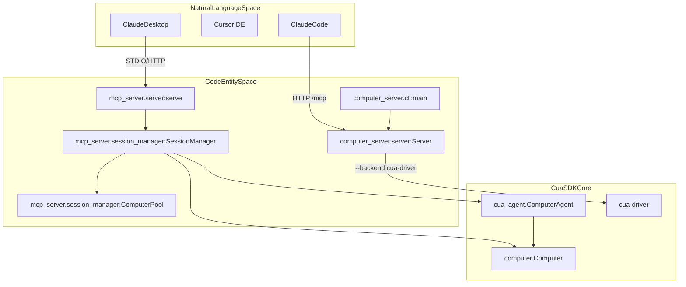
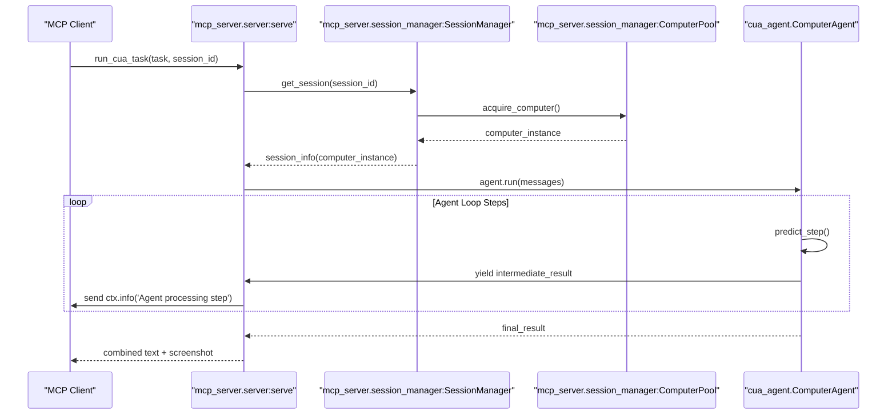

<!-- source: DeepWiki mcp.deepwiki.com · repo trycua/cua · page 3.5 MCP Server · fetched 2026-10-29 -->

# MCP Server

<details>
<summary>Relevant source files</summary>

The following files were used as context for generating this wiki page:

- [libs/cua-driver/rust/crates/cua-driver-core/src/server.rs](libs/cua-driver/rust/crates/cua-driver-core/src/server.rs)
- [libs/cua-driver/rust/crates/cua-driver-core/src/session.rs](libs/cua-driver/rust/crates/cua-driver-core/src/session.rs)
- [libs/cua-driver/rust/crates/cua-driver/src/cli.rs](libs/cua-driver/rust/crates/cua-driver/src/cli.rs)
- [libs/cua-driver/rust/crates/cua-driver/src/main.rs](libs/cua-driver/rust/crates/cua-driver/src/main.rs)
- [libs/cua-driver/rust/crates/cua-driver/src/mcp_http.rs](libs/cua-driver/rust/crates/cua-driver/src/mcp_http.rs)
- [libs/cua-driver/rust/crates/cua-driver/src/proxy.rs](libs/cua-driver/rust/crates/cua-driver/src/proxy.rs)
- [libs/cua-driver/rust/crates/cua-driver/src/responsibility.rs](libs/cua-driver/rust/crates/cua-driver/src/responsibility.rs)
- [libs/cua-driver/rust/crates/cua-driver/src/serve.rs](libs/cua-driver/rust/crates/cua-driver/src/serve.rs)
- [libs/cua-driver/rust/crates/cua-driver/src/telemetry.rs](libs/cua-driver/rust/crates/cua-driver/src/telemetry.rs)
- [libs/cua-driver/rust/crates/platform-macos/src/tools/check_permissions.rs](libs/cua-driver/rust/crates/platform-macos/src/tools/check_permissions.rs)
- [libs/cua-driver/rust/examples/embedded-host-macos/ExampleAgentHarness.swift](libs/cua-driver/rust/examples/embedded-host-macos/ExampleAgentHarness.swift)

</details>


The MCP Server component is a key part of the Cua platform, providing an interface for managing Cua agents and computers via the Model Context Protocol (MCP). It serves as a session manager, coordinating agent lifecycles, resource pooling, and usage telemetry. The MCP Server exists primarily as two patterns:

- A high-level Python MCP Server (`cua-mcp-server`), which manages `ComputerAgent` instances running multi-step autonomous tasks.

- A low-level Computer Server (`cua-computer-server`), which exposes fine-grained OS primitive actions as MCP tools for direct external control.

Both implementations revolve around an MCP JSON-RPC 2.0 server protocol over STDIO or HTTP, with tight integration to the Cua Rust SDK and the `cua-driver` background automation runtime.

---

## Architecture and Role

The MCP Server acts as a bridge between the MCP protocol and Cua’s agent and computer infrastructure. It translates MCP requests into SDK operations and implements session and resource lifecycle management.



**Diagram: MCP Server architecture bridging natural language user agents to Cua SDK components and driver backends**

In this architecture:

- The Python MCP server (`mcp_server.server`) accepts MCP requests from clients like Claude Desktop.

- It uses `SessionManager` (in `mcp_server.session_manager`) to handle multiple concurrent session states, pooling `Computer` instances for efficiency.

- The `ComputerAgent` in `cua_agent` runs the agent loop logic using the returned computer instances.

- The low-level `computer_server` exposes OS primitives via MCP endpoints, delegating either to native OS backends or the Rust-based `cua-driver`.

Sources:  
`libs/python/mcp-server/mcp_server/server.py:117-168`  
`libs/python/mcp-server/mcp_server/session_manager.py:35-80`  
`libs/python/computer-server/README.md:9-80`  
`libs/python/computer-server/cli.py:130-150`  

---

## Python Agent MCP Server

The Python `cua-mcp-server` package provides a session-oriented MCP server interface to run full `ComputerAgent` loops, enabling autonomous multi-turn tasks with agents [libs/python/mcp-server/mcp_server/server.py:117-160]().

### Session Management

- The `SessionManager` maintains a mapping of session IDs to session data that include `ComputerAgent` and `Computer` instances.

- `ComputerPool` holds a collection of `Computer` objects (default max 5) to recycle VM or host backend connections, speeding up session acquisition.

- Each MCP request to run a task retrieves or creates a session, acquires a computer from the pool, and runs the agent loop with the client message sequence.



**Diagram: Agent MCP Server session and resource pool flow**

### Key Implementation Details

- **Computer Pooling**: The pool reduces latency for session startup by reusing existing `Computer` instances [session_manager.py:35-43]().

- **Safe Context Calls**: The `_maybe_call_ctx_method` utility safely invokes context methods on the MCP `Context` object [server.py:65-74]().

- **Agent Initialization**: The agent is configured to keep only the last N screenshots in context (default 3, configurable via `CUA_MAX_IMAGES`) to optimize prompt size [server.py:158-164]().

- **Output Normalization**: Utilities `_normalise_message_content` and `_serialise_tool_content` convert structured agent responses into MCP-friendly strings and metadata [server.py:75-115]().

Sources:  
`libs/python/mcp-server/mcp_server/server.py:66-95`  
`libs/python/mcp-server/mcp_server/server.py:158-164`  
`libs/python/mcp-server/mcp_server/session_manager.py:35-65`  

---

## Computer Server (Low-Level MCP Server)

The `cua-computer-server` package provides a finely grained toolset exposing OS primitives over MCP. It is callable with `python -m computer_server` and mounts a `FastMCP` server at `/mcp` [libs/python/computer-server/README.md:31-59]().

### Tools Exposed

- **Screen and Mouse**: `computer_screenshot`, `computer_click`, `computer_scroll`.

- **Keyboard Input**: `computer_type`, `computer_hotkey`.

- **Filesystem Operations**: `computer_file_read`, `computer_list_directory`.

- **Window Management**: `computer_activate_window`, `computer_launch_app`.

There are over 40 such low-level tools implemented.

### Running Backends

- **native** backend: Uses native platform bindings (PyObjC for macOS, python-xlib for Linux) to perform operations directly [cli.py:58-65]().

- **cua-driver** backend: Routes requests to the Rust `cua-driver` automation runtime. This enables no-focus-steal background computer-use automation with driver-level capabilities [README.md:61-68](). This backend is optimized for host-based or VM-hosted automation tasks.

### Integration Example for Claude Code

Agents like Claude Code can connect to this computer server via HTTP:

```bash
claude mcp add cua-computer-server --transport http http://localhost:8000/mcp
```

Sources:  
`libs/python/computer-server/cli.py:58-65`  
`libs/python/computer-server/README.md:61-68`  
`libs/python/computer-server/README.md:98-101`  

---

## MCP Server Configuration & Usage

### Environment Variables

| Variable                   | Description                                            | Default                                |
|----------------------------|--------------------------------------------------------|--------------------------------------|
| `CUA_MODEL_NAME`            | LLM used by the Agent MCP server                       | `anthropic/claude-sonnet-4-5-20250929` |
| `CUA_MAX_IMAGES`            | Max screenshots retained in agent context              | `3`                                  |
| `CUA_USE_HOST_COMPUTER_SERVER` | If true, MCP sessions use the host machine server instead of VM | `false`                              |
| `CUA_BACKEND`               | Default automation backend for computer-server          | `native`                             |

These are read and used by the MCP Python server and session manager components to adjust agent behavior and resource usage.

Sources:  
`libs/python/mcp-server/mcp_server/server.py:158-164`  
`libs/python/mcp-server/mcp_server/session_manager.py:61-65`  

---

## Underlying Rust MCP Server Implementation in cua-driver

The Rust crate `cua-driver` implements a local daemon that provides MCP JSON-RPC 2.0 over various transports (STDIO, Unix socket, Windows Named Pipe, HTTP). It serves as the underpinning backend for some MCP sessions especially for low-level computer control.

### CLI and Daemon Serve Commands

- The `cua-driver` CLI defaults to the MCP server mode (`mcp serve`), providing an MCP daemon accessible over platform sockets [cli.rs:1-169]().

- The serve subcommand runs a local daemon that listens on a platform-specific socket or pipe [serve.rs:1-192]().

### MCP Transport and Session Handling

- Requests are line-delimited JSON objects conforming to the MCP method shapes (`call`, `list`, `describe`, `shutdown`) [serve.rs:6-14]().

- The daemon maintains a registry of active proxy sessions and manages trusted session resumption with expiry semantics [serve.rs:32-117]().

- It supports direct SDK runtime ownership and proxying to an embedded service depending on platform and launch parameters [proxy.rs:1-160]().

### HTTP MCP Transport

- An HTTP front-end listener is implemented to allow multiplexed concurrent agents over distinct HTTP connections, improving parallelism [mcp_http.rs:1-158]().

- The HTTP daemon binds only to localhost and requires a configured token for authorization.

### Session Lifecycle and Cleanup

- The Rust MCP server manages session lifecycle hooks for cleanup, revival, and telemetry observation of sessions and tools [cua-driver-core/src/session.rs:1-204]().

- It supports granular session transport types and client kinds for telemetry demarcation.

### Responsibility on macOS

- The daemon may re-exec itself with a "disclaim" spawn attribute to delegate responsibility (TCC entitlement context) properly for permissions [responsibility.rs:1-168]().

---

## Summary

The MCP Server component is vital for bridging Cua agents, external model providers, and the local or VM-hosted computer automation backends. It provides session management, request routing, tool invocation, pooling of costly resources such as VM or host `Computer` instances, and telemetry. It exists as both:

- A Python MCP Server that provides full `ComputerAgent` loops with session tracking and pooling.

- A low-level Computer Server that exposes detailed OS primitives over MCP.

Beneath them, the Rust `cua-driver` MCP daemon provides a robust JSON-RPC transport, session lifecycle, and authorization enforcement layer with both STDIO and HTTP transports, leveraging platform capabilities and fine-grained permission models.

---

# References to Key Source Files

| Component                                    | File Path                                                     | Lines               |
|----------------------------------------------|---------------------------------------------------------------|---------------------|
| MCP CLI Commands and Parsing                  | `libs/cua-driver/rust/crates/cua-driver/src/cli.rs`           | 1-169               |
| MCP Daemon Main Entry & Startup               | `libs/cua-driver/rust/crates/cua-driver/src/main.rs`          | 1-170               |
| MCP Daemon Serve Protocol & Session Handling | `libs/cua-driver/rust/crates/cua-driver/src/serve.rs`         | 1-192               |
| MCP HTTP Transport                            | `libs/cua-driver/rust/crates/cua-driver/src/mcp_http.rs`      | 1-158               |
| MCP Proxy & Direct Runtime Adapter            | `libs/cua-driver/rust/crates/cua-driver/src/proxy.rs`         | 1-160               |
| Session Lifecycle Hooks                       | `libs/cua-driver/rust/crates/cua-driver-core/src/session.rs`  | 1-204               |
| macOS Responsibility Re-exec                  | `libs/cua-driver/rust/crates/cua-driver/src/responsibility.rs` | 1-168               |

Sources:  
`libs/cua-driver/rust/crates/cua-driver/src/cli.rs`  
`libs/cua-driver/rust/crates/cua-driver/src/main.rs`  
`libs/cua-driver/rust/crates/cua-driver/src/serve.rs`  
`libs/cua-driver/rust/crates/cua-driver/src/mcp_http.rs`  
`libs/cua-driver/rust/crates/cua-driver/src/proxy.rs`  
`libs/cua-driver/rust/crates/cua-driver-core/src/session.rs`  
`libs/cua-driver/rust/crates/cua-driver/src/responsibility.rs`

---

