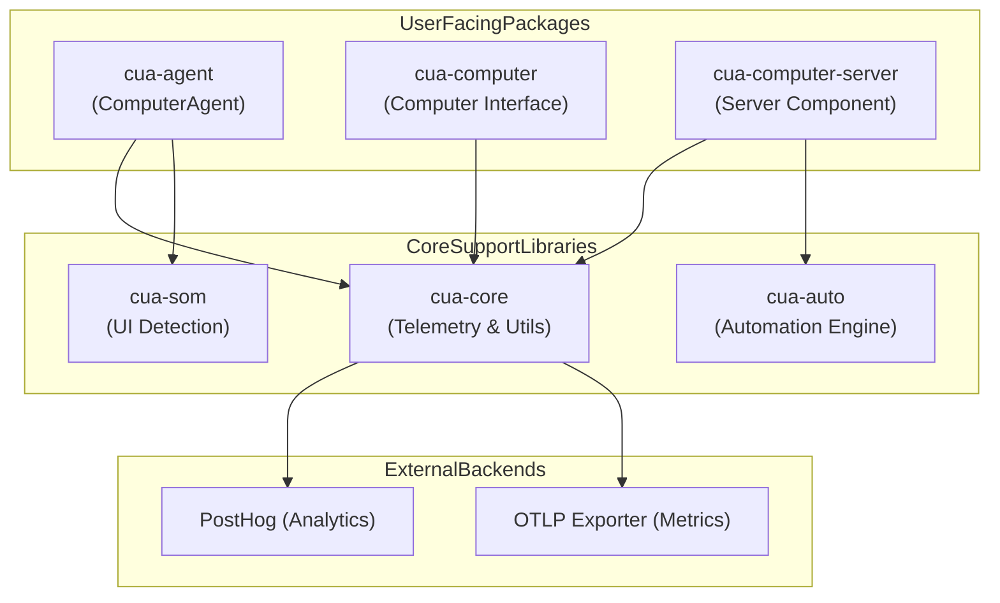
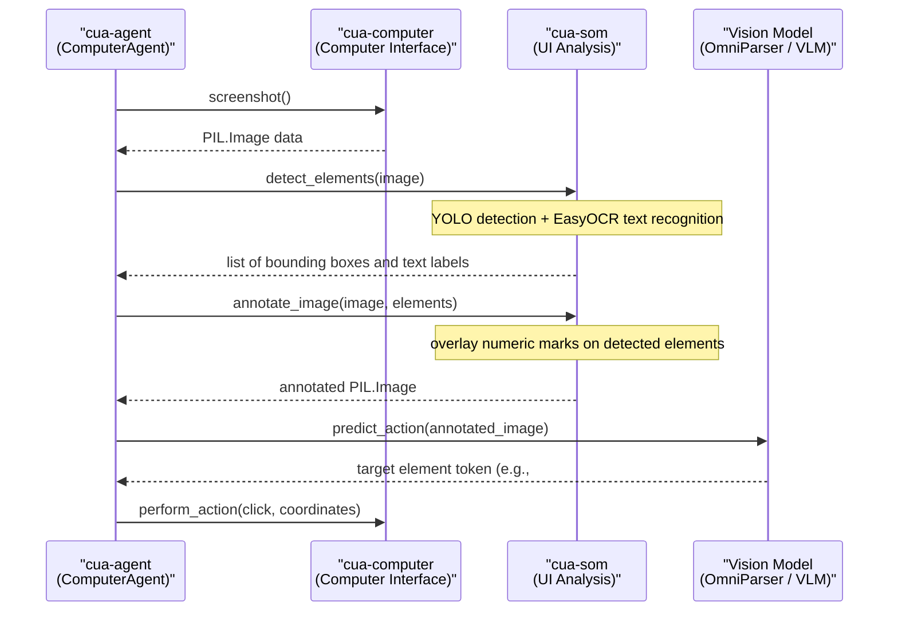

<!-- source: DeepWiki mcp.deepwiki.com · repo trycua/cua · page 3.6 Core Utilities and SOM · fetched 2026-10-29 -->

# Core Utilities and SOM

<details>
<summary>Relevant source files</summary>

The following files were used as context for generating this wiki page:

- [.github/scripts/tests/test_documented_cargo_targets.py](.github/scripts/tests/test_documented_cargo_targets.py)
- [Makefile](Makefile)
- [TESTING.md](TESTING.md)
- [libs/cua-driver/rust/README.md](libs/cua-driver/rust/README.md)
- [libs/python/agent/.bumpversion.cfg](libs/python/agent/.bumpversion.cfg)
- [libs/python/agent/README.md](libs/python/agent/README.md)
- [libs/python/agent/pyproject.toml](libs/python/agent/pyproject.toml)
- [libs/python/agent/tests/conftest.py](libs/python/agent/tests/conftest.py)
- [libs/python/agent/tests/test_computer_agent.py](libs/python/agent/tests/test_computer_agent.py)
- [libs/python/agent/tests/test_telemetry_events.py](libs/python/agent/tests/test_telemetry_events.py)
- [libs/python/core/.bumpversion.cfg](libs/python/core/.bumpversion.cfg)
- [libs/python/core/README.md](libs/python/core/README.md)
- [libs/python/core/pyproject.toml](libs/python/core/pyproject.toml)
- [libs/python/core/tests/conftest.py](libs/python/core/tests/conftest.py)
- [libs/python/core/tests/test_telemetry.py](libs/python/core/tests/test_telemetry.py)
- [libs/python/som/.bumpversion.cfg](libs/python/som/.bumpversion.cfg)
- [libs/python/som/README.md](libs/python/som/README.md)
- [libs/python/som/pyproject.toml](libs/python/som/pyproject.toml)
- [scripts/docs-generators/python-sdk.ts](scripts/docs-generators/python-sdk.ts)
- [skills/gui-automation/SKILL.md](skills/gui-automation/SKILL.md)
- [skills/gui-automation/references/command-reference.md](skills/gui-automation/references/command-reference.md)

</details>


## Purpose and Scope

This page documents the foundational libraries and shared utilities within the Cua ecosystem, focusing on:

- **`cua-core`**: Provides telemetry integration, logging, and cross-package utility functions used by Cua Python packages.
- **`cua-som`**: The Set-of-Mark visual grounding and OCR library that analyzes UI screenshots for element detection and labeling.
- **`cua-auto`**: The cross-package automation primitives and terminal engine library supporting uniform OS-level input and process control.

These components serve as essential building blocks consumed by the higher-level packages such as `cua-agent`, `cua-computer`, and `cua-computer-server`.

**Sources:** [libs/python/core/pyproject.toml:6-8](), [libs/python/som/pyproject.toml:6-8](), [libs/python/computer-server/pyproject.toml:29-29]()

---

## cua-core: Shared Utilities and Telemetry

### Purpose and Architecture

`cua-core` is a foundational Python package that provides:

- Telemetry event tracking and integration interfaces.
- Utilities for logging and common data models used across Cua Python packages.
- Optional support for operational metrics collection using OpenTelemetry.

### Key Dependencies and Configuration

- **Telemetry Backend**: Uses `posthog` (>=3.20.0) as the main analytics backend for event tracking and user behavior monitoring.
- **Operational Metrics**: Provides optional dependencies for OpenTelemetry API and SDK (`opentelemetry-api`, `opentelemetry-sdk`, `opentelemetry-exporter-otlp-proto-http`) to gather the Four Golden Signals metrics (latency, traffic, errors, saturation).
- Compatible with Python 3.11 to <3.14.

**Dependency excerpt (pyproject.toml):**

```toml
dependencies = [
    "posthog>=3.20.0",
]

[project.optional-dependencies]
otel = [
    "opentelemetry-api>=1.20.0",
    "opentelemetry-sdk>=1.20.0",
    "opentelemetry-exporter-otlp-proto-http>=1.20.0",
]
telemetry = [
    "opentelemetry-api>=1.20.0",
    "opentelemetry-sdk>=1.20.0",
    "opentelemetry-exporter-otlp-proto-http>=1.20.0",
]
```

### Telemetry Implementation Details

- The telemetry client uses a singleton pattern (`PostHogTelemetryClient`) to maintain a global instance responsible for event dispatch.
- Installation UUIDs and persistent state are stored under a config path typically at `~/.config/cua/installation_id`.
- Telemetry is governed by environment variables and config files for opt-in/opt-out control:
  - Environment variables: `CUA_TELEMETRY`, `CUA_TELEMETRY_ENABLED`, `DO_NOT_TRACK`.
  - A config file under `~/.cua/config.toml` with a `[telemetry]` section can disable telemetry globally.
  
- The system respects privacy by honoring opt-out flags or CI environment detection to suppress telemetry during automated workflows.
- When telemetry is disabled, all event recording calls no-op immediately to avoid overhead.
- When enabled, events are serialized and sent asynchronously to PostHog.

### Key Classes and Functions

- `PostHogTelemetryClient`: Main class encapsulating the PostHog client lifecycle, configuration, and event recording.
- `is_telemetry_enabled()`: Function to detect if telemetry should be enabled based on environment and config.
- Event recording functions which serialize events with context such as version, platform, and model information.

---

## Dependency Graph: Core Package Integration

This diagram maps user-facing Cua packages and their dependencies on core shared libraries and external telemetry/meters backends.



**Sources:** [libs/python/computer/pyproject.toml:18-18](), [libs/python/agent/pyproject.toml:21-41](), [libs/python/computer-server/pyproject.toml:29-37](), [libs/python/core/pyproject.toml:13-30]()

---

## cua-som: UI Detection and OCR Library

### Purpose and Functionality

`cua-som` (Set-of-Mark) is a Python package specializing in visual grounding for UI automation:

- Uses computer vision and OCR to identify UI elements in screenshots.
- Combines YOLO-based icon detection with EasyOCR text detection.
- Assigns unique numeric labels ("marks") visually on detected elements to enable referencing by VLMs (Vision-Language Models).
- This approach replaces fragile direct coordinate references with stable, indexed UI element tokens.

### Core Components and Techniques

- **Icon Detection**: YOLO model (via `ultralytics` package) trained to detect UI iconography at multiple scales.
- **Text Detection**: GPU-accelerated OCR via `easyocr` extracting text content for input fields, buttons, labels.
- **Visualization**: Uses `supervision` and `opencv-python-headless` to render bounding boxes and numeric marks on images.
- **Hardware Acceleration**: 
  - Optimized for Apple Silicon Macs with Metal Performance Shaders (MPS).
  - Falls back to CUDA or CPU-only mode depending on detected hardware.
  
### Usage Example

```python
from som import OmniParser
from PIL import Image

parser = OmniParser()
image = Image.open("screenshot.png")
result = parser.parse(
    image,
    box_threshold=0.3,
    iou_threshold=0.1,
    use_ocr=True
)

for elem in result.elements:
    if elem.type == "icon":
        print(f"Icon: confidence={elem.confidence:.3f}, bbox={elem.bbox.coordinates}")
    else:  # text
        print(f"Text: '{elem.content}', confidence={elem.confidence:.3f}")
```

### License and Maintenance

- `cua-som` is licensed under **AGPL-3.0-or-later** because of the dependencies (notably the Ultralytics YOLO).
- It is **deprecated** and no longer maintained within the core Cua packages.
- The `omni` optional feature in `cua-agent` that used `cua-som` was removed due to the license mismatch and maintenance status.
- Users who want `cua-som` can install it separately with awareness of its AGPL licensing.

**Note:** Current Cua development favors newer visual grounding mechanisms in separate models and packages.

---

## Visual Grounding Data Flow

This sequence diagram depicts how `cua-agent` integrates with `cua-som` to process screenshots into annotated images with numeric UI element labels for downstream VLM consumption.



**Sources:** [libs/python/som/pyproject.toml:8-25](), [libs/python/agent/pyproject.toml:40-42]()

---

## cua-auto: Cross-Platform Automation Library

### Purpose and Role

- `cua-auto` is a low-level automation library providing primitives for cross-platform input injection and terminal management.
- Implements abstractions to unify input/event dispatch across macOS, Windows, and Linux.
- Provides PTY and terminal interaction engines used by `cua-computer-server` to apply commands, send input events, or emulate terminals in a consistent manner.
- It forms a reusable foundation for other Cua components requiring OS-level interaction and automation.

**Sources:** [libs/python/computer-server/pyproject.toml:28-29]()

---

## Version Coordination and Release Sync

The core utility packages maintain aligned versioning for compatibility and synchronized release cycles through `.bumpversion.cfg` files:

| Package     | Current Version | Config File Path                      |
|-------------|-----------------|-------------------------------------|
| `cua-core`  | 0.3.2           | [libs/python/core/.bumpversion.cfg:2-2]() |
| `cua-som`   | 0.1.4           | [libs/python/som/.bumpversion.cfg:2-2]()  |
| `cua-agent` | 0.9.0           | [libs/python/agent/.bumpversion.cfg:2-2]()|

This systematic version bumping mechanism ensures consistent dependency upgrades and package releases across the Cua ecosystem.

---

# Summary

This page documented key foundational components:

- **`cua-core`**: provides robust telemetry and logging with opt-in/out controls using PostHog and OpenTelemetry.
- **`cua-som`**: the deprecated but feature-rich visual grounding library that performs YOLO-based icon detection combined with OCR for UI element analysis.
- **`cua-auto`**: the automation primitives package abstracting cross-OS input and terminal control.

They are critical enablers for higher-level user-facing packages such as `cua-agent` and `cua-computer-server`, and integrate with telemetry backends and model-driven components to complete the Cua platform.

---

# References

- [libs/python/core/pyproject.toml:6-30]()
- [libs/python/core/tests/test_telemetry.py:29-173]()
- [libs/python/som/pyproject.toml:6-29]()
- [libs/python/agent/pyproject.toml:21-42]()
- [libs/python/computer-server/pyproject.toml:28-38]()
- [libs/python/core/.bumpversion.cfg:2-2]()
- [libs/python/som/.bumpversion.cfg:2-2]()
- [libs/python/agent/.bumpversion.cfg:2-2]()

---

