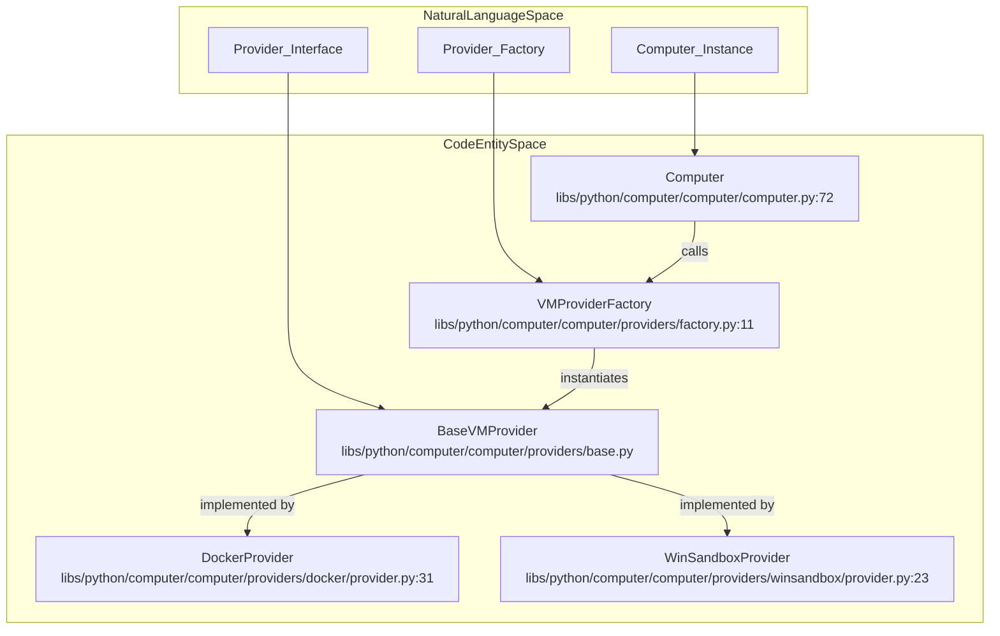
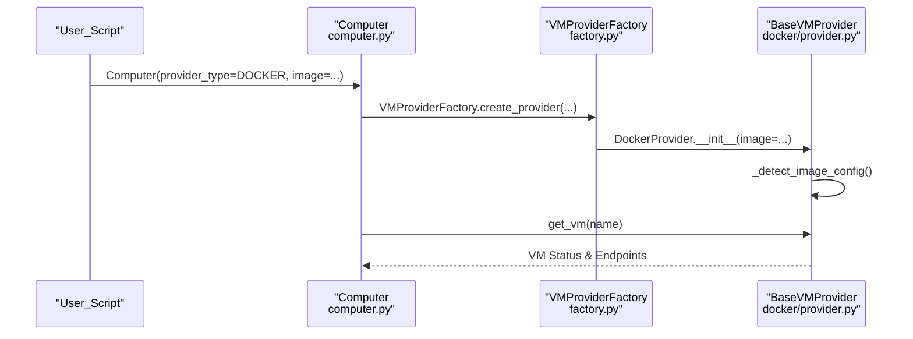

<!-- source: DeepWiki mcp.deepwiki.com · repo trycua/cua · page 4 Execution Environments · fetched 2026-10-29 -->

# Execution Environments

Relevant source files

The following files were used as context for generating this wiki page:

- [.github/workflows/cd-bench-images.yml](.github/workflows/cd-bench-images.yml)
- [.github/workflows/cd-image-linux.yml](.github/workflows/cd-image-linux.yml)
- [.github/workflows/cd-image-omarchy.yml](.github/workflows/cd-image-omarchy.yml)
- [.github/workflows/cd-image-windows.yml](.github/workflows/cd-image-windows.yml)
- [.github/workflows/cd-images-spacesd-release.yml](.github/workflows/cd-images-spacesd-release.yml)
- [.github/workflows/ci-images-spacesd-lag.yml](.github/workflows/ci-images-spacesd-lag.yml)
- [libs/cua/crates/cua-spaces-app-core/parity/golden/create-gpu.json](libs/cua/crates/cua-spaces-app-core/parity/golden/create-gpu.json)
- [libs/cua/crates/cua-spaces-app-core/parity/golden/create-resources.json](libs/cua/crates/cua-spaces-app-core/parity/golden/create-resources.json)
- [libs/images/README.md](libs/images/README.md)
- [libs/images/bench/web/lock.json](libs/images/bench/web/lock.json)
- [libs/images/macos/build.sh](libs/images/macos/build.sh)
- [libs/images/macos/files/install-guest.sh](libs/images/macos/files/install-guest.sh)
- [libs/images/sandbox-images.json](libs/images/sandbox-images.json)
- [scripts/images/image_pins.py](scripts/images/image_pins.py)
- [scripts/images/pins-pr.sh](scripts/images/pins-pr.sh)
- [scripts/images/release-macos.sh](scripts/images/release-macos.sh)
- [scripts/images/tests/test_image_pins.py](scripts/images/tests/test_image_pins.py)

The Cua framework supports multiple execution environments, enabling agents to control VMs and containers across diverse platforms (macOS, Linux, Windows, and Android). The `Computer` class ([libs/python/computer/computer/computer.py:72-167]()) abstracts these execution environments via a unified provider pattern, allowing agentic workflows to target local or remote infrastructure without modifying interaction logic.

This is a parent page providing a high-level overview of available execution environments. For deep technical details, see the child pages:
- [Provider Architecture](#4.1) — Explain the provider abstraction: `VMProviderFactory`, `BaseVMProvider` interface, provider types (`CLOUD`, `LUME`, `DOCKER`, etc.), and how Computer SDK selects and initializes providers
- [Cloud Provider](#4.2) — Using Cua Cloud Sandbox: authentication with `CUA_API_KEY`, creating and managing cloud VMs via API, sandbox lifecycle, and pricing/limitations
- [Lume Provider (macOS VMs)](#4.3) — Using Lume for local macOS VMs: requirements, lume CLI installation, pulling images, VM management, and integration with Computer SDK
- [Docker Provider](#4.4) — Running agents in Docker containers: KASM images, `trycua/lumier`, XFCE desktop environment, port mappings, volume mounts, and Docker-specific configuration
- [Windows Sandbox and Host Providers](#4.5) — Cover Windows Sandbox provider for Windows 10/11 Pro testing and the Host provider for running computer-server directly on localhost without VMs
- [QEMU and Android Providers](#4.6) — Running sandboxes with QEMU: Docker-wrapped and bare-metal QEMU modes, Linux/Windows QEMU images, Android emulator runtime with gRPC `EmulatorController`, and mobile interface support
- [Sandbox Image Catalog and Build Pipeline](#4.7) — `libs/images`: `sandbox-images.json` pins, `bench/osworld/omarchy/macos/linux/windows` image builds, manifest tooling, and CD workflows that publish them

---

## Environment Types Overview

Cua offers a wide range of providers managed through `VMProviderFactory` ([libs/python/computer/computer/providers/factory.py:11-173]()).

| Type | Provider Class | Use Case | Platforms | Key Features |
|---|---|---|---|---|
| **Cloud / CloudV2** | `CloudProvider` / `CloudV2Provider` | Production, zero-setup | Any (API-based) | Managed Ubuntu containers, token auth, domain-based endpoints |
| **Lume** | `LumeProvider` | Local macOS virtualization | macOS (Apple Silicon) | Native Apple `Virtualization.framework`, full macOS VMs |
| **Docker** | `DockerProvider` | Cross-platform containerized execution | Linux, macOS, Windows | Lightweight Linux containers, XFCE desktops, Kasm images |
| **Lumier** | `LumierProvider` | Containerized macOS runtimes | macOS (Apple Silicon) | macOS VMs nested inside Docker containers |
| **Windows Sandbox** | `WinSandboxProvider` | Windows native testing | Windows 10/11 Pro | Ephemeral Windows VMs, `pywinsandbox` integration |
| **QEMU / Android** | `DockerProvider` (QEMU images) | Emulated multi-arch environments | Any (Docker-based) | Emulated Linux, Windows, and Android runtimes via QEMU |

Sources: [libs/python/computer/computer/providers/factory.py:11-173](), [libs/python/computer/computer/providers/docker/provider.py:31-67](), [libs/python/computer/computer/providers/winsandbox/provider.py:23-50]()

---

## Execution Environment Architecture

The execution environment system bridges high-level agent configuration parameters to concrete platform backends. The `Computer` class instantiates providers using `VMProviderFactory`, which returns an instance implementing the `BaseVMProvider` interface.

Title: Provider Factory and Code Entity Mapping

Sources: [libs/python/computer/computer/computer.py:72-167](), [libs/python/computer/computer/providers/factory.py:11-50](), [libs/python/computer/computer/providers/docker/provider.py:31-67](), [libs/python/computer/computer/providers/winsandbox/provider.py:23-50]()

---

## Provider Highlights

### 1. Cloud Providers
Managed sandboxes hosted on the Cua Cloud infrastructure. They authenticate using `CUA_API_KEY` and connect via `aiohttp` and `websockets` ([libs/python/computer/computer/interface/generic.py:6-7]()). For details, see [Cloud Provider](#4.2).

### 2. Lume Provider
Local macOS virtualization leveraging Apple Silicon. Managed via the Lume CLI ([libs/python/computer/computer/providers/factory.py:58-73]()). Lume images are built in tiers (slim, full, xcode) and published to `ghcr.io/trycua/macos` ([libs/images/macos/build.sh:12-15]()). For details, see [Lume Provider (macOS VMs)](#4.3).

### 3. Docker Provider & Lumier
Runs isolated containers and detects image types (`_detect_image_config`) to configure home directories (`/home/kasm-user`, `/home/cua`, or `/home/androidusr`) ([libs/python/computer/computer/providers/docker/provider.py:80-121]()). Docker images for Linux, such as `ghcr.io/trycua/linux:24.04`, are canonical and can be run locally or on Fleet ([libs/images/README.md:7]()). For details, see [Docker Provider](#4.4).

### 4. Windows Sandbox and Host Providers
Leverages `pywinsandbox` for ephemeral Windows test environments, executing setup routines like `setup_script.ps1` ([libs/python/computer/computer/providers/winsandbox/setup_script.ps1:1-153]()) or connecting directly to a host computer server (`use_host_computer_server=True`) ([libs/python/computer/computer/computer.py:101]()). Windows images like `ghcr.io/trycua/windows:2022` are built as containerDisks ([libs/images/README.md:25]()). For details, see [Windows Sandbox and Host Providers](#4.5).

### 5. QEMU and Android Providers
Enables hardware emulation for mobile or non-native desktop targets via QEMU container images ([libs/python/computer/computer/providers/docker/provider.py:60-62]()). This includes Linux and Windows QEMU images ([libs/images/sandbox-images.json:56-60](), [libs/images/sandbox-images.json:108-112]()). For details, see [QEMU and Android Providers](#4.6).

### 6. Sandbox Image Catalog and Build Pipeline
The `libs/images` directory contains the `sandbox-images.json` catalog, which defines available sandbox images, their properties, and how they are built and published. This catalog is used by applications like Cua Spaces and OpenKoalaBots samples ([libs/images/sandbox-images.json:1-2]()). Images are grouped into `canonical`, `benchmark`, and `distro` ([libs/images/sandbox-images.json:4-7]()). The build pipeline for these images is managed through GitHub Actions workflows like `cd-image-linux.yml` ([.github/workflows/cd-image-linux.yml:1-729]()), `cd-bench-images.yml` ([.github/workflows/cd-bench-images.yml:1-431]()), and `cd-images-spacesd-release.yml` ([.github/workflows/cd-images-spacesd-release.yml:1-206]()). These workflows handle building, gating, pushing, and promoting images to registries like `ghcr.io/trycua` ([libs/images/README.md:15-17]()). For details, see [Sandbox Image Catalog and Build Pipeline](#4.7).

Sources: [libs/python/computer/computer/interface/generic.py:6-7](), [libs/python/computer/computer/providers/factory.py:58-73](), [libs/images/macos/build.sh:12-15](), [libs/python/computer/computer/providers/docker/provider.py:80-121](), [libs/images/README.md:7](), [libs/python/computer/computer/providers/winsandbox/setup_script.ps1:1-153](), [libs/python/computer/computer/computer.py:101](), [libs/images/README.md:25](), [libs/python/computer/computer/providers/docker/provider.py:60-62](), [libs/images/sandbox-images.json:56-60](), [libs/images/sandbox-images.json:108-112](), [libs/images/sandbox-images.json:1-2](), [libs/images/sandbox-images.json:4-7](), [.github/workflows/cd-image-linux.yml:1-729](), [.github/workflows/cd-bench-images.yml:1-431](), [.github/workflows/cd-images-spacesd-release.yml:1-206](), [libs/images/README.md:15-17]()

---

## Lifecycle Execution Flow

Title: Lifecycle Execution and Verification Flow

Sources: [libs/python/computer/computer/computer.py:92-167](), [libs/python/computer/computer/providers/factory.py:11-50](), [libs/python/computer/computer/providers/docker/provider.py:39-121]()

---

