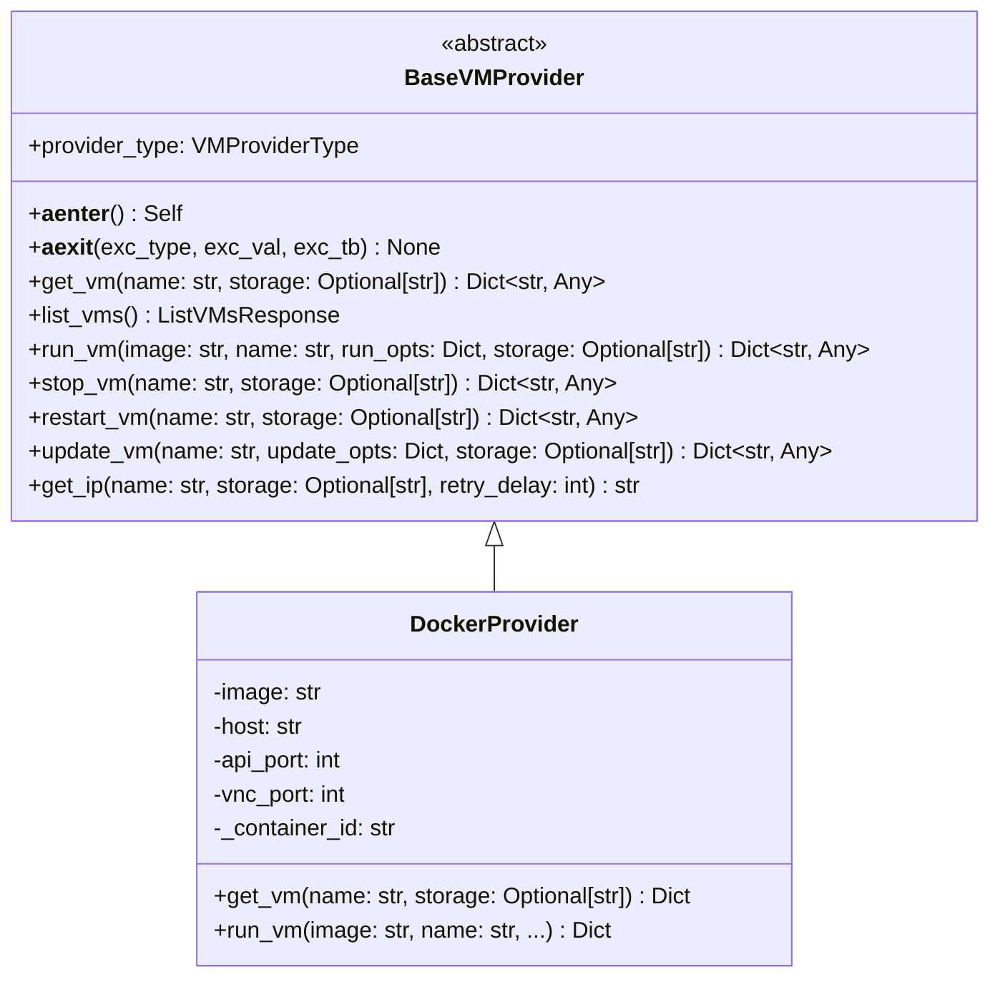
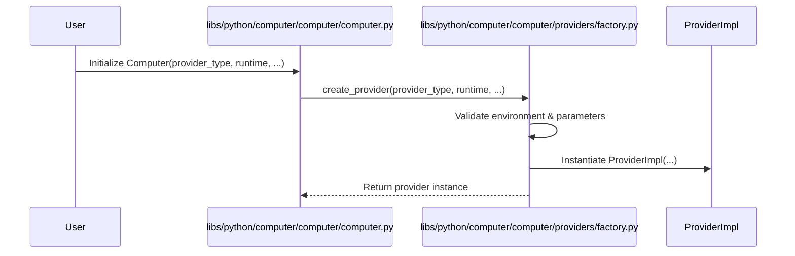
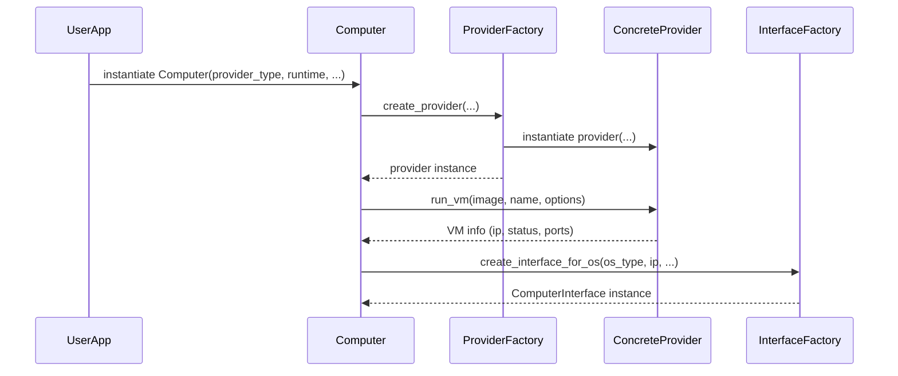
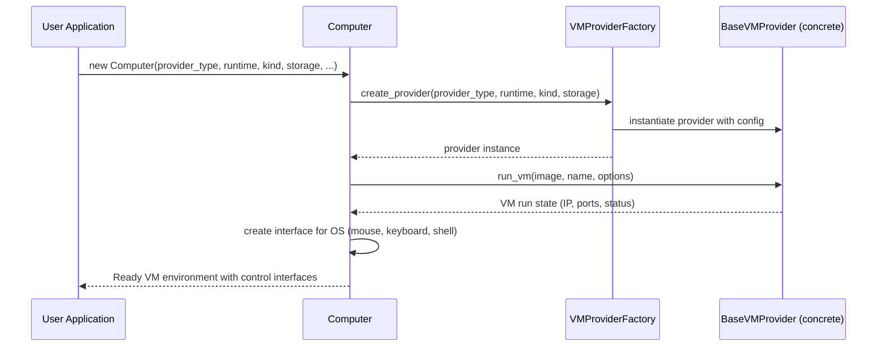

<!-- source: DeepWiki mcp.deepwiki.com · repo trycua/cua · page 4.1 Provider Architecture · fetched 2026-10-29 -->

# Provider Architecture

<details>
<summary>Relevant source files</summary>

The following files were used as context for generating this wiki page:

- [docs/content/docs/cua-sdk/reference/runtime-support.mdx](docs/content/docs/cua-sdk/reference/runtime-support.mdx)
- [libs/python/cua-sandbox/CHANGELOG.md](libs/python/cua-sandbox/CHANGELOG.md)
- [libs/python/cua-sandbox/README.md](libs/python/cua-sandbox/README.md)
- [libs/python/cua-sandbox/VERSION](libs/python/cua-sandbox/VERSION)
- [libs/python/cua-sandbox/cua_sandbox/__init__.py](libs/python/cua-sandbox/cua_sandbox/__init__.py)
- [libs/python/cua-sandbox/cua_sandbox/pool.py](libs/python/cua-sandbox/cua_sandbox/pool.py)
- [libs/python/cua-sandbox/cua_sandbox/sandbox.py](libs/python/cua-sandbox/cua_sandbox/sandbox.py)
- [libs/python/cua-sandbox/cua_sandbox/sync/__init__.py](libs/python/cua-sandbox/cua_sandbox/sync/__init__.py)
- [libs/python/cua-sandbox/cua_sandbox/transport/fleet.py](libs/python/cua-sandbox/cua_sandbox/transport/fleet.py)
- [libs/python/cua-sandbox/cua_sandbox/transport/fleet_cloud.py](libs/python/cua-sandbox/cua_sandbox/transport/fleet_cloud.py)
- [libs/python/cua-sandbox/pyproject.toml](libs/python/cua-sandbox/pyproject.toml)
- [libs/python/cua-sandbox/tests/test_fleet_cloud_client.py](libs/python/cua-sandbox/tests/test_fleet_cloud_client.py)
- [libs/python/cua-sandbox/tests/test_fleet_cloud_transport.py](libs/python/cua-sandbox/tests/test_fleet_cloud_transport.py)
- [libs/python/cua-sandbox/tests/test_fleet_sdk_distribution.py](libs/python/cua-sandbox/tests/test_fleet_sdk_distribution.py)
- [libs/python/cua-sandbox/tests/test_fleet_sdk_packaging.py](libs/python/cua-sandbox/tests/test_fleet_sdk_packaging.py)
- [libs/python/cua-sandbox/tests/test_fleet_transport.py](libs/python/cua-sandbox/tests/test_fleet_transport.py)
- [libs/python/cua-sandbox/tests/test_pool.py](libs/python/cua-sandbox/tests/test_pool.py)
- [libs/python/cua-sandbox/tests/test_sandbox_fleet_lifecycle.py](libs/python/cua-sandbox/tests/test_sandbox_fleet_lifecycle.py)
- [libs/python/cua-sandbox/tests/test_vm_cleanup.py](libs/python/cua-sandbox/tests/test_vm_cleanup.py)
- [libs/python/cua-sandbox/uv.lock](libs/python/cua-sandbox/uv.lock)

</details>


## Purpose and Scope

This page documents the provider abstraction layer that enables the `Computer` SDK to manage and interact uniformly with a variety of execution environments. These include local macOS VMs (Lume), Docker containers, cloud backends (Fleet), Windows Sandboxes, and other platform-specific runtimes.

The provider abstraction isolates backend-specific details behind a consistent interface for provisioning, controlling, and querying sandboxed VM or container instances. It handles runtime selection by `kind` (VM vs container) and `runtime` engine (e.g., `qemu`, `lume`, `docker`, `gvisor`), supports ephemeral vs persistent storage, and manages lifecycle events asynchronously.

This architecture is primarily implemented in the Python SDK under `libs/python/computer/computer/providers/`. It integrates tightly with the `Computer` class in `libs/python/computer/computer/computer.py`, which uses the provider factory (`factory.py`) to instantiate the correct backend provider according to the platform and user inputs.

Related detailed provider info and guides live in these sections:

- Cloud Provider (4.2)
- Lume Provider (4.3)
- Docker Provider (4.4)
- Windows Sandbox Provider (4.5)

---

## Architecture Overview

At the core is an abstract interface `BaseVMProvider` that all providers implement, exposing a unified lifecycle API for sandboxed execution environments.

The factory class `VMProviderFactory` dynamically resolves the appropriate provider class by inspecting the requested `VMProviderType` and environment capabilities.

The typical workflow is:

1. The `Computer` class requests a provider via `VMProviderFactory.create_provider()`, specifying provider type, runtime, and storage configuration.
2. The factory performs pre-flight checks (e.g. Docker availability, Windows Sandbox install).
3. The factory returns a concrete provider instance implementing the `BaseVMProvider` interface.
4. The `Computer` calls lifecycle methods on the provider: `run_vm()`, `get_vm()`, `stop_vm()`, `list_vms()`, etc.
5. Providers supply metadata including IP addresses, ports, and status to the SDK.
6. The SDK then creates OS-specific interfaces for remote control (mouse, keyboard, shell) via an interface factory.

### Provider Entity Diagram

```mermaid
graph TB
    subgraph "ComputerSDKLayer"
        Computer["Computer\n(libs/python/computer/computer/computer.py)"]
    end

    subgraph "ProviderAbstraction"
        Factory["VMProviderFactory\n(libs/python/computer/computer/providers/factory.py)"]
        Base["BaseVMProvider\n(libs/python/computer/computer/providers/base.py)"]
    end
    
    subgraph "ConcreteProviders"
        Lume["LumeProvider\n(libs/python/computer/computer/providers/lume/provider.py)"]
        Lumier["LumierProvider\n(libs/python/computer/computer/providers/lumier/provider.py)"]
        Docker["DockerProvider\n(libs/python/computer/computer/providers/docker/provider.py)"]
        Cloud["CloudProvider\n(libs/python/computer/computer/providers/cloud/provider.py)"]
        WinSandbox["WinSandboxProvider\n(libs/python/computer/computer/providers/winsandbox/provider.py)"]
    end
    
    Computer -->|"calls create_provider()"| Factory
    Factory -->|instantiates| Base
    Base <|-- Lume
    Base <|-- Lumier
    Base <|-- Docker
    Base <|-- Cloud
    Base <|-- WinSandbox
    
    Lume -->|"manages"| LumeVM["macOS VMs (Lume)"]
    Lumier -->|"manages"| LumierContainer["macOS Docker Containers"]
    Docker -->|"manages"| DockerContainer["Linux/Android Docker Containers"]
    Cloud -->|"manages"| CloudVM["Cloud VMs (Fleet)"]
    WinSandbox -->|"manages"| WindowsSandbox["Windows Sandbox Environments"]
```

Sources:  
`libs/python/computer/computer/computer.py:68-72`  
`libs/python/computer/computer/providers/factory.py:11-50`  
`libs/python/computer/computer/providers/base.py:10-134`

---

## VMProviderType Enumeration

The provider type is identified by the `VMProviderType` enum:

| Provider Type | Description | Typical Platform | Usage Example |
|---------------|-------------|------------------|---------------|
| `LUME` | Native macOS virtual machines via the Lume tool | macOS Apple Silicon | Local macOS VM development |
| `LUMIER` | Docker-wrapped macOS VMs | macOS Apple Silicon | macOS containerized runtime |
| `DOCKER` | Docker containers for Linux, QEMU, Android emulator | Cross-platform | Linux automation and Android testing |
| `CLOUD` | Cua Cloud sandbox backend (legacy) | Any | Remote VM management on api.cua.ai |
| `CLOUDV2` | Cua Cloud sandbox backend (v2) | Any | Fleet backend with async HTTP |
| `WINSANDBOX` | Windows Sandbox runtime | Windows 10/11 | Windows VM sandbox |
| `UNKNOWN` | Fallback for unknown providers | N/A | Error handling or fallback |

This enum drives the factory’s provider selection logic and constrains recognized runtimes.

Sources:  
`libs/python/computer/computer/providers/base.py:10-20`  
`libs/python/computer/computer/computer.py:104`  
`libs/python/computer/computer/providers/factory.py:52-56`

---

## BaseVMProvider Interface

The `BaseVMProvider` abstract base class defines the foundational contract each provider implements. It acts as an asynchronous context manager for resource lifecycle and exposes core VM/container lifecycle methods.

### Main Interface Methods

| Method | Purpose |
|---------|---------|
| `__aenter__()` / `__aexit__()` | Async resource context management |
| `get_vm(name, storage)` | Query metadata and status for a named VM/container |
| `list_vms()` | List all active or known VMs/containers |
| `run_vm(image, name, run_opts, storage)` | Provision and start a VM or container |
| `stop_vm(name, storage)` | Stop and clean up the VM/container |
| `restart_vm(name, storage)` | Restart the VM/container |
| `update_vm(name, update_opts, storage)` | Apply live configuration changes |
| `get_ip(name, storage, retry_delay)` | Await the IP address assignment asynchronously |

### Interface UML Diagram



Sources:  
`libs/python/computer/computer/providers/base.py:22-134`  
`libs/python/computer/computer/providers/docker/provider.py:31-49`

---

## VMProviderFactory

The `VMProviderFactory` implements the provider selection and instantiation logic.

### Parameters

| Parameter | Type | Description | Applies to Providers |
|-----------|------|-------------|---------------------|
| `provider_type` | `Union[str, VMProviderType]` | Desired provider | All |
| `provider_port` | `int` | API port for HTTP or management ports | LUME, LUMIER |
| `host` | `str` | Hostname for the API server | LUME, LUMIER, DOCKER |
| `storage` | `Optional[str]` | Path for persistent VM image or container storage | LUME, LUMIER, DOCKER |
| `ephemeral` | `bool` | Ephemeral storage flag (discard on shutdown) | All |
| `image` | `Optional[str]` | Container image to run for Docker or Lumier providers | LUMIER, DOCKER |
| `noVNC_port` | `Optional[int]` | Port for noVNC web clients | LUMIER, DOCKER |
| `api_port` | `Optional[int]` | Port for `computer-server` API | DOCKER |

### Validation and Environment Detection

The factory verifies environment readiness, such as:

- Docker CLI presence and daemon status for Docker/Lumier.
- Windows Sandbox availability for `WINSANDBOX`.
- Local socket availability for Lume API.

If a provider is selected but prerequisites are missing, the factory raises an informative error.

### Basic Factory Workflow



Sources:  
`libs/python/computer/computer/providers/factory.py:15-50`  
`libs/python/computer/computer/providers/docker/provider.py:39-67`

---

## Provider Lifecycle in Computer SDK Initialization

The `Computer` instance manages the backend sandbox's lifecycle through its provider abstraction:

- It creates an instance of the requested provider type via the factory.
- It calls `run_vm()` on the provider, passing image, name, and runtime arguments.
- It awaits environment readiness, fetching IP addresses and port info.
- It then uses `computer.computer.interface.factory.create_interface_for_os` to instantiate platform-specific control interfaces (for mouse, keyboard, shell, screen, etc.).
- Errors during startup or unreachable runtimes raise exceptions with descriptive messages.

### Initialization Sequence Diagram



Sources:  
`libs/python/computer/computer/computer.py:92-122`  
`libs/python/computer/computer/providers/factory.py:20-50`  
`libs/python/computer/computer/interface/factory.py:14-38`

---

## Docker Provider Specifics

The `DockerProvider` class manages container lifecycle for locally running Linux, QEMU, KASM, and Android emulator images.

### Image Type Detection and Defaults

DockerProvider uses the image tag/name to heuristically determine the guest image type and accordingly sets the default home directory inside the container.

| Image pattern suffix | Detected image type | Default home directory |
|---------------------|---------------------|-----------------------|
| contains `xfce` or `docker-xfce` | `docker-xfce` | `/home/cua` |
| contains `qemu-linux` | `qemu-linux` | `/` (root) |
| contains `qemu-windows` | `qemu-windows` | `/` (root) |
| contains `qemu-android` | `qemu-android` | `/home/androidusr` |
| otherwise (default KASM) | `kasm` | `/home/kasm-user` |

### Memory Parsing

The provider converts raw memory allocation strings with units (GB/MB etc.) into Docker-compatible flags (e.g., `"8GB"` to `"8g"`). It accepts both numeric and string formats.

### Persistence

- Supports both ephemeral and persistent storage modes.
- If a valid host directory path is given, persistent disk volumes are attached.
- For specialized QEMU-based containers, a golden image directory is required for caching.

Sources:  
`libs/python/computer/computer/providers/docker/provider.py:39-120`  
`libs/python/computer/computer/providers/docker/provider.py:127-152`

---

## Storage and Persistence Management

Providers handle sandbox storage according to configuration:

| Storage type | Description | Providers supporting |
|--------------|-------------|---------------------|
| Persistent | VM/container image storage on disk, maintains state across runs | LUME, LUMIER, DOCKER |
| Ephemeral | Temporary storage discarded on shutdown | All (by ephemeral=True flag) |
| Forced ephemeral | Windows Sandbox forces ephemeral; no persistent storage supported | WINSANDBOX |

The `ephemeral` boolean option in `VMProviderFactory.create_provider()` governs this behavior. When storage is specified, providers mount or reference corresponding persistent volumes.

Sources:  
`libs/python/computer/computer/providers/docker/provider.py:39-93`  
`libs/python/computer/computer/providers/winsandbox/provider.py:30-71`

---

# Summary Diagram: Natural Language to Code Mapping

```mermaid
graph LR
    subgraph "Natural Language Concepts"
        NL_ComputerSDK["Computer SDK"]
        NL_ProviderFactory["Provider Factory"]
        NL_ProviderInterface["Base Provider Interface"]
        NL_LocalProvider["Local Docker/Lume/Lumier Providers"]
        NL_CloudProvider["Cloud Provider (Fleet)"]
        NL_WinSandboxProvider["Windows Sandbox Provider"]
    end

    subgraph "Code Entities"
        Computer_py["Computer\nlibs/python/computer/computer/computer.py"]
        VMProviderFactory_py["VMProviderFactory\nlibs/python/computer/computer/providers/factory.py"]
        BaseVMProvider_py["BaseVMProvider\nlibs/python/computer/computer/providers/base.py"]
        
        LumeProvider_py["LumeProvider\nlibs/python/computer/computer/providers/lume/provider.py"]
        LumierProvider_py["LumierProvider\nlibs/python/computer/computer/providers/lumier/provider.py"]
        DockerProvider_py["DockerProvider\nlibs/python/computer/computer/providers/docker/provider.py"]
        CloudProvider_py["CloudProvider\nlibs/python/computer/computer/providers/cloud/provider.py"]
        WinSandboxProvider_py["WinSandboxProvider\nlibs/python/computer/computer/providers/winsandbox/provider.py"]
    end

    NL_ComputerSDK -->|initializes| Computer_py
    NL_ProviderFactory -->|selects and creates| VMProviderFactory_py
    NL_ProviderInterface -->|implemented by| BaseVMProvider_py
    
    NL_LocalProvider -->|runtime options| LumeProvider_py
    NL_LocalProvider -->|runtime options| LumierProvider_py
    NL_LocalProvider -->|runtime options| DockerProvider_py
    NL_CloudProvider -->|Fleet SDK| CloudProvider_py
    NL_WinSandboxProvider -->|Windows runtime| WinSandboxProvider_py

    Computer_py -->|calls create_provider| VMProviderFactory_py
    VMProviderFactory_py -->|creates instance| BaseVMProvider_py
    BaseVMProvider_py <|-- LumeProvider_py
    BaseVMProvider_py <|-- LumierProvider_py
    BaseVMProvider_py <|-- DockerProvider_py
    BaseVMProvider_py <|-- CloudProvider_py
    BaseVMProvider_py <|-- WinSandboxProvider_py
```

Sources:  
`libs/python/computer/computer/computer.py:68-90`  
`libs/python/computer/computer/providers/factory.py:10-90`  
`libs/python/computer/computer/providers/base.py:10-134`  
`libs/python/computer/computer/providers/docker/provider.py:30-152`  
`libs/python/computer/computer/providers/lume/provider.py:10-50` (implied)  
`libs/python/computer/computer/providers/winsandbox/provider.py:15-70`

---

# Summary Table: Provider Selection by Runtime and Kind

| `kind` (VM or container) | `runtime` (engine) | Provider Implementation | Typical platform |
|--------------------------|--------------------|-------------------------|------------------|
| `vm` | `lume` | `LumeProvider` (with `VMProviderType.LUME`) | macOS (Apple Silicon) |
| `vm` | `kubevirt` / `cloud` | `CloudProvider` (Fleet sandbox) | Cloud API (any) |
| `container` | `docker` / `runc` | `DockerProvider` | Linux, Windows, Android |
| `container` | `lumier` | `LumierProvider` (wrapper around macOS VMs in Docker) | macOS |
| `vm` | `winsandbox` | `WinSandboxProvider` | Windows 10/11 |

The factory enforces `kind` and `runtime` compatibility and raises `InvalidPlacement` for invalid combinations.

Sources:  
`libs/python/computer/computer/provider/factory.py:50-70` (implied runtime-kind checking)  
`libs/python/computer/computer/computer.py:75-110`

---

# Detailed Data Flow: Creating and Running a Sandbox Environment



Sources:  
`libs/python/computer/computer/computer.py:85-115`  
`libs/python/computer/computer/providers/factory.py:20-50`  
`libs/python/computer/computer/providers/base.py:30-60`

---

# Conclusion

The provider architecture in the Computer SDK abstracts over diverse VM and container runtimes with a unified interface bound by the `BaseVMProvider` abstract class. The `VMProviderFactory` dynamically selects and constructs the correct provider implementation based on runtime, kind, and platform capabilities. This design enables the `Computer` class to uniformly create and manage sandboxed execution environments locally or remotely, delegate OS-level control interfaces seamlessly, and evolve with new backends while preserving a consistent high-level API.

---

# References

- `libs/python/computer/computer/computer.py`  
- `libs/python/computer/computer/providers/base.py`  
- `libs/python/computer/computer/providers/factory.py`  
- `libs/python/computer/computer/providers/docker/provider.py`  
- `libs/python/computer/computer/providers/lume/provider.py`  
- `libs/python/computer/computer/providers/winsandbox/provider.py`

---

