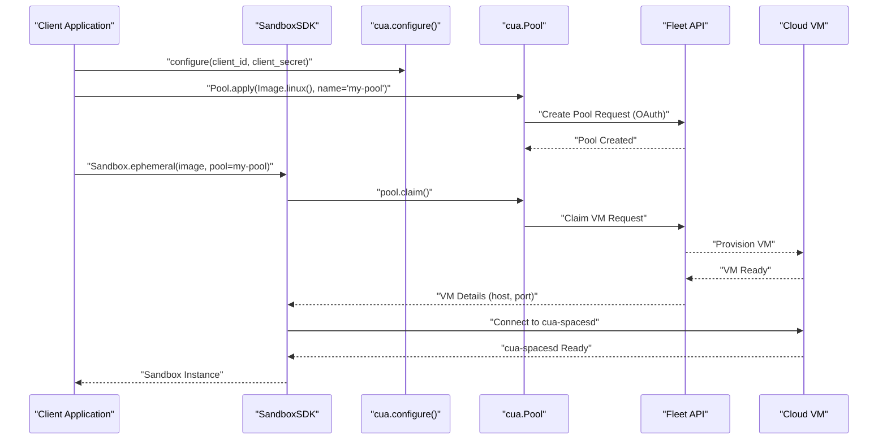
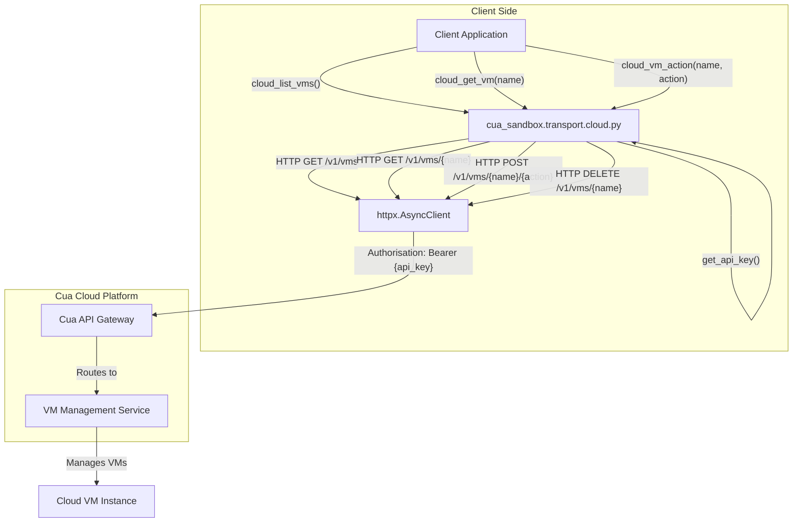

<!-- source: DeepWiki mcp.deepwiki.com · repo trycua/cua · page 4.2 Cloud Provider · fetched 2026-10-29 -->

# Cloud Provider

Relevant source files

The following files were used as context for generating this wiki page:

- [libs/python/cua-sandbox/cua_sandbox/builder/executor.py](libs/python/cua-sandbox/cua_sandbox/builder/executor.py)
- [libs/python/cua-sandbox/cua_sandbox/builder/windows_unattend.py](libs/python/cua-sandbox/cua_sandbox/builder/windows_unattend.py)
- [libs/python/cua-sandbox/cua_sandbox/image.py](libs/python/cua-sandbox/cua_sandbox/image.py)
- [libs/python/cua-sandbox/cua_sandbox/registry/qemu_builder.py](libs/python/cua-sandbox/cua_sandbox/registry/qemu_builder.py)
- [libs/python/cua-sandbox/cua_sandbox/runtime/_bw_init.js](libs/python/cua-sandbox/cua_sandbox/runtime/_bw_init.js)
- [libs/python/cua-sandbox/cua_sandbox/runtime/android_emulator.py](libs/python/cua-sandbox/cua_sandbox/runtime/android_emulator.py)
- [libs/python/cua-sandbox/cua_sandbox/transport/cloud.py](libs/python/cua-sandbox/cua_sandbox/transport/cloud.py)
- [libs/python/cua-sandbox/tests/test_cloud.py](libs/python/cua-sandbox/tests/test_cloud.py)
- [libs/python/cua-sandbox/tests/test_from_registry_ostype.py](libs/python/cua-sandbox/tests/test_from_registry_ostype.py)
- [libs/python/cua-sandbox/tests/test_windows_cloud.py](libs/python/cua-sandbox/tests/test_windows_cloud.py)
- [libs/python/cua-sandbox/tests/test_windows_timing.py](libs/python/cua-sandbox/tests/test_windows_timing.py)
- [tests/test_image_builder.py](tests/test_image_builder.py)
- [tests/test_image_builder_cloud.py](tests/test_image_builder_cloud.py)
- [tests/test_interfaces.py](tests/test_interfaces.py)

The Cloud Provider enables remote sandbox management through the Cua Public API. It abstracts the complexity of provisioning virtual machines (VMs) and containers in the cloud, providing a unified interface for computer-use agents to interact with remote environments.

## Purpose and Scope

The Cloud Provider system previously consisted of two primary layers:
1.  **Management Layer**: `CloudProvider` (`libs/python/computer/computer/providers/cloud/provider.py`) and `CloudV2Provider` (`libs/python/computer/computer/providers/cloud/providerv2.py`) handled lifecycle operations like creation, listing, and deletion via the Cua API at `api.cua.ai` [libs/python/cua-sandbox/cua_sandbox/transport/cloud.py:1-5]().
2.  **Transport Layer**: `CloudTransport` (`libs/python/cua-sandbox/cua_sandbox/transport/cloud.py`) managed the connection to a specific instance, resolving endpoints and delegating command execution to an internal `HTTPTransport` (`libs/python/cua-sandbox/cua_sandbox/transport/http.py`) pointed at the VM's `computer-server` endpoint [libs/python/cua-sandbox/cua_sandbox/transport/cloud.py:1-6]().

**Important Note**: The legacy API-key cloud VMs (api.cua.ai) driven through `computer-server` have been removed. Cloud sandboxes now run on Fleet using OAuth client credentials or a Fleet workload token. The `CloudTransport` class remains for compatibility but will raise a `LegacyCloudRemovedError` on `connect()` [libs/python/cua-sandbox/cua_sandbox/transport/cloud.py:31-39](), [libs/python/cua-sandbox/cua_sandbox/transport/cloud.py:85]().

**Current Capabilities (for existing API-key VMs and Fleet-based sandboxes):**
- **API-driven VM Lifecycle**: The `cloud_list_vms`, `cloud_get_vm`, and `cloud_vm_action` functions allow listing, inspecting, and deleting existing API-key VMs [libs/python/cua-sandbox/cua_sandbox/transport/cloud.py:119-182]().
- **Fleet Integration**: New cloud sandboxes are provisioned via Fleet, using `cua.Pool.apply()` and `pool.claim()` [libs/python/cua-sandbox/cua_sandbox/transport/cloud.py:7-10]().
- **Image Building**: The `Image` builder (`cua_sandbox.image.py`) supports defining sandbox images for Linux, macOS, and Windows, including installation steps and environment variables [libs/python/cua-sandbox/cua_sandbox/image.py:1-20]().
- **Snapshotting**: Sandboxes can be snapshotted, including stateful snapshots that capture memory state for faster resumption [tests/test_windows_timing.py:61-66](), [tests/test_windows_cloud.py:88-93]().

Sources: [libs/python/cua-sandbox/cua_sandbox/transport/cloud.py:1-182](), [libs/python/cua-sandbox/cua_sandbox/image.py:1-20](), [tests/test_windows_timing.py:61-66](), [tests/test_windows_cloud.py:88-93]()

## Authentication and API Key Resolution

Cloud operations previously relied on a `CUA_API_KEY`. While legacy API-key VMs can still be managed with an API key, new cloud sandboxes require Fleet credentials.

### API Key Resolution (Legacy)
For managing existing API-key VMs, the SDK and CLI resolve the API key in the following priority:
1.  Explicit `api_key` parameter passed to `CloudTransport` or related functions [libs/python/cua-sandbox/cua_sandbox/transport/cloud.py:68](), [libs/python/cua-sandbox/cua_sandbox/transport/cloud.py:120]().
2.  `CUA_API_KEY` environment variable (via `get_api_key()`) [libs/python/cua-sandbox/cua_sandbox/transport/cloud.py:23]().

### Fleet Authentication (Current)
For new cloud sandboxes, authentication is handled via Fleet:
-   OAuth client credentials (`client_id`, `client_secret`) configured via `cua.configure()` or environment variables (`CUA_CLIENT_ID`, `CUA_CLIENT_SECRET`) [libs/python/cua-sandbox/cua_sandbox/transport/cloud.py:8]().
-   A Fleet workload token (`FLEETS_TOKEN`) [libs/python/cua-sandbox/cua_sandbox/transport/cloud.py:8]().

The system prioritizes Fleet authentication. If Fleet credentials are provided, sandbox creation will route to Fleet. If only a legacy API key is present, it will attempt to use the legacy cloud (which will then fail on `connect()`) [tests/test_cloud.py:37-38](), [tests/test_cloud.py:96-97]().

Sources: [libs/python/cua-sandbox/cua_sandbox/transport/cloud.py:7-10](), [libs/python/cua-sandbox/cua_sandbox/transport/cloud.py:23](), [libs/python/cua-sandbox/cua_sandbox/transport/cloud.py:68](), [libs/python/cua-sandbox/cua_sandbox/transport/cloud.py:120](), [tests/test_cloud.py:37-38](), [tests/test_cloud.py:96-97]()

## Architecture and Data Flow

The Cloud Provider now primarily routes new sandbox requests to Fleet, while retaining limited functionality for legacy API-key VMs.

Title: "Cloud Sandbox Provisioning Flow (Fleet-based)"

Sources: [libs/python/cua-sandbox/cua_sandbox/transport/cloud.py:7-10](), [tests/test_cloud.py:47-59]()

Title: "Legacy Cloud VM Management (API-key based)"

Sources: [libs/python/cua-sandbox/cua_sandbox/transport/cloud.py:119-182]()

## Sandbox Lifecycle Management

### 1. Provisioning
New sandboxes are provisioned through Fleet by creating a `Pool` and then `claiming` a sandbox from it [libs/python/cua-sandbox/cua_sandbox/transport/cloud.py:9-10](). The `Image` builder (`cua_sandbox.image.py`) defines the VM's configuration, including OS type, version, and installation steps [libs/python/cua-sandbox/cua_sandbox/image.py:1-20](). For Windows VMs, the `os_type` and `kind` parameters are crucial for correct firmware selection (e.g., UEFI for Windows containerDisks) [tests/test_from_registry_ostype.py:25-28](), [tests/test_from_registry_ostype.py:59-60]().

### 2. Image Customization
The `Image` builder allows for extensive customization:
-   `.env()`: Sets environment variables [tests/test_image_builder_cloud.py:45-55]().
-   `.apt_install()`, `.brew_install()`, `.choco_install()`, `.apk_install()`: Installs packages specific to the OS [libs/python/cua-sandbox/cua_sandbox/image.py:140-146](), [tests/test_image_builder_cloud.py:67-69]().
-   `.pwa_install()`: Installs Progressive Web Apps (PWAs) on Android [tests/test_image_builder_cloud.py:94-99]().
-   `.run()`: Executes arbitrary shell commands [libs/python/cua-sandbox/cua_sandbox/image.py:140-146]().
These layers are executed by `LayerExecutor` (`cua_sandbox.builder.executor.py`) against the running `cua-spacesd` instance in the VM [libs/python/cua-sandbox/cua_sandbox/builder/executor.py:60-62](), [libs/python/cua-sandbox/cua_sandbox/builder/executor.py:136-176]().

### 3. Snapshotting
The `Sandbox.snapshot()` method allows creating snapshots of a running VM.
-   `stateful=False` (default): Creates a disk-only snapshot, requiring a full boot on restoration [tests/test_windows_timing.py:43-46]().
-   `stateful=True`: Creates a snapshot including the VM's memory state, allowing for near-instantaneous resumption (forking) [tests/test_windows_timing.py:61-66](), [tests/test_windows_cloud.py:88-93]().

### 4. Remote Access
Remote desktop access is provided via VNC for VMs. The URL is constructed using the sandbox host and a password-protected `vnc.html` endpoint.

Sources: [libs/python/cua-sandbox/cua_sandbox/transport/cloud.py:9-10](), [libs/python/cua-sandbox/cua_sandbox/image.py:1-20](), [libs/python/cua-sandbox/cua_sandbox/image.py:140-146](), [libs/python/cua-sandbox/cua_sandbox/builder/executor.py:60-62](), [libs/python/cua-sandbox/cua_sandbox/builder/executor.py:136-176](), [tests/test_from_registry_ostype.py:25-28](), [tests/test_from_registry_ostype.py:59-60](), [tests/test_image_builder_cloud.py:45-55](), [tests/test_image_builder_cloud.py:67-69](), [tests/test_image_builder_cloud.py:94-99](), [tests/test_windows_timing.py:43-46](), [tests/test_windows_timing.py:61-66](), [tests/test_windows_cloud.py:88-93]()

## Limitations

-   **Legacy API-key Cloud Removal**: The direct API-key based cloud VM provisioning (`api.cua.ai`) has been removed. Attempts to `connect()` using `CloudTransport` will raise a `LegacyCloudRemovedError` [libs/python/cua-sandbox/cua_sandbox/transport/cloud.py:31-39](), [libs/python/cua-sandbox/cua_sandbox/transport/cloud.py:85]().
-   **Migration to Fleet**: Users are encouraged to migrate to Fleet-based cloud sandboxes, which use OAuth client credentials or workload tokens for authentication and `cua.Pool` for VM management [libs/python/cua-sandbox/cua_sandbox/transport/cloud.py:7-10]().
-   **Windows ISO Download**: For Windows VMs, the system can auto-download specific versions (10, 11, server-2019, server-2022, server-2025) from Microsoft's evaluation center. Other versions require providing a local ISO path [libs/python/cua-sandbox/cua_sandbox/builder/windows_unattend.py:114-144]().
-   **Android Emulator Setup**: The Android emulator runtime requires Java and will attempt to auto-install Android SDK command-line tools, emulator, and platform-tools if not found [libs/python/cua-sandbox/cua_sandbox/runtime/android_emulator.py:83-174]().

Sources: [libs/python/cua-sandbox/cua_sandbox/transport/cloud.py:7-10](), [libs/python/cua-sandbox/cua_sandbox/transport/cloud.py:31-39](), [libs/python/cua-sandbox/cua_sandbox/transport/cloud.py:85](), [libs/python/cua-sandbox/cua_sandbox/builder/windows_unattend.py:114-144](), [libs/python/cua-sandbox/cua_sandbox/runtime/android_emulator.py:83-174]()

---

