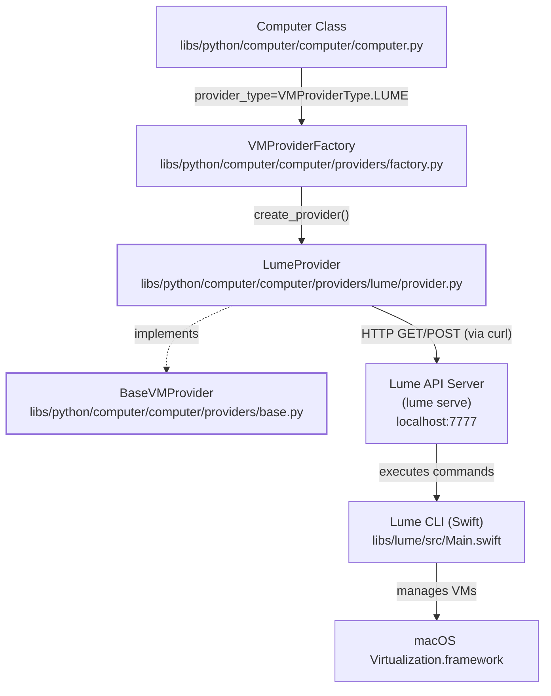
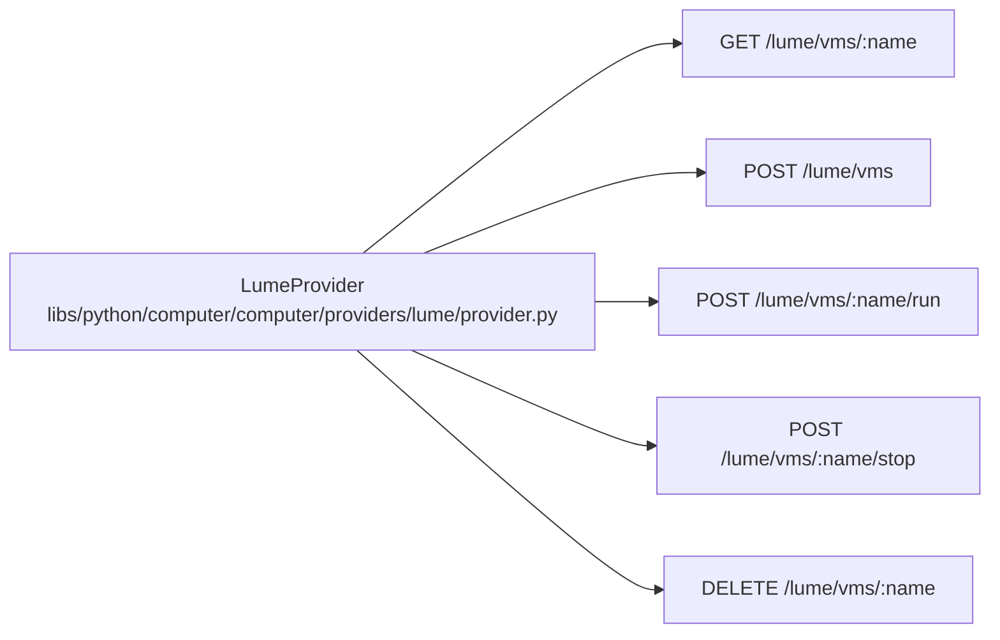

<!-- source: DeepWiki mcp.deepwiki.com · repo trycua/cua · page 4.3 Lume Provider (macOS VMs) · fetched 2026-10-29 -->

# Lume Provider (macOS VMs)

Relevant source files

The following files were used as context for generating this wiki page:

- [.github/workflows/cd-swift-lume.yml](.github/workflows/cd-swift-lume.yml)
- [libs/lume/CHANGELOG.md](libs/lume/CHANGELOG.md)
- [libs/lume/VERSION](libs/lume/VERSION)
- [libs/lume/resources/Info.plist](libs/lume/resources/Info.plist)
- [libs/lume/resources/lume.entitlements](libs/lume/resources/lume.entitlements)
- [libs/lume/scripts/build/build-debug.sh](libs/lume/scripts/build/build-debug.sh)
- [libs/lume/scripts/build/build-release-notarized.sh](libs/lume/scripts/build/build-release-notarized.sh)
- [libs/lume/scripts/build/build-release.sh](libs/lume/scripts/build/build-release.sh)
- [libs/lume/scripts/install-local.sh](libs/lume/scripts/install-local.sh)
- [libs/lume/scripts/install.sh](libs/lume/scripts/install.sh)
- [libs/lume/scripts/uninstall.sh](libs/lume/scripts/uninstall.sh)
- [libs/lume/src/Main.swift](libs/lume/src/Main.swift)
- [libs/lume/src/Unattended/ResourceBundle.swift](libs/lume/src/Unattended/ResourceBundle.swift)
- [libs/lume/tests/Mocks/MockVM.swift](libs/lume/tests/Mocks/MockVM.swift)
- [libs/lume/tests/VM/VMDetailsPrinterTests.swift](libs/lume/tests/VM/VMDetailsPrinterTests.swift)
- [libs/lume/tests/VMTests.swift](libs/lume/tests/VMTests.swift)

## Purpose and Scope

The Lume Provider enables management of local macOS virtual machines through the Lume API server running on `localhost:7777`. It implements the `BaseVMProvider` interface using curl-based HTTP communication, eliminating the need for complex Python SDK dependencies for VM management [libs/python/computer/computer/providers/factory.py:62-73](). This provider is specifically designed for macOS VM management using Apple's `Virtualization.framework` on Apple Silicon hardware [libs/lume/src/Main.swift:11-15]().

The Lume system itself is a Swift-based CLI and server implementation [libs/lume/src/Main.swift:6-15]() that provides high-performance macOS virtualization tailored for computer-use agents.

Sources: `libs/python/computer/computer/providers/factory.py:58-79]`, `libs/lume/src/Main.swift:6-17]`, `libs/lume/VERSION:1-1`

## Provider Architecture

The `LumeProvider` class is the primary implementation of the `BaseVMProvider` interface for native macOS virtualization. Unlike the `DockerProvider` which manages containers [libs/python/computer/computer/providers/docker/provider.py:31-37](), or the `WinSandboxProvider` which uses `pywinsandbox` [libs/python/computer/computer/providers/winsandbox/provider.py:23-29](), the `LumeProvider` interfaces with a local Swift-based daemon.

### Data Flow and Entity Mapping

**Diagram: LumeProvider in the VM Provider Hierarchy**

The provider is instantiated through `VMProviderFactory` when `provider_type=VMProviderType.LUME` is specified [libs/python/computer/computer/providers/factory.py:58-60](). The Computer class manages the provider lifecycle and passes configuration such as CPU, memory, and display resolution [libs/python/computer/computer/computer.py:92-122]().

Sources: `libs/python/computer/computer/providers/factory.py:58-79]`, `libs/python/computer/computer/computer.py:92-122]`, `libs/lume/src/Main.swift:61-81`

## Initialization and Configuration

The `Computer` class serves as the entry point for configuring the Lume backend. Key parameters are passed during `__init__` [libs/python/computer/computer/computer.py:93-122]():

| Parameter | Type | Default | Description |
|-----------|------|---------|-------------|
| `display` | `str/Display` | `1024x768` | VM resolution [libs/python/computer/computer/computer.py:94]() |
| `memory` | `str` | `8GB` | VM RAM allocation [libs/python/computer/computer/computer.py:95]() |
| `cpu` | `str` | `4` | Number of CPU cores [libs/python/computer/computer/computer.py:96]() |
| `provider_port` | `int` | `7777` | Lume API server port [libs/python/computer/computer/computer.py:105]() |
| `ephemeral` | `bool` | `False` | Delete VM on stop [libs/python/computer/computer/computer.py:111]() |

### Lume Installation
The system requires the `lume` binary to be present. It can be installed via the provided shell script [libs/lume/scripts/install.sh:1-30](). This script sets up the Lume background service as a macOS `LaunchAgent` [libs/lume/scripts/install.sh:37]().

Sources: `libs/python/computer/computer/computer.py:92-167]`, `libs/lume/scripts/install.sh:1-60`

## Communication Layer

The communication between the Python SDK and the Lume server follows a RESTful pattern. The default server endpoint is `http://localhost:7777` [docs/content/docs/reference/lume/http-api.mdx:19-23]().

### API Interaction Pattern

**Diagram: REST API Mapping**

| Operation | HTTP Path | Functionality |
|-----------|-----------|---------------|
| List VMs | `GET /lume/vms` | Returns all local VMs [docs/content/docs/reference/lume/http-api.mdx:29-33]() |
| Get Info | `GET /lume/vms/:name` | Returns status, IP, and VNC URL [docs/content/docs/reference/lume/http-api.mdx:72-76]() |
| Create | `POST /lume/vms` | Initializes a new disk image [docs/content/docs/reference/lume/http-api.mdx:116-120]() |
| Run | `POST /lume/vms/:name/run` | Boots the VM (supports `--detach`) [docs/content/docs/reference/lume/cli-reference.mdx:53-86]() |

Sources: `docs/content/docs/reference/lume/http-api.mdx:15-238]`, `docs/content/docs/reference/lume/cli-reference.mdx:19-86`

## VM Lifecycle Operations

### Provisioning and Pulling
Lume supports pulling pre-configured images from OCI registries (default `ghcr.io/trycua`) [docs/content/docs/reference/lume/cli-reference.mdx:71-72](). The standard image for computer-use is `macos-sequoia-cua`.

### Integration with Computer SDK
Once a VM is in the `running` state, the `Computer` class establishes a connection to the internal `computer-server` running inside the guest OS. 

1. **IP Discovery**: The provider polls the Lume API until the guest's IP address is reported via ARP/Virtio-net.
2. **Interface Protocol**: The `GenericComputerInterface` connects to the guest via WebSocket (`/ws`) and REST (`/cmd`) [libs/python/computer/computer/interface/generic.py:108-152]().
3. **macOS Specialization**: The `MacOSComputerInterface` is used to handle specific Apple AX (Accessibility) events and `diorama_cmd` [libs/python/computer/computer/interface/macos.py:6-7]().

Sources: `libs/python/computer/computer/interface/generic.py:108-152]`, `libs/python/computer/computer/interface/macos.py:6-27]`, `docs/content/docs/reference/lume/cli-reference.mdx:71-73`

## Requirements

| Requirement | Specification |
|-------------|---------------|
| **Hardware** | Apple Silicon (M1/M2/M3/M4) |
| **Host OS** | macOS 15+ (Sequoia) for best performance |
| **Guest OS** | macOS 14+ or Linux (Virtio-gpu supported) |
| **Software** | Lume CLI/Server (v0.6.0+) [libs/lume/VERSION:1-1]() |
| **Network** | Port 7777 (Lume API), Port 5900+ (VNC) [docs/content/docs/reference/lume/cli-reference.mdx:125-127]() |

Sources: `libs/lume/src/Main.swift:11-23]`, `libs/lume/VERSION:1-1]`, `docs/content/docs/reference/lume/cli-reference.mdx:35-44`

---

