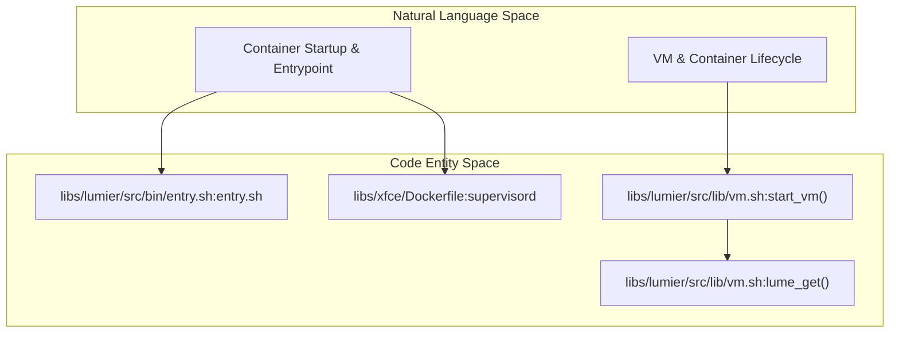
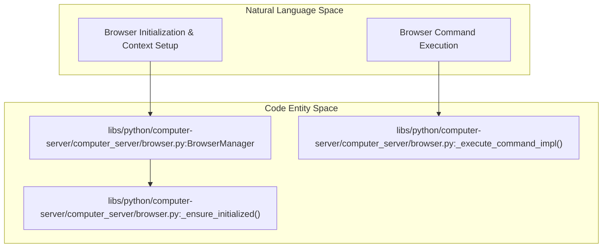

<!-- source: DeepWiki mcp.deepwiki.com · repo trycua/cua · page 4.4 Docker Provider · fetched 2026-10-29 -->

# Docker Provider

Relevant source files

The following files were used as context for generating this wiki page:

- [.github/workflows/cd-container-xfce.yml](.github/workflows/cd-container-xfce.yml)
- [.github/workflows/ci-container-xfce.yml](.github/workflows/ci-container-xfce.yml)
- [.gitignore](.gitignore)
- [libs/kasm/.bumpversion.cfg](libs/kasm/.bumpversion.cfg)
- [libs/kasm/Dockerfile](libs/kasm/Dockerfile)
- [libs/kasm/README.md](libs/kasm/README.md)
- [libs/kasm/VERSION](libs/kasm/VERSION)
- [libs/lumier/.dockerignore](libs/lumier/.dockerignore)
- [libs/lumier/Dockerfile](libs/lumier/Dockerfile)
- [libs/lumier/README.md](libs/lumier/README.md)
- [libs/lumier/src/bin/entry.sh](libs/lumier/src/bin/entry.sh)
- [libs/lumier/src/config/constants.sh](libs/lumier/src/config/constants.sh)
- [libs/lumier/src/hooks/on-logon.sh](libs/lumier/src/hooks/on-logon.sh)
- [libs/lumier/src/lib/utils.sh](libs/lumier/src/lib/utils.sh)
- [libs/lumier/src/lib/vm.sh](libs/lumier/src/lib/vm.sh)
- [libs/qemu-docker/android/Dockerfile](libs/qemu-docker/android/Dockerfile)
- [libs/qemu-docker/android/dev.Dockerfile](libs/qemu-docker/android/dev.Dockerfile)
- [libs/qemu-docker/android/src/entry.sh](libs/qemu-docker/android/src/entry.sh)
- [libs/xfce/Development.md](libs/xfce/Development.md)
- [libs/xfce/Dockerfile](libs/xfce/Dockerfile)
- [libs/xfce/Dockerfile.dev](libs/xfce/Dockerfile.dev)
- [libs/xfce/README.md](libs/xfce/README.md)
- [libs/xfce/requirements-cua-driver.txt](libs/xfce/requirements-cua-driver.txt)
- [libs/xfce/src/supervisor/supervisord.conf](libs/xfce/src/supervisor/supervisord.conf)
- [libs/xfce/src/xfce-config/xfce4-power-manager.xml](libs/xfce/src/xfce-config/xfce4-power-manager.xml)
- [libs/xfce/src/xfce-config/xfce4-session.xml](libs/xfce/src/xfce-config/xfce4-session.xml)

## Purpose and Scope

The Docker Provider enables running Linux-based execution environments as Docker containers. It provides cross-platform support for computer-use agents by containerizing Ubuntu desktops with graphical interfaces (XFCE or KASM) and macOS/Linux wrappers via Lumier. This provider is ideal for development, testing, and scenarios where lightweight, ephemeral Linux environments are needed without managing full virtual machines.

The Docker provider manages the lifecycle of containers that host the `computer-server`, a FastAPI-based service that translates agent actions into OS-level commands using tools like `python-xlib`, `pyautogui`, and `playwright`.

---

## Architecture Overview

The Docker Provider integrates container orchestration with the `Computer` class and internal container entrypoints such as `entry.sh` and `start_vm()`.

### Diagram: System Concepts to Code Entities (Orchestration & Container Boot)

**Sources:** [libs/lumier/src/bin/entry.sh:1-153](), [libs/lumier/src/lib/vm.sh:1-120](), [libs/xfce/Dockerfile:170-175]()

---

## Implementation Details

The Docker provider ecosystem supports several image families, each with specific configurations and initialization routines defined in Dockerfiles and shell scripts.

### Image Comparison and Specifications

| Image Identifier | Base Image | Home Directory | Purpose & Key Libraries |
|------------------|------------|----------------|--------------------------|
| `kasm` | `kasmweb/core-ubuntu-jammy:1.17.0` | `/home/kasm-default-profile` | High-performance VNC via KasmVNC, Python 3.12, Playwright [libs/kasm/Dockerfile:1-60]() |
| `docker-xfce` | `kicad/kicad:9.0` | `/home/cua` | Vanilla XFCE desktop, Tigervnc, Computer Server, Playwright [libs/xfce/Dockerfile:5-128]() |
| `docker-xfce-dev` | `ubuntu:22.04` | `/home/cua` | Development container with local source mount support [libs/xfce/Dockerfile.dev:4-128]() |
| `lumier` | Base Container Runner | `/home/cua` | macOS/Linux virtual machines inside Docker via Lume API [libs/lumier/src/bin/entry.sh:28-42]() |

**Sources:** [libs/kasm/Dockerfile:1-60](), [libs/xfce/Dockerfile:5-128](), [libs/xfce/Dockerfile.dev:4-128](), [libs/lumier/src/bin/entry.sh:28-42]()

---

## Container Environment

### XFCE Container Implementation
The XFCE image is the standard lightweight environment. It uses `supervisord` to manage background services [libs/xfce/Dockerfile:164-165]().
1.  **VNC Server**: `tigervnc-standalone-server` provides virtual display `:1` [libs/xfce/Dockerfile:47-49]().
2.  **noVNC**: A WebSocket proxy (`/opt/noVNC`) that allows viewing the desktop via web browsers [libs/xfce/Dockerfile:102-105]().
3.  **Computer Server**: The `cua-spacesd` daemon (gRPC + gRPC-Web on port 3211) is installed and managed by `supervisord` [libs/xfce/Dockerfile:139-160](), [libs/xfce/src/supervisor/supervisord.conf]().
4.  **Python Environment**: `uv` is used to install Python 3.13 and create a virtual environment at `/opt/venv` [libs/xfce/Dockerfile:78-84]().
5.  **Cua Driver SDK**: The `cua-driver` Python SDK and its bundled executable are installed for co-located applications [libs/xfce/Dockerfile:130-137]().

Power management and screen locks are explicitly removed during build to keep the display active for visual agents [libs/xfce/Dockerfile:87-91]().

**Sources:** [libs/xfce/Dockerfile:47-165](), [libs/xfce/src/supervisor/supervisord.conf]()

### Kasm Container Implementation
The Kasm image provides a desktop environment based on KasmVNC.
1.  **Python Environment**: Python 3.12 is installed via the `deadsnakes` PPA, and `uv` is used for package management [libs/kasm/Dockerfile:12-17](), [libs/kasm/Dockerfile:51-52]().
2.  **Cua Spacesd**: The `cua-spacesd` daemon is installed and started via a custom startup script [libs/kasm/Dockerfile:54-76](), [libs/kasm/start-spacesd.sh]().
3.  **Playwright**: Installed with Firefox dependencies for browser automation [libs/kasm/Dockerfile:78-79]().
4.  **Sudo Access**: The `kasm-user` is configured with `NOPASSWD` sudo access [libs/kasm/Dockerfile:38-41]().

**Sources:** [libs/kasm/Dockerfile:12-79](), [libs/kasm/start-spacesd.sh]()

### Lumier Container Implementation
The `lumier` container is designed to host macOS and Linux virtual machines within a Docker environment. It acts as a wrapper around the Lume VM management tool.
1.  **Entrypoint**: The `entry.sh` script orchestrates the VM lifecycle, including starting, stopping, and cleaning up VMs [libs/lumier/src/bin/entry.sh:123-127]().
2.  **VM Management**: It uses `lume_get`, `lume_set`, `lume_run`, and `lume_delete` functions to interact with the Lume API, typically running on `host.docker.internal:7777` [libs/lumier/src/lib/vm.sh:122-167](), [libs/lumier/src/lib/vm.sh:170-190]().
3.  **SSH Access**: The container waits for SSH to become available on the VM and executes an `on-logon.sh` script for post-provisioning tasks [libs/lumier/src/lib/vm.sh:98-119](), [libs/lumier/src/lib/utils.sh:4-43]().
4.  **Shared Directories**: Supports mounting host directories into the VM via the `--shared-dir` argument to `lume_run` [libs/lumier/src/lib/vm.sh:48-57]().
5.  **Ephemeral Storage**: By default, it uses ephemeral storage for VMs, meaning VM state is lost when the container stops [libs/lumier/src/bin/entry.sh:35-42]().

**Sources:** [libs/lumier/src/bin/entry.sh:1-153](), [libs/lumier/src/lib/vm.sh:1-465](), [libs/lumier/src/lib/utils.sh:1-180]()

---

## Browser Integration (Playwright)

Both XFCE and KASM images include a pre-installed `BrowserManager` based on Playwright, enabling programmatic browser control visible on the desktop.

### Diagram: Natural Language Space to Code Entity Space (Browser Management)

**Sources:** [libs/python/computer-server/computer_server/browser.py:22-175]()

### Key Browser Implementation Details
-   **Visibility**: Launched with `headless=False` so visual agents can observe the rendered page [libs/python/computer-server/computer_server/browser.py:99-108]().
-   **Persistence**: Uses `launch_persistent_context()` with a user data directory in `~/.playwright-firefox` to preserve cookies and sessions across steps [libs/python/computer-server/computer_server/browser.py:98-105]().
-   **Anti-Detection**: Injects an initialization script that patches `navigator.webdriver` to `false` [libs/python/computer-server/computer_server/browser.py:113-137]().

**Sources:** [libs/python/computer-server/computer_server/browser.py:22-175]()

---

## Configuration and Deployment

### Port Mappings
Docker containers expose standard ports for remote interaction:
-   **3211**: `cua-spacesd` gRPC and gRPC-Web API [libs/xfce/Dockerfile:15](), [libs/kasm/Dockerfile:93]()
-   **5901**: Raw VNC Protocol endpoint (XFCE only) [libs/xfce/Dockerfile:13]()
-   **6901**: noVNC Web Interface for browser-based viewing (XFCE only) [libs/xfce/Dockerfile:14]()
-   **8006**: noVNC Web Interface for Lumier (proxied from VM VNC port) [libs/lumier/src/bin/entry.sh:136]()

### Volume Mounts
For `lumier` containers, host paths can be mounted into the VM. The `HOST_SHARED_PATH` environment variable is used to specify the host path, which is then mounted into the VM at `/Volumes/My Shared Files` [libs/lumier/src/lib/utils.sh:66-70]().

### Development Mode (`Dockerfile.dev`)
The development container variant installs Python 3.12 via deadsnakes PPA, configures build toolchains, and copies a locally built `cua-spacesd` binary [libs/xfce/Dockerfile.dev:78-128](), [libs/xfce/Dockerfile.dev:129-131](). This allows for rapid iteration on the `cua-spacesd` daemon without rebuilding the entire image.

**Sources:** [libs/xfce/Dockerfile:13-15](), [libs/xfce/Dockerfile.dev:78-131](), [libs/kasm/Dockerfile:93](), [libs/lumier/src/bin/entry.sh:136](), [libs/lumier/src/lib/utils.sh:66-70]()

---

