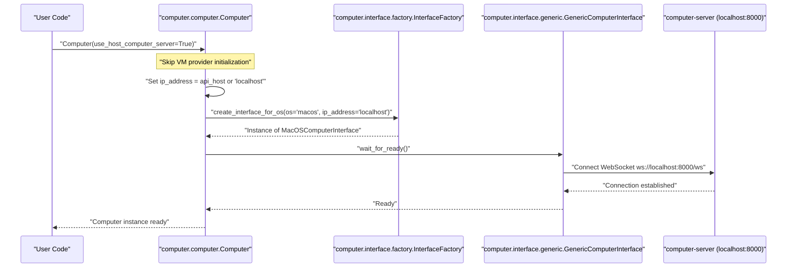
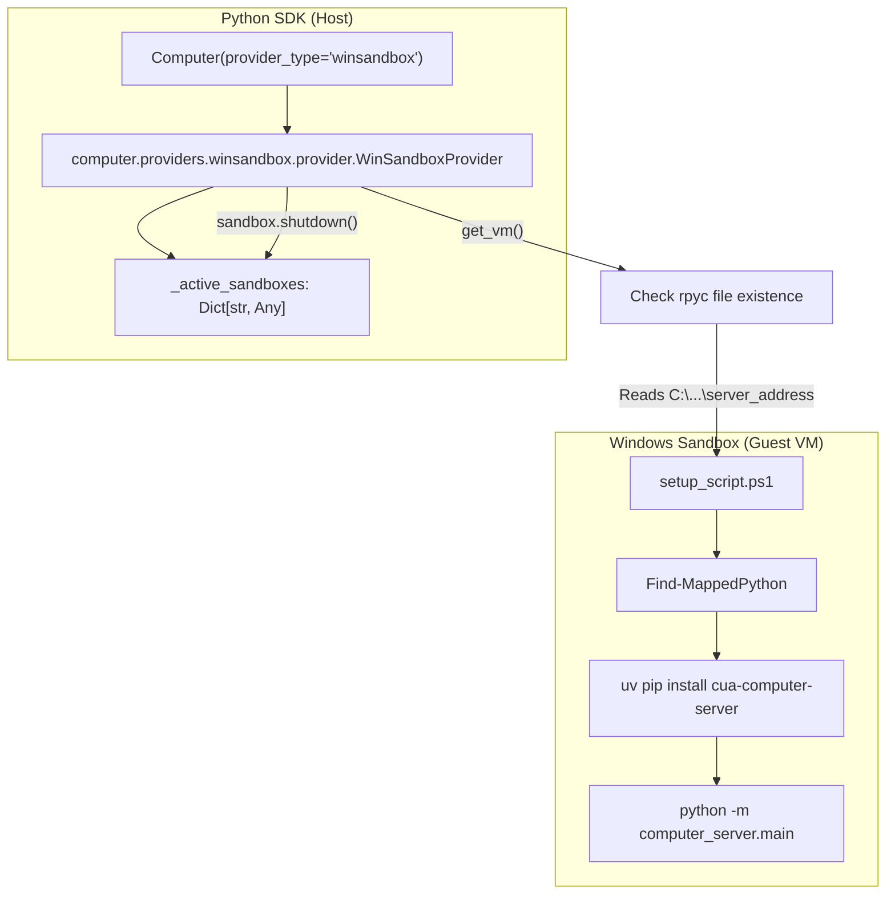
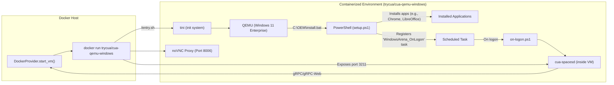

<!-- source: DeepWiki mcp.deepwiki.com · repo trycua/cua · page 4.5 Windows Sandbox and Host Providers · fetched 2026-10-29 -->

# Windows Sandbox and Host Providers

<details>
<summary>Relevant source files</summary>

The following files were used as context for generating this wiki page:

- [libs/qemu-docker/windows/Dockerfile](libs/qemu-docker/windows/Dockerfile)
- [libs/qemu-docker/windows/README.md](libs/qemu-docker/windows/README.md)
- [libs/qemu-docker/windows/src/entry.sh](libs/qemu-docker/windows/src/entry.sh)
- [libs/qemu-docker/windows/src/vm/setup/install.bat](libs/qemu-docker/windows/src/vm/setup/install.bat)
- [libs/qemu-docker/windows/src/vm/setup/on-logon.ps1](libs/qemu-docker/windows/src/vm/setup/on-logon.ps1)
- [libs/qemu-docker/windows/src/vm/setup/setup-utils.psm1](libs/qemu-docker/windows/src/vm/setup/setup-utils.psm1)
- [libs/qemu-docker/windows/src/vm/setup/setup.ps1](libs/qemu-docker/windows/src/vm/setup/setup.ps1)
- [libs/qemu-docker/windows/src/vm/setup/tools_config.json](libs/qemu-docker/windows/src/vm/setup/tools_config.json)

</details>


## Purpose and Scope

This document covers two execution environments for running Computer-Use Agents that differ from traditional VM providers: the **Host Provider** (localhost mode) and the **Windows Sandbox Provider**.

The Host Provider enables direct connection to a `computer-server` instance running on localhost without any VM or container, useful for development and debugging. The Windows Sandbox Provider leverages Windows 10/11's built-in Windows Sandbox feature to create isolated, ephemeral Windows environments for agent execution.

For information about other VM providers, see [Provider Architecture](#4.1), [Lume Provider (macOS VMs)](#4.3), [Docker Provider](#4.4), and [Cloud Provider](#4.2).

---

## Host Provider (Localhost Mode)

### Overview

The Host Provider is a special mode that bypasses all VM provider initialization and connects directly to a `computer-server` instance running on `localhost`. This mode is primarily used for:

- **Development and debugging**: Running agents on your local machine without overhead.
- **Testing computer-server**: Direct testing of computer-server functionality.
- **CI/CD environments**: Where a VM is unnecessary or not feasible.

When enabled via `use_host_computer_server=True`, the `Computer` class skips `VMProviderFactory` logic and sets the IP address to `localhost` [libs/python/computer/computer/computer.py:101](), [libs/python/computer/computer/computer.py:311-314]().

**Sources:** [libs/python/computer/computer/computer.py:101-102](), [libs/python/computer/computer/computer.py:311-314]()

### Configuration

Enable Host Provider mode by passing `use_host_computer_server=True` to the `Computer` constructor:

```python
from computer import Computer

# Connect to computer-server running on localhost
computer = Computer(
    use_host_computer_server=True,
    api_port=8000,    # Optional: custom port
    os_type="macos",   # Determines which interface to use
)
```

**Parameters:**
- `use_host_computer_server`: Set to `True` to enable localhost mode [libs/python/computer/computer/computer.py:101]().
- `api_port`: Port where `computer-server` is listening [libs/python/computer/computer/computer.py:107]().
- `api_host`: Optional host IP address to use when `use_host_computer_server` is True (defaults to "localhost") [libs/python/computer/computer/computer.py:109]().

**Sources:** [libs/python/computer/computer/computer.py:101-156]()

### Connection Flow



**Sources:** [libs/python/computer/computer/computer.py:311-325](), [libs/python/computer/computer/interface/factory.py:10-69](), [libs/python/computer/computer/interface/generic.py:108-130]()

---

## Windows Sandbox Provider

### Overview

The `WinSandboxProvider` uses **Windows Sandbox**, a lightweight, isolated desktop environment. It leverages the `pywinsandbox` library to automate the lifecycle of these environments [libs/python/computer/computer/providers/winsandbox/provider.py:24-28]().

Key characteristics:
- **Ephemeral**: Storage is always destroyed on exit. The provider ignores `ephemeral=False` [libs/python/computer/computer/providers/winsandbox/provider.py:61-71]().
- **Isolated**: Starts with a clean Windows installation for every session.
- **Automated Setup**: Uses a PowerShell script (`setup_script.ps1`) to find the host's Python installation and install `cua-computer-server` inside the sandbox [libs/python/computer/computer/providers/winsandbox/setup_script.ps1:1-153]().

**Sources:** [libs/python/computer/computer/providers/winsandbox/provider.py:23-28](), [libs/python/computer/computer/providers/winsandbox/setup_script.ps1:1-5]()

### Requirements

- **OS**: Windows 10/11 Pro/Enterprise with Virtualization enabled.
- **Library**: `pywinsandbox` must be installed via `pip install pywinsandbox` [libs/python/computer/computer/providers/winsandbox/provider.py:50-54]().

### Implementation Details

The `WinSandboxProvider` inherits from `BaseVMProvider` [libs/python/computer/computer/providers/winsandbox/provider.py:23]() and manages active sandboxes in a dictionary `_active_sandboxes` [libs/python/computer/computer/providers/winsandbox/provider.py:76]().

#### Data Flow: Natural Language to Code Entity Space



**Sources:** [libs/python/computer/computer/providers/winsandbox/provider.py:23-101](), [libs/python/computer/computer/providers/winsandbox/setup_script.ps1:7-70](), [libs/python/computer/computer/providers/winsandbox/setup_script.ps1:118-128]()

### Key Functions

| Entity | Location | Purpose |
| :--- | :--- | :--- |
| `WinSandboxProvider` | [libs/python/computer/computer/providers/winsandbox/provider.py:23]() | Main provider class implementing `BaseVMProvider`. |
| `get_vm` | [libs/python/computer/computer/providers/winsandbox/provider.py:103]() | Retrieves sandbox status by checking for a `server_address` file via RPyC in the shared desktop directory [libs/python/computer/computer/providers/winsandbox/provider.py:138-144](). |
| `Find-MappedPython` | [libs/python/computer/computer/providers/winsandbox/setup_script.ps1:7]() | PowerShell function to locate the Python executable mapped from the host's desktop to the sandbox [libs/python/computer/computer/providers/winsandbox/setup_script.ps1:7-70](). |
| `setup_script.ps1` | [libs/python/computer/computer/providers/winsandbox/setup_script.ps1:1]() | Entry point for sandbox configuration, installs `uv` package manager and starts the server in background [libs/python/computer/computer/providers/winsandbox/setup_script.ps1:83-128](). |

**Sources:** [libs/python/computer/computer/providers/winsandbox/provider.py:23-195](), [libs/python/computer/computer/providers/winsandbox/setup_script.ps1:1-153]()

---

## Docker-Wrapped QEMU Alternative

For environments where native Windows Sandbox is not available (e.g., Linux hosts), Cua provides Docker-wrapped QEMU images.

### Architecture: QEMU Windows Container

The `DockerProvider` detects QEMU-based images (e.g., `trycua/cua-qemu-windows`) and configures them specifically [libs/python/computer/computer/providers/docker/provider.py:57-61](), [libs/python/computer/computer/providers/docker/provider.py:106-110]().

The `trycua/cua-qemu-windows` Docker image [libs/qemu-docker/windows/Dockerfile:1]() provides a Windows 11 virtual desktop container with QEMU/KVM for Computer-Using Agents [libs/qemu-docker/windows/README.md:3](). It runs `cua-spacesd` (gRPC + gRPC-Web on port 3211) as a logon task [libs/qemu-docker/windows/README.md:7](), [libs/qemu-docker/windows/src/vm/setup/on-logon.ps1:1-2](). The `entry.sh` script [libs/qemu-docker/windows/src/entry.sh:1]() manages the VM lifecycle, including starting QEMU and waiting for `cua-spacesd` to become ready [libs/qemu-docker/windows/src/entry.sh:31-63](). It also exposes port 3211 for `cua-spacesd` and 8006 for the noVNC web interface [libs/qemu-docker/windows/Dockerfile:36-38]().

The `INSTALL_WINARENA_APPS` build argument [libs/qemu-docker/windows/Dockerfile:17]() allows for the installation of benchmark applications like Chrome, LibreOffice, and VLC [libs/qemu-docker/windows/Dockerfile:8-9](). This is controlled by the `install_config.json` file generated by `entry.sh` [libs/qemu-docker/windows/src/entry.sh:21-29]() and processed by `setup.ps1` inside the VM [libs/qemu-docker/windows/src/vm/setup/setup.ps1:16-29](). The `setup.ps1` script also installs Git via Chocolatey [libs/qemu-docker/windows/src/vm/setup/setup.ps1:41-54]() and sets up `cua-spacesd` [libs/qemu-docker/windows/src/vm/setup/setup.ps1:56-65](). Helper functions for downloading and installing tools are provided in `setup-utils.psm1` [libs/qemu-docker/windows/src/vm/setup/setup-utils.psm1:1-201](), using `tools_config.json` for mirror URLs [libs/qemu-docker/windows/src/vm/setup/tools_config.json:1-44]().



**Sources:** [libs/python/computer/computer/providers/docker/provider.py:31-67](), [libs/python/computer/computer/providers/docker/provider.py:106-110](), [libs/qemu-docker/windows/Dockerfile:1-40](), [libs/qemu-docker/windows/README.md:1-11](), [libs/qemu-docker/windows/src/entry.sh:1-78](), [libs/qemu-docker/windows/src/vm/setup/setup.ps1:1-250](), [libs/qemu-docker/windows/src/vm/setup/setup-utils.psm1:1-201](), [libs/qemu-docker/windows/src/vm/setup/tools_config.json:1-44](), [libs/qemu-docker/windows/src/vm/setup/install.bat:1-31](), [libs/qemu-docker/windows/src/vm/setup/on-logon.ps1:1-2]()

---

## Summary Comparison

| Feature | Host Provider | Windows Sandbox | Docker (Kasm/XFCE) | QEMU (Linux/Windows) |
| :--- | :--- | :--- | :--- | :--- |
| **Isolation** | None (Localhost) | High (Hyper-V VM) | Moderate (Container) | High (Nested VM) |
| **Host OS** | Any | Windows 10/11 | Linux/macOS/Windows | Linux/Windows |
| **Persistence** | Persistent | Always Ephemeral | Configurable | Golden Image Based |
| **Code Entity** | `use_host_computer_server` | `WinSandboxProvider` | `DockerProvider` | `DockerProvider` (QEMU images) |

**Sources:** [libs/python/computer/computer/computer.py:101](), [libs/python/computer/computer/providers/winsandbox/provider.py:23](), [libs/python/computer/computer/providers/docker/provider.py:31](), [libs/python/computer/computer/providers/docker/provider.py:83-110]()

---

