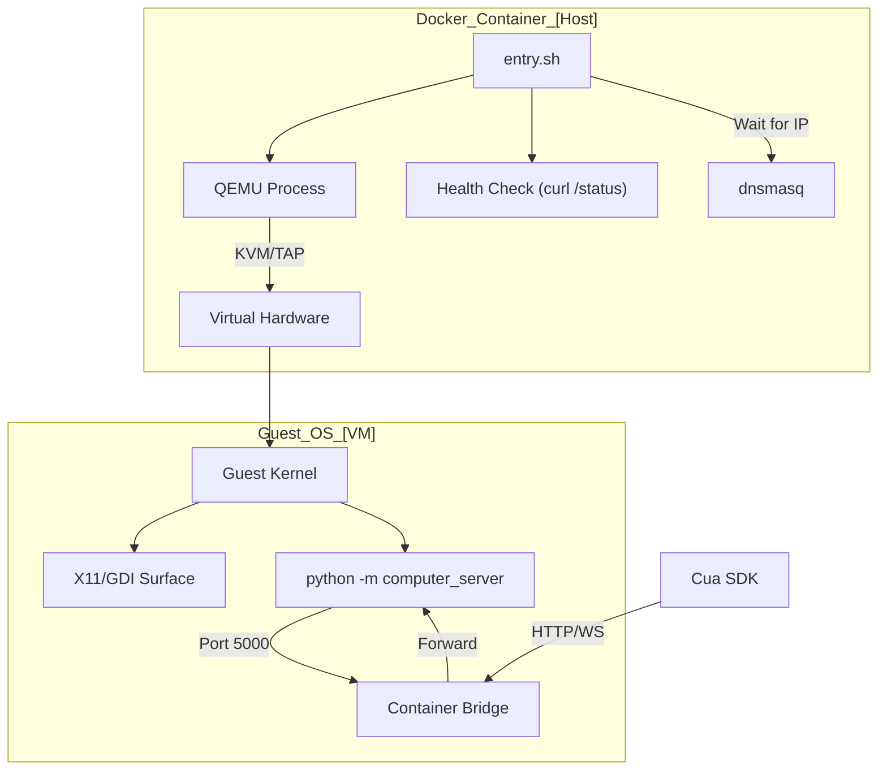
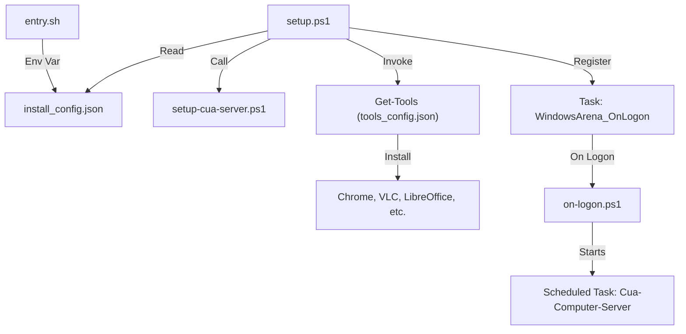
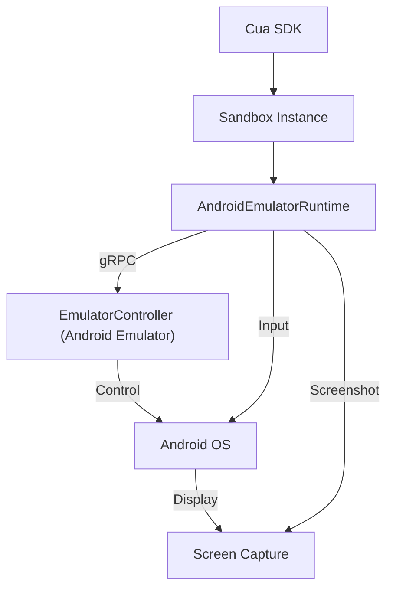

<!-- source: DeepWiki mcp.deepwiki.com · repo trycua/cua · page 4.6 QEMU and Android Providers · fetched 2026-10-29 -->

# QEMU and Android Providers

Relevant source files

The following files were used as context for generating this wiki page:

- [libs/lumier/.bumpversion.cfg](libs/lumier/.bumpversion.cfg)
- [libs/lumier/VERSION](libs/lumier/VERSION)
- [libs/qemu-docker/android/.bumpversion.cfg](libs/qemu-docker/android/.bumpversion.cfg)
- [libs/qemu-docker/android/VERSION](libs/qemu-docker/android/VERSION)
- [libs/qemu-docker/linux/.bumpversion.cfg](libs/qemu-docker/linux/.bumpversion.cfg)
- [libs/qemu-docker/linux/VERSION](libs/qemu-docker/linux/VERSION)
- [libs/xfce/.bumpversion.cfg](libs/xfce/.bumpversion.cfg)
- [libs/xfce/VERSION](libs/xfce/VERSION)

This page describes the implementation and architecture of the QEMU-based execution environments within the Cua framework. These providers enable high-fidelity sandboxing for Linux, Windows, and Android operating systems by wrapping virtual machines inside Docker containers.

## QEMU Provider Architecture

The QEMU providers in Cua use a "Docker-wrapped VM" pattern. This approach provides the isolation and hardware-level emulation of QEMU/KVM while maintaining the portability and orchestration benefits of Docker.

### Core Components and Data Flow

The system operates by nesting a virtual machine inside a Docker container. The container manages the QEMU lifecycle, networking, and the exposure of the `computer-server` API to the host SDK.

#### Diagram: QEMU Container Internal Architecture

Sources: [libs/qemu-docker/windows/src/entry.sh:31-64]()

### Implementation Details

1.  **Lifecycle Management**: The `entry.sh` script acts as the supervisor. It initializes the QEMU process (often via `tini`) and monitors the guest's boot progress [libs/qemu-docker/windows/src/entry.sh:31-35]().
2.  **Networking**: The container typically runs a DHCP server (like `dnsmasq`) to assign an IP to the VM. The `entry.sh` script parses the DHCP range to detect the VM's internal IP for health checking [libs/qemu-docker/windows/src/entry.sh:42-51]().
3.  **Guest Readiness**: The container waits for the `computer-server` to respond on port 5000 inside the VM before signaling that the sandbox is ready [libs/qemu-docker/windows/src/entry.sh:53-62]().

Sources: [libs/qemu-docker/windows/src/entry.sh:1-77]()

---

## Windows QEMU Provider

The Windows provider runs a Windows 11 Enterprise Evaluation image [libs/qemu-docker/windows/Dockerfile:26](). It is specifically optimized for benchmarks like Windows Arena.

### Provisioning and Setup
The setup process uses PowerShell scripts to configure the guest environment during the image build or first boot.

*   **UV Integration**: The guest uses the `uv` package manager to manage the `cua-computer-server` and `cua-agent` installations.
*   **Persistence**: A scheduled task `WindowsArena_OnLogon` is registered to ensure automation scripts and the server start automatically on logon [libs/qemu-docker/windows/src/vm/setup/setup.ps1:67-74](). The `on-logon.ps1` script then starts the `Cua-Computer-Server` scheduled task [libs/qemu-docker/windows/src/vm/setup/on-logon.ps1:1-2]().
*   **Windows Arena Apps**: The provider can optionally install a suite of benchmark applications (Chrome, LibreOffice, VLC, VS Code, GIMP, Thunderbird) defined in `tools_config.json` if the `INSTALL_WINARENA_APPS` environment variable is set to `true` [libs/qemu-docker/windows/src/vm/setup/tools_config.json:1-44](), [libs/qemu-docker/windows/src/vm/setup/setup.ps1:18-29](). The `setup-utils.psm1` module provides helper functions for logging, Chocolatey installation, environment path modification, tool configuration parsing, and robust file downloading from mirrors [libs/qemu-docker/windows/src/vm/setup/setup-utils.psm1:1-201]().

#### Diagram: Windows Guest Provisioning Logic

Sources: [libs/qemu-docker/windows/src/vm/setup/setup.ps1:18-35](), [libs/qemu-docker/windows/src/vm/setup/setup.ps1:83-150](), [libs/qemu-docker/windows/src/entry.sh:23-29](), [libs/qemu-docker/windows/src/vm/setup/on-logon.ps1:1-2]()

---

## Android Provider

The Android provider runs an Android emulator runtime with specialized mobile interface support.

### Architecture and Lifecycle
The Android container bridges the `computer-server` with the Android subsystem.

*   **Version Management**: The Android provider follows a standard versioning scheme, currently at `0.2.0` [libs/qemu-docker/android/VERSION:1]().
*   **QEMU Integration**: Similar to the Windows provider, it leverages QEMU for hardware emulation within the Docker boundary.
*   **gRPC EmulatorController**: The `AndroidEmulatorRuntime` class in `cua_sandbox` is responsible for managing the Android emulator. It connects to the emulator's gRPC `EmulatorController` service to send commands and receive events [libs/python/cua-sandbox/cua_sandbox/runtime/android_emulator.py:100-102](). This allows for programmatic control of the Android device, including screen capture, input injection, and application management.
*   **Mobile Interface Support**: The `AndroidEmulatorRuntime` translates generic `Computer` commands into Android-specific actions, enabling agents to interact with mobile applications and the Android OS.

#### Diagram: Android Emulator Runtime Interaction

Sources: [libs/qemu-docker/android/VERSION:1](), [libs/qemu-docker/android/.bumpversion.cfg:1-8](), [libs/python/cua-sandbox/cua_sandbox/runtime/android_emulator.py:100-102]()

---

## Common QEMU and Docker Configuration

Both Windows and Linux QEMU containers share common configuration patterns for performance and control:

1.  **QMP (QEMU Machine Protocol)**: Enabled via `-qmp tcp:0.0.0.0:7200,server,nowait` to allow external control of the VM state [libs/qemu-docker/windows/Dockerfile:30]().
2.  **Resource Allocation**: Defaulted to 8 CPU cores and 8GB RAM to ensure smooth execution of modern OSs [libs/qemu-docker/windows/Dockerfile:24-25]().
3.  **NoVNC**: Provides a web-based visual interface on port 8006 (Windows) for human monitoring and manual intervention [libs/qemu-docker/windows/Dockerfile:38]().
4.  **Graceful Shutdown**: The `entry.sh` script implements a `cleanup()` function that traps `SIGTERM` and `SIGINT` to shut down the QEMU process safely [libs/qemu-docker/windows/src/entry.sh:3-13]().

### Versioning
Containers are managed using `bumpversion` to ensure consistent tagging across the Docker images:
*   **XFCE**: `docker-xfce-v{version}` [libs/xfce/.bumpversion.cfg:5](). The current version is `0.2.0` [libs/xfce/VERSION:1]().
*   **QEMU Linux**: `docker-cua-qemu-linux-v{version}` [libs/qemu-docker/linux/.bumpversion.cfg:5](). The current version is `0.2.0` [libs/qemu-docker/linux/VERSION:1]().
*   **Android**: `docker-cua-qemu-android-v{version}` [libs/qemu-docker/android/.bumpversion.cfg:5](). The current version is `0.2.0` [libs/qemu-docker/android/VERSION:1]().
*   **Lumier**: `docker-lumier-v{version}` [libs/lumier/.bumpversion.cfg:5](). The current version is `0.1.3` [libs/lumier/VERSION:1]().

Sources: [libs/qemu-docker/windows/Dockerfile:24-38](), [libs/qemu-docker/windows/src/entry.sh:3-13](), [libs/xfce/.bumpversion.cfg:1-8](), [libs/xfce/VERSION:1](), [libs/qemu-docker/linux/.bumpversion.cfg:1-8](), [libs/qemu-docker/linux/VERSION:1](), [libs/qemu-docker/android/.bumpversion.cfg:1-8](), [libs/qemu-docker/android/VERSION:1](), [libs/lumier/.bumpversion.cfg:1-8](), [libs/lumier/VERSION:1]()

---

