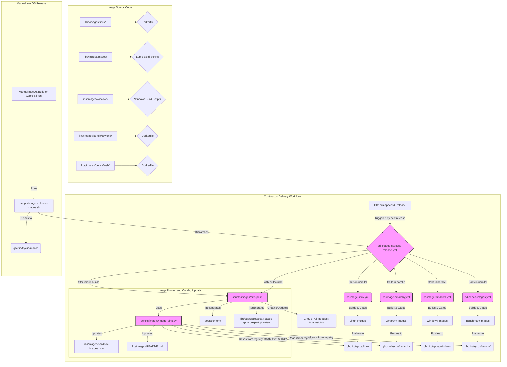

<!-- source: DeepWiki mcp.deepwiki.com · repo trycua/cua · page 4.7 Sandbox Image Catalog and Build Pipeline · fetched 2026-10-29 -->

# Sandbox Image Catalog and Build Pipeline

<details>
<summary>Relevant source files</summary>

The following files were used as context for generating this wiki page:

- [.github/workflows/cd-bench-images.yml](.github/workflows/cd-bench-images.yml)
- [.github/workflows/cd-image-linux.yml](.github/workflows/cd-image-linux.yml)
- [.github/workflows/cd-image-omarchy.yml](.github/workflows/cd-image-omarchy.yml)
- [.github/workflows/cd-image-windows.yml](.github/workflows/cd-image-windows.yml)
- [.github/workflows/cd-images-spacesd-release.yml](.github/workflows/cd-images-spacesd-release.yml)
- [.github/workflows/ci-images-spacesd-lag.yml](.github/workflows/ci-images-spacesd-lag.yml)
- [docs/content/docs/cua-sdk/reference/rust/cua-spaces.mdx](docs/content/docs/cua-sdk/reference/rust/cua-spaces.mdx)
- [docs/content/docs/cua-sdk/reference/rust/cua-spacesd-client.mdx](docs/content/docs/cua-sdk/reference/rust/cua-spacesd-client.mdx)
- [libs/cua-bench/cua_bench/images.py](libs/cua-bench/cua_bench/images.py)
- [libs/cua-spacesd/crates/cua-spacesd-doctor/src/checks/capabilities.rs](libs/cua-spacesd/crates/cua-spacesd-doctor/src/checks/capabilities.rs)
- [libs/cua-spacesd/crates/cua-spacesd-doctor/src/checks/volume.rs](libs/cua-spacesd/crates/cua-spacesd-doctor/src/checks/volume.rs)
- [libs/cua/crates/cua-spaces-app-core/parity/golden/create-gpu.json](libs/cua/crates/cua-spaces-app-core/parity/golden/create-gpu.json)
- [libs/cua/crates/cua-spaces-app-core/parity/golden/create-resources.json](libs/cua/crates/cua-spaces-app-core/parity/golden/create-resources.json)
- [libs/cua/crates/cua-spacesd-client/src/manifest.rs](libs/cua/crates/cua-spacesd-client/src/manifest.rs)
- [libs/images/README.md](libs/images/README.md)
- [libs/images/bench/osworld/evidence/containerdisk-local-amd64-capabilities.json](libs/images/bench/osworld/evidence/containerdisk-local-amd64-capabilities.json)
- [libs/images/bench/osworld/evidence/containerdisk-local-amd64-doctor.json](libs/images/bench/osworld/evidence/containerdisk-local-amd64-doctor.json)
- [libs/images/bench/osworld/evidence/containerdisk-local-amd64.json](libs/images/bench/osworld/evidence/containerdisk-local-amd64.json)
- [libs/images/bench/osworld/evidence/rootfs-local-amd64-capabilities.json](libs/images/bench/osworld/evidence/rootfs-local-amd64-capabilities.json)
- [libs/images/bench/osworld/evidence/rootfs-local-amd64-doctor.json](libs/images/bench/osworld/evidence/rootfs-local-amd64-doctor.json)
- [libs/images/bench/osworld/evidence/rootfs-local-amd64.json](libs/images/bench/osworld/evidence/rootfs-local-amd64.json)
- [libs/images/bench/osworld/image.json](libs/images/bench/osworld/image.json)
- [libs/images/bench/osworld/lock.json](libs/images/bench/osworld/lock.json)
- [libs/images/bench/web/image.json](libs/images/bench/web/image.json)
- [libs/images/bench/web/lock.json](libs/images/bench/web/lock.json)
- [libs/images/common/tools/cua-image-manifest](libs/images/common/tools/cua-image-manifest)
- [libs/images/common/tools/tests/fixtures/manifest.linux.json](libs/images/common/tools/tests/fixtures/manifest.linux.json)
- [libs/images/common/tools/tests/test_cua_image_manifest.py](libs/images/common/tools/tests/test_cua_image_manifest.py)
- [libs/images/macos/build.sh](libs/images/macos/build.sh)
- [libs/images/macos/files/install-guest.sh](libs/images/macos/files/install-guest.sh)
- [libs/images/sandbox-images.json](libs/images/sandbox-images.json)
- [scripts/images/image_pins.py](scripts/images/image_pins.py)
- [scripts/images/pins-pr.sh](scripts/images/pins-pr.sh)
- [scripts/images/release-macos.sh](scripts/images/release-macos.sh)
- [scripts/images/tests/test_image_pins.py](scripts/images/tests/test_image_pins.py)

</details>


This page details the Cua platform's sandbox image catalog and the continuous delivery (CD) workflows responsible for building and publishing these images. It covers the structure of `libs/images/sandbox-images.json`, the build processes for various operating systems (macOS, Linux, Windows, Omarchy), the tooling for managing image manifests, and the CD pipelines that ensure images are up-to-date and correctly pinned.

## Sandbox Image Catalog (`sandbox-images.json`)

The `libs/images/sandbox-images.json` file serves as the canonical source of truth for all sandbox images offered by Cua. This includes images used by Cua Spaces, OpenKoalaBots samples, and those listed in the documentation. It defines image properties, supported platforms, and their intended use cases.

Each entry in `sandbox-images.json` represents a specific sandbox image and includes the following key fields:

*   `$comment`: Provides a comprehensive explanation of the file's purpose, how entries are checked, and the tag grammar for images [libs/images/sandbox-images.json:1-2]().
*   `schemaVersion`: The version of the schema used for the catalog [libs/images/sandbox-images.json:3]().
*   `groups`: Categorizes images into logical groups like "canonical", "benchmark", and "distro" [libs/images/sandbox-images.json:4-7](). The `picker: false` attribute indicates images not intended for direct selection in the Cua Spaces app [libs/images/sandbox-images.json:6]().
*   `images`: An array of image objects, each describing a specific sandbox image [libs/images/sandbox-images.json:9-10]().
    *   `ref`: The full OCI reference for the image (e.g., `ghcr.io/trycua/linux:24.04`) [libs/images/sandbox-images.json:10-11]().
    *   `group`: The category the image belongs to (e.g., "canonical") [libs/images/sandbox-images.json:12]().
    *   `os`: The operating system family (e.g., "linux", "macos", "windows") [libs/images/sandbox-images.json:13]().
    *   `name`: A human-readable name for the image [libs/images/sandbox-images.json:14]().
    *   `distro`: An object specifying the distribution ID and name, used for UI display and OS icon selection [libs/images/sandbox-images.json:15]().
    *   `tier`: Defines the image's content level: `slim` (minimal for CI/benchmarks), `full` (default with dev tooling), or `xcode` (macOS-specific with Xcode) [libs/images/sandbox-images.json:20-21]().
    *   `variant`: Indicates whether the image is a `container` or `vm` [libs/images/sandbox-images.json:17]().
    *   `summary`: A brief description of the image [libs/images/sandbox-images.json:18]().
    *   `spacesd`: A boolean indicating if the image ships with `cua-spacesd` [libs/images/sandbox-images.json:19]().
    *   `digest`: The SHA256 digest of the published image, ensuring immutability [libs/images/sandbox-images.json:20]().
    *   `sizes`: Records download, unpacked, and disk sizes per platform (`amd64`, `arm64`), measured at a specific digest [libs/images/sandbox-images.json:21-22](). This is validated by the `catalog` step in release pipelines [libs/images/sandbox-images.json:22]().
    *   `browsers`: Lists the browsers included in the image [libs/images/sandbox-images.json:28]().
    *   `arch`: Supported architectures (e.g., `amd64`, `arm64`) [libs/images/sandbox-images.json:29]().
    *   `local`: The local runtime provider (e.g., `container`, `qemu`) [libs/images/sandbox-images.json:30]().
    *   `cloud`: The cloud runtime provider (e.g., `gvisor`, `kubevirt`) [libs/images/sandbox-images.json:31]().
    *   `published`: A boolean indicating if the image is publicly available [libs/images/sandbox-images.json:32]().
    *   `sdk`: The Python SDK constructor used to reference the image (e.g., `Image.linux()`) [libs/images/sandbox-images.json:33]().
    *   `guide`: A link to the relevant documentation page [libs/images/sandbox-images.json:34]().

The `sandbox-images.json` file is used to generate documentation (e.g., `scripts/docs-generators/sandbox.ts`) and image lists for applications like Cua Spaces and OpenKoalaBots [libs/images/sandbox-images.json:1-2](). Canonical entries are checked against `libs/cua/crates/cua-image/src/canonical.rs` [libs/images/sandbox-images.json:1-2]().

### Image Metadata and Annotations

Images carry specific OCI annotations to provide metadata:
*   `ai.cua.image.variants`: A JSON map linking variants (e.g., `containerdisk`) to their pinned references [libs/images/README.md:30-31]().
*   `ai.cua.image.source`: For copied images, this indicates the source reference and digest [libs/images/README.md:33]().
*   `ai.cua.image.os`: Specifies the operating system (`linux`, `windows`, `macos`) [libs/images/README.md:34]().
*   `ai.cua.spacesd`: Indicates whether `cua-spacesd` is running on the image [libs/images/README.md:34](). The legacy `ai.cua.env-driver` is also read by the resolver [libs/images/README.md:34]().
*   `ai.cua.doctor.status` and `ai.cua.doctor.report`: Annotations on image children indicating the status and report of `cua-spacesd doctor --strict` checks [libs/images/image_pins.py:140-145]().

Sources:
- [libs/images/sandbox-images.json:1-114]()
- [libs/images/README.md:1-35]()
- [libs/images/image_pins.py:140-145]()

## Image Build Pipelines

Cua employs dedicated CD workflows to build and publish sandbox images for different operating systems and use cases. These pipelines ensure images are consistently built, tested, and made available.

### Linux Image Build (`cd-image-linux.yml`)

The `cd-image-linux.yml` workflow is responsible for building and publishing the canonical Linux Spaces image (`ghcr.io/trycua/linux`). It supports both container and VM disk variants, and `slim` and `full` tiers.

**Workflow Steps:**
1.  **Build and Gate:** `cua images release` command is used to build the rootfs and disk images. This step includes rigorous gating checks:
    *   `cua-spacesd doctor --strict` under `runc` and `gVisor` [cd-image-linux.yml:9-10]().
    *   `amd64` disk variant tested under QEMU+KVM [cd-image-linux.yml:10-11]().
    *   Conformance tests and eval parity checks [cd-image-linux.yml:11-12]().
    *   Content digest calculation [cd-image-linux.yml:12-13]().
2.  **Push:** If all gates pass, the doctored rootfs and disk images are pushed to `ghcr.io/trycua/linux` with immutable dated tags (e.g., `docker-<tag>-<arch>`, `<tag>-<arch>`) [cd-image-linux.yml:17-20]().
3.  **Publish:** This step involves attestation, publishing, verification, and promotion.
    *   Reports become OCI referrers and image-doctor ledger entries [cd-image-linux.yml:23-24]().
    *   Immutable dated pins are created (e.g., `ghcr.io/trycua/linux:<series>-disk-<yyyymmdd>-<sha7>`) with doctor reports attached [cd-image-linux.yml:24-27]().
    *   Verification ensures pins hold the doctored bytes and link correctly [cd-image-linux.yml:28-29]().
    *   Finally, floating tags (e.g., `24.04-disk`, `24.04`) are moved to point to the new pins [cd-image-linux.yml:29]().

**Tiers:**
*   `slim`: Minimal desktop with `cua-spacesd` and Chromium, used for CI and benchmarks [cd-image-linux.yml:46-47]().
*   `full`: The default image, including dev tooling [cd-image-linux.yml:47]().

The workflow is triggered by `push` events on `linux-image-v*` tags, weekly schedules for security updates, `pull_request` events for specific file changes, and `workflow_dispatch` for manual runs [cd-image-linux.yml:64-82]().

### macOS Image Build (Lume)

macOS images are built using Lume, a Swift-based VM management tool, on Apple silicon hosts. The `macos/` directory contains the build scripts.

**Tiers:**
*   `26-slim`: Base VM with `cua-spacesd` and Google Chrome [libs/images/README.md:40]().
*   `26`: Full tier, including Command Line Tools, Homebrew, and dev tools [libs/images/README.md:40]().
*   `26-xcode`: Full tier plus Xcode [libs/images/README.md:40]().

Each tier builds upon the gated VM of the tier below, with pinned versions defined in `macos/versions.env` [libs/images/README.md:40](). The `cua images release` command orchestrates the build, gating, and publishing process [libs/images/README.md:41-42]().

**Build Process:**
1.  **Build:** `cua images release libs/images/macos --tier slim` (and `full`, `xcode`) [libs/images/README.md:43-44]().
2.  **Gates:** Includes `doctor --strict` and `ax probe` from the build, and live input tests on a clone [libs/images/README.md:44-45]().
3.  **Publish:** Pushes `<pin>-raw`, annotates with tier and content key, attaches doctor reports, and verifies [libs/images/README.md:46-47]().
4.  **Promote:** Moves floating tags through `check-tag-safety.sh --moving` [libs/images/README.md:49]().

The `cua-spacesd` daemon is installed as `/Applications/Cua Spacesd.app` and started via a LaunchAgent [libs/images/README.md:55-57]().

### Windows Image Build (`cd-image-windows.yml`)

The `cd-image-windows.yml` workflow builds Windows images (e.g., `ghcr.io/trycua/windows:2022`) as containerDisks. The build process includes installing the Windows workspace and `cua-spacesd`, gated by `cua-spacesd doctor --strict` checks within the guest [libs/images/README.md:25]().

### Omarchy Image Build (`cd-image-omarchy.yml`)

The `cd-image-omarchy.yml` workflow builds Omarchy images (Arch, Hyprland) with `cua-driver-bin` and `cua-hyprland-plugin`, plus `cua-spacesd`. These are VM-only images for `amd64` [libs/images/README.md:11]().

### Benchmark Image Builds (`cd-bench-images.yml`)

The `cd-bench-images.yml` workflow handles converted benchmark images (e.g., `libs/images/bench/osworld`, `libs/images/bench/web`). Each Linux benchmark image ships as two cross-linked OCI indexes: a rootfs for Docker/gVisor and a containerDisk for KubeVirt/QEMU [cd-bench-images.yml:4-6]().

**Key aspects:**
*   **Tiers:** Dockerfile benchmarks build `FROM` the `slim` tier of the Linux image to minimize dependencies [cd-bench-images.yml:13-15]().
*   **Annotations:** Images are annotated with `ai.cua.image.os`, `ai.cua.spacesd`, `ai.cua.image.requires`, and `ai.cua.bench.{id,version,server}` [cd-bench-images.yml:9-10]().
*   **Gating:** Builds are gated by `cua-spacesd doctor --strict` checks [cd-bench-images.yml:20-21]().
*   **Promotion:** Immutable pins are staged, verified, and then floating tags are promoted [cd-bench-images.yml:21-24]().
*   **OSWorld:** The OSWorld benchmark requires significant disk space, which is managed by directing the work tree to `/mnt` on runners with a second disk [cd-bench-images.yml:27-28]().

Sources:
- [cd-image-linux.yml:1-63]()
- [libs/images/README.md:1-57]()
- [cd-bench-images.yml:1-28]()
- [libs/images/sandbox-images.json:1-114]()

## Manifest Tooling and Image Pins

The `scripts/images/image_pins.py` script is a crucial tool for managing image pins and ensuring that the `sandbox-images.json` catalog reflects the latest verified `cua-spacesd` versions.

**Purpose:**
*   Determines which catalog images run a given `cua-spacesd` version [scripts/images/image_pins.py:1-2]().
*   Manages the movement of image pins in `sandbox-images.json` and `libs/images/README.md` [scripts/images/image_pins.py:2-3]().

**Key Concepts:**
*   **Version Reporting:** A tag "reports" a `cua-spacesd` version if every platform child of the resolved image has a passing doctor report (an OCI referrer of type `application/vnd.cua.doctor.report.v1+json`) annotated with `ai.cua.doctor.spacesd=<version>` [scripts/images/image_pins.py:14-18]().
*   **Image Status:**
    *   `pinned`: Every floating tag reports the version, and the catalog already holds the floating digests [scripts/images/image_pins.py:24-25]().
    *   `ready`: Every floating tag reports the version, but some catalog digest differs, indicating a new digest was pushed [scripts/images/image_pins.py:26-27]().
    *   `pending`: Some floating tag does not yet report the version [scripts/images/image_pins.py:28]().

**Commands:**
*   `status`: Prints the image status table (or JSON) [scripts/images/image_pins.py:30]().
*   `apply`: Moves every "ready" OS by updating its digests and sizes in `sandbox-images.json` and moving the dated pin in `README.md` [scripts/images/image_pins.py:31-36](). It exits with an error if a successful CI build did not result in a version report [scripts/images/image_pins.py:37-38]().
*   `lag`: Used for CI checks, it warns about catalog digests that do not report the expected version [scripts/images/image_pins.py:39-40]().

The script relies on `crane` and `oras` for interacting with OCI registries [scripts/images/image_pins.py:42-43](). The `Registry` class provides methods for `digest`, `manifest`, `tags`, and `reports` [scripts/images/image_pins.py:84-97](). The `spacesd_of` function determines the `cua-spacesd` version reported by a given image reference and digest, handling cases of mixed versions or missing reports across child manifests [scripts/images/image_pins.py:125-151]().

Sources:
- [scripts/images/image_pins.py:1-181]()
- [libs/images/sandbox-images.json:1-114]()
- [libs/images/README.md:1-57]()

## CD Workflows for Publishing Images

The `cd-images-spacesd-release.yml` workflow orchestrates the rebuilding and publishing of sandbox images whenever a new `cua-spacesd` release occurs. This workflow ensures that all images are updated to run the latest `cua-spacesd` version.

**Workflow Trigger:**
*   `workflow_run` event from the "CD: cua-spacesd" workflow, specifically when a `cua-spacesd` release is completed successfully [cd-images-spacesd-release.yml:40-42]().
*   `workflow_dispatch` for manual triggering with a specific `cua-spacesd` version [cd-images-spacesd-release.yml:43-49]().

**Workflow Steps:**
1.  **Resolve Version:** The `resolve` job determines the `cua-spacesd` version to target, either from the `workflow_run` event or manual input [cd-images-spacesd-release.yml:64-102](). It also verifies that the target `cua-spacesd` version is a published release [cd-images-spacesd-release.yml:97-99]().
2.  **Image Builds (Parallel):** If `build` is true, it calls the individual image build workflows (`cd-image-linux.yml`, `cd-image-omarchy.yml`, `cd-image-windows.yml`, `cd-bench-images.yml`) as reusable workflows in parallel [cd-images-spacesd-release.yml:106-157](). Each of these sub-workflows builds, gates (including `cua-spacesd doctor --strict`), and promotes its respective image.
3.  **Pins PR (`pins-pr.sh`):** The `pins` job runs `scripts/images/pins-pr.sh` to open or update a pull request on the `images/pins` branch [cd-images-spacesd-release.yml:159-160]().
    *   This script uses `image_pins.py apply` to update `libs/images/sandbox-images.json` and `libs/images/README.md` with new digests and pins for images that successfully report the target `cua-spacesd` version [scripts/images/pins-pr.sh:7-10]().
    *   It regenerates parity goldens and documentation based on the updated catalog [scripts/images/pins-pr.sh:11-15]().
    *   The PR's title and body (a per-OS checklist) are set, and the branch is force-pushed [scripts/images/pins-pr.sh:16-17]().
    *   If no changes are detected, an existing PR is closed [scripts/images/pins-pr.sh:89-95]().
    *   The PR is opened using a GitHub App token to ensure checks run [cd-images-spacesd-release.yml:166-170]().

**macOS Handling:** macOS images cannot be built directly in this workflow due to the requirement for Apple silicon. The PR lists macOS as pending with a command (`scripts/images/release-macos.sh X.Y.Z`) that can be run manually on a Mac. After a manual macOS release, the workflow can be re-dispatched with `build=false` to refresh the pins PR and include macOS [cd-images-spacesd-release.yml:20-24]().

### Diagram: Sandbox Image Build and Release Pipeline


Title: Sandbox Image Build and Release Pipeline Overview

Sources:
- [cd-images-spacesd-release.yml:1-170]()
- [scripts/images/pins-pr.sh:1-117]()
- [scripts/images/image_pins.py:1-181]()

### Diagram: `image_pins.py` Data Flow

```mermaid
graph TD
    A[Registry (ghcr.io/trycua)] -->|crane, oras| B(image_pins.py)
    B -->|Reads image manifests, tags, reports| C{Image Metadata}
    C -->|Image Ref, Digest, OCI Annotations (ai.cua.doctor.spacesd, ai.cua.doctor.status)| D{Image Children (amd64, arm64)}
    D -->|Determines cua-spacesd version reported by each child| E{Consolidated Version Report (e.g., "0.5.2", "mixed:0.5.1,0.5.2", None)}

    subgraph "Catalog and Documentation"
        F[libs/images/sandbox-images.json]
        G[libs/images/README.md]
    end

    B -->|Loads current catalog| F
    B -->|Loads current README| G

    E -->|Compares reported version with target version| H{Image Status (pinned, ready, pending)}

    H -- "If status is 'ready'" --> I(image_pins.py apply)
    I -->|Updates digest and sizes| F
    I -->|Updates pin in table| G

    subgraph "Output"
        J[JSON Summary]
        K[PR Body (Markdown Checklist)]
        L[Console Output (status, lag)]
    end

    B -->|Generates| J
    B -->|Generates| K
    B -->|Generates| L
```
Title: `image_pins.py` Data Flow for Image Pin Management

Sources:
- [scripts/images/image_pins.py:1-181]()
- [libs/images/sandbox-images.json:1-114]()
- [libs/images/README.md:1-57]()

---

