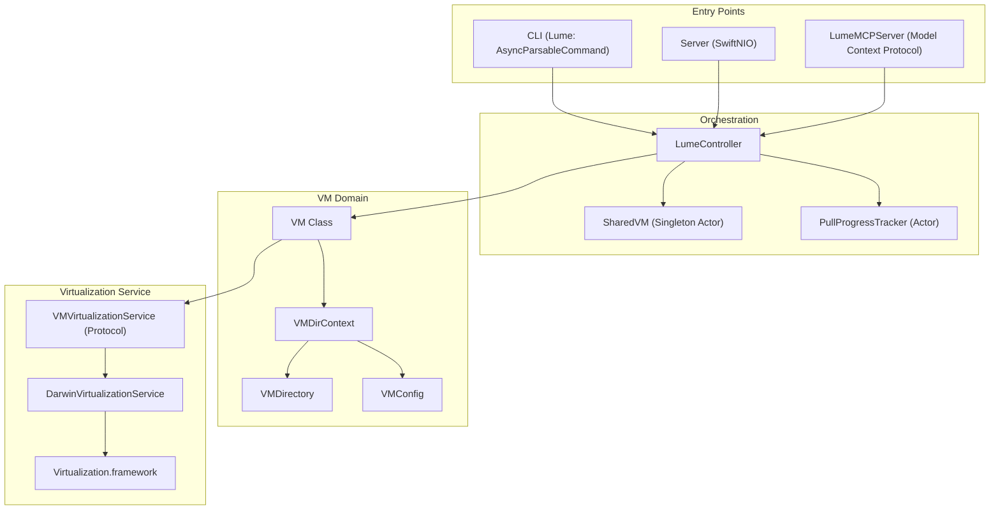
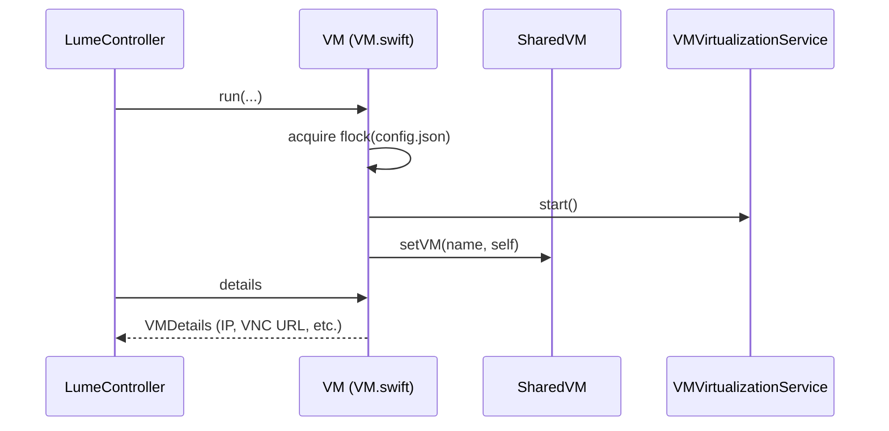

<!-- source: DeepWiki mcp.deepwiki.com · repo trycua/cua · page 5.1 Lume Architecture · fetched 2026-10-29 -->

# Lume Architecture

Relevant source files

The following files were used as context for generating this wiki page:

- [libs/lume/.cursorignore](libs/lume/.cursorignore)
- [libs/lume/Development.md](libs/lume/Development.md)
- [libs/lume/Package.resolved](libs/lume/Package.resolved)
- [libs/lume/Package.swift](libs/lume/Package.swift)
- [libs/lume/README.md](libs/lume/README.md)
- [libs/lume/scripts/setup-cua.sh](libs/lume/scripts/setup-cua.sh)
- [libs/lume/src/Clipboard/ClipboardWatcher.swift](libs/lume/src/Clipboard/ClipboardWatcher.swift)
- [libs/lume/src/Commands/Config.swift](libs/lume/src/Commands/Config.swift)
- [libs/lume/src/Commands/Create.swift](libs/lume/src/Commands/Create.swift)
- [libs/lume/src/Commands/DetachedRun.swift](libs/lume/src/Commands/DetachedRun.swift)
- [libs/lume/src/Commands/Pull.swift](libs/lume/src/Commands/Pull.swift)
- [libs/lume/src/Commands/Push.swift](libs/lume/src/Commands/Push.swift)
- [libs/lume/src/Commands/Run.swift](libs/lume/src/Commands/Run.swift)
- [libs/lume/src/Commands/SSH.swift](libs/lume/src/Commands/SSH.swift)
- [libs/lume/src/Commands/Serve.swift](libs/lume/src/Commands/Serve.swift)
- [libs/lume/src/Commands/Setup.swift](libs/lume/src/Commands/Setup.swift)
- [libs/lume/src/ContainerRegistry/GCSImageRegistry.swift](libs/lume/src/ContainerRegistry/GCSImageRegistry.swift)
- [libs/lume/src/ContainerRegistry/ImageContainerRegistry.swift](libs/lume/src/ContainerRegistry/ImageContainerRegistry.swift)
- [libs/lume/src/ContainerRegistry/ImageRegistry.swift](libs/lume/src/ContainerRegistry/ImageRegistry.swift)
- [libs/lume/src/ContainerRegistry/RegistryFactory.swift](libs/lume/src/ContainerRegistry/RegistryFactory.swift)
- [libs/lume/src/Errors/Errors.swift](libs/lume/src/Errors/Errors.swift)
- [libs/lume/src/FileSystem/Home.swift](libs/lume/src/FileSystem/Home.swift)
- [libs/lume/src/FileSystem/Settings.swift](libs/lume/src/FileSystem/Settings.swift)
- [libs/lume/src/FileSystem/VMConfig.swift](libs/lume/src/FileSystem/VMConfig.swift)
- [libs/lume/src/FileSystem/VMDirectory.swift](libs/lume/src/FileSystem/VMDirectory.swift)
- [libs/lume/src/LumeController.swift](libs/lume/src/LumeController.swift)
- [libs/lume/src/Resources/unattended-presets/sequoia.yml](libs/lume/src/Resources/unattended-presets/sequoia.yml)
- [libs/lume/src/Resources/unattended-presets/tahoe.yml](libs/lume/src/Resources/unattended-presets/tahoe.yml)
- [libs/lume/src/SSH/SSHClient.swift](libs/lume/src/SSH/SSHClient.swift)
- [libs/lume/src/SSH/SSHErrors.swift](libs/lume/src/SSH/SSHErrors.swift)
- [libs/lume/src/SSH/SystemSSHClient.swift](libs/lume/src/SSH/SystemSSHClient.swift)
- [libs/lume/src/Server/APIDocExtractor.swift](libs/lume/src/Server/APIDocExtractor.swift)
- [libs/lume/src/Server/HTTP.swift](libs/lume/src/Server/HTTP.swift)
- [libs/lume/src/Server/Handlers.swift](libs/lume/src/Server/Handlers.swift)
- [libs/lume/src/Server/MCPServer.swift](libs/lume/src/Server/MCPServer.swift)
- [libs/lume/src/Server/Requests.swift](libs/lume/src/Server/Requests.swift)
- [libs/lume/src/Server/Responses.swift](libs/lume/src/Server/Responses.swift)
- [libs/lume/src/Server/Server.swift](libs/lume/src/Server/Server.swift)
- [libs/lume/src/Unattended/HealthCheckRunner.swift](libs/lume/src/Unattended/HealthCheckRunner.swift)
- [libs/lume/src/Unattended/UnattendedConfig.swift](libs/lume/src/Unattended/UnattendedConfig.swift)
- [libs/lume/src/Unattended/UnattendedInstaller.swift](libs/lume/src/Unattended/UnattendedInstaller.swift)
- [libs/lume/src/Update/VersionCheck.swift](libs/lume/src/Update/VersionCheck.swift)
- [libs/lume/src/Utils/CommandDocExtractor.swift](libs/lume/src/Utils/CommandDocExtractor.swift)
- [libs/lume/src/Utils/CommandRegistry.swift](libs/lume/src/Utils/CommandRegistry.swift)
- [libs/lume/src/Utils/NetworkUtils.swift](libs/lume/src/Utils/NetworkUtils.swift)
- [libs/lume/src/VM/DarwinVM.swift](libs/lume/src/VM/DarwinVM.swift)
- [libs/lume/src/VM/LinuxVM.swift](libs/lume/src/VM/LinuxVM.swift)
- [libs/lume/src/VM/VM.swift](libs/lume/src/VM/VM.swift)
- [libs/lume/src/VM/VMDetails.swift](libs/lume/src/VM/VMDetails.swift)
- [libs/lume/src/VM/VMDetailsPrinter.swift](libs/lume/src/VM/VMDetailsPrinter.swift)
- [libs/lume/src/VM/VMDisplayPresenter.swift](libs/lume/src/VM/VMDisplayPresenter.swift)
- [libs/lume/src/VNC/VNCService.swift](libs/lume/src/VNC/VNCService.swift)
- [libs/lume/src/Virtualization/DHCPLeaseParser.swift](libs/lume/src/Virtualization/DHCPLeaseParser.swift)
- [libs/lume/src/Virtualization/VMVirtualizationService.swift](libs/lume/src/Virtualization/VMVirtualizationService.swift)
- [libs/lume/tests/ClipboardWatcherTests.swift](libs/lume/tests/ClipboardWatcherTests.swift)
- [libs/lume/tests/CreateCommandTests.swift](libs/lume/tests/CreateCommandTests.swift)
- [libs/lume/tests/DHCPLeaseParserTests.swift](libs/lume/tests/DHCPLeaseParserTests.swift)
- [libs/lume/tests/DetachedRunTests.swift](libs/lume/tests/DetachedRunTests.swift)
- [libs/lume/tests/LumeControllerTests.swift](libs/lume/tests/LumeControllerTests.swift)
- [libs/lume/tests/Mocks/MockVNCService.swift](libs/lume/tests/Mocks/MockVNCService.swift)
- [libs/lume/tests/NativeFileDropTests.swift](libs/lume/tests/NativeFileDropTests.swift)
- [libs/lume/tests/RunCommandTests.swift](libs/lume/tests/RunCommandTests.swift)
- [libs/lume/tests/SHA256FileTests.swift](libs/lume/tests/SHA256FileTests.swift)
- [libs/lume/tests/SSHClientTests.swift](libs/lume/tests/SSHClientTests.swift)
- [libs/lume/tests/VMDisplayLifecycleTests.swift](libs/lume/tests/VMDisplayLifecycleTests.swift)
- [libs/lume/tests/VMVirtualizationServiceTests.swift](libs/lume/tests/VMVirtualizationServiceTests.swift)
- [libs/lume/tests/VersionCheckTests.swift](libs/lume/tests/VersionCheckTests.swift)
- [scripts/docs-generators/lume.test.ts](scripts/docs-generators/lume.test.ts)
- [scripts/docs-generators/lume.ts](scripts/docs-generators/lume.ts)

## Purpose and Scope

This document describes the internal architecture of Lume, the macOS VM management system. It covers the Swift-based implementation, the `LumeController` orchestration layer, VM lifecycle management, and integration with macOS `Virtualization.framework`. Lume is designed specifically for Apple Silicon to provide high-performance, programmable macOS environments for Computer-Use Agents.

## System Overview

Lume is a lightweight CLI and local API server designed to build, run, and manage macOS VMs on Apple Silicon [libs/lume/README.md:2-3](). It acts as a wrapper around Apple's `Virtualization.framework`, providing a high-level interface for VM operations and OCI-compliant image distribution [libs/lume/src/ContainerRegistry/ImageContainerRegistry.swift:1-173]() (specifically, the `PushError` enum and related functions indicate OCI image handling).

### Core Architecture Components

The following diagram bridges the high-level system concepts to the specific Swift classes and protocols that implement them.

**Sources:** [libs/lume/src/LumeController.swift:160-180](), [libs/lume/src/VM/VM.swift:43-72](), [libs/lume/src/Server/Server.swift:167-175](), [libs/lume/src/Server/MCPServer.swift:7-13]()

## LumeController: The Orchestration Layer

The `LumeController` is the central entry point for both CLI commands and API handlers [libs/lume/src/LumeController.swift:160-161](). It coordinates image loading, VM instantiation, and lifecycle management.

### Key Responsibilities
- **VM Listing**: Implements a lightweight path to list VMs by reading configuration files directly from `Home` without instantiating full VM objects [libs/lume/src/LumeController.swift:187-193]().
- **Async Operations**: Manages background tasks like image pulling and VM provisioning via `Task.detached` [libs/lume/src/Server/Handlers.swift:161-163]().
- **Status Tracking**: Uses `PullProgressTracker` (an actor) to track the progress of ongoing image downloads across different threads/requests [libs/lume/src/LumeController.swift:29-157]().

### Shared State Management
Lume uses a `SharedVM` singleton to track running virtual machines within the process [libs/lume/src/LumeController.swift:8-10]().
- `getVM(name:)`: Retrieves a cached `VM` instance [libs/lume/src/LumeController.swift:14-16]().
- `setVM(name:vm:)`: Registers a running `VM` [libs/lume/src/LumeController.swift:18-20]().

**Sources:** [libs/lume/src/LumeController.swift:8-25](), [libs/lume/src/LumeController.swift:29-157](), [libs/lume/src/LumeController.swift:187-193](), [libs/lume/src/Server/Handlers.swift:161-163]()

## VM Lifecycle and Virtualization

The `VM` class represents an individual virtual machine and encapsulates its state, configuration, and virtualization service [libs/lume/src/VM/VM.swift:43-45]().

### Virtualization Integration
Lume abstracts the underlying virtualization engine through the `VMVirtualizationService` protocol [libs/lume/src/Virtualization/VMVirtualizationService.swift:22-34]().
- **DarwinVirtualizationService**: The primary implementation using Apple's `VZVirtualMachine`.
- **Configuration**: `VMVirtualizationServiceContext` passes hardware details like CPU count, memory size, and storage attachments to the service [libs/lume/src/Virtualization/VMVirtualizationService.swift:5-20]().

### VM Run Sequence
When `VM.run()` is called, the following steps occur:
1. **Initialization Check**: Ensures the `VMDirectory` is properly initialized.
2. **Lock Acquisition**: Attempts to acquire an exclusive `flock` on the `config.json` file to prevent multiple instances from running the same VM.
3. **Service Setup**: Instantiates the `VMVirtualizationService` via a factory [libs/lume/src/VM/VM.swift:87-89]().
4. **VNC Start**: Initializes the `VNCService` for remote display access [libs/lume/src/VM/VM.swift:100-101]().

**Sources:** [libs/lume/src/VM/VM.swift:87-89](), [libs/lume/src/VM/VM.swift:100-101](), [libs/lume/src/LumeController.swift:18-20](), [libs/lume/src/Virtualization/VMVirtualizationService.swift:49-79]()

## Storage and Configuration

Lume manages its environment through the `Home` and `VMDirectory` classes.

### Home Directory Management
The `Home` class manages the `.lume` directory structure.
- **Storage Locations**: Supports multiple storage paths, including a default location and named storage volumes.
- **Ephemeral Storage**: Supports a special "ephemeral" mode using `TMPDIR` for short-lived VMs.

### VM Directory Structure
Each VM resides in its own directory managed by `VMDirectory`, containing:
- `config.json`: Hardware and OS settings.
- `disk.img`: The primary virtual disk.
- `nvram.bin`: Non-volatile RAM state for the VM.
- `provisioning_marker`: A temporary file indicating the VM is currently being created, checked by `getVMDetailsLightweight`.

**Sources:** [libs/lume/src/FileSystem/Home.swift](), [libs/lume/src/FileSystem/VMDirectory.swift]()

## Server and API Handlers

The Lume server (default port 7777) uses SwiftNIO to map HTTP requests to `LumeController` methods [libs/lume/src/Server/Server.swift:167-175]().

### Async Handlers
Many operations are long-running and use `Task.detached` to return immediate responses while continuing work in the background:
- **`handlePullStart`**: Returns `202 Accepted` immediately while the image pull continues in a detached task [libs/lume/src/Server/Handlers.swift:146-156]().
- **`handleCreateVM`**: Starts the provisioning process and returns a "provisioning" status.

### Model Context Protocol (MCP)
Lume includes an `LumeMCPServer` that exposes VM management tools to AI agents via the Model Context Protocol [libs/lume/src/Server/MCPServer.swift:7-13](). It registers tools such as `lume_list_vms`, `lume_create_vm`, and `lume_run_vm` [libs/lume/src/Server/MCPServer.swift:35-43]().

**Sources:** [libs/lume/src/Server/Handlers.swift:5-175](), [libs/lume/src/Server/Requests.swift](), [libs/lume/src/Server/Server.swift:24-122](), [libs/lume/src/Server/MCPServer.swift:35-43]()

## Image Management and Registry Integration

Lume supports OCI-compliant image distribution with specific optimizations for large VM disk layers.

### Image Pulling and Reassembly
The `ImageContainerRegistry` handles interaction with registries like `ghcr.io` [libs/lume/src/ContainerRegistry/ImageContainerRegistry.swift:1-173]().
- **Sparse File Reassembly**: To optimize disk space, `gunzipChunkAndWriteSparse` skips zero-filled 4 MiB blocks to create holes in the sparse disk image [libs/lume/src/ContainerRegistry/ImageContainerRegistry.swift:48-153]().
- **Streaming Hashing**: Disk layers are multi-GB, so Lume uses `sha256OfFile` to hash in 4 MiB chunks to verify integrity without loading the entire file into memory [libs/lume/src/ContainerRegistry/ImageContainerRegistry.swift:22-41]().

### OCI Chunking
Lume groups logical disk parts by shared OCI blobs while preserving order using `groupOCIChunksByDigest`.

**Sources:** [libs/lume/src/ContainerRegistry/ImageContainerRegistry.swift:1-173]()

## Error Model

Lume defines a comprehensive error model using Swift's `Error` and `LocalizedError` protocols. Errors are categorized by their origin, providing clear and actionable messages.

### Error Categories
- **`HomeError`**: Relates to issues with the Lume home directory or storage locations, such as `directoryCreationFailed` or `storageLocationNotFound` [libs/lume/src/Errors/Errors.swift:3-48]().
- **`PullError`**: Covers issues during image pulling, including `invalidImageFormat`, `tokenFetchFailed`, `layerDownloadFailed`, and `layerVerificationFailed` [libs/lume/src/Errors/Errors.swift:50-95]().
- **`VMConfigError`**: For problems with VM configuration, like `invalidDisplayResolution`, `invalidHardwareModel`, or `noBridgeInterfaceFound` [libs/lume/src/Errors/Errors.swift:97-145]().
- **`VMDirectoryError`**: Specific to VM directory operations, such as `configNotFound` or `diskOperationFailed` [libs/lume/src/Errors/Errors.swift:147-165]().
- **`PushError`**: Errors encountered during image pushing, including `uploadInitiationFailed`, `blobUploadFailed`, and `manifestPushFailed` [libs/lume/src/ContainerRegistry/ImageContainerRegistry.swift:156-172]().

These errors are typically caught by `LumeController` or API handlers and translated into appropriate HTTP responses or CLI output.

**Sources:** [libs/lume/src/Errors/Errors.swift:3-165](), [libs/lume/src/ContainerRegistry/ImageContainerRegistry.swift:156-172]()

## Unattended Setup Presets

Lume supports unattended setup for macOS VMs, allowing for automated configuration post-installation. This is particularly useful for creating consistent sandbox environments.

### Preset Mechanism
- **`unattended` option**: The `create` command and `CreateVMRequest` accept an `unattended` parameter, which can be a preset name (e.g., "tahoe", "sequoia") or a path to a YAML configuration file [libs/lume/src/Commands/Create.swift](), [libs/lume/src/Server/Requests.swift]().
- **`UnattendedConfig`**: This struct loads and parses the YAML configuration, defining `boot_wait`, `boot_commands`, and `health_check` parameters [libs/lume/src/Unattended/UnattendedConfig.swift]().
- **`UnattendedInstaller`**: This component applies the unattended configuration to the VM, which typically involves patching the installed disk offline, creating a user, enabling autologin and SSH, and disabling sleep/screen locking [libs/lume/src/Unattended/UnattendedInstaller.swift]().

### Built-in Presets
Lume includes several built-in presets:
- **`sequoia.yml`**: Configures macOS Sequoia with SSH enabled, `lume` user/password, autologin, and disabled sleep/screen locking [libs/lume/src/Resources/unattended-presets/sequoia.yml:1-16]().
- **`tahoe.yml`**: Similar configuration for macOS Tahoe [libs/lume/src/Resources/unattended-presets/tahoe.yml:1-16]().

The setup process includes a health check, typically an SSH connection, to verify the configuration before the VM is marked as ready [libs/lume/src/Unattended/HealthCheckRunner.swift]().

**Sources:** [libs/lume/src/Commands/Create.swift](), [libs/lume/src/Server/Requests.swift](), [libs/lume/src/Unattended/UnattendedConfig.swift](), [libs/lume/src/Unattended/UnattendedInstaller.swift](), [libs/lume/src/Unattended/HealthCheckRunner.swift](), [libs/lume/src/Resources/unattended-presets/sequoia.yml:1-16](), [libs/lume/src/Resources/unattended-presets/tahoe.yml:1-16]()

## Summary of Key Implementation Details

| Component | Code Entity | File Reference |
|-----------|-------------|----------------|
| **Orchestrator** | `class LumeController` | [libs/lume/src/LumeController.swift:160]() |
| **VM Object** | `class VM` | [libs/lume/src/VM/VM.swift:43]() |
| **State Cache** | `class SharedVM` | [libs/lume/src/LumeController.swift:8]() |
| **Storage** | `class Home` | [libs/lume/src/FileSystem/Home.swift]() |
| **API Logic** | `extension Server` | [libs/lume/src/Server/Handlers.swift:6]() |
| **NIO Handler** | `class HTTPChannelHandler` | [libs/lume/src/Server/Server.swift:24]() |
| **Pull Tracker** | `actor PullProgressTracker` | [libs/lume/src/LumeController.swift:29]() |
| **MCP Interface** | `class LumeMCPServer` | [libs/lume/src/Server/MCPServer.swift:7]() |
| **Registry Client** | `ImageContainerRegistry` | [libs/lume/src/ContainerRegistry/ImageContainerRegistry.swift:1]() |
| **Error Handling** | `enum HomeError`, `enum PullError`, `enum VMConfigError`, `enum VMDirectoryError`, `enum PushError` | [libs/lume/src/Errors/Errors.swift:3](), [libs/lume/src/ContainerRegistry/ImageContainerRegistry.swift:156]() |
| **Unattended Setup Config** | `struct UnattendedConfig` | [libs/lume/src/Unattended/UnattendedConfig.swift]() |
| **Unattended Setup Installer** | `class UnattendedInstaller` | [libs/lume/src/Unattended/UnattendedInstaller.swift]() |

**Sources:** [libs/lume/src/LumeController.swift:1-180](), [libs/lume/src/VM/VM.swift:1-177](), [libs/lume/src/Server/Server.swift:126-193](), [libs/lume/src/Server/MCPServer.swift:7-32](), [libs/lume/src/ContainerRegistry/ImageContainerRegistry.swift:1-173](), [libs/lume/src/Errors/Errors.swift:3-165](), [libs/lume/src/Unattended/UnattendedConfig.swift](), [libs/lume/src/Unattended/UnattendedInstaller.swift]()

---

