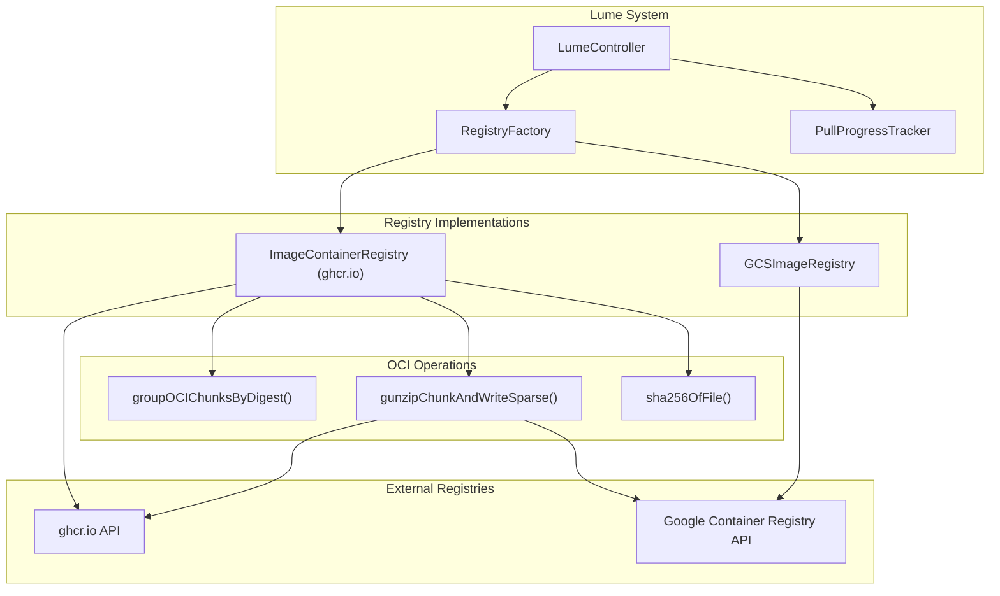
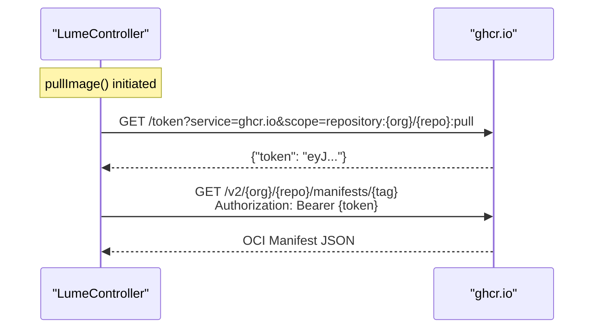
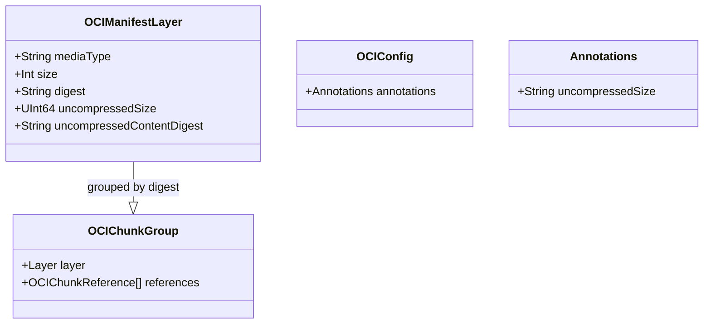
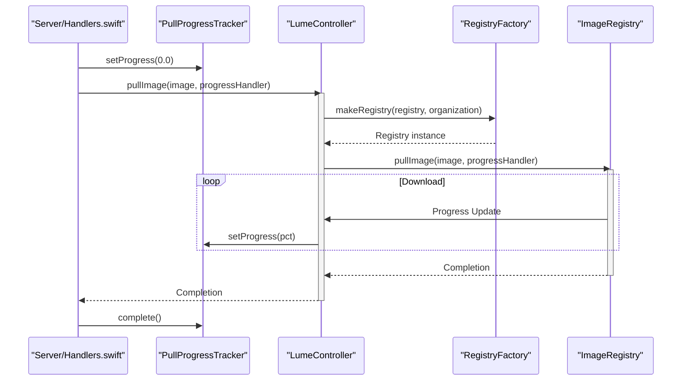

<!-- source: DeepWiki mcp.deepwiki.com · repo trycua/cua · page 5.2 Image Registry Integration · fetched 2026-10-29 -->

# Image Registry Integration

Relevant source files

The following files were used as context for generating this wiki page:

- [libs/lume/.cursorignore](libs/lume/.cursorignore)
- [libs/lume/Development.md](libs/lume/Development.md)
- [libs/lume/README.md](libs/lume/README.md)
- [libs/lume/scripts/setup-cua.sh](libs/lume/scripts/setup-cua.sh)
- [libs/lume/src/Commands/Config.swift](libs/lume/src/Commands/Config.swift)
- [libs/lume/src/Commands/Create.swift](libs/lume/src/Commands/Create.swift)
- [libs/lume/src/Commands/Pull.swift](libs/lume/src/Commands/Pull.swift)
- [libs/lume/src/Commands/Push.swift](libs/lume/src/Commands/Push.swift)
- [libs/lume/src/Commands/Run.swift](libs/lume/src/Commands/Run.swift)
- [libs/lume/src/ContainerRegistry/GCSImageRegistry.swift](libs/lume/src/ContainerRegistry/GCSImageRegistry.swift)
- [libs/lume/src/ContainerRegistry/ImageContainerRegistry.swift](libs/lume/src/ContainerRegistry/ImageContainerRegistry.swift)
- [libs/lume/src/ContainerRegistry/ImageRegistry.swift](libs/lume/src/ContainerRegistry/ImageRegistry.swift)
- [libs/lume/src/ContainerRegistry/RegistryFactory.swift](libs/lume/src/ContainerRegistry/RegistryFactory.swift)
- [libs/lume/src/FileSystem/Home.swift](libs/lume/src/FileSystem/Home.swift)
- [libs/lume/src/FileSystem/Settings.swift](libs/lume/src/FileSystem/Settings.swift)
- [libs/lume/src/LumeController.swift](libs/lume/src/LumeController.swift)
- [libs/lume/src/Server/Handlers.swift](libs/lume/src/Server/Handlers.swift)
- [libs/lume/src/Server/MCPServer.swift](libs/lume/src/Server/MCPServer.swift)
- [libs/lume/src/Server/Requests.swift](libs/lume/src/Server/Requests.swift)
- [libs/lume/src/Server/Responses.swift](libs/lume/src/Server/Responses.swift)
- [libs/lume/src/Server/Server.swift](libs/lume/src/Server/Server.swift)
- [libs/lume/src/Utils/CommandDocExtractor.swift](libs/lume/src/Utils/CommandDocExtractor.swift)
- [libs/lume/src/Utils/CommandRegistry.swift](libs/lume/src/Utils/CommandRegistry.swift)
- [libs/lume/src/VM/VM.swift](libs/lume/src/VM/VM.swift)
- [libs/lume/src/VNC/VNCService.swift](libs/lume/src/VNC/VNCService.swift)
- [libs/lume/tests/CreateCommandTests.swift](libs/lume/tests/CreateCommandTests.swift)
- [libs/lume/tests/Mocks/MockVNCService.swift](libs/lume/tests/Mocks/MockVNCService.swift)
- [scripts/docs-generators/lume.test.ts](scripts/docs-generators/lume.test.ts)
- [scripts/docs-generators/lume.ts](scripts/docs-generators/lume.ts)

This document describes how Lume integrates with container registries (primarily **ghcr.io** and **GCS**) to pull and push VM images. It covers the authentication mechanisms, OCI manifest format, layer types, and the implementation details of registry communication.

For information about the actual image pulling and caching mechanisms, see [Image Pull and Cache System](5.4). For details on publishing images to the registry, see [Image Push and Distribution](5.5). For the HTTP API that wraps these operations, see [HTTP API Reference](5.3).

## Registry Architecture Overview

Lume uses the `ImageContainerRegistry` logic (implemented in `libs/lume/src/ContainerRegistry/ImageContainerRegistry.swift`) as the primary interface to GitHub Container Registry. The registry integration follows the OCI (Open Container Initiative) distribution specification for fetching and storing VM disk images as container artifacts. While GitHub Container Registry is the default, Lume's architecture supports registry and organization overrides during pull and push operations [libs/lume/src/Server/Requests.swift:101-102]().

**Registry Integration Architecture**

**Sources:**
- [libs/lume/src/LumeController.swift:160-179]()
- [libs/lume/src/ContainerRegistry/ImageContainerRegistry.swift:1-173]()
- [libs/lume/src/ContainerRegistry/GCSImageRegistry.swift]()
- [libs/lume/src/ContainerRegistry/RegistryFactory.swift]()

The `PullRequest` and `PushRequest` structures handle registry parameters with the following defaults:

| Parameter | Default Value | Description |
|-----------|---------------|-------------|
| `registry` | `ghcr.io` | Container registry hostname [libs/lume/src/Server/Requests.swift:101]() |
| `organization` | `trycua` | Organization/namespace in registry [libs/lume/src/Server/Requests.swift:102]() |
| `storage` | `nil` | Optional storage location name or direct path [libs/lume/src/Server/Requests.swift:103]() |

**Sources:**
- [libs/lume/src/Server/Requests.swift:86-105]()
- [libs/lume/src/Server/Requests.swift:178-204]()

## Authentication System

Lume uses token-based authentication with container registries. Authentication tokens are obtained using the OAuth2 token endpoint (for ghcr.io) or Google Cloud authentication mechanisms (for GCS) before making any API requests.

**Authentication Flow (ghcr.io)**

**Sources:**
- [libs/lume/src/Server/Handlers.swift:85-94]()
- [libs/lume/src/ContainerRegistry/ImageContainerRegistry.swift:156-163]()

### Error States
The system defines specific errors for authentication failures within `PushError` and `PullError`:
- `PushError.authenticationFailed`: General failure to authenticate [libs/lume/src/ContainerRegistry/ImageContainerRegistry.swift:161]().
- `PullError.tokenFetchFailed`: Specific failure during token acquisition.

**Sources:**
- [libs/lume/src/ContainerRegistry/ImageContainerRegistry.swift:156-172]()

## OCI Manifest and Multi-Architecture Support

Lume uses OCI-compliant manifests to describe VM images. A critical feature is the handling of sparse disk images and multi-part layers to accommodate large macOS disk files.

### OCI Manifest Structure

**Manifest Entity Mapping**

**Sources:**
- [libs/lume/src/ContainerRegistry/ImageContainerRegistry.swift:123-128]()

### Sparse File Support
Lume implements a specialized `gunzipChunkAndWriteSparse` function to handle disk images. This function decompresses chunks and skips zero-filled blocks (4 MiB granularity) to maintain file sparsity on the host APFS filesystem [libs/lume/src/ContainerRegistry/ImageContainerRegistry.swift:48-97]().

- **`sparseHoleGranularityBytes`**: Set to 4 MiB [libs/lume/src/ContainerRegistry/ImageContainerRegistry.swift:43]().
- **Zero Skipping**: If a decompressed chunk matches `sparseZeroChunk`, the file pointer is moved without writing, creating a hole [libs/lume/src/ContainerRegistry/ImageContainerRegistry.swift:109-112]().

**Sources:**
- [libs/lume/src/ContainerRegistry/ImageContainerRegistry.swift:43-153]()

## Multi-Architecture and Layer Grouping

Lume optimizes downloads by grouping logical disk parts that share the same OCI blob digest. This is handled by `groupOCIChunksByDigest` [libs/lume/src/ContainerRegistry/ImageContainerRegistry.swift:180-197]().

### Chunk Metadata
Individual layers contain metadata used for reassembly:
- **`uncompressedDigest`**: SHA256 of the raw data [libs/lume/src/ContainerRegistry/ImageContainerRegistry.swift:124]().
- **`uncompressedSize`**: Original size before compression [libs/lume/src/ContainerRegistry/ImageContainerRegistry.swift:125]().
- **`OCIAnnotation.partOffset`**: The byte offset where this part belongs in the final disk image [libs/lume/src/ContainerRegistry/ImageContainerRegistry.swift:187]().

**Sources:**
- [libs/lume/src/ContainerRegistry/ImageContainerRegistry.swift:123-128]()
- [libs/lume/src/ContainerRegistry/ImageContainerRegistry.swift:180-197]()

## Integration with Lume Controller

The `LumeController` coordinates the registry integration through asynchronous tasks, allowing the CLI or API to return immediately while the pull happens in the background.

**Data Flow: API to Registry**

**Sources:**
- [libs/lume/src/Server/Handlers.swift:161-163]()
- [libs/lume/src/LumeController.swift:27-63]()
- [libs/lume/src/ContainerRegistry/RegistryFactory.swift]()

### Progress Tracking
The `PullProgressTracker` actor maintains the state of active registry operations, keyed by VM name [libs/lume/src/LumeController.swift:31-63](). This allows the `handleGetVM` endpoint to return a synthetic "pulling" status with a `downloadProgress` percentage [libs/lume/src/Server/Handlers.swift:38-50]().

**Sources:**
- [libs/lume/src/LumeController.swift:31-63]()
- [libs/lume/src/Server/Handlers.swift:25-60]()

## Key Implementation Functions

| Function | File | Description |
|----------|------|-------------|
| `sha256OfFile(at:)` | [libs/lume/src/ContainerRegistry/ImageContainerRegistry.swift:22]() | Streams multi-GB disk layers in 4MB chunks to calculate digests without memory exhaustion. |
| `gunzipChunkAndWriteSparse` | [libs/lume/src/ContainerRegistry/ImageContainerRegistry.swift:48]() | Uses system `gunzip` and `FileHandle.seek` to create sparse disk images. |
| `groupOCIChunksByDigest` | [libs/lume/src/ContainerRegistry/ImageContainerRegistry.swift:180]() | De-duplicates layers to prevent redundant downloads of identical blobs. |
| `handlePullStart` | [libs/lume/src/Server/Handlers.swift:123]() | The HTTP entry point that initiates the detached registry pull task. |

**Sources:**
- [libs/lume/src/ContainerRegistry/ImageContainerRegistry.swift:22-153]()
- [libs/lume/src/ContainerRegistry/ImageContainerRegistry.swift:180-197]()
- [libs/lume/src/Server/Handlers.swift:123-163]()

---

