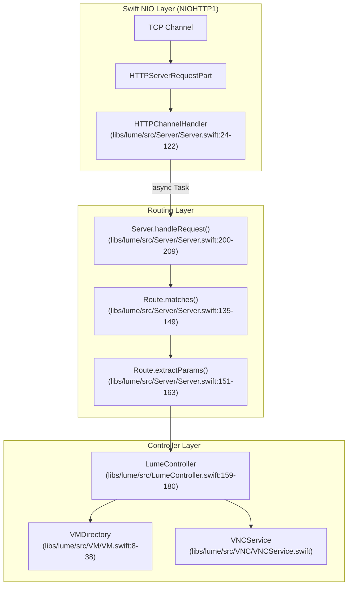
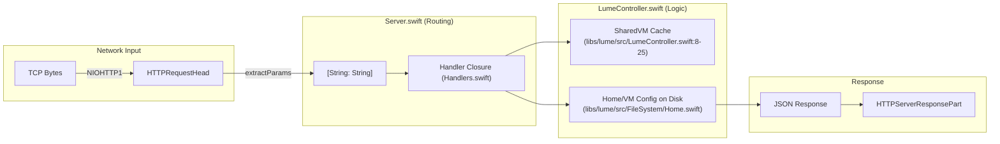

<!-- source: DeepWiki mcp.deepwiki.com · repo trycua/cua · page 5.3 HTTP API Reference · fetched 2026-10-29 -->

# HTTP API Reference

<details>
<summary>Relevant source files</summary>

The following files were used as context for generating this wiki page:

- [.github/workflows/ci-check-docs.yml](.github/workflows/ci-check-docs.yml)
- [.github/workflows/ci-platform-linux-portability.yml](.github/workflows/ci-platform-linux-portability.yml)
- [.github/workflows/ci-swift-linker.yml](.github/workflows/ci-swift-linker.yml)
- [docs/README.md](docs/README.md)
- [libs/cua-driver/docs/action-support.md](libs/cua-driver/docs/action-support.md)
- [libs/cua-driver/docs/test-harness-convergence-plan.md](libs/cua-driver/docs/test-harness-convergence-plan.md)
- [libs/cua-driver/rust/crates/platform-linux/src/wayland/kwin_helper.rs](libs/cua-driver/rust/crates/platform-linux/src/wayland/kwin_helper.rs)
- [libs/cua-driver/rust/crates/platform-linux/tests/kwin_helper_contract.rs](libs/cua-driver/rust/crates/platform-linux/tests/kwin_helper_contract.rs)
- [libs/lume/.cursorignore](libs/lume/.cursorignore)
- [libs/lume/Development.md](libs/lume/Development.md)
- [libs/lume/README.md](libs/lume/README.md)
- [libs/lume/scripts/setup-cua.sh](libs/lume/scripts/setup-cua.sh)
- [libs/lume/src/Commands/Config.swift](libs/lume/src/Commands/Config.swift)
- [libs/lume/src/Commands/Create.swift](libs/lume/src/Commands/Create.swift)
- [libs/lume/src/Commands/Pull.swift](libs/lume/src/Commands/Pull.swift)
- [libs/lume/src/Commands/Push.swift](libs/lume/src/Commands/Push.swift)
- [libs/lume/src/Commands/Run.swift](libs/lume/src/Commands/Run.swift)
- [libs/lume/src/ContainerRegistry/GCSImageRegistry.swift](libs/lume/src/ContainerRegistry/GCSImageRegistry.swift)
- [libs/lume/src/ContainerRegistry/ImageContainerRegistry.swift](libs/lume/src/ContainerRegistry/ImageContainerRegistry.swift)
- [libs/lume/src/ContainerRegistry/ImageRegistry.swift](libs/lume/src/ContainerRegistry/ImageRegistry.swift)
- [libs/lume/src/ContainerRegistry/RegistryFactory.swift](libs/lume/src/ContainerRegistry/RegistryFactory.swift)
- [libs/lume/src/FileSystem/Home.swift](libs/lume/src/FileSystem/Home.swift)
- [libs/lume/src/FileSystem/Settings.swift](libs/lume/src/FileSystem/Settings.swift)
- [libs/lume/src/LumeController.swift](libs/lume/src/LumeController.swift)
- [libs/lume/src/Server/Handlers.swift](libs/lume/src/Server/Handlers.swift)
- [libs/lume/src/Server/MCPServer.swift](libs/lume/src/Server/MCPServer.swift)
- [libs/lume/src/Server/Requests.swift](libs/lume/src/Server/Requests.swift)
- [libs/lume/src/Server/Responses.swift](libs/lume/src/Server/Responses.swift)
- [libs/lume/src/Server/Server.swift](libs/lume/src/Server/Server.swift)
- [libs/lume/src/Utils/CommandDocExtractor.swift](libs/lume/src/Utils/CommandDocExtractor.swift)
- [libs/lume/src/Utils/CommandRegistry.swift](libs/lume/src/Utils/CommandRegistry.swift)
- [libs/lume/src/VM/VM.swift](libs/lume/src/VM/VM.swift)
- [libs/lume/src/VNC/VNCService.swift](libs/lume/src/VNC/VNCService.swift)
- [libs/lume/tests/CreateCommandTests.swift](libs/lume/tests/CreateCommandTests.swift)
- [libs/lume/tests/Mocks/MockVNCService.swift](libs/lume/tests/Mocks/MockVNCService.swift)
- [scripts/ci/macos/test-swift-linker-symbols.sh](scripts/ci/macos/test-swift-linker-symbols.sh)
- [scripts/docs-generators/config.json](scripts/docs-generators/config.json)
- [scripts/docs-generators/cua-driver-policy-binary.test.ts](scripts/docs-generators/cua-driver-policy-binary.test.ts)
- [scripts/docs-generators/cua-driver-policy.test.ts](scripts/docs-generators/cua-driver-policy.test.ts)
- [scripts/docs-generators/cua-driver.ts](scripts/docs-generators/cua-driver.ts)
- [scripts/docs-generators/lume.test.ts](scripts/docs-generators/lume.test.ts)
- [scripts/docs-generators/lume.ts](scripts/docs-generators/lume.ts)
- [scripts/docs-generators/runner.test.ts](scripts/docs-generators/runner.test.ts)
- [scripts/docs-generators/runner.ts](scripts/docs-generators/runner.ts)

</details>


This document provides a complete reference for Lume's HTTP API, which exposes VM lifecycle management, image registry operations, configuration endpoints, logging facilities, and an MCP (Model Context Protocol) server interface. The API is designed for programmatic control of Lume VMs and integrates with the [Computer SDK](#3.1) via the Lume provider.

For architecture and daemon setup, see [Lume Architecture](#5.1).

---

## Overview

Lume's HTTP API is a RESTful JSON API served by the `lume serve` daemon. It runs on localhost and is implemented using **Swift NIO**, providing high-performance non-blocking I/O.

- **Transport:** HTTP/1.1 over TCP
- **Data format:** JSON payloads for requests and responses
- **Default port:** `7777` (configurable via command line or environment) [libs/lume/src/Server/Server.swift:168-182]()
- **Authentication:** None (localhost-only access)
- **Concurrency:** Handlers use Swift concurrency bridged from NIO event loops, ensuring asynchronous non-blocking behavior [libs/lume/src/Server/Server.swift:65-77]().

---

## Server Architecture

The server builds on the SwiftNIO stack. Incoming TCP connections decode HTTP/1.1 request parts which are accumulated into complete requests by `HTTPChannelHandler`. Each request is dispatched to a routing layer in the `Server` class, which matches registered routes by HTTP method and path (supporting path parameters). Matched routes invoke async handlers implemented in `LumeController`.

### Request Lifecycle Diagram



Sources:
[libs/lume/src/Server/Server.swift:24-122]()
[libs/lume/src/Server/Server.swift:130-164]()
[libs/lume/src/Server/Server.swift:200-209]()
[libs/lume/src/LumeController.swift:159-180]()
[libs/lume/src/VM/VM.swift:8-38]()
[libs/lume/src/VNC/VNCService.swift]()

---

## Connection and Base URL

The server listens on `http://localhost:7777` by default, started via:

```bash
lume serve --port 7777
```

During startup, it performs a port availability check and raises a `PortError.alreadyInUse` if the port is bound by another process, safeguarding against conflicts [libs/lume/src/Server/Server.swift:8-17](), [libs/lume/src/Server/Server.swift:168-182]().

Sources:
[libs/lume/src/Server/Server.swift:8-17]()
[libs/lume/src/Server/Server.swift:168-182]()

---

## VM Management Endpoints

### List Virtual Machines

- **Method:** `GET`
- **Endpoint:** `/lume/vms`
- **Query Parameters:**
  - `storage` (optional): Storage location name or direct path to filter VMs.

**Response:**
An array of `VMDetails` objects representing all matching VMs, loaded by reading VM config files on disk [libs/lume/src/LumeController.swift:184-193]().

Sources:
[libs/lume/src/LumeController.swift:184-193]()
[libs/lume/src/Server/Handlers.swift:9-23]()

### Get VM Details

- **Method:** `GET`
- **Endpoint:** `/lume/vms/:name`
- **Path Parameter:**
  - `name` (required): Name of the VM.

If an active image pull is in progress for the VM, a synthetic "pulling" status is returned including `downloadProgress` to indicate progress [libs/lume/src/Server/Handlers.swift:38-50](), [libs/lume/src/LumeController.swift:36-60]().

Sources:
[libs/lume/src/Server/Handlers.swift:25-51]()
[libs/lume/src/LumeController.swift:36-60]()

### Create a New VM

- **Method:** `POST`
- **Endpoint:** `/lume/vms`
- **Request Body (`CreateVMRequest`):**

```json
{
  "name": "my-vm",
  "os": "macOS",
  "cpu": 4,
  "memory": "8GB",
  "diskSize": "50GB",
  "display": "1024x768",
  "ipsw": "latest",
  "unattended": "sequoia"
}
```

The endpoint starts async VM creation in the background to avoid blocking. It replies with a `202 Accepted` response, indicating provisioning is ongoing [libs/lume/src/Server/Handlers.swift:160-175]().

Sources:
[libs/lume/src/Server/Handlers.swift:160-175]()
[libs/lume/src/Server/Requests.swift:111-138]()

### Clone a VM

- **Method:** `POST`
- **Endpoint:** `/lume/vms/clone`
- **Request Body (`CloneRequest`):**

```json
{
  "name": "source-vm",
  "newName": "cloned-vm"
}
```

Performs a clone operation, typically using APFS cloning to efficiently duplicate the VM directory [libs/lume/src/Server/Handlers.swift:186-206]().

Sources:
[libs/lume/src/Server/Handlers.swift:186-206]()
[libs/lume/src/Server/Requests.swift:165-170]()

### Run a VM

- **Method:** `POST`
- **Endpoint:** `/lume/vms/:name/run`
- **Request Body (`RunVMRequest`):**

```json
{
  "noDisplay": true,
  "sharedDirectories": [
    {
      "hostPath": "/Users/local/data",
      "readOnly": false
    }
  ],
  "network": "nat",
  "clipboard": true
}
```

Starting a VM will invoke `VM.run()`, which launches the VM and starts associated services such as native or VNC display. If clipboard sync is enabled, `ClipboardWatcher` is started to sync clipboards bidirectionally over SSH [libs/lume/src/Server/Handlers.swift:233-274](), [libs/lume/src/VM/VM.swift:174-177]().

Sources:
[libs/lume/src/Server/Handlers.swift:233-274]()
[libs/lume/src/VM/VM.swift:174-177]()
[libs/lume/src/Server/Requests.swift:14-84]()

### Pull an Image

- **Method:** `POST`
- **Endpoint:** `/lume/pull/start`
- **Request Body (`PullRequest`):**

```json
{
  "image": "trycua/macos-ventura:latest",
  "name": "my-ventura-vm",
  "registry": "ghcr.io",
  "organization": "trycua"
}
```

Initiates an asynchronous pull of a VM image from a container registry. The response is `202 Accepted` if the pull starts successfully or is already in progress. Progress can be monitored via `GET /lume/vms/:name` [libs/lume/src/Server/Handlers.swift:123-163]().

Sources:
[libs/lume/src/Server/Handlers.swift:123-163]()
[libs/lume/src/Server/Requests.swift:86-105]()

### Cancel an Image Pull

- **Method:** `POST`
- **Endpoint:** `/lume/pull/cancel`
- **Request Body (`PullCancelRequest`):**

```json
{
  "name": "my-ventura-vm"
}
```

Cancels an ongoing image pull for the specified VM name. Returns `200 OK` if cancelled, `404 Not Found` if no pull is active, or `500 Internal Server Error` if the cancellation times out [libs/lume/src/Server/Handlers.swift:79-121]().

Sources:
[libs/lume/src/Server/Handlers.swift:79-121]()
[libs/lume/src/Server/Requests.swift:107-109]()
[libs/lume/src/LumeController.swift:114-133]()

### Push an Image

- **Method:** `POST`
- **Endpoint:** `/lume/push/start`
- **Request Body (`PushRequest`):**

```json
{
  "name": "my-vm",
  "imageName": "my-custom-macos",
  "tags": ["latest", "v1.0"],
  "registry": "ghcr.io",
  "organization": "trycua",
  "singleLayer": true
}
```

Initiates an asynchronous push of a local VM's disk image to a container registry. The process involves chunking, compressing, and uploading layers. The response is `202 Accepted` if the push starts successfully [libs/lume/src/Server/Handlers.swift:208-231]().

Sources:
[libs/lume/src/Server/Handlers.swift:208-231]()
[libs/lume/src/Server/Requests.swift:182-202]()
[libs/lume/src/ContainerRegistry/ImageContainerRegistry.swift:155-172]()

---

## Configuration Endpoints

### Storage Locations

- List storage: `GET /lume/config/locations`
- Add storage: `POST /lume/config/locations`
- Remove storage: `DELETE /lume/config/locations/:name`

Storage locations are managed by `SettingsManager` and represent named paths for VM storage [libs/lume/src/Server/Handlers.swift:375-432]().

Sources:
[libs/lume/src/Server/Handlers.swift:375-432]()
[libs/lume/src/FileSystem/Settings.swift]()

---

## Logging Endpoints

- **Endpoint:** `GET /lume/logs`
- **Query Params:**
  - `type` (optional): Filter log type (`info` or `error`)
  - `lines` (optional): Number of log lines to fetch

Returns recent daemon logs from `Logger.getLogs()` [libs/lume/src/Server/Handlers.swift:434-447]().

Sources:
[libs/lume/src/Server/Handlers.swift:434-447]()

---

## MCP Server

Lume exposes an MCP server implementing the Model Context Protocol to allow LLMs to control VMs using standard tool interfaces. This server starts inside the daemon and uses `StdioTransport` for communication [libs/lume/src/Server/MCPServer.swift:1-32]().

### MCP Tools

The `LumeMCPServer` registers several tools that allow MCP clients to interact with Lume VMs. These tools are defined in `LumeMCPServer.toolDefinitions` [libs/lume/src/Server/MCPServer.swift:41-42]().

- `lume_list_vms`: List all VMs [libs/lume/src/Server/MCPServer.swift:140-145]()
- `lume_create_vm`: Provision a VM [libs/lume/src/Server/MCPServer.swift:147-154]()
- `lume_run_vm`: Start VM execution [libs/lume/src/Server/MCPServer.swift:156-163]()
- `lume_stop_vm`: Stop a running VM [libs/lume/src/Server/MCPServer.swift:165-170]()
- `lume_clone_vm`: Clone an existing VM [libs/lume/src/Server/MCPServer.swift:172-177]()
- `lume_delete_vm`: Delete a VM [libs/lume/src/Server/MCPServer.swift:179-184]()
- `lume_get_vm`: Get details of a specific VM [libs/lume/src/Server/MCPServer.swift:186-191]()
- `lume_set_vm`: Modify VM configuration [libs/lume/src/Server/MCPServer.swift:193-198]()
- `lume_exec`: Execute a command inside a VM [libs/lume/src/Server/MCPServer.swift:200-205]()
- `lume_ssh`: Open an SSH session to a VM [libs/lume/src/Server/MCPServer.swift:207-212]()
- `lume_pull_image`: Pull a VM image [libs/lume/src/Server/MCPServer.swift:214-219]()
- `lume_push_image`: Push a VM image [libs/lume/src/Server/MCPServer.swift:221-226]()

### MCP Server Interaction Diagram

```mermaid
graph TD
    A[MCP Client] --> B{LumeMCPServer<br/>(libs/lume/src/Server/MCPServer.swift)}
    B -- CallTool Request --> C{handleToolCall<br/>(libs/lume/src/Server/MCPServer.swift:50-51)}
    C --> D{LumeController<br/>(libs/lume/src/LumeController.swift)}
    D -- VM Management Actions --> E[VM Lifecycle Operations]
    E --> F[VM Filesystem / VNC / Network]
    F -- Status/Output --> D
    D -- Result --> C
    C -- CallTool Result --> B
    B --> A
```

Sources:
[libs/lume/src/Server/MCPServer.swift:1-32]()
[libs/lume/src/Server/MCPServer.swift:41-42]()
[libs/lume/src/Server/MCPServer.swift:50-51]()
[libs/lume/src/Server/MCPServer.swift:140-226]()
[libs/lume/src/LumeController.swift]()

---

## Request and Response Schemas

Some major data schemas used in the API:

| Schema              | Description                                | Reference Lines                        |
|---------------------|--------------------------------------------|--------------------------------------|
| `VMDetails`         | Detailed VM info (name, state, IP, config) | [libs/lume/src/VM/VM.swift:132-171]()         |
| `PullRequest`       | Pull parameters for image pull              | [libs/lume/src/Server/Requests.swift:86-105]()          |
| `CreateVMRequest`   | Parameters for VM creation                   | [libs/lume/src/Server/Requests.swift:111-138]()         |
| `CloneRequest`      | Parameters for cloning a VM                  | [libs/lume/src/Server/Requests.swift:165-170]()        |
| `RunVMRequest`      | Parameters for running a VM                   | [libs/lume/src/Server/Requests.swift:14-84]()          |
| `PushRequest`       | Parameters for pushing a VM image            | [libs/lume/src/Server/Requests.swift:182-202]()          |

Sources:
[libs/lume/src/VM/VM.swift:132-171]()
[libs/lume/src/Server/Requests.swift:14-84]()
[libs/lume/src/Server/Requests.swift:86-105]()
[libs/lume/src/Server/Requests.swift:111-138]()
[libs/lume/src/Server/Requests.swift:165-170]()
[libs/lume/src/Server/Requests.swift:182-202]()

---

## Implementation Details

### Data Flow: HTTP Request to VM Action



Sources:
[libs/lume/src/LumeController.swift:8-25]()
[libs/lume/src/FileSystem/Home.swift]()

### Request Handling

`HTTPChannelHandler` accumulates HTTP request parts and, upon completion, creates an `HTTPRequest`. An asynchronous Swift concurrency `Task` is spawned to execute the registered route handler method on a `Server` instance. The response is sent back via an `EventLoopPromise` to avoid blocking the NIO event loop [libs/lume/src/Server/Server.swift:24-122](), [libs/lume/src/Server/Server.swift:68-85]().

Sources:
[libs/lume/src/Server/Server.swift:24-122]()
[libs/lume/src/Server/Server.swift:68-85]()

### Route Matching and Parameter Extraction

A `Route` struct stores the method and URL pattern. Matching is done by splitting the path and supporting named parameters with a colon prefix (`:name`). Matching routes extract parameters as a dictionary passed to handlers [libs/lume/src/Server/Server.swift:130-164]().

Sources:
[libs/lume/src/Server/Server.swift:130-164]()

---

## Complete Endpoint Summary

| Endpoint               | Method  | Description                         | Request Body / Query params           | Response Type          |
|------------------------|---------|-----------------------------------|-------------------------------------|-----------------------|
| `/lume/vms`            | GET     | List all VMs                      | Optional `storage` query             | `[VMDetails]` array    |
| `/lume/vms/:name`      | GET     | Get VM details                   | `name` path param, optional `storage` | `VMDetails`            |
| `/lume/vms`            | POST    | Create a new VM                  | `CreateVMRequest` JSON              | Async `202 Accepted`   |
| `/lume/vms/:name`      | DELETE  | Delete a VM                     | `name` path param, optional `storage` | Status message         |
| `/lume/vms/clone`      | POST    | Clone a VM                     | `CloneRequest` JSON                 | Status message         |
| `/lume/vms/:name/run`  | POST    | Run a VM                       | `RunVMRequest` JSON                 | Status message         |
| `/lume/pull/start`     | POST    | Pull a VM image                  | `PullRequest` JSON                  | Async `202 Accepted`   |
| `/lume/pull/cancel`    | POST    | Cancel an image pull             | `PullCancelRequest` JSON            | Status message         |
| `/lume/push/start`     | POST    | Push a VM image                  | `PushRequest` JSON                  | Async `202 Accepted`   |
| `/lume/config/locations` | GET   | List configured storage locations | None                              | List of storages       |
| `/lume/config/locations` | POST  | Add a storage location           | Storage location data                | Status                 |
| `/lume/config/locations/:name` | DELETE | Remove a storage location | Storage name                        | Status                 |
| `/lume/logs`           | GET     | Fetch daemon logs                | Optional `type` and `lines` params  | Log entries            |

Sources:
[libs/lume/src/Server/Server.swift:1-182]()
[libs/lume/src/Server/Handlers.swift:1-460]()
[libs/lume/src/LumeController.swift:20-160]()
[libs/lume/src/Server/MCPServer.swift:1-202]()
[libs/lume/src/Server/Requests.swift:1-210]()

---

# Appendix: Example Curl Requests

### List VMs

```bash
curl "http://localhost:7777/lume/vms"
```

### Create VM

```bash
curl -X POST http://localhost:7777/lume/vms -H 'Content-Type: application/json' -d '{
  "name": "my-vm",
  "os": "macOS",
  "cpu": 4,
  "memory": "8GB",
  "diskSize": "50GB",
  "display": "1024x768"
}'
```

### Run VM

```bash
curl -X POST http://localhost:7777/lume/vms/my-vm/run -H 'Content-Type: application/json' -d '{
  "noDisplay": true,
  "clipboard": true,
  "sharedDirectories": [{"hostPath": "/Users/local/data", "readOnly": false}],
  "network": "nat"
}'
```

### Pull Image

```bash
curl -X POST http://localhost:7777/lume/pull/start -H 'Content-Type: application/json' -d '{
  "image": "trycua/macos-ventura:latest",
  "name": "my-ventura-vm"
}'
```

### Push Image

```bash
curl -X POST http://localhost:7777/lume/push/start -H 'Content-Type: application/json' -d '{
  "name": "my-vm",
  "imageName": "my-custom-macos",
  "tags": ["latest", "v1.0"]
}'
```

---

This completes the comprehensive HTTP API reference for the Lume server on port 7777, covering VM management, configuration, logging, MCP server integration, and data schemas. This interface is central to integrating Lume VMs with the Cua ecosystem, enabling automation, lifecycle control, and developer tooling.

---

