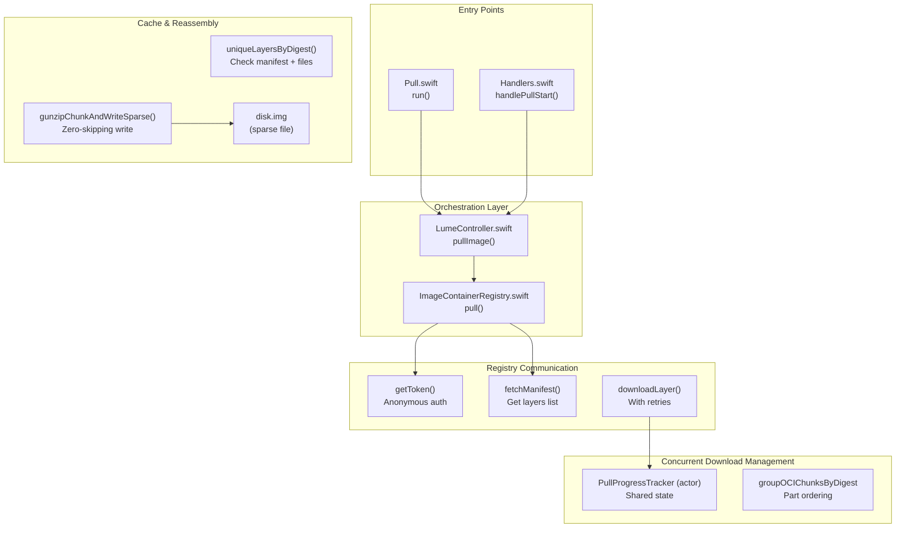
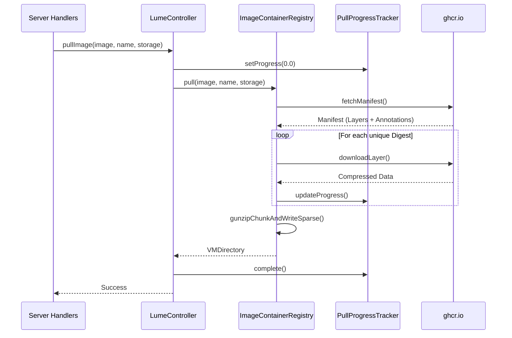

<!-- source: DeepWiki mcp.deepwiki.com · repo trycua/cua · page 5.4 Image Pull and Cache System · fetched 2026-10-29 -->

# Image Pull and Cache System

Relevant source files

The following files were used as context for generating this wiki page:

- [libs/lume/.cursorignore](libs/lume/.cursorignore)
- [libs/lume/Development.md](libs/lume/Development.md)
- [libs/lume/README.md](libs/lume/README.md)
- [libs/lume/scripts/setup-cua.sh](libs/lume/scripts/setup-cua.sh)
- [libs/lume/src/Commands/Config.swift](libs/lume/src/Commands/Config.swift)
- [libs/lume/src/Commands/Create.swift](libs/lume/src/Commands/Create.swift)
- [libs/lume/src/Commands/Pull.swift](libs/lume/src/Commands/Pull.swift)
- [libs/lume/src/Commands/Push.swift](libs/lume/src/Commands/Push.swift)
- [libs/lume/src/Commands/Run.swift](libs/lume/src/Commands/Run.swift)
- [libs/lume/src/ContainerRegistry/GCSImageRegistry.swift](libs/lume/src/ContainerRegistry/GCSImageRegistry.swift)
- [libs/lume/src/ContainerRegistry/ImageContainerRegistry.swift](libs/lume/src/ContainerRegistry/ImageContainerRegistry.swift)
- [libs/lume/src/ContainerRegistry/ImageRegistry.swift](libs/lume/src/ContainerRegistry/ImageRegistry.swift)
- [libs/lume/src/ContainerRegistry/RegistryFactory.swift](libs/lume/src/ContainerRegistry/RegistryFactory.swift)
- [libs/lume/src/FileSystem/Home.swift](libs/lume/src/FileSystem/Home.swift)
- [libs/lume/src/FileSystem/Settings.swift](libs/lume/src/FileSystem/Settings.swift)
- [libs/lume/src/LumeController.swift](libs/lume/src/LumeController.swift)
- [libs/lume/src/Server/Handlers.swift](libs/lume/src/Server/Handlers.swift)
- [libs/lume/src/Server/MCPServer.swift](libs/lume/src/Server/MCPServer.swift)
- [libs/lume/src/Server/Requests.swift](libs/lume/src/Server/Requests.swift)
- [libs/lume/src/Server/Responses.swift](libs/lume/src/Server/Responses.swift)
- [libs/lume/src/Server/Server.swift](libs/lume/src/Server/Server.swift)
- [libs/lume/src/Utils/CommandDocExtractor.swift](libs/lume/src/Utils/CommandDocExtractor.swift)
- [libs/lume/src/Utils/CommandRegistry.swift](libs/lume/src/Utils/CommandRegistry.swift)
- [libs/lume/src/VM/VM.swift](libs/lume/src/VM/VM.swift)
- [libs/lume/src/VNC/VNCService.swift](libs/lume/src/VNC/VNCService.swift)
- [libs/lume/tests/CreateCommandTests.swift](libs/lume/tests/CreateCommandTests.swift)
- [libs/lume/tests/Mocks/MockVNCService.swift](libs/lume/tests/Mocks/MockVNCService.swift)
- [scripts/docs-generators/lume.test.ts](scripts/docs-generators/lume.test.ts)
- [scripts/docs-generators/lume.ts](scripts/docs-generators/lume.ts)

## Purpose and Scope

The Image Pull and Cache System is responsible for downloading OCI-compliant VM images from container registries (primarily GitHub Container Registry at `ghcr.io`), caching them locally to avoid redundant downloads, and reassembling multi-part disk images into bootable VM disk files. This system is a core component of Lume's image distribution infrastructure.

This document covers the download orchestration, caching strategy, concurrent layer fetching, disk reassembly with zero-skipping optimization, and progress tracking.

**Sources**: [libs/lume/src/ContainerRegistry/ImageContainerRegistry.swift:1-41]()

---

## Architecture Overview

The image pull system consists of several coordinated actors and classes that manage concurrent downloads, cache validation, and disk reassembly.

### System Entity Mapping

**Key Components**:

| Component | Entity Type | Purpose |
|-----------|------|---------|
| `ImageContainerRegistry` | Class | Main orchestrator for pull and push operations [libs/lume/src/ContainerRegistry/ImageContainerRegistry.swift:218-220](). |
| `PullProgressTracker` | Actor | Thread-safe progress tracking keyed by VM name, shared across the process [libs/lume/src/LumeController.swift:31-63](). |
| `OCIManifestLayer` | Struct | Individual layer with digest, size, and uncompressed metadata [libs/lume/src/ContainerRegistry/ImageContainerRegistry.swift:131-148](). |
| `OCIChunkGroup` | Struct | Groups logical disk parts by shared OCI blob to optimize download [libs/lume/src/ContainerRegistry/ImageContainerRegistry.swift:173-176](). |

**Sources**: [libs/lume/src/ContainerRegistry/ImageContainerRegistry.swift:131-197](), [libs/lume/src/LumeController.swift:31-66]()

---

## Pull Operation Flow

The pull system coordinates the download and reassembly of OCI artifacts. It supports multi-part disk images where multiple logical chunks may map to a single physical OCI blob.

### Sequence of Events

### Async Pull Tracking
When triggered via the HTTP API, the pull operation runs as a detached task. The status is tracked by the `PullProgressTracker` actor.

- **Start**: `handlePullStart` records the start and sets progress to 0.0 [libs/lume/src/Server/Handlers.swift:79-80]().
- **Progress**: `LumeController.pullImage` accepts a `progressHandler` closure that updates the tracker via `setProgress` [libs/lume/src/Server/Handlers.swift:91-93]().
- **Status Retrieval**: `handleGetVM` checks `PullProgressTracker.shared.getProgress(for: name)` to return a synthetic "pulling" status with `downloadProgress` [libs/lume/src/Server/Handlers.swift:30-44]().

**Sources**: [libs/lume/src/Server/Handlers.swift:30-115](), [libs/lume/src/LumeController.swift:31-63]()

---

## Disk Image Reassembly

The reassembly process transforms downloaded compressed blobs into a single bootable `.img` file. Lume handles multi-GB layers by hashing and processing in chunks.

### Zero-Skipping and Sparse Writing
To optimize disk space and I/O performance, Lume uses a "zero-skipping" strategy during reassembly via `gunzipChunkAndWriteSparse` [libs/lume/src/ContainerRegistry/ImageContainerRegistry.swift:48-50]().

1. **Streaming Decompression**: It uses the system `/usr/bin/gunzip` to stream compressed data to a raw temporary file [libs/lume/src/ContainerRegistry/ImageContainerRegistry.swift:62-67]().
2. **Sparse Hole Detection**: The system reads the decompressed data in 4 MiB chunks (`sparseHoleGranularityBytes`) [libs/lume/src/ContainerRegistry/ImageContainerRegistry.swift:43-44]().
3. **Seeking vs Writing**: If a 4 MiB chunk consists entirely of zeros, the system increments the `currentWriteOffset` without writing to disk [libs/lume/src/ContainerRegistry/ImageContainerRegistry.swift:84-87](). If the chunk contains data, it seeks to the offset and writes [libs/lume/src/ContainerRegistry/ImageContainerRegistry.swift:89-92]().
4. **Efficiency**: This creates "holes" in the sparse file, ensuring that the actual disk usage matches only the non-zero data in the image.

**Sources**: [libs/lume/src/ContainerRegistry/ImageContainerRegistry.swift:21-41](), [libs/lume/src/ContainerRegistry/ImageContainerRegistry.swift:43-97]()

---

## Cache Validation

Lume validates local data using SHA256 digests to ensure integrity.

- **File Hashing**: Large disk layers are hashed in 4 MiB chunks to manage memory pressure [libs/lume/src/ContainerRegistry/ImageContainerRegistry.swift:29-32]().
- **Digest Matching**: The system compares the local file's SHA256 against the `digest` provided in the OCI manifest [libs/lume/src/ContainerRegistry/ImageContainerRegistry.swift:38-41]().
- **OCI Metadata**: It looks for specific annotations like `com.trycua.lume.disk.uncompressed_size` in the `OCIConfig` to validate that the reassembled file matches the expected size [libs/lume/src/ContainerRegistry/ImageContainerRegistry.swift:150-159]().

**Sources**: [libs/lume/src/ContainerRegistry/ImageContainerRegistry.swift:21-41](), [libs/lume/src/ContainerRegistry/ImageContainerRegistry.swift:150-159]()

---

## Error Handling

The system defines specialized errors in `PullError` and `PushError` to handle failure modes:

| Error Case | Description |
|------------|-------------|
| `layerDownloadFailed` | Triggered if a specific blob download or gunzip process fails [libs/lume/src/ContainerRegistry/ImageContainerRegistry.swift:71](). |
| `layerVerificationFailed` | Downloaded layer failed checksum verification [libs/lume/src/Errors/Errors.swift:74-78](). |
| `missingUncompressedSizeAnnotation` | Occurs if the OCI manifest lacks required sparse file metadata [libs/lume/src/ContainerRegistry/ImageContainerRegistry.swift:109](). |
| `reassemblySetupFailed` | Occurs if the sparse file cannot be initialized at the specified path [libs/lume/src/ContainerRegistry/ImageContainerRegistry.swift:111](). |
| `missingPart` | Missing a required part number for reassembly [libs/lume/src/ContainerRegistry/ImageContainerRegistry.swift:112](). |

**Sources**: [libs/lume/src/ContainerRegistry/ImageContainerRegistry.swift:99-116](), [libs/lume/src/Errors/Errors.swift:50-95]()

---

