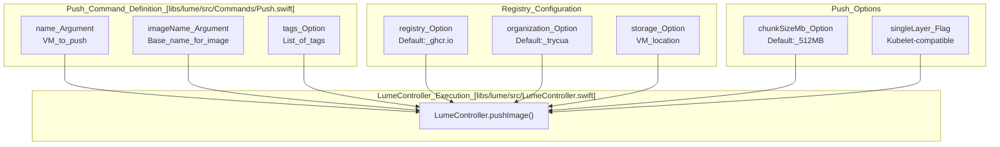
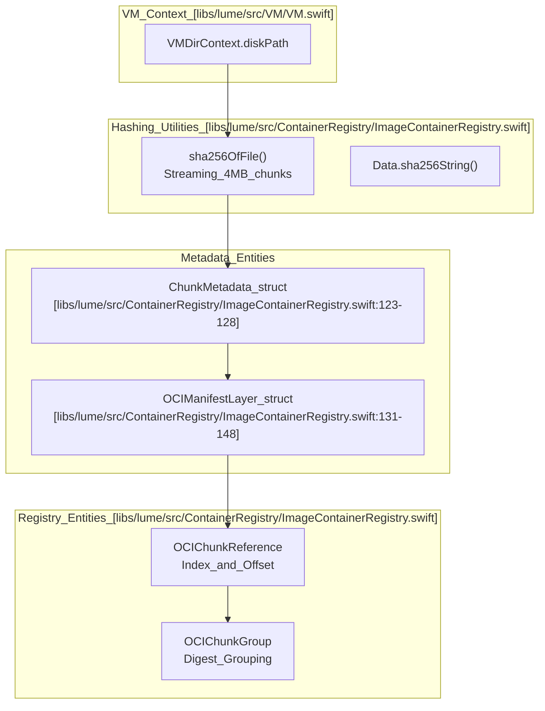

<!-- source: DeepWiki mcp.deepwiki.com · repo trycua/cua · page 5.5 Image Push and Distribution · fetched 2026-10-29 -->

# Image Push and Distribution

Relevant source files

The following files were used as context for generating this wiki page:

- [.github/workflows/cd-swift-lume.yml](.github/workflows/cd-swift-lume.yml)
- [libs/lume/.cursorignore](libs/lume/.cursorignore)
- [libs/lume/CHANGELOG.md](libs/lume/CHANGELOG.md)
- [libs/lume/Development.md](libs/lume/Development.md)
- [libs/lume/README.md](libs/lume/README.md)
- [libs/lume/VERSION](libs/lume/VERSION)
- [libs/lume/resources/Info.plist](libs/lume/resources/Info.plist)
- [libs/lume/resources/lume.entitlements](libs/lume/resources/lume.entitlements)
- [libs/lume/scripts/build/build-debug.sh](libs/lume/scripts/build/build-debug.sh)
- [libs/lume/scripts/build/build-release-notarized.sh](libs/lume/scripts/build/build-release-notarized.sh)
- [libs/lume/scripts/build/build-release.sh](libs/lume/scripts/build/build-release.sh)
- [libs/lume/scripts/install-local.sh](libs/lume/scripts/install-local.sh)
- [libs/lume/scripts/install.sh](libs/lume/scripts/install.sh)
- [libs/lume/scripts/setup-cua.sh](libs/lume/scripts/setup-cua.sh)
- [libs/lume/scripts/uninstall.sh](libs/lume/scripts/uninstall.sh)
- [libs/lume/src/Commands/Config.swift](libs/lume/src/Commands/Config.swift)
- [libs/lume/src/Commands/Create.swift](libs/lume/src/Commands/Create.swift)
- [libs/lume/src/Commands/Pull.swift](libs/lume/src/Commands/Pull.swift)
- [libs/lume/src/Commands/Push.swift](libs/lume/src/Commands/Push.swift)
- [libs/lume/src/Commands/Run.swift](libs/lume/src/Commands/Run.swift)
- [libs/lume/src/ContainerRegistry/GCSImageRegistry.swift](libs/lume/src/ContainerRegistry/GCSImageRegistry.swift)
- [libs/lume/src/ContainerRegistry/ImageContainerRegistry.swift](libs/lume/src/ContainerRegistry/ImageContainerRegistry.swift)
- [libs/lume/src/ContainerRegistry/ImageRegistry.swift](libs/lume/src/ContainerRegistry/ImageRegistry.swift)
- [libs/lume/src/ContainerRegistry/RegistryFactory.swift](libs/lume/src/ContainerRegistry/RegistryFactory.swift)
- [libs/lume/src/FileSystem/Home.swift](libs/lume/src/FileSystem/Home.swift)
- [libs/lume/src/FileSystem/Settings.swift](libs/lume/src/FileSystem/Settings.swift)
- [libs/lume/src/LumeController.swift](libs/lume/src/LumeController.swift)
- [libs/lume/src/Main.swift](libs/lume/src/Main.swift)
- [libs/lume/src/Server/Handlers.swift](libs/lume/src/Server/Handlers.swift)
- [libs/lume/src/Server/MCPServer.swift](libs/lume/src/Server/MCPServer.swift)
- [libs/lume/src/Server/Requests.swift](libs/lume/src/Server/Requests.swift)
- [libs/lume/src/Server/Responses.swift](libs/lume/src/Server/Responses.swift)
- [libs/lume/src/Server/Server.swift](libs/lume/src/Server/Server.swift)
- [libs/lume/src/Unattended/ResourceBundle.swift](libs/lume/src/Unattended/ResourceBundle.swift)
- [libs/lume/src/Utils/CommandDocExtractor.swift](libs/lume/src/Utils/CommandDocExtractor.swift)
- [libs/lume/src/Utils/CommandRegistry.swift](libs/lume/src/Utils/CommandRegistry.swift)
- [libs/lume/src/VM/VM.swift](libs/lume/src/VM/VM.swift)
- [libs/lume/src/VNC/VNCService.swift](libs/lume/src/VNC/VNCService.swift)
- [libs/lume/tests/CreateCommandTests.swift](libs/lume/tests/CreateCommandTests.swift)
- [libs/lume/tests/Mocks/MockVM.swift](libs/lume/tests/Mocks/MockVM.swift)
- [libs/lume/tests/Mocks/MockVNCService.swift](libs/lume/tests/Mocks/MockVNCService.swift)
- [libs/lume/tests/VM/VMDetailsPrinterTests.swift](libs/lume/tests/VM/VMDetailsPrinterTests.swift)
- [libs/lume/tests/VMTests.swift](libs/lume/tests/VMTests.swift)
- [scripts/docs-generators/lume.test.ts](scripts/docs-generators/lume.test.ts)
- [scripts/docs-generators/lume.ts](scripts/docs-generators/lume.ts)

This document describes the Lume image push workflow, which publishes macOS VM disk images to OCI-compliant container registries like GitHub Container Registry (ghcr.io). The push process handles large disk images by chunking them into manageable parts, compressing each part, generating OCI manifests, and uploading blobs with proper authentication.

For information about the complementary image pull workflow, see page 5.4. For the HTTP API that exposes these operations, see page 5.3.

## Push Command Interface

The image push functionality is exposed through both a CLI command and an HTTP API endpoint. The `push` command provides extensive options for controlling the distribution behavior, while the HTTP API enables programmatic access for automation.

### CLI Command Structure

The `push` command is registered in the `CommandRegistry` [libs/lume/src/Utils/CommandRegistry.swift:8-8]() and documented in the command extractor [libs/lume/src/Utils/CommandDocExtractor.swift:79-80](). It supports multi-tagging and configurable chunk sizes.

**Push Command Entity Mapping**

Sources: [libs/lume/src/Commands/Push.swift:5-20](), [libs/lume/src/Utils/CommandDocExtractor.swift:79-80](), [libs/lume/src/Utils/CommandRegistry.swift:8-8](), [libs/lume/src/LumeController.swift:66-86]()

### HTTP API Endpoint

The `/lume/vms/push` endpoint accepts a `PushRequest` JSON payload [libs/lume/src/Server/Requests.swift:178-204]() and executes the push operation. The server handles these requests by mapping the JSON to internal Swift structures.

| Field | Type | Required | Default | Description |
|-------|------|----------|---------|-------------|
| `name` | string | Yes | - | Local VM name to push |
| `imageName` | string | Yes | - | Base image name in registry |
| `tags` | string[] | Yes | - | Tags to apply to image |
| `registry` | string | No | `ghcr.io` | Registry URL |
| `organization` | string | No | `trycua` | Registry organization |
| `storage` | string | No | - | VM storage location |
| `chunkSizeMb` | integer | No | 512 | Chunk size in MB |
| `singleLayer` | boolean | No | false | Push as single disk layer |

Sources: [libs/lume/src/Server/Requests.swift:178-204](), [libs/lume/src/Server/Handlers.swift:6-23]()

## Disk Image Chunking and Compression

Large macOS disk images (often 50GB-100GB+) must be chunked into manageable parts before upload. The chunking process splits the `disk.img`, calculates digests, and generates metadata for reassembly.

### Chunking Workflow

The `ImageContainerRegistry` coordinates chunking. It utilizes streaming SHA256 hashing to handle multi-GB disk layers efficiently without loading entire files into memory [libs/lume/src/ContainerRegistry/ImageContainerRegistry.swift:22-41]().

**Push Data Flow and Chunking**

Sources: [libs/lume/src/ContainerRegistry/ImageContainerRegistry.swift:22-41](), [libs/lume/src/ContainerRegistry/ImageContainerRegistry.swift:123-128](), [libs/lume/src/ContainerRegistry/ImageContainerRegistry.swift:131-148](), [libs/lume/src/ContainerRegistry/ImageContainerRegistry.swift:168-176](), [libs/lume/src/VM/VM.swift:26-28]()

### Compression and Sparse File Handling

Lume handles disk image distribution with a focus on efficiency. During the pull/reassembly phase, it uses `gunzipChunkAndWriteSparse` to skip zero-filled 4 MiB blocks, creating holes in the sparse file to save disk space [libs/lume/src/ContainerRegistry/ImageContainerRegistry.swift:48-97]().

If the legacy LZ4 compression is used and the binary is missing, the system throws `PushError.lz4NotFound` [libs/lume/src/ContainerRegistry/ImageContainerRegistry.swift:107-107]().

Sources: [libs/lume/src/ContainerRegistry/ImageContainerRegistry.swift:48-97](), [libs/lume/src/ContainerRegistry/ImageContainerRegistry.swift:107-107]()

## OCI Manifest Generation

Lume generates OCI-compliant manifests that describe the layers (chunks), configuration, and metadata of the VM image.

### Manifest and Config Structure

The registry implementation groups logical disk parts by their shared OCI blob while preserving the order in which each unique digest first appears in the manifest using `groupOCIChunksByDigest` [libs/lume/src/ContainerRegistry/ImageContainerRegistry.swift:180-197]().

Lume uses custom annotations to track sparse file properties and chunk ordering [libs/lume/src/ContainerRegistry/ImageContainerRegistry.swift:150-159]():
- `com.trycua.lume.disk.uncompressed_size`: The required uncompressed disk size annotation in the image `config.json` [libs/lume/src/ContainerRegistry/ImageContainerRegistry.swift:153-153]().

Sources: [libs/lume/src/ContainerRegistry/ImageContainerRegistry.swift:180-197](), [libs/lume/src/ContainerRegistry/ImageContainerRegistry.swift:150-159](), [libs/lume/src/ContainerRegistry/ImageContainerRegistry.swift:153-153]()

## Registry Distribution Flow

The `ImageContainerRegistry` handles the actual interaction with the registry API, including token acquisition and blob streaming.

1.  **Authentication**: Lume handles authentication errors during the push process [libs/lume/src/ContainerRegistry/ImageContainerRegistry.swift:104-105]().
2.  **Blob Upload**: Compressed chunks are uploaded as OCI blobs. Failure during this phase results in `PushError.blobUploadFailed` [libs/lume/src/ContainerRegistry/ImageContainerRegistry.swift:102-102]().
3.  **Manifest Push**: The final manifest, linking all blobs and the configuration, is pushed to the registry. Failure results in `PushError.manifestPushFailed` [libs/lume/src/ContainerRegistry/ImageContainerRegistry.swift:103-103]().
4.  **Multi-Tag Support**: The push request allows specifying multiple tags for a single image push operation [libs/lume/src/Server/Requests.swift:181-181]().

Sources: [libs/lume/src/ContainerRegistry/ImageContainerRegistry.swift:100-116](), [libs/lume/src/Server/Requests.swift:178-204]()

## Error Handling

The push process defines specific error cases in `PushError` [libs/lume/src/ContainerRegistry/ImageContainerRegistry.swift:100-116]() to handle common failure modes during distribution.

| Error Case | Description |
| :--- | :--- |
| `uploadInitiationFailed` | Failed to start the blob upload session with the registry. |
| `blobUploadFailed` | Error occurred during the transmission of a chunk blob. |
| `manifestPushFailed` | The final manifest could not be accepted by the registry. |
| `lz4NotFound` | The LZ4 compression utility is missing from the host system. |
| `insufficientPermissions` | The provided credentials do not have push access to the repository. |
| `missingUncompressedSizeAnnotation` | Sparse file handling failed due to missing size annotations in config. |

Sources: [libs/lume/src/ContainerRegistry/ImageContainerRegistry.swift:100-116]()

## Lume Build and Notarization Scripts

Lume's release process involves building, signing, and notarizing the application for macOS distribution. This ensures the application is trusted by macOS Gatekeeper.

### Build Process

The `build-release-notarized.sh` script [libs/lume/scripts/build/build-release-notarized.sh:1-278]() orchestrates the build and notarization. It first builds the Lume executable in release configuration [libs/lume/scripts/build/build-release-notarized.sh:70-71]().

### App Bundle Assembly and Signing

After building, the script assembles the Lume executable into an `.app` bundle structure [libs/lume/scripts/build/build-release-notarized.sh:73-95](). This includes copying the binary, resource bundles, and generating an `Info.plist` [libs/lume/scripts/build/build-release-notarized.sh:93-95]().

A crucial step is embedding the provisioning profile, which is required for entitlements like `com.apple.vm.networking` [libs/lume/scripts/build/build-release-notarized.sh:97-105](). The application bundle is then signed using a Developer ID Application certificate [libs/lume/scripts/build/build-release-notarized.sh:120-124](). The signature is verified to ensure integrity [libs/lume/scripts/build/build-release-notarized.sh:128-130]().

For local development, the `install-local.sh` script [libs/lume/scripts/install-local.sh:1-370]() provides an option to build and sign with local-safe entitlements, or with bridged entitlements if a provisioning profile is available [libs/lume/scripts/install-local.sh:136-172]().

### Installer Package Creation

The signed `.app` bundle is then packaged into a `.pkg` installer using `pkgbuild` [libs/lume/scripts/build/build-release-notarized.sh:141-146](). This installer is also signed with a Developer ID Installer certificate.

### Notarization

The final `.pkg` installer is submitted to Apple's notarization service using `xcrun notarytool` [libs/lume/scripts/build/build-release-notarized.sh:161-167](). The script waits for the notarization process to complete and checks its status, providing detailed logs if it fails [libs/lume/scripts/build/build-release-notarized.sh:170-202](). This step is critical for macOS to allow the application to run without security warnings.

The entire CD workflow for Lume is defined in the `.github/workflows/cd-swift-lume.yml` GitHub Actions workflow [cd-swift-lume.yml:1-347](), which handles versioning, certificate import, and the notarization process.

Sources: [libs/lume/scripts/build/build-release-notarized.sh:1-278](), [libs/lume/scripts/build/build-release-notarized.sh:70-71](), [libs/lume/scripts/build/build-release-notarized.sh:73-95](), [libs/lume/scripts/build/build-release-notarized.sh:97-105](), [libs/lume/scripts/build/build-release-notarized.sh:120-124](), [libs/lume/scripts/build/build-release-notarized.sh:128-130](), [libs/lume/scripts/build/build-release-notarized.sh:141-146](), [libs/lume/scripts/build/build-release-notarized.sh:161-167](), [libs/lume/scripts/build/build-release-notarized.sh:170-202](), [libs/lume/scripts/install-local.sh:1-370](), [libs/lume/scripts/install-local.sh:136-172](), [cd-swift-lume.yml:1-347]()

---

