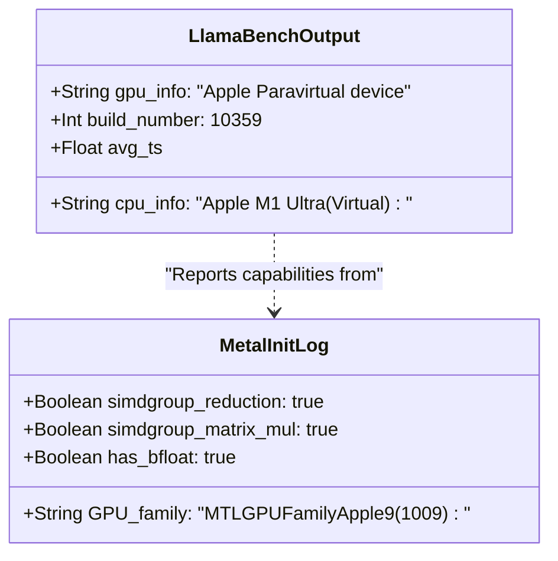

<!-- source: DeepWiki mcp.deepwiki.com · repo trycua/cua · page 5.6 Lume Metal Capability Shim · fetched 2026-10-29 -->

# Lume Metal Capability Shim

<details>
<summary>Relevant source files</summary>

The following files were used as context for generating this wiki page:

- [.github/workflows/cd-swift-lume.yml](.github/workflows/cd-swift-lume.yml)
- [libs/lume/CHANGELOG.md](libs/lume/CHANGELOG.md)
- [libs/lume/VERSION](libs/lume/VERSION)
- [libs/lume/resources/Info.plist](libs/lume/resources/Info.plist)
- [libs/lume/resources/lume.entitlements](libs/lume/resources/lume.entitlements)
- [libs/lume/scripts/build/build-debug.sh](libs/lume/scripts/build/build-debug.sh)
- [libs/lume/scripts/build/build-release-notarized.sh](libs/lume/scripts/build/build-release-notarized.sh)
- [libs/lume/scripts/build/build-release.sh](libs/lume/scripts/build/build-release.sh)
- [libs/lume/scripts/install-local.sh](libs/lume/scripts/install-local.sh)
- [libs/lume/scripts/install.sh](libs/lume/scripts/install.sh)
- [libs/lume/scripts/uninstall.sh](libs/lume/scripts/uninstall.sh)
- [libs/lume/src/Main.swift](libs/lume/src/Main.swift)
- [libs/lume/src/Unattended/ResourceBundle.swift](libs/lume/src/Unattended/ResourceBundle.swift)
- [libs/lume/tests/Mocks/MockVM.swift](libs/lume/tests/Mocks/MockVM.swift)
- [libs/lume/tests/VM/VMDetailsPrinterTests.swift](libs/lume/tests/VM/VMDetailsPrinterTests.swift)
- [libs/lume/tests/VMTests.swift](libs/lume/tests/VMTests.swift)

</details>


The **Lume Metal Capability Shim** is an experimental compatibility layer designed to unlock the full performance potential of Apple Silicon GPUs inside macOS Virtual Machines. By default, macOS guests running via `Virtualization.framework` report a conservative Metal capability profile (typically Apple GPU Family 5), which causes high-performance ML libraries like `llama.cpp` or `MLX` to fall back to slower execution paths [blog/gpu-passthrough-macos-vms.md:7-9]().

The shim operates as a process-scoped library injected via `DYLD_INSERT_LIBRARIES` that intercepts Metal API queries to report higher GPU family support and increased threadgroup memory limits, enabling 11–16× faster LLM inference in virtualized environments [blog/gpu-passthrough-macos-vms.md:1-2, 35-37]().

## Implementation Overview

The shim addresses the "capability gap" where the paravirtualized GPU driver in the guest is technically capable of executing modern Metal kernels but reports itself as an older device [blog/gpu-passthrough-macos-vms.md:29-31]().

### Interception Mechanism
The shim intercepts two primary queries:
1.  `supportsFamily:`: Changes the reported Apple family (e.g., from family 5 to family 9) [blog/gpu-passthrough-macos-vms.md:39-40]().
2.  `maxThreadgroupMemoryLength`: Raises the reported limit from 32 KB to 64 KB [blog/gpu-passthrough-macos-vms.md:40-41]().

### Data Flow: Capability Request Interception
The following diagram illustrates how the shim sits between the application (e.g., `llama-bench`) and the guest OS Metal framework.

**Metal Capability Interception Flow**
```mermaid
graph TD
    subgraph "Guest macOS VM"
        [llama-bench-process] -->|"supportsFamily(1009)"| [LumeMetalCapabilities-dylib]
        [LumeMetalCapabilities-dylib] -->|"Read Env"| [LUME_METAL_APPLE_FAMILY_MAX]
        [LumeMetalCapabilities-dylib] -- "Intercepted Answer: True" --> [llama-bench-process]
        
        [llama-bench-process] -->|"maxThreadgroupMemory"| [LumeMetalCapabilities-dylib]
        [LumeMetalCapabilities-dylib] -- "Intercepted Answer: 64KB" --> [llama-bench-process]
    end

    subgraph "Host macOS"
        [Guest-GPU-Driver] <--> [Virtualization-Framework]
        [Virtualization-Framework] <--> [Physical-Apple-GPU]
    end

    [LumeMetalCapabilities-dylib] -.-> [Guest-GPU-Driver]
```
Sources: [blog/gpu-passthrough-macos-vms.md:35-57]()

## Configuration and Usage

The shim is activated by injecting the compiled dylib into a target process and configuring the desired capability levels via environment variables.

### Environment Variables
| Variable | Purpose | Example Value |
| :--- | :--- | :--- |
| `DYLD_INSERT_LIBRARIES` | Path to the shim dylib | `./LumeMetalCapabilities-arm64.dylib` |
| `LUME_METAL_APPLE_FAMILY_MAX` | The maximum Apple GPU family to report | `1009` (Apple Family 9) |
| `LUME_METAL_MAX_THREADGROUP_MEMORY` | The max threadgroup memory in bytes | `65536` (64 KB) |

### Execution Example
To run a benchmark with the shim enabled:
```bash
DYLD_INSERT_LIBRARIES=./LumeMetalCapabilities-arm64.dylib \
LUME_METAL_APPLE_FAMILY_MAX=1009 \
./llama-bench -m ./model.gguf -p 512 -ngl -1
```
Sources: [evidence/lume-metal-capability-shim/2026-08-11-m1-ultra-muse-glimmer-64g/README.md:32-35]()

## Validation Evidence (M1 Ultra)

Validation runs performed on August 11, 2026, using an M1 Ultra host and macOS Tahoe guest, demonstrate significant speedups for LLM workloads.

### Muse Glimmer 30B Results
Tests conducted with Meta's Muse Glimmer 30B (Q4_K-M) showed that unlocking the capability profile allowed the use of SIMD-group reduction, SIMD-group matrix multiplication, and bfloat16 kernels [evidence/lume-metal-capability-shim/2026-08-11-m1-ultra-muse-glimmer-64g/README.md:9-12, 38-41]().

| Metric | Stock Guest | Unlocked Guest | Speedup |
| :--- | :--- | :--- | :--- |
| Prompt Processing (pp512) | 25.83 tok/s | 194.97 tok/s | **7.55x** |
| Token Generation (tg128) | 2.37 tok/s | 21.08 tok/s | **8.87x** |

**Entity Association: Benchmark Metadata**

Sources: [evidence/lume-metal-capability-shim/2026-08-11-m1-ultra-muse-glimmer-64g/clean-unlocked-tg128.json:5-7, 41](), [evidence/lume-metal-capability-shim/2026-08-11-m1-ultra-muse-glimmer-64g/clean-unlocked-tg128.stderr:6-12]()

## Capability Comparison

The shim bridges the gap between reported and actual hardware capabilities [blog/gpu-passthrough-macos-vms.md:44-51]().

| Capability | Stock VM (Reported) | With Shim (Reported) |
| :--- | :--- | :--- |
| `supportsFamily:1009` | `false` | `true` |
| SIMD-group matrix | Disabled | **Enabled** |
| SIMD-group reduction | Disabled | **Enabled** |
| bfloat16 | Disabled | **Enabled** |
| Max Threadgroup Memory | 32 KB | **64 KB** |

## Caveats and Limitations

*   **Process Scoped:** The shim must be injected into every process that requires high-performance Metal access; it does not change system-wide VM settings [blog/gpu-passthrough-macos-vms.md:59-60]().
*   **Experimental:** This is a research release. Each additional Metal API or hardware-specific feature requires separate validation [blog/gpu-passthrough-macos-vms.md:11, 61]().
*   **Safety:** Malformed configuration causes the shim to fail-safe, defaulting back to the stock capability path [blog/gpu-passthrough-macos-vms.md:52]().

Sources: [blog/gpu-passthrough-macos-vms.md:11, 52, 59-61]()

---

