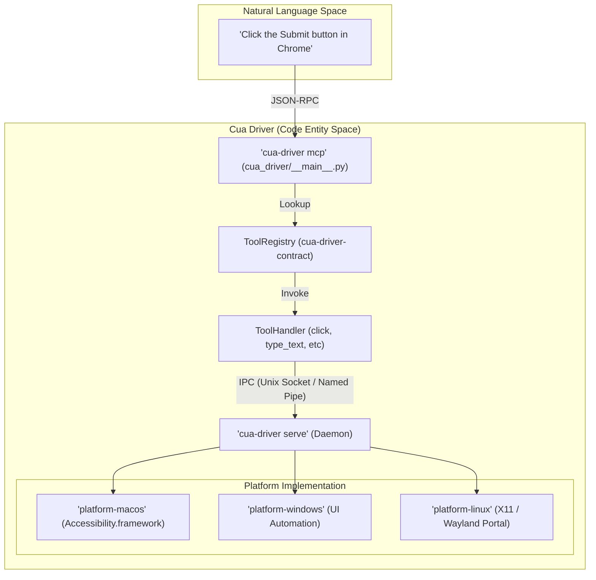
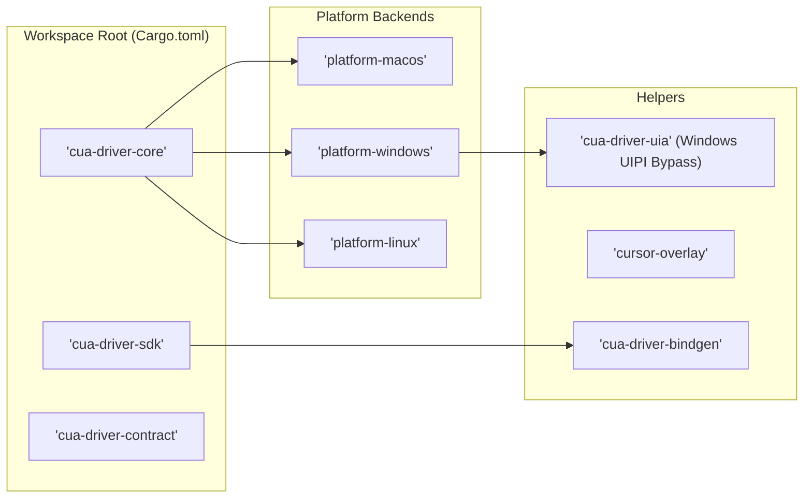

<!-- source: DeepWiki mcp.deepwiki.com · repo trycua/cua · page 6 cua-driver: Background Computer-Use · fetched 2026-10-29 -->

# cua-driver: Background Computer-Use

Relevant source files

The following files were used as context for generating this wiki page:

- [.release-please-manifest.json](.release-please-manifest.json)
- [libs/cua-driver/python/pyproject.toml](libs/cua-driver/python/pyproject.toml)
- [libs/cua-driver/python/src/cua_driver/__init__.py](libs/cua-driver/python/src/cua_driver/__init__.py)
- [libs/cua-driver/rust/CHANGELOG.md](libs/cua-driver/rust/CHANGELOG.md)
- [libs/cua-driver/rust/Cargo.lock](libs/cua-driver/rust/Cargo.lock)
- [libs/cua-driver/rust/Cargo.toml](libs/cua-driver/rust/Cargo.toml)
- [libs/cua-driver/rust/Skills/cua-driver/SKILL.md](libs/cua-driver/rust/Skills/cua-driver/SKILL.md)
- [libs/cua-driver/rust/VERSION](libs/cua-driver/rust/VERSION)
- [libs/cua-driver/typescript/package-lock.json](libs/cua-driver/typescript/package-lock.json)
- [libs/cua-driver/typescript/package.json](libs/cua-driver/typescript/package.json)

`cua-driver` is a background computer-use automation driver that allows Large Language Models (LLMs) to observe and control an operating system without stealing focus from the user. It exposes OS-level controls (Accessibility, Screen Recording, Input Synthesis) as [Model Context Protocol (MCP)](https://modelcontextprotocol.io) tools.

The driver exists in two primary implementations:
1.  **Swift (macOS native):** The reference implementation providing deep integration with `AppKit` and `Accessibility.framework`.
2.  **Rust (`cua-driver-rs`):** The current canonical cross-platform implementation providing native support for macOS, Windows, and Linux [libs/cua-driver/rust/Cargo.toml:11-13]().

### High-Level System Architecture

The following diagram illustrates how a Natural Language request from an LLM (the "Natural Language Space") is translated into concrete OS actions within the "Code Entity Space" via `cua-driver`.

**From Intent to OS Action**

Sources: [libs/cua-driver/rust/Cargo.toml:1-17](), [libs/cua-driver/python/src/cua_driver/__main__.py:1-20](), [libs/cua-driver/rust/crates/platform-macos/Cargo.toml:1-10](), [libs/cua-driver/rust/crates/platform-windows/Cargo.toml:1-10](), [libs/cua-driver/rust/crates/platform-linux/Cargo.toml:1-10]()

---

## Architecture and MCP Tools
The driver operates on a **daemon-proxy model**. When invoked as an MCP server (`cua-driver mcp`), it detects if it has the necessary TCC (Transparency, Consent, and Control) permissions. On macOS, it typically proxies to the installed `CuaDriver.app` daemon so AX and Screen Recording grants retain the signed app-bundle identity.

Key features include:
*   **Tool Surface:** Exposes MCP tools such as `screenshot`, `click`, `type_text`, `get_window_state`, `list_apps`, and `list_windows` [libs/cua-driver/rust/Skills/cua-driver/SKILL.md:41-48]().
*   **Tool Registry:** The `cua-driver-contract` crate defines the schemas and contracts for these tools [libs/cua-driver/rust/Cargo.toml:5]().
*   **CLI Parity:** Every MCP tool is also callable from the shell as `cua-driver <name> '<JSON-args>'`.

For details, see [cua-driver Architecture and MCP Tools](#6.1).

Sources: [libs/cua-driver/rust/Cargo.toml:1-17](), [libs/cua-driver/rust/Skills/cua-driver/SKILL.md:1-107]()

---

## Installation and Setup
`cua-driver` provides a "sudo-free" installation experience across all platforms using optimized scripts.

| Platform | Command |
| :--- | :--- |
| **macOS/Linux** | `curl -fsSL https://cua.ai/driver/install.sh | bash` |
| **Windows** | `irm https://cua.ai/driver/install.ps1 | iex` |

The installer manages versioned binaries and path configuration. On Windows, it registers a Scheduled Task for autostart. On macOS, it requires explicit Accessibility and Screen Recording grants through the `cua-driver permissions` utility. The `cua-driver` version is tracked in `libs/cua-driver/rust/VERSION` [libs/cua-driver/rust/VERSION:1-1]() and `libs/cua-driver/python/pyproject.toml` [libs/cua-driver/python/pyproject.toml:7-7]().

For details, see [cua-driver Installation and Setup](#6.2).

Sources: [libs/cua-driver/rust/VERSION:1-1](), [libs/cua-driver/python/pyproject.toml:7-7]()

---

## Platform Backends and Input Delivery
The `cua-driver` is implemented in Rust and structured as a workspace of crates, each handling specific platform interactions and functionalities [libs/cua-driver/rust/Cargo.toml:1-17]().

**Cross-Platform Binary Structure**

Sources: [libs/cua-driver/rust/Cargo.toml:1-17](), [libs/cua-driver/rust/crates/cua-driver-uia/Cargo.toml:1-5]()

*   **macOS:** Utilizes `Accessibility.framework` (AX), `SkyLight`, and `ScreenCaptureKit` for observation and input synthesis.
*   **Windows:** Leverages `UI Automation` (UIA) and `Win32` APIs, with a dedicated `UIAccess` worker for elevated processes [libs/cua-driver/rust/Cargo.toml:10]().
*   **Linux:** Integrates with `AT-SPI`, `X11`, and `Wayland` (via `portal-libei` and an experimental Hyprland plugin).
*   **Input Synthesis:** Handles various input methods including keyboard, mouse, and scroll events, with options for foreground and background delivery.
*   **Cursor Overlays:** The `cursor-overlay` crate manages the agent's visual cursor, which can be distinct from the system cursor [libs/cua-driver/rust/Cargo.toml:15]().

For details, see [Platform Backends and Input Delivery](#6.3).

Sources: [libs/cua-driver/rust/Cargo.toml:1-58](), [libs/cua-driver/rust/CHANGELOG.md:1-1103]()

---

## Background Computer-Use and Browser Integration
`cua-driver` enables agents to drive applications without hijacking the user's focus through the "no-foreground principle" [libs/cua-driver/rust/Skills/cua-driver/SKILL.md:67-69]().

*   **AX-Based Navigation:** The `get_window_state` tool returns a structured accessibility tree, allowing agents to ground actions on `element_token` rather than raw pixels [libs/cua-driver/rust/Skills/cua-driver/SKILL.md:42-43]().
*   **Visual Feedback:** The `cursor-overlay` crate renders an "agent cursor" to show where the AI is clicking without moving the actual system hardware cursor [libs/cua-driver/rust/Cargo.toml:15]().
*   **Browser Integration:** Supports integration with browsers via `CDP` (Chrome DevTools Protocol), `WebKit`, and `Electron`, allowing agents to interact with web content. This includes attaching to browser profiles and managing consent UI.
*   **FocusGuard:** A mechanism to prevent focus stealing during background operations.

For details, see [Background Computer-Use and Browser Integration](#6.4).

Sources: [libs/cua-driver/rust/Skills/cua-driver/SKILL.md:1-107](), [libs/cua-driver/rust/Cargo.toml:1-17]()

---

## cua-driver SDKs and Language Bindings
`cua-driver` provides SDKs for Python and TypeScript, generated using UniFFI, to facilitate integration with various agent frameworks.

*   **Python SDK:** The `cua-driver` Python package [libs/cua-driver/python/pyproject.toml:6-6]() bundles the Rust binary and provides native bindings via `_native` and `_native_contract` modules [libs/cua-driver/python/src/cua_driver/__init__.py:9-153](). It includes a native loader and supports wheel packaging for distribution [libs/cua-driver/python/pyproject.toml:52-60]().
*   **TypeScript SDK:** The `@trycua/cua-driver` package [libs/cua-driver/typescript/package.json:2-2]() provides TypeScript bindings, enabling Node.js runtime builds and remote channel communication [libs/cua-driver/typescript/package.json:1-66](), [libs/cua-driver/typescript/package-lock.json:1-192]().
*   **Typed Driver Interface:** Both SDKs expose a typed interface for interacting with the driver, ensuring type safety and ease of use.

For details, see [cua-driver SDKs and Language Bindings](#6.5).

Sources: [libs/cua-driver/python/pyproject.toml:1-63](), [libs/cua-driver/python/src/cua_driver/__init__.py:1-363](), [libs/cua-driver/typescript/package.json:1-66](), [libs/cua-driver/typescript/package-lock.json:1-192]()

---

## cua-driver Demos and Examples
The `cua-driver` ecosystem includes specialized demos to showcase concurrent background operation.

*   **Multi-Cursor Demos:** Demonstrates multiple agents driving different UI frameworks (Qt, GTK, Electron, WPF, SwiftUI) simultaneously on one machine.
*   **CUA Jukebox:** A MIDI-driven background computer-use demo with timing-synchronized cursor pools.
*   **Python Wrapper:** The `cua-driver` package on PyPI allows for easy distribution and programmatic control of the driver binary [libs/cua-driver/python/pyproject.toml:6-8]().
*   **`jev-use` Example:** An example demonstrating the use of `cua-driver` for specific tasks.
*   **`agent-sdks` Examples:** Showcases how to integrate `cua-driver` with various agent SDKs.

For details, see [cua-driver Demos and Examples](#6.6).

Sources: [libs/cua-driver/python/pyproject.toml:1-63]()

---

## Hyprland Plugin and Compositor Integration
`cua-driver` includes an optional experimental Hyprland plugin for isolated input on Wayland, addressing the complexities of Wayland's security model.

*   **ABI Fingerprint Gating:** Ensures compatibility and security with specific Hyprland versions.
*   **Discovery-Only Default Build:** The plugin is built in a discovery-only mode by default, requiring explicit activation.
*   **`cua-input-v3` Protocol Candidate:** Explores a new protocol for isolated input on Wayland.
*   **Desktop Fault Policy Tests:** Includes tests for handling desktop fault policies.
*   **`kwin-target-helper` and `wayland-helper`:** Utilities for interacting with Wayland compositors.
*   **`portal-libei` Path:** Investigates the use of `portal-libei` for secure input injection on Wayland. The `cua-driver` changelog mentions support for rotated Hyprland outputs [libs/cua-driver/rust/CHANGELOG.md:56-56]().

For details, see [Hyprland Plugin and Compositor Integration](#6.7).

Sources: [libs/cua-driver/rust/CHANGELOG.md:56-56]()

---

## Recording and Trajectory Capture in cua-driver
The `cua-driver` includes a recording subsystem that allows for capturing trajectories of agent interactions.

*   **`start_recording` / `stop_recording` tools:** These tools enable explicit control over the recording process [libs/cua-driver/rust/Skills/cua-driver/SKILL.md:48-48]().
*   **Frame Capture Hooks:** Platform-specific hooks are used to capture visual frames during recording.
*   **Sentinel/E2E Testkit Integration:** The recording functionality is integrated with the `cua-driver-testkit` and `cua-driver-e2e` crates [libs/cua-driver/rust/Cargo.toml:8-9]() for end-to-end testing and validation.
*   **`RECORDING.md` Contract:** Defines the contract for recorded artifacts.

For details, see [Recording and Trajectory Capture in cua-driver](#6.8).

Sources: [libs/cua-driver/rust/Skills/cua-driver/SKILL.md:48-48](), [libs/cua-driver/rust/Cargo.toml:8-9]()

---

