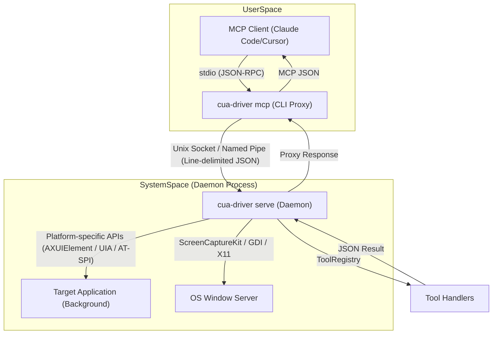
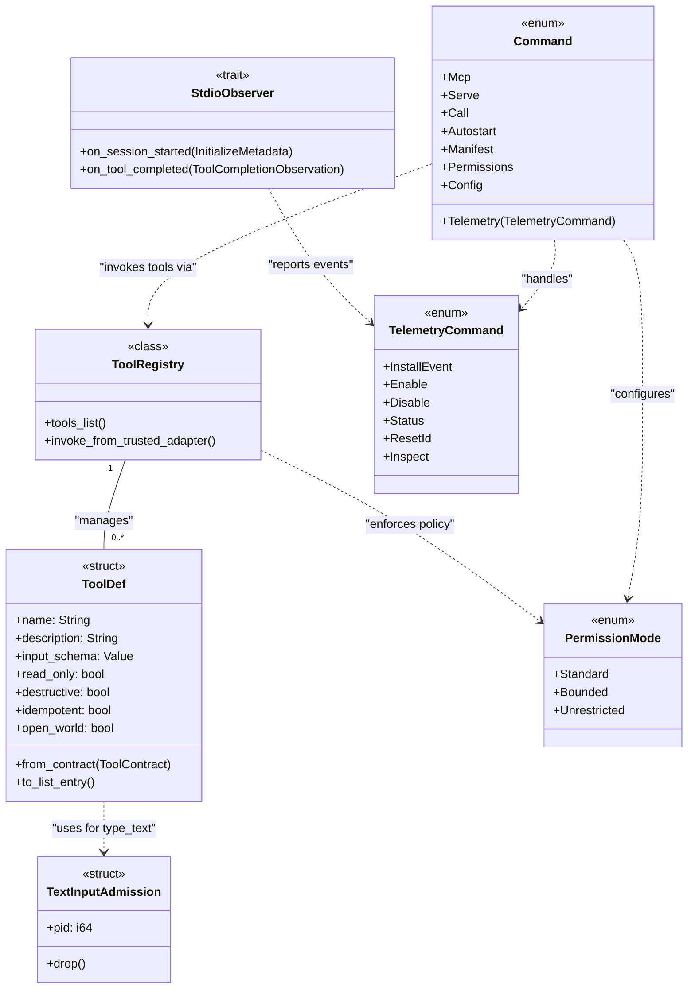
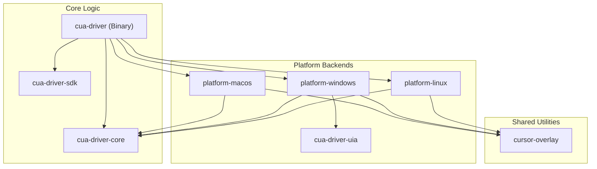

<!-- source: DeepWiki mcp.deepwiki.com · repo trycua/cua · page 6.1 cua-driver Architecture and MCP Tools · fetched 2026-10-29 -->

# cua-driver Architecture and MCP Tools

<details>
<summary>Relevant source files</summary>

The following files were used as context for generating this wiki page:

- [.github/workflows/clawhub-cua-driver.yml](.github/workflows/clawhub-cua-driver.yml)
- [docs/content/docs/cua-driver/guides/connect-your-agent.mdx](docs/content/docs/cua-driver/guides/connect-your-agent.mdx)
- [libs/cua-driver/README.md](libs/cua-driver/README.md)
- [libs/cua-driver/contract/manifest.json](libs/cua-driver/contract/manifest.json)
- [libs/cua-driver/python/src/cua_driver/_native.py](libs/cua-driver/python/src/cua_driver/_native.py)
- [libs/cua-driver/python/src/cua_driver/_native_contract.py](libs/cua-driver/python/src/cua_driver/_native_contract.py)
- [libs/cua-driver/python/tests/test_uniffi_loader.py](libs/cua-driver/python/tests/test_uniffi_loader.py)
- [libs/cua-driver/rust/Skills/cua-driver/LINUX.md](libs/cua-driver/rust/Skills/cua-driver/LINUX.md)
- [libs/cua-driver/rust/Skills/cua-driver/README.md](libs/cua-driver/rust/Skills/cua-driver/README.md)
- [libs/cua-driver/rust/Skills/cua-driver/WINDOWS.md](libs/cua-driver/rust/Skills/cua-driver/WINDOWS.md)
- [libs/cua-driver/rust/crates/cua-driver-contract/src/bin/cua-contract-gen.rs](libs/cua-driver/rust/crates/cua-driver-contract/src/bin/cua-contract-gen.rs)
- [libs/cua-driver/rust/crates/cua-driver-contract/src/compatibility.rs](libs/cua-driver/rust/crates/cua-driver-contract/src/compatibility.rs)
- [libs/cua-driver/rust/crates/cua-driver-contract/src/desktop.rs](libs/cua-driver/rust/crates/cua-driver-contract/src/desktop.rs)
- [libs/cua-driver/rust/crates/cua-driver-contract/src/inputs.rs](libs/cua-driver/rust/crates/cua-driver-contract/src/inputs.rs)
- [libs/cua-driver/rust/crates/cua-driver-contract/src/lib.rs](libs/cua-driver/rust/crates/cua-driver-contract/src/lib.rs)
- [libs/cua-driver/rust/crates/cua-driver-contract/src/outputs.rs](libs/cua-driver/rust/crates/cua-driver-contract/src/outputs.rs)
- [libs/cua-driver/rust/crates/cua-driver-contract/src/verification.rs](libs/cua-driver/rust/crates/cua-driver-contract/src/verification.rs)
- [libs/cua-driver/rust/crates/cua-driver-core/src/authorization.rs](libs/cua-driver/rust/crates/cua-driver-core/src/authorization.rs)
- [libs/cua-driver/rust/crates/cua-driver-core/src/cursor_shape.rs](libs/cua-driver/rust/crates/cua-driver-core/src/cursor_shape.rs)
- [libs/cua-driver/rust/crates/cua-driver-core/src/element_token.rs](libs/cua-driver/rust/crates/cua-driver-core/src/element_token.rs)
- [libs/cua-driver/rust/crates/cua-driver-core/src/server.rs](libs/cua-driver/rust/crates/cua-driver-core/src/server.rs)
- [libs/cua-driver/rust/crates/cua-driver-core/src/session.rs](libs/cua-driver/rust/crates/cua-driver-core/src/session.rs)
- [libs/cua-driver/rust/crates/cua-driver-core/src/session_authorization.rs](libs/cua-driver/rust/crates/cua-driver-core/src/session_authorization.rs)
- [libs/cua-driver/rust/crates/cua-driver-core/src/snapshot_store.rs](libs/cua-driver/rust/crates/cua-driver-core/src/snapshot_store.rs)
- [libs/cua-driver/rust/crates/cua-driver-core/src/tool.rs](libs/cua-driver/rust/crates/cua-driver-core/src/tool.rs)
- [libs/cua-driver/rust/crates/cua-driver-core/src/tool_schema.rs](libs/cua-driver/rust/crates/cua-driver-core/src/tool_schema.rs)
- [libs/cua-driver/rust/crates/cua-driver-core/tests/contract_parity.rs](libs/cua-driver/rust/crates/cua-driver-core/tests/contract_parity.rs)
- [libs/cua-driver/rust/crates/cua-driver-core/tests/snapshot_invariants.rs](libs/cua-driver/rust/crates/cua-driver-core/tests/snapshot_invariants.rs)
- [libs/cua-driver/rust/crates/cua-driver-sdk/src/abi.rs](libs/cua-driver/rust/crates/cua-driver-sdk/src/abi.rs)
- [libs/cua-driver/rust/crates/cua-driver-sdk/src/lib.rs](libs/cua-driver/rust/crates/cua-driver-sdk/src/lib.rs)
- [libs/cua-driver/rust/crates/cua-driver-sdk/src/runtime.rs](libs/cua-driver/rust/crates/cua-driver-sdk/src/runtime.rs)
- [libs/cua-driver/rust/crates/cua-driver/src/cli.rs](libs/cua-driver/rust/crates/cua-driver/src/cli.rs)
- [libs/cua-driver/rust/crates/cua-driver/src/main.rs](libs/cua-driver/rust/crates/cua-driver/src/main.rs)
- [libs/cua-driver/rust/crates/cua-driver/src/mcp_http.rs](libs/cua-driver/rust/crates/cua-driver/src/mcp_http.rs)
- [libs/cua-driver/rust/crates/cua-driver/src/proxy.rs](libs/cua-driver/rust/crates/cua-driver/src/proxy.rs)
- [libs/cua-driver/rust/crates/cua-driver/src/responsibility.rs](libs/cua-driver/rust/crates/cua-driver/src/responsibility.rs)
- [libs/cua-driver/rust/crates/cua-driver/src/serve.rs](libs/cua-driver/rust/crates/cua-driver/src/serve.rs)
- [libs/cua-driver/rust/crates/cua-driver/src/skills.rs](libs/cua-driver/rust/crates/cua-driver/src/skills.rs)
- [libs/cua-driver/rust/crates/cua-driver/src/telemetry.rs](libs/cua-driver/rust/crates/cua-driver/src/telemetry.rs)
- [libs/cua-driver/rust/crates/cua-driver/tests/protocol_schema_test.rs](libs/cua-driver/rust/crates/cua-driver/tests/protocol_schema_test.rs)
- [libs/cua-driver/rust/crates/cua-driver/tests/schema_consistency_test.rs](libs/cua-driver/rust/crates/cua-driver/tests/schema_consistency_test.rs)
- [libs/cua-driver/rust/crates/platform-macos/src/tools/check_permissions.rs](libs/cua-driver/rust/crates/platform-macos/src/tools/check_permissions.rs)
- [libs/cua-driver/rust/crates/platform-macos/src/tools/invoke_menu.rs](libs/cua-driver/rust/crates/platform-macos/src/tools/invoke_menu.rs)
- [libs/cua-driver/rust/examples/embedded-host-macos/ExampleAgentHarness.swift](libs/cua-driver/rust/examples/embedded-host-macos/ExampleAgentHarness.swift)
- [libs/cua-driver/scripts/post-install-hints.txt](libs/cua-driver/scripts/post-install-hints.txt)
- [libs/cua-driver/typescript/src/native/cua_driver_contract.ts](libs/cua-driver/typescript/src/native/cua_driver_contract.ts)
- [libs/cua-driver/typescript/src/native/cua_driver_sdk-ffi.ts](libs/cua-driver/typescript/src/native/cua_driver_sdk-ffi.ts)
- [libs/cua-driver/typescript/src/native/cua_driver_sdk.ts](libs/cua-driver/typescript/src/native/cua_driver_sdk.ts)
- [scripts/docs-generators/cli-specs/cua-driver-mcp-linux.json](scripts/docs-generators/cli-specs/cua-driver-mcp-linux.json)
- [scripts/docs-generators/cli-specs/cua-driver-mcp-macos.json](scripts/docs-generators/cli-specs/cua-driver-mcp-macos.json)
- [scripts/docs-generators/cli-specs/cua-driver-mcp-windows.json](scripts/docs-generators/cli-specs/cua-driver-mcp-windows.json)

</details>


`cua-driver` is a background computer-use driver that exposes OS-level controls to Large Language Models (LLMs) via the Model Context Protocol (MCP). It is designed to allow agents to drive applications without stealing the user's focus, using a daemon-proxy model to handle macOS TCC (Transparency, Consent, and Control) permissions and Windows UIPI (User Interface Privilege Isolation) effectively.

## Architecture: Daemon-Proxy Model

The `cua-driver` architecture solves a critical security challenge on macOS: TCC permissions (Accessibility and Screen Recording) are tied to the **Bundle ID** of the application that requested them.

When an MCP client (like Claude Code or Cursor) spawns `cua-driver mcp` from a terminal, macOS attributes the process to the parent terminal rather than the `CuaDriver.app` bundle. This causes Accessibility (AX) probes to fail silently. To circumvent this, `cua-driver` employs a proxy model:

1.  **Context Detection**: The `mcp` command detects if it is running in a terminal context [libs/cua-driver/rust/crates/cua-driver/src/cli.rs:19-36]().
2.  **Daemon Launch**: It ensures a `cua-driver serve` daemon is running. On macOS, it proxies to the installed `CuaDriver.app` daemon so AX and Screen Recording grants retain the app-bundle identity [libs/cua-driver/README.md:44-47]().
3.  **IPC Proxy**: The CLI process acts as a thin proxy, forwarding all MCP tool calls over a Unix domain socket (macOS/Linux) or Named Pipe (Windows) to the long-running daemon [libs/cua-driver/rust/crates/cua-driver/src/serve.rs:1-6]().
4.  **TCC/UIPI Survival**: Because the daemon runs within the signed bundle or at a specific integrity level, it retains its Accessibility and Screen Recording grants across restarts and updates [libs/cua-driver/README.md:44-47]().

### Process Model and Data Flow

Title: "cua-driver Proxy Flow"

Sources: [libs/cua-driver/rust/crates/cua-driver/src/cli.rs:19-36](), [libs/cua-driver/README.md:44-47](), [libs/cua-driver/rust/crates/cua-driver/src/main.rs:1-14](), [libs/cua-driver/rust/crates/cua-driver/src/serve.rs:1-6]()

## CLI/Serve/MCP Entrypoints

The `cua-driver` executable provides several entry points for different use cases:

*   **`cua-driver` (default) or `cua-driver mcp`**: This is the primary entry point for MCP clients. It acts as a proxy to the daemon, handling JSON-RPC 2.0 over stdio [libs/cua-driver/rust/crates/cua-driver/src/cli.rs:5-6](). On Windows and Linux, `cua-driver mcp` can own its SDK runtime directly, shutting down on stdin EOF. On macOS, it always proxies to the installed `CuaDriver.app` daemon for TCC attribution [libs/cua-driver/README.md:44-47]().
*   **`cua-driver serve`**: This command launches the long-running daemon process. It listens for incoming requests over a Unix domain socket or named pipe [libs/cua-driver/rust/crates/cua-driver/src/cli.rs:52-52](). This daemon hosts the `ToolRegistry` and performs the actual OS interactions.
*   **`cua-driver list-tools`**: Lists all available tools with their names and descriptions [libs/cua-driver/rust/crates/cua-driver/src/cli.rs:7-7]().
*   **`cua-driver describe <tool>`**: Prints the JSON schema for a specific tool [libs/cua-driver/rust/crates/cua-driver/src/cli.rs:8-8]().
*   **`cua-driver call <tool> [json-args]` or `cua-driver <tool> [json-args]`**: Invokes a specific tool with provided JSON arguments and prints the result [libs/cua-driver/rust/crates/cua-driver/src/cli.rs:9-10]().

Sources: [libs/cua-driver/rust/crates/cua-driver/src/cli.rs:5-10](), [libs/cua-driver/rust/crates/cua-driver/src/serve.rs:1-6](), [libs/cua-driver/README.md:44-47]()

## Session Lifecycle

`cua-driver` manages sessions to maintain state and authorization contexts for agents.

*   **Session Creation**: When an MCP client connects, a session is established. For trusted connections, `bind_trusted_connection` creates a `CuaDriverSession` [libs/cua-driver/rust/crates/cua-driver/src/serve.rs:60-71]().
*   **Session Identity**: Each session has an identity, either explicitly provided by the client or implicitly derived from the transport. This identity is used for cursor, recording, configuration, and cleanup [libs/cua-driver/rust/crates/cua-driver/src/serve.rs:177-187]().
*   **Trusted Sessions**: `cua-driver` supports trusted sessions with options like `idle_ttl_seconds` and `absolute_ttl_seconds` for automatic expiration and resume capabilities [libs/cua-driver/rust/crates/cua-driver-sdk/src/runtime.rs:100-101](). These sessions can be detached and resumed using credentials [libs/cua-driver/rust/crates/cua-driver/src/serve.rs:102-118]().
*   **Session Termination**: Sessions are closed explicitly or implicitly upon transport disconnection or expiration. The `end_session` tool can be called to clean up a trusted session [libs/cua-driver/rust/crates/cua-driver/src/serve.rs:120-137]().

Sources: [libs/cua-driver/rust/crates/cua-driver/src/serve.rs:35-187](), [libs/cua-driver/rust/crates/cua-driver-sdk/src/runtime.rs:100-101]()

## Authorization and Permission Modes

`cua-driver` implements a robust authorization system to control what agents can do and under what conditions. This is crucial for security and user trust.

*   **Permission Modes**: The daemon operates in different permission modes, configured at startup and immutable thereafter [libs/cua-driver/rust/crates/cua-driver-core/src/authorization.rs:1-6]().
    *   **Standard Mode**: Requires explicit human consent for certain operations.
    *   **Bounded Mode**: Operations are restricted by a `capability_manifest`.
    *   **Unrestricted Mode**: Bypasses approval prompts, intended for disposable or fully trusted environments [libs/cua-driver/rust/crates/cua-driver/src/main.rs:97-103]().
*   **Capability Manifest**: In bounded mode, a JSON manifest specifies the allowed tools and their parameters, acting as a scope ceiling [libs/cua-driver/rust/crates/cua-driver/src/cli.rs:61-62]().
*   **Launch Grants**: Specific grants can be configured at launch time, such as `existing-profile`, which are only valid in standard permission mode [libs/cua-driver/rust/crates/cua-driver/src/cli.rs:36-36](), [libs/cua-driver/rust/crates/cua-driver/src/main.rs:93-94]().
*   **Risk Classes**: Tools are assigned `RiskClass` (R0-R4) to categorize their potential impact, with `RiskEnforcement` indicating whether consent is actively enforced or metadata-only [libs/cua-driver/rust/crates/cua-driver-core/src/authorization.rs:49-121]().
*   **Policy Validation**: `validate_startup_authorization` and `validate_configured_policy` ensure that the daemon's configuration adheres to security policies before processing requests [libs/cua-driver/rust/crates/cua-driver/src/main.rs:96-96](), [libs/cua-driver/rust/crates/cua-driver/src/proxy.rs:45-46]().

Title: "Permission Mode Flow"
```mermaid
graph TD
    A[Daemon Startup] --> B{Permission Mode Configured?};
    B -- Yes --> C{Mode: Standard, Bounded, or Unrestricted?};
    C -- Standard --> D[Requires Human Consent for R1+ Operations];
    C -- Bounded --> E[Operations limited by Capability Manifest];
    C -- Unrestricted --> F[Bypasses Approvals, High Risk];
    B -- No --> G[Default Mode (e.g., Standard)];
    D --> H[Tool Call];
    E --> H;
    F --> H;
    H --> I{Tool Authorization Check};
    I -- Authorized --> J[Execute Tool];
    I -- Denied --> K[Refuse Tool Call];
```
Sources: [libs/cua-driver/rust/crates/cua-driver-core/src/authorization.rs:1-184](), [libs/cua-driver/rust/crates/cua-driver/src/cli.rs:57-62](), [libs/cua-driver/rust/crates/cua-driver/src/main.rs:54-104](), [libs/cua-driver/rust/crates/cua-driver/src/proxy.rs:45-46]()

## ToolRegistry and MCP Tool Surface

The `ToolRegistry` is the central hub for all capabilities exposed to the LLM. It manages a collection of `ToolDef` structures, mapping tool names to specific implementation handlers [libs/cua-driver/rust/crates/cua-driver-core/src/tool.rs:127-136]().

### Core Tools Surface

`cua-driver` exposes a comprehensive set of MCP tools. For example, on Windows, it exposes 59 tools [scripts/docs-generators/cli-specs/cua-driver-mcp-windows.json:1-2951](), and on Linux, 62 tools [scripts/docs-generators/cli-specs/cua-driver-mcp-linux.json:1-2951]().

| Tool | Purpose | Implementation Detail |
| :--- | :--- | :--- |
| `get_window_state` | Snapshot UI & AX tree | Returns structured `elements` array and Markdown rendering of the accessibility tree, plus a screenshot. Grounding anchor for vision flows. The index map is replaced by the next snapshot [libs/cua-driver/rust/Skills/cua-driver/WINDOWS.md:1-88](). |
| `screenshot` | Capture screen | Captures a screenshot of the entire screen or a specific window. The `claude_code_compat` flag registers a window-scoped, JPEG @ 85% version [libs/cua-driver/rust/crates/cua-driver/src/cli.rs:28-32](). |
| `click` | Perform click | Supports `element_token` (AX) or `x,y` (pixel) coordinates. The modality is chosen at action time [libs/cua-driver/contract/manifest.json:12-16](). |
| `type_text` | Keyboard input | Delivers text to a specific PID without requiring focus. Employs `TextInputAdmission` to prevent concurrent input conflicts [libs/cua-driver/rust/crates/cua-driver-core/src/tool.rs:84-122](). |
| `list_apps` | Enumerate processes | Lists running applications and installed launchers (e.g., `.app` bundles on macOS, `.lnk` on Windows, `.desktop` on Linux) [scripts/docs-generators/cli-specs/cua-driver-mcp-macos.json:1-19](), [scripts/docs-generators/cli-specs/cua-driver-mcp-linux.json:1-19](). |
| `list_windows` | Get window details | Returns window IDs, titles, geometry (z-index, visibility), and accessibility tree for a specific window [scripts/docs-generators/cli-specs/cua-driver-mcp-macos.json:20-44](), [libs/cua-driver/rust/Skills/cua-driver/LINUX.md:73-87](). |
| `launch_app` | Start Application | Starts an app via `bundle_id` or `launch_path` [scripts/docs-generators/cli-specs/cua-driver-mcp-macos.json:1-19](). |

### Contract Schemas

The `cua-driver-contract` crate defines the stable API contract for tools, including input and output schemas. This ensures consistency across different language bindings and client implementations.

*   **`ToolDef`**: Contains metadata for a tool, including its name, description, input schema, and annotations like `read_only`, `destructive`, `idempotent`, and `open_world` [libs/cua-driver/rust/crates/cua-driver-core/src/tool.rs:127-136]().
*   **`ToolContract`**: A canonical client contract used to build runtime MCP definitions [libs/cua-driver/rust/crates/cua-driver-core/src/tool.rs:142-156]().
*   **Schema Generation**: The `cua-driver dump-docs` command can emit a stable JSON description of the CLI surface, including subcommands, arguments, MCP invocation, and version, for downstream consumers [libs/cua-driver/rust/crates/cua-driver/src/cli.rs:165-169]().

Sources: [libs/cua-driver/rust/crates/cua-driver-core/src/tool.rs:127-156](), [libs/cua-driver/rust/crates/cua-driver/src/cli.rs:165-169](), [scripts/docs-generators/cli-specs/cua-driver-mcp-windows.json:1-2951](), [scripts/docs-generators/cli-specs/cua-driver-mcp-linux.json:1-2951](), [libs/cua-driver/contract/manifest.json:12-16](), [scripts/docs-generators/cli-specs/cua-driver-mcp-macos.json:1-19](), [scripts/docs-generators/cli-specs/cua-driver-mcp-macos.json:20-44](), [libs/cua-driver/rust/Skills/cua-driver/WINDOWS.md:1-88](), [libs/cua-driver/rust/Skills/cua-driver/LINUX.md:73-87]()

## Telemetry

`cua-driver` includes a privacy-focused telemetry system to collect content-free product usage data.

*   **Opt-in/Opt-out**: Telemetry is enabled by default but can be disabled via CLI commands (`cua-driver telemetry disable`) or environment variables (`CUA_DRIVER_RS_TELEMETRY_ENABLED=false`) [libs/cua-driver/rust/crates/cua-driver/src/telemetry.rs:151-156]().
*   **Pseudonymous IDs**: A local installation ID is used as a PostHog `distinct_id` but is not duplicated into event properties, ensuring pseudonymous tracking [libs/cua-driver/rust/crates/cua-driver/src/telemetry.rs:36-37]().
*   **Bounded Properties**: Event builders only accept fixed event names and bounded properties, never sensitive information like prompts, tool arguments, screenshots, or URLs [libs/cua-driver/rust/crates/cua-driver/src/telemetry.rs:8-12]().
*   **Events**: Tracked events include `installation_registered`, `mcp_session_started`, `mcp_tool_completed`, `agent_session_started`, and `agent_session_ended` [libs/cua-driver/rust/crates/cua-driver/src/telemetry.rs:71-87]().
*   **Local Inspection**: Events can be inspected locally without being sent over the network using `cua-driver telemetry status --json` [libs/cua-driver/rust/crates/cua-driver/src/main.rs:166-168]().
*   **Update Checks**: The telemetry setting does not control update checks, which can be disabled separately via `CUA_DRIVER_RS_UPDATE_CHECK=false` [libs/cua-driver/rust/crates/cua-driver/src/telemetry.rs:42-42]().

Sources: [libs/cua-driver/rust/crates/cua-driver/src/telemetry.rs:1-157](), [libs/cua-driver/rust/crates/cua-driver/src/main.rs:166-168]()

## Agent Cursor Overlay

To provide visual feedback and indicate agent intent, `cua-driver` includes a configurable cursor overlay.

*   **Visual Feedback**: The overlay shows the agent's cursor movements and actions, making it clear what the agent is doing.
*   **Configuration**: Users can customize the overlay's appearance and behavior through CLI flags:
    *   `--cursor-theme <installed-theme-id>`: Selects an installed cursor theme [libs/cua-driver/rust/crates/cua-driver/src/main.rs:9-9]().
    *   `--cursor-reduced-motion <auto|on|off>`: Sets accessibility motion preference [libs/cua-driver/rust/crates/cua-driver/src/main.rs:10-10]().
    *   `--no-overlay`: Disables the overlay entirely [libs/cua-driver/rust/crates/cua-driver/src/main.rs:11-11]().
    *   `--glide-ms <f64>`: Overrides the cursor glide duration [libs/cua-driver/rust/crates/cua-driver/src/main.rs:12-12]().
    *   `--dwell-ms <f64>`: Overrides the post-click dwell duration [libs/cua-driver/rust/crates/cua-driver/src/main.rs:13-13]().
    *   `--idle-hide-ms <f64>`: Overrides the idle-hide timeout [libs/cua-driver/rust/crates/cua-driver/src/main.rs:14-14]().

Sources: [libs/cua-driver/rust/crates/cua-driver/src/main.rs:8-14]()

## Code Entity Mapping (Rust Core)

Title: "Code Entity Mapping (Rust Core)"

Sources: [libs/cua-driver/rust/crates/cua-driver/src/cli.rs:18-164](), [libs/cua-driver/rust/crates/cua-driver-core/src/tool.rs:84-192](), [libs/cua-driver/rust/crates/cua-driver-core/src/authorization.rs:139-184](), [libs/cua-driver/rust/crates/cua-driver/src/telemetry.rs:147-157](), [libs/cua-driver/rust/crates/cua-driver-core/src/server.rs:43-53]()

### Platform-Specific Backends

The Rust implementation uses a workspace-based architecture to isolate platform-specific logic while sharing the core protocol.

Title: "Workspace Dependency Graph"

Sources: [libs/cua-driver/rust/Cargo.toml:1-17](), [libs/cua-driver/rust/crates/cua-driver/src/cli.rs:153-158]()

---

