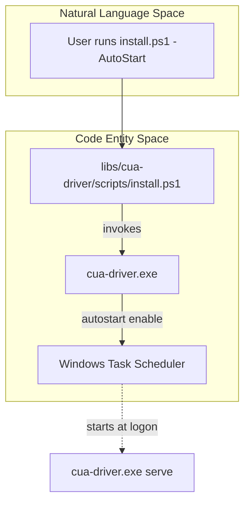

<!-- source: DeepWiki mcp.deepwiki.com · repo trycua/cua · page 6.2 cua-driver Installation and Setup · fetched 2026-10-29 -->

# cua-driver Installation and Setup

Relevant source files

The following files were used as context for generating this wiki page:

- [.github/release-state/cua-driver-rs-published-version](.github/release-state/cua-driver-rs-published-version)
- [.github/release-state/cua-driver-rs-withdrawn-versions](.github/release-state/cua-driver-rs-withdrawn-versions)
- [.github/scripts/tests/test_verify_cua_driver_release_archives.py](.github/scripts/tests/test_verify_cua_driver_release_archives.py)
- [.github/workflows/ci-cua-driver-installer-compat.yml](.github/workflows/ci-cua-driver-installer-compat.yml)
- [.github/workflows/ci-test-scripts.yml](.github/workflows/ci-test-scripts.yml)
- [libs/cua-driver/rust/crates/cua-driver/src/autostart.rs](libs/cua-driver/rust/crates/cua-driver/src/autostart.rs)
- [libs/cua-driver/rust/crates/cua-driver/src/stop.rs](libs/cua-driver/rust/crates/cua-driver/src/stop.rs)
- [libs/cua-driver/rust/crates/platform-macos/src/permissions/panel.rs](libs/cua-driver/rust/crates/platform-macos/src/permissions/panel.rs)
- [libs/cua-driver/scripts/README.md](libs/cua-driver/scripts/README.md)
- [libs/cua-driver/scripts/_install-common.psm1](libs/cua-driver/scripts/_install-common.psm1)
- [libs/cua-driver/scripts/_install-common.sh](libs/cua-driver/scripts/_install-common.sh)
- [libs/cua-driver/scripts/_install-local-rust.sh](libs/cua-driver/scripts/_install-local-rust.sh)
- [libs/cua-driver/scripts/_install-rust.sh](libs/cua-driver/scripts/_install-rust.sh)
- [libs/cua-driver/scripts/_local-signing.sh](libs/cua-driver/scripts/_local-signing.sh)
- [libs/cua-driver/scripts/install-local.ps1](libs/cua-driver/scripts/install-local.ps1)
- [libs/cua-driver/scripts/install-local.sh](libs/cua-driver/scripts/install-local.sh)
- [libs/cua-driver/scripts/install.ps1](libs/cua-driver/scripts/install.ps1)
- [libs/cua-driver/scripts/install.sh](libs/cua-driver/scripts/install.sh)
- [libs/cua-driver/scripts/tests/conftest.py](libs/cua-driver/scripts/tests/conftest.py)
- [libs/cua-driver/scripts/tests/install-common-windows-regression.ps1](libs/cua-driver/scripts/tests/install-common-windows-regression.ps1)
- [libs/cua-driver/scripts/tests/install-windows-regression.ps1](libs/cua-driver/scripts/tests/install-windows-regression.ps1)
- [libs/cua-driver/scripts/tests/test_install_autostart_summary.py](libs/cua-driver/scripts/tests/test_install_autostart_summary.py)
- [libs/cua-driver/scripts/tests/test_install_isolated_autostart.py](libs/cua-driver/scripts/tests/test_install_isolated_autostart.py)
- [libs/cua-driver/scripts/tests/test_install_local.py](libs/cua-driver/scripts/tests/test_install_local.py)
- [libs/cua-driver/scripts/tests/test_installer_bash32_syntax.py](libs/cua-driver/scripts/tests/test_installer_bash32_syntax.py)
- [libs/cua-driver/scripts/tests/test_uninstall_claude_mcp.py](libs/cua-driver/scripts/tests/test_uninstall_claude_mcp.py)
- [libs/cua-driver/scripts/tests/test_uninstall_claude_mcp_no_python.py](libs/cua-driver/scripts/tests/test_uninstall_claude_mcp_no_python.py)
- [libs/cua-driver/scripts/tests/test_uninstall_claude_mcp_safety.py](libs/cua-driver/scripts/tests/test_uninstall_claude_mcp_safety.py)
- [libs/cua-driver/scripts/tests/test_uninstall_daemon_stop.py](libs/cua-driver/scripts/tests/test_uninstall_daemon_stop.py)
- [libs/cua-driver/scripts/tests/test_uninstall_windows_mcp_guidance.py](libs/cua-driver/scripts/tests/test_uninstall_windows_mcp_guidance.py)
- [libs/cua-driver/scripts/tests/uninstall-history-purge-test.sh](libs/cua-driver/scripts/tests/uninstall-history-purge-test.sh)
- [libs/cua-driver/scripts/tests/update-apply-windows-e2e.ps1](libs/cua-driver/scripts/tests/update-apply-windows-e2e.ps1)
- [libs/cua-driver/scripts/uninstall-local.sh](libs/cua-driver/scripts/uninstall-local.sh)
- [libs/cua-driver/scripts/uninstall.ps1](libs/cua-driver/scripts/uninstall.ps1)
- [libs/cua-driver/scripts/uninstall.sh](libs/cua-driver/scripts/uninstall.sh)

This page provides technical details for installing and configuring `cua-driver` across macOS, Windows, and Linux. `cua-driver` is a background computer-use driver that exposes OS-level automation tools via the Model Context Protocol (MCP). It primarily utilizes a Rust implementation (`cua-driver-rs`) for cross-platform support [libs/cua-driver/scripts/install.sh:2-3]().

## Installation Architecture

The installation process uses platform-specific scripts to manage binary distribution, path configuration, and background service registration. The Rust implementation is the canonical driver for all platforms [libs/cua-driver/scripts/install.sh:81-82]().

### macOS Installation Flow
The macOS installer downloads a signed and notarized `CuaDriver.app` bundle. This bundle is critical because macOS Transparency, Consent, and Control (TCC) permissions are keyed to the bundle identifier `com.trycua.driver` [libs/cua-driver/scripts/_install-rust.sh:50-51]().

1.  **Bundle Placement**: The script moves `CuaDriver.app` to `/Applications/` [libs/cua-driver/scripts/_install-rust.sh:220-221]().
2.  **CLI Symlinking**: It creates a symlink at `~/.local/bin/cua-driver` pointing to the executable inside the app bundle [libs/cua-driver/scripts/_install-rust.sh:222-223]().
3.  **Path Update**: If the bin directory is not in the user's `PATH`, the script appends an export to the shell configuration [libs/cua-driver/scripts/_install-rust.sh:23-24]().

### Windows Installation Flow
The Windows installer (`install.ps1`) implements a versioned layout using NTFS directory junctions to allow atomic upgrades without requiring Administrator privileges or Developer Mode [libs/cua-driver/scripts/install.ps1:4-5]().

1.  **Junction Creation**: It creates two tiers of junctions: `%LOCALAPPDATA%\Programs\Cua\cua-driver\bin` (visible to PATH) and `%USERPROFILE%\.cua-driver\packages\current` [libs/cua-driver/scripts/install.ps1:16-19]().
2.  **Architecture Detection**: It detects `x86_64` or `ARM64` to download the correct release [libs/cua-driver/scripts/install.ps1:221-226]().
3.  **Scheduled Task**: The installer supports an autostart task that runs with `LogonType=Interactive` to land in a session with an attached desktop, required for GUI tools [libs/cua-driver/scripts/install.ps1:59-61]().

### Linux Installation Flow
On Linux, the `install.sh` script delegates to `_install-rust.sh` [libs/cua-driver/scripts/install.sh:109-110](). It follows a similar three-tier directory structure using symlinks [libs/cua-driver/scripts/_install-rust.sh:50-58]().

### Versioned Layout (Linux/Windows)
To support atomic upgrades and rollbacks, the Rust driver uses the following layout:

| Tier | Path Example (Linux) | Description |
| :--- | :--- | :--- |
| **Release Dir** | `~/.cua-driver/packages/releases/0.12.6-...` | Immutable directory containing a specific version [libs/cua-driver/scripts/_install-rust.sh:54-56](). |
| **Current Link** | `~/.cua-driver/packages/current` | Symlink/Junction pointing to the active release directory [libs/cua-driver/scripts/_install-rust.sh:57-57](). |
| **Visible Bin** | `~/.local/bin/cua-driver` | Link pointing to the binary within the `current` path [libs/cua-driver/scripts/_install-rust.sh:58-58](). |

Sources: [libs/cua-driver/scripts/install.sh:1-122](), [libs/cua-driver/scripts/install.ps1:1-130](), [libs/cua-driver/scripts/_install-rust.sh:1-135]()

## Local Development Installation and Signing

For local development, `cua-driver` can be built and installed from source. This process differs from the release installation, particularly concerning macOS signing requirements.

### macOS Local Development
The `_install-local-rust.sh` script handles local builds for macOS and Linux [libs/cua-driver/scripts/_install-local-rust.sh:3-4]().

*   **Build Configuration**: Developers can choose between `debug` (default) and `release` builds using the `--release` flag [libs/cua-driver/scripts/_install-local-rust.sh:98-99]().
*   **Autostart**: The `--autostart` flag registers a `LaunchAgent` on macOS or a `systemd --user` unit on Linux. On macOS, this is crucial for TCC permissions, as a launchd-started daemon is attributed to `com.trycua.driver.local`, allowing for consistent permission grants [libs/cua-driver/scripts/_install-local-rust.sh:125-132]().
*   **Signing**: The `CUA_DRIVER_REQUIRE_STABLE_SIGNING` environment variable or `--require-stable-signing` flag can enforce that the installation stops if a certificate-backed identity is not available. This is recommended for behavior and E2E verification [libs/cua-driver/scripts/_local-signing.sh:1-2](), [libs/cua-driver/scripts/_install-local-rust.sh:136-139]().
*   **Local Product Namespace**: Local builds are installed into a separate namespace (e.g., `/Applications/CuaDriverLocal.app` and `~/.local/bin/cua-driver-local`) to avoid conflicts with release installations [libs/cua-driver/scripts/_install-local-rust.sh:33-34]().

### Windows Local Development
The `install-local.ps1` script is used for local development on Windows. It builds the Rust project and installs it into a local product namespace, similar to the Linux/macOS local installer [libs/cua-driver/scripts/install-local.ps1:1-4]().

Sources: [libs/cua-driver/scripts/_install-local-rust.sh:1-646](), [libs/cua-driver/scripts/install-local.ps1:1-456](), [libs/cua-driver/scripts/_local-signing.sh:1-2]()

## Version Fallback Logic and Channels

The `cua-driver` installer supports pinning specific versions, installing the latest stable or nightly releases, and includes fallback logic for version resolution.

### Version Resolution Precedence
The installer determines the version to install based on the following precedence [libs/cua-driver/scripts/install.ps1:119-123]():
1.  `$env:CUA_DRIVER_RS_VERSION` (environment variable)
2.  `-Release` argument to the install script
3.  Baked version in the install script (e.g., `$Script:CuaDriverRsBakedVersion`) [libs/cua-driver/scripts/install.ps1:126]()
4.  GitHub Releases API (as a fallback)

The baked version is updated by the CI workflow after a release is published [libs/cua-driver/scripts/install.ps1:119-123](), [libs/cua-driver/scripts/_install-rust.sh:129-133]().

### Channels
The `-Channel` parameter allows users to persist and install the latest "stable" or "nightly" release [libs/cua-driver/scripts/install.ps1:58-59](), [libs/cua-driver/scripts/_install-rust.sh:24-25](). This is managed by the `release_channel.rs` module in the Rust codebase [libs/cua-driver/rust/crates/cua-driver/src/release_channel.rs:1-10]().

### Update Mechanism
The `cua-driver update` command checks for newer versions and offers to install them. It respects the configured channel (stable/nightly) [libs/cua-driver/rust/crates/cua-driver/src/updater.rs:1-10]().

Sources: [libs/cua-driver/scripts/install.ps1:1-1964](), [libs/cua-driver/scripts/_install-rust.sh:1-1605](), [libs/cua-driver/rust/crates/cua-driver/src/release_channel.rs:1-10](), [libs/cua-driver/rust/crates/cua-driver/src/updater.rs:1-10]()

## TCC Permissions Gate (macOS)

`cua-driver` requires **Accessibility** and **Screen Recording** permissions to function on macOS. These are managed by the TCC (Transparency, Consent, and Control) subsystem.

### Implementation: Permissions Verification
The `cua-driver` CLI provides commands to manage these permissions:

*   **`permissions status`**: Reports the status of required grants and identifies the bundle ID [docs/content/docs/tutorials/drive-your-first-app.mdx:73-74]().
*   **`permissions grant`**: Launches the `CuaDriver` app to trigger the system permission dialogs. This ensures the grants are associated with the stable bundle ID `com.trycua.driver` rather than the terminal emulator [docs/content/docs/tutorials/drive-your-first-app.mdx:51-53]().

### The Bundle ID Requirement
TCC grants are persistent only if the binary is part of a signed app bundle. To solve this, the installer places the binary inside `CuaDriver.app` and symlinks it, ensuring that when the driver is invoked, it is recognized as the `com.trycua.driver` bundle [libs/cua-driver/scripts/_install-rust.sh:50-51]().

Sources: [libs/cua-driver/scripts/_install-rust.sh:1-250](), [docs/content/docs/tutorials/drive-your-first-app.mdx:35-83]()

## Windows Autostart and Scheduled Tasks

On Windows, `cua-driver` utilizes the Task Scheduler to ensure the `serve` daemon starts at logon, providing persistent background computer-use capabilities.

### Scheduled Task Configuration
The autostart mechanism can be enabled during installation via the `-AutoStart` switch [libs/cua-driver/scripts/install.ps1:59-61]().

*   **LogonType**: Set to `Interactive` to ensure the process runs in a session with a desktop (Session 1+), which is required for GUI automation tools like `screenshot` and `click` [libs/cua-driver/scripts/install.ps1:61-63]().
*   **Task Registration**: The installer invokes `cua-driver autostart enable` to configure the task [libs/cua-driver/scripts/install.ps1:144-145]().

### Self-Elevation Logic
The Windows installer logic includes functions to handle the lifecycle of the daemon. `Stop-CuaDriverLocalDaemons` is used to clean up existing processes before an upgrade [libs/cua-driver/scripts/install-local.ps1:150-151]().

### Data Flow: Installation to Autostart

Sources: [libs/cua-driver/scripts/install.ps1:59-67](), [libs/cua-driver/scripts/install-local.ps1:139-148](), [libs/cua-driver/rust/crates/cua-driver/src/autostart.rs:144-146]()

## Skills Installation

The `cua-driver` provides a `skills` subcommand to manage agent skill packs. These skill packs contain documentation and examples that teach AI agents how to operate native applications.

### `cua-driver skills` Subcommands
The `skills.rs` module defines the functionality for managing skill packs [libs/cua-driver/rust/crates/cua-driver/src/skills.rs:1-10]().

*   **`install`**: Fetches, places, and symlinks the skill pack. This operation is idempotent [libs/cua-driver/rust/crates/cua-driver/src/skills.rs:12-13]().
*   **`update`**: Re-fetches the skill pack, even if a local copy exists, to refresh its content [libs/cua-driver/rust/crates/cua-driver/src/skills.rs:14-15]().
*   **`uninstall [--all]`**: Removes agent symlinks. With `--all`, it also deletes the local copy under `<HomeDir>/skills/cua-driver/` [libs/cua-driver/rust/crates/cua-driver/src/skills.rs:16-18]().
*   **`status`**: Prints the local install state and per-agent link state [libs/cua-driver/rust/crates/cua-driver/src/skills.rs:19-20]().
*   **`path`**: Prints the local skill pack directory: `<HomeDir>/skills/cua-driver` [libs/cua-driver/rust/crates/cua-driver/src/skills.rs:21-22]().

### Skill Pack Content
The skill pack includes various Markdown files covering different aspects of `cua-driver` usage, such as `SKILL.md`, `WORKFLOW.md`, `RUNTIME.md`, and platform-specific guides like `WINDOWS.md`, `MACOS.md`, and `LINUX.md` [libs/cua-driver/rust/crates/cua-driver/src/skills.rs:78-90](). By default, `install` only drops the host platform's deep-dive document (e.g., `WINDOWS.md` on Windows) [libs/cua-driver/rust/crates/cua-driver/src/skills.rs:23-26](). The `--all-platforms` flag can be used to include all platform-specific documents [libs/cua-driver/rust/crates/cua-driver/src/skills.rs:98-100]().

### Agent Detection
The `skills` command detects and links the skill pack into various agent directories, including:
*   Claude Code: `~/.claude/skills/`
*   Codex: `~/.agents/skills/`
*   OpenCode: `~/.config/opencode/skills/` (macOS/Linux), `%APPDATA%\opencode\skills\` (Windows)
*   Antigravity: `~/.gemini/skills/`
*   Hermes: `$HERMES_HOME/skills/` or `~/.hermes/skills/`

The installer creates the necessary skills directory if the client's home directory proves the client is installed [libs/cua-driver/rust/crates/cua-driver/src/skills.rs:40-63]().

### Skill Pack Fetch Source
By default, the skill pack is fetched from the versioned release asset matching the binary's own version (e.g., `cua-driver-rs-v<v>-skills.tar.gz` from GitHub Releases) [libs/cua-driver/rust/crates/cua-driver/src/skills.rs:28-32](). The `--from main` option can be used to fetch the latest from the `main` branch for bleeding-edge validation [libs/cua-driver/rust/crates/cua-driver/src/skills.rs:34-36]().

Sources: [libs/cua-driver/rust/crates/cua-driver/src/skills.rs:1-1559](), [libs/cua-driver/rust/Skills/cua-driver/README.md:48-52](), [libs/cua-driver/rust/Skills/cua-driver/WINDOWS.md:1-88](), [libs/cua-driver/rust/Skills/cua-driver/LINUX.md:1-120]()

## Uninstalling `cua-driver`

The `cua-driver` provides platform-specific uninstall scripts to remove the installed runtime, configuration, and associated files.

### macOS/Linux Uninstall
The `uninstall.sh` script handles the removal for macOS and Linux [libs/cua-driver/scripts/uninstall.sh:1-4]().

*   **Rust Uninstall**: Removes symlinks, versioned packages, and runtime payloads under `~/.cua-driver/`. On macOS, it removes the `/Applications/CuaDriver.app` bundle. It also cleans up autostart entries (LaunchAgent on macOS, systemd user unit on Linux) [libs/cua-driver/scripts/uninstall.sh:22-44]().
*   **TCC Grants**: By default, it revokes TCC grants on macOS. The `--keep-tcc` flag can be used to preserve them across reinstallations [libs/cua-driver/scripts/uninstall.sh:54-56]().
*   **Purge Data**: The `--purge` flag also deletes pseudonymous identity and preference data [libs/cua-driver/scripts/uninstall.sh:73-74]().
*   **Legacy Cleanup**: The uninstaller also cleans up legacy paths like `~/.cua-driver-rs/` and `CuaDriverRs.app` [libs/cua-driver/scripts/uninstall.sh:38-39]().
*   **MCP Registration Cleanup**: The uninstaller attempts to remove `cua-driver`'s MCP registrations from `~/.claude.json`. It only removes entries where the command path resolves to a file within a directory selected for deletion, preventing accidental removal of unrelated or custom installations [libs/cua-driver/scripts/uninstall.sh:50-51](), [libs/cua-driver/scripts/tests/test_uninstall_claude_mcp.py:17-33](), [libs/cua-driver/scripts/tests/test_uninstall_claude_mcp_safety.py:49-67]().

### Windows Uninstall
The `uninstall.ps1` script removes the Windows installation [libs/cua-driver/scripts/uninstall.ps1:1-3]().

*   **Scheduled Task**: Removes the `cua-driver-serve` Scheduled Task [libs/cua-driver/scripts/uninstall.ps1:24-25]().
*   **Running Processes**: Terminates any running `cua-driver.exe` processes to prevent file locking issues during deletion [libs/cua-driver/scripts/uninstall.ps1:26-27]().
*   **Directory Junctions**: Removes the visible bin directory junction and the `current` package junction [libs/cua-driver/scripts/uninstall.ps1:28-29]().
*   **Package Home**: Removes the package home directory and runtime artifacts. Pseudonymous telemetry IDs and preferences are preserved unless `--purge` is specified [libs/cua-driver/scripts/uninstall.ps1:30-32]().
*   **Skill Junctions**: Removes skill junctions under agent configuration directories [libs/cua-driver/scripts/uninstall.ps1:33-37]().
*   **Self-Elevation**: The script includes logic to self-elevate via UAC if necessary to terminate elevated processes or delete the Scheduled Task [libs/cua-driver/scripts/uninstall.ps1:119-123]().
*   **MCP Registration Guidance**: Unlike the macOS/Linux uninstaller, the Windows script does not automatically edit `~/.claude.json`. Instead, it provides a message guiding the user to manually verify and remove `cua-computer-use` registrations if they belong to the uninstalled release [libs/cua-driver/scripts/uninstall.ps1:39-44]().

Sources: [libs/cua-driver/scripts/uninstall.sh:1-1192](), [libs/cua-driver/scripts/uninstall.ps1:1-553](), [libs/cua-driver/scripts/tests/test_uninstall_claude_mcp.py:10-112](), [libs/cua-driver/scripts/tests/test_uninstall_claude_mcp_safety.py:10-161]()

## Installation Summary Table

| Platform | Installer | Implementation | Background Service |
| :--- | :--- | :--- | :--- |
| **macOS** | `install.sh` | Rust | `LaunchAgent` (via `CuaDriver.app`) [libs/cua-driver/scripts/_install-rust.sh:50-51]() |
| **Windows** | `install.ps1` | Rust | `Scheduled Task` (Interactive) [libs/cua-driver/scripts/install.ps1:59-64]() |
| **Linux** | `install.sh` | Rust | `systemd --user` (Optional) [libs/cua-driver/scripts/_install-rust.sh:110-111]() |

Sources: [libs/cua-driver/scripts/install.sh:1-122](), [libs/cua-driver/scripts/install.ps1:1-130](), [libs/cua-driver/scripts/_install-rust.sh:1-135]()

---

