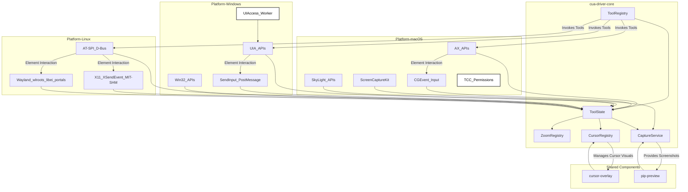

<!-- source: DeepWiki mcp.deepwiki.com · repo trycua/cua · page 6.3 Platform Backends and Input Delivery · fetched 2026-10-29 -->

# Platform Backends and Input Delivery

Relevant source files

The following files were used as context for generating this wiki page:

- [.github/scripts/tests/test_ci_rust_linux_capture.py](.github/scripts/tests/test_ci_rust_linux_capture.py)
- [.github/workflows/ci-rust-linux.yml](.github/workflows/ci-rust-linux.yml)
- [.github/workflows/license-check.yml](.github/workflows/license-check.yml)
- [docs/content/docs/cua-driver/reference/mcp-tools/apps-and-windows.mdx](docs/content/docs/cua-driver/reference/mcp-tools/apps-and-windows.mdx)
- [docs/content/docs/cua-driver/reference/mcp-tools/click.mdx](docs/content/docs/cua-driver/reference/mcp-tools/click.mdx)
- [docs/content/docs/cua-driver/reference/mcp-tools/double-and-right-click.mdx](docs/content/docs/cua-driver/reference/mcp-tools/double-and-right-click.mdx)
- [docs/content/docs/cua-driver/reference/mcp-tools/keyboard.mdx](docs/content/docs/cua-driver/reference/mcp-tools/keyboard.mdx)
- [docs/content/docs/cua-driver/reference/mcp-tools/keys-and-shortcuts.mdx](docs/content/docs/cua-driver/reference/mcp-tools/keys-and-shortcuts.mdx)
- [docs/content/docs/cua-driver/reference/mcp-tools/maintenance.mdx](docs/content/docs/cua-driver/reference/mcp-tools/maintenance.mdx)
- [docs/content/docs/cua-driver/reference/mcp-tools/page.mdx](docs/content/docs/cua-driver/reference/mcp-tools/page.mdx)
- [docs/content/docs/cua-driver/reference/mcp-tools/pointer.mdx](docs/content/docs/cua-driver/reference/mcp-tools/pointer.mdx)
- [docs/content/docs/cua-driver/reference/mcp-tools/recording.mdx](docs/content/docs/cua-driver/reference/mcp-tools/recording.mdx)
- [docs/content/docs/cua-driver/reference/mcp-tools/screen.mdx](docs/content/docs/cua-driver/reference/mcp-tools/screen.mdx)
- [docs/content/docs/cua-driver/reference/mcp-tools/values-and-clipboard.mdx](docs/content/docs/cua-driver/reference/mcp-tools/values-and-clipboard.mdx)
- [flake.nix](flake.nix)
- [libs/cua-driver/docs/computer-history-preview.md](libs/cua-driver/docs/computer-history-preview.md)
- [libs/cua-driver/docs/cursor-themes.md](libs/cua-driver/docs/cursor-themes.md)
- [libs/cua-driver/rust/Skills/cua-driver/WORKFLOW.md](libs/cua-driver/rust/Skills/cua-driver/WORKFLOW.md)
- [libs/cua-driver/rust/crates/cua-driver-contract/Cargo.toml](libs/cua-driver/rust/crates/cua-driver-contract/Cargo.toml)
- [libs/cua-driver/rust/crates/cua-driver-core/Cargo.toml](libs/cua-driver/rust/crates/cua-driver-core/Cargo.toml)
- [libs/cua-driver/rust/crates/cua-driver-core/examples/history_hook_bench.rs](libs/cua-driver/rust/crates/cua-driver-core/examples/history_hook_bench.rs)
- [libs/cua-driver/rust/crates/cua-driver-core/src/capture_runtime.rs](libs/cua-driver/rust/crates/cua-driver-core/src/capture_runtime.rs)
- [libs/cua-driver/rust/crates/cua-driver-core/src/expectation.rs](libs/cua-driver/rust/crates/cua-driver-core/src/expectation.rs)
- [libs/cua-driver/rust/crates/cua-driver-core/src/health_report.rs](libs/cua-driver/rust/crates/cua-driver-core/src/health_report.rs)
- [libs/cua-driver/rust/crates/cua-driver-core/src/history.rs](libs/cua-driver/rust/crates/cua-driver-core/src/history.rs)
- [libs/cua-driver/rust/crates/cua-driver-core/src/lib.rs](libs/cua-driver/rust/crates/cua-driver-core/src/lib.rs)
- [libs/cua-driver/rust/crates/cua-driver-core/src/timestamp.rs](libs/cua-driver/rust/crates/cua-driver-core/src/timestamp.rs)
- [libs/cua-driver/rust/crates/cua-driver-core/src/walk_budget.rs](libs/cua-driver/rust/crates/cua-driver-core/src/walk_budget.rs)
- [libs/cua-driver/rust/crates/cua-driver-e2e/tests/agent_cursor_windows_test.rs](libs/cua-driver/rust/crates/cua-driver-e2e/tests/agent_cursor_windows_test.rs)
- [libs/cua-driver/rust/crates/cua-driver-e2e/tests/computer_history_cross_platform_test.rs](libs/cua-driver/rust/crates/cua-driver-e2e/tests/computer_history_cross_platform_test.rs)
- [libs/cua-driver/rust/crates/cua-driver-e2e/tests/cross_platform_behavior_test.rs](libs/cua-driver/rust/crates/cua-driver-e2e/tests/cross_platform_behavior_test.rs)
- [libs/cua-driver/rust/crates/cua-driver-e2e/tests/desktop_scope_linux_test.rs](libs/cua-driver/rust/crates/cua-driver-e2e/tests/desktop_scope_linux_test.rs)
- [libs/cua-driver/rust/crates/cua-driver-e2e/tests/harness_gtk3_test.rs](libs/cua-driver/rust/crates/cua-driver-e2e/tests/harness_gtk3_test.rs)
- [libs/cua-driver/rust/crates/cua-driver-e2e/tests/harness_libreoffice_test.rs](libs/cua-driver/rust/crates/cua-driver-e2e/tests/harness_libreoffice_test.rs)
- [libs/cua-driver/rust/crates/cua-driver-e2e/tests/harness_swiftui_test.rs](libs/cua-driver/rust/crates/cua-driver-e2e/tests/harness_swiftui_test.rs)
- [libs/cua-driver/rust/crates/cua-driver-e2e/tests/harness_winui3_test.rs](libs/cua-driver/rust/crates/cua-driver-e2e/tests/harness_winui3_test.rs)
- [libs/cua-driver/rust/crates/cua-driver-e2e/tests/harness_wpf_test.rs](libs/cua-driver/rust/crates/cua-driver-e2e/tests/harness_wpf_test.rs)
- [libs/cua-driver/rust/crates/cua-driver-e2e/tests/installed_app_textedit_macos_test.rs](libs/cua-driver/rust/crates/cua-driver-e2e/tests/installed_app_textedit_macos_test.rs)
- [libs/cua-driver/rust/crates/cua-driver-e2e/tests/support/foreground_text_oracle.rs](libs/cua-driver/rust/crates/cua-driver-e2e/tests/support/foreground_text_oracle.rs)
- [libs/cua-driver/rust/crates/cua-driver-sdk/Cargo.toml](libs/cua-driver/rust/crates/cua-driver-sdk/Cargo.toml)
- [libs/cua-driver/rust/crates/cua-driver-sdk/tests/README.md](libs/cua-driver/rust/crates/cua-driver-sdk/tests/README.md)
- [libs/cua-driver/rust/crates/cua-driver-sdk/tests/async_io_embedding.rs](libs/cua-driver/rust/crates/cua-driver-sdk/tests/async_io_embedding.rs)
- [libs/cua-driver/rust/crates/cua-driver-testkit/src/observer.rs](libs/cua-driver/rust/crates/cua-driver-testkit/src/observer.rs)
- [libs/cua-driver/rust/crates/cua-driver-uia/Cargo.toml](libs/cua-driver/rust/crates/cua-driver-uia/Cargo.toml)
- [libs/cua-driver/rust/crates/cua-driver/Cargo.toml](libs/cua-driver/rust/crates/cua-driver/Cargo.toml)
- [libs/cua-driver/rust/crates/cua-driver/build.rs](libs/cua-driver/rust/crates/cua-driver/build.rs)
- [libs/cua-driver/rust/crates/cua-driver/cua-driver.manifest](libs/cua-driver/rust/crates/cua-driver/cua-driver.manifest)
- [libs/cua-driver/rust/crates/cua-driver/cua-driver.rc](libs/cua-driver/rust/crates/cua-driver/cua-driver.rc)
- [libs/cua-driver/rust/crates/cua-driver/src/history_runtime.rs](libs/cua-driver/rust/crates/cua-driver/src/history_runtime.rs)
- [libs/cua-driver/rust/crates/cua-driver/tests/launch_app_standard_user_test.rs](libs/cua-driver/rust/crates/cua-driver/tests/launch_app_standard_user_test.rs)
- [libs/cua-driver/rust/crates/cursor-overlay/Cargo.toml](libs/cua-driver/rust/crates/cursor-overlay/Cargo.toml)
- [libs/cua-driver/rust/crates/cursor-overlay/src/lib.rs](libs/cua-driver/rust/crates/cursor-overlay/src/lib.rs)
- [libs/cua-driver/rust/crates/cursor-overlay/src/render_state.rs](libs/cua-driver/rust/crates/cursor-overlay/src/render_state.rs)
- [libs/cua-driver/rust/crates/pip-preview/Cargo.toml](libs/cua-driver/rust/crates/pip-preview/Cargo.toml)
- [libs/cua-driver/rust/crates/platform-linux/Cargo.toml](libs/cua-driver/rust/crates/platform-linux/Cargo.toml)
- [libs/cua-driver/rust/crates/platform-linux/src/atspi/mod.rs](libs/cua-driver/rust/crates/platform-linux/src/atspi/mod.rs)
- [libs/cua-driver/rust/crates/platform-linux/src/atspi/native.rs](libs/cua-driver/rust/crates/platform-linux/src/atspi/native.rs)
- [libs/cua-driver/rust/crates/platform-linux/src/browser_consent_ui.rs](libs/cua-driver/rust/crates/platform-linux/src/browser_consent_ui.rs)
- [libs/cua-driver/rust/crates/platform-linux/src/browser_setup_ui.rs](libs/cua-driver/rust/crates/platform-linux/src/browser_setup_ui.rs)
- [libs/cua-driver/rust/crates/platform-linux/src/capture.rs](libs/cua-driver/rust/crates/platform-linux/src/capture.rs)
- [libs/cua-driver/rust/crates/platform-linux/src/capture_action_frame.rs](libs/cua-driver/rust/crates/platform-linux/src/capture_action_frame.rs)
- [libs/cua-driver/rust/crates/platform-linux/src/health_report.rs](libs/cua-driver/rust/crates/platform-linux/src/health_report.rs)
- [libs/cua-driver/rust/crates/platform-linux/src/history.rs](libs/cua-driver/rust/crates/platform-linux/src/history.rs)
- [libs/cua-driver/rust/crates/platform-linux/src/input/delivery.rs](libs/cua-driver/rust/crates/platform-linux/src/input/delivery.rs)
- [libs/cua-driver/rust/crates/platform-linux/src/input/mod.rs](libs/cua-driver/rust/crates/platform-linux/src/input/mod.rs)
- [libs/cua-driver/rust/crates/platform-linux/src/input/mpx_owner.rs](libs/cua-driver/rust/crates/platform-linux/src/input/mpx_owner.rs)
- [libs/cua-driver/rust/crates/platform-linux/src/installed_apps.rs](libs/cua-driver/rust/crates/platform-linux/src/installed_apps.rs)
- [libs/cua-driver/rust/crates/platform-linux/src/lib.rs](libs/cua-driver/rust/crates/platform-linux/src/lib.rs)
- [libs/cua-driver/rust/crates/platform-linux/src/overlay.rs](libs/cua-driver/rust/crates/platform-linux/src/overlay.rs)
- [libs/cua-driver/rust/crates/platform-linux/src/proc_fs.rs](libs/cua-driver/rust/crates/platform-linux/src/proc_fs.rs)
- [libs/cua-driver/rust/crates/platform-linux/src/tools/impl_.rs](libs/cua-driver/rust/crates/platform-linux/src/tools/impl_.rs)
- [libs/cua-driver/rust/crates/platform-linux/src/tools/impl_/press_key_tests.rs](libs/cua-driver/rust/crates/platform-linux/src/tools/impl_/press_key_tests.rs)
- [libs/cua-driver/rust/crates/platform-linux/src/wayland/hyprland.rs](libs/cua-driver/rust/crates/platform-linux/src/wayland/hyprland.rs)
- [libs/cua-driver/rust/crates/platform-linux/src/wayland/libei.rs](libs/cua-driver/rust/crates/platform-linux/src/wayland/libei.rs)
- [libs/cua-driver/rust/crates/platform-linux/src/wayland/mod.rs](libs/cua-driver/rust/crates/platform-linux/src/wayland/mod.rs)
- [libs/cua-driver/rust/crates/platform-linux/src/wayland/overlay.rs](libs/cua-driver/rust/crates/platform-linux/src/wayland/overlay.rs)
- [libs/cua-driver/rust/crates/platform-linux/src/wayland/portal.rs](libs/cua-driver/rust/crates/platform-linux/src/wayland/portal.rs)
- [libs/cua-driver/rust/crates/platform-linux/src/wayland/portal_screenshot.rs](libs/cua-driver/rust/crates/platform-linux/src/wayland/portal_screenshot.rs)
- [libs/cua-driver/rust/crates/platform-linux/tests/click_input_x11.rs](libs/cua-driver/rust/crates/platform-linux/tests/click_input_x11.rs)
- [libs/cua-driver/rust/crates/platform-macos/Cargo.toml](libs/cua-driver/rust/crates/platform-macos/Cargo.toml)
- [libs/cua-driver/rust/crates/platform-macos/build.rs](libs/cua-driver/rust/crates/platform-macos/build.rs)
- [libs/cua-driver/rust/crates/platform-macos/src/apps/mod.rs](libs/cua-driver/rust/crates/platform-macos/src/apps/mod.rs)
- [libs/cua-driver/rust/crates/platform-macos/src/apps/nsworkspace.rs](libs/cua-driver/rust/crates/platform-macos/src/apps/nsworkspace.rs)
- [libs/cua-driver/rust/crates/platform-macos/src/ax/bindings.rs](libs/cua-driver/rust/crates/platform-macos/src/ax/bindings.rs)
- [libs/cua-driver/rust/crates/platform-macos/src/ax/launch.rs](libs/cua-driver/rust/crates/platform-macos/src/ax/launch.rs)
- [libs/cua-driver/rust/crates/platform-macos/src/ax/mod.rs](libs/cua-driver/rust/crates/platform-macos/src/ax/mod.rs)
- [libs/cua-driver/rust/crates/platform-macos/src/ax/tree.rs](libs/cua-driver/rust/crates/platform-macos/src/ax/tree.rs)
- [libs/cua-driver/rust/crates/platform-macos/src/browser/consent_ui.rs](libs/cua-driver/rust/crates/platform-macos/src/browser/consent_ui.rs)
- [libs/cua-driver/rust/crates/platform-macos/src/browser/setup_ui.rs](libs/cua-driver/rust/crates/platform-macos/src/browser/setup_ui.rs)
- [libs/cua-driver/rust/crates/platform-macos/src/cursor/overlay.rs](libs/cua-driver/rust/crates/platform-macos/src/cursor/overlay.rs)
- [libs/cua-driver/rust/crates/platform-macos/src/history.rs](libs/cua-driver/rust/crates/platform-macos/src/history.rs)
- [libs/cua-driver/rust/crates/platform-macos/src/input/mouse.rs](libs/cua-driver/rust/crates/platform-macos/src/input/mouse.rs)
- [libs/cua-driver/rust/crates/platform-macos/src/lib.rs](libs/cua-driver/rust/crates/platform-macos/src/lib.rs)
- [libs/cua-driver/rust/crates/platform-macos/src/tools/capture_binding.rs](libs/cua-driver/rust/crates/platform-macos/src/tools/capture_binding.rs)
- [libs/cua-driver/rust/crates/platform-macos/src/tools/click.rs](libs/cua-driver/rust/crates/platform-macos/src/tools/click.rs)
- [libs/cua-driver/rust/crates/platform-macos/src/tools/cursor_tools.rs](libs/cua-driver/rust/crates/platform-macos/src/tools/cursor_tools.rs)
- [libs/cua-driver/rust/crates/platform-macos/src/tools/double_click.rs](libs/cua-driver/rust/crates/platform-macos/src/tools/double_click.rs)
- [libs/cua-driver/rust/crates/platform-macos/src/tools/drag.rs](libs/cua-driver/rust/crates/platform-macos/src/tools/drag.rs)
- [libs/cua-driver/rust/crates/platform-macos/src/tools/get_desktop_state.rs](libs/cua-driver/rust/crates/platform-macos/src/tools/get_desktop_state.rs)
- [libs/cua-driver/rust/crates/platform-macos/src/tools/get_screen_size.rs](libs/cua-driver/rust/crates/platform-macos/src/tools/get_screen_size.rs)
- [libs/cua-driver/rust/crates/platform-macos/src/tools/get_window_state.rs](libs/cua-driver/rust/crates/platform-macos/src/tools/get_window_state.rs)
- [libs/cua-driver/rust/crates/platform-macos/src/tools/health_report.rs](libs/cua-driver/rust/crates/platform-macos/src/tools/health_report.rs)
- [libs/cua-driver/rust/crates/platform-macos/src/tools/hotkey.rs](libs/cua-driver/rust/crates/platform-macos/src/tools/hotkey.rs)
- [libs/cua-driver/rust/crates/platform-macos/src/tools/launch_app.rs](libs/cua-driver/rust/crates/platform-macos/src/tools/launch_app.rs)
- [libs/cua-driver/rust/crates/platform-macos/src/tools/list_apps.rs](libs/cua-driver/rust/crates/platform-macos/src/tools/list_apps.rs)
- [libs/cua-driver/rust/crates/platform-macos/src/tools/list_windows.rs](libs/cua-driver/rust/crates/platform-macos/src/tools/list_windows.rs)
- [libs/cua-driver/rust/crates/platform-macos/src/tools/mod.rs](libs/cua-driver/rust/crates/platform-macos/src/tools/mod.rs)
- [libs/cua-driver/rust/crates/platform-macos/src/tools/press_key.rs](libs/cua-driver/rust/crates/platform-macos/src/tools/press_key.rs)
- [libs/cua-driver/rust/crates/platform-macos/src/tools/right_click.rs](libs/cua-driver/rust/crates/platform-macos/src/tools/right_click.rs)
- [libs/cua-driver/rust/crates/platform-macos/src/tools/scroll.rs](libs/cua-driver/rust/crates/platform-macos/src/tools/scroll.rs)
- [libs/cua-driver/rust/crates/platform-macos/src/tools/set_value.rs](libs/cua-driver/rust/crates/platform-macos/src/tools/set_value.rs)
- [libs/cua-driver/rust/crates/platform-macos/src/tools/type_text.rs](libs/cua-driver/rust/crates/platform-macos/src/tools/type_text.rs)
- [libs/cua-driver/rust/crates/platform-macos/src/tools/type_text_chars.rs](libs/cua-driver/rust/crates/platform-macos/src/tools/type_text_chars.rs)
- [libs/cua-driver/rust/crates/platform-macos/src/windows.rs](libs/cua-driver/rust/crates/platform-macos/src/windows.rs)
- [libs/cua-driver/rust/crates/platform-windows/Cargo.toml](libs/cua-driver/rust/crates/platform-windows/Cargo.toml)
- [libs/cua-driver/rust/crates/platform-windows/examples/get_screen_size_parity.rs](libs/cua-driver/rust/crates/platform-windows/examples/get_screen_size_parity.rs)
- [libs/cua-driver/rust/crates/platform-windows/src/browser_consent_ui.rs](libs/cua-driver/rust/crates/platform-windows/src/browser_consent_ui.rs)
- [libs/cua-driver/rust/crates/platform-windows/src/browser_installation_path.rs](libs/cua-driver/rust/crates/platform-windows/src/browser_installation_path.rs)
- [libs/cua-driver/rust/crates/platform-windows/src/browser_setup_ui.rs](libs/cua-driver/rust/crates/platform-windows/src/browser_setup_ui.rs)
- [libs/cua-driver/rust/crates/platform-windows/src/browser_standard_user.rs](libs/cua-driver/rust/crates/platform-windows/src/browser_standard_user.rs)
- [libs/cua-driver/rust/crates/platform-windows/src/capture.rs](libs/cua-driver/rust/crates/platform-windows/src/capture.rs)
- [libs/cua-driver/rust/crates/platform-windows/src/capture_admission.rs](libs/cua-driver/rust/crates/platform-windows/src/capture_admission.rs)
- [libs/cua-driver/rust/crates/platform-windows/src/clipboard.rs](libs/cua-driver/rust/crates/platform-windows/src/clipboard.rs)
- [libs/cua-driver/rust/crates/platform-windows/src/health_report.rs](libs/cua-driver/rust/crates/platform-windows/src/health_report.rs)
- [libs/cua-driver/rust/crates/platform-windows/src/history.rs](libs/cua-driver/rust/crates/platform-windows/src/history.rs)
- [libs/cua-driver/rust/crates/platform-windows/src/input/delivery.rs](libs/cua-driver/rust/crates/platform-windows/src/input/delivery.rs)
- [libs/cua-driver/rust/crates/platform-windows/src/input/inject.rs](libs/cua-driver/rust/crates/platform-windows/src/input/inject.rs)
- [libs/cua-driver/rust/crates/platform-windows/src/input/keyboard.rs](libs/cua-driver/rust/crates/platform-windows/src/input/keyboard.rs)
- [libs/cua-driver/rust/crates/platform-windows/src/input/mod.rs](libs/cua-driver/rust/crates/platform-windows/src/input/mod.rs)
- [libs/cua-driver/rust/crates/platform-windows/src/input/mouse.rs](libs/cua-driver/rust/crates/platform-windows/src/input/mouse.rs)
- [libs/cua-driver/rust/crates/platform-windows/src/lib.rs](libs/cua-driver/rust/crates/platform-windows/src/lib.rs)
- [libs/cua-driver/rust/crates/platform-windows/src/lparam.rs](libs/cua-driver/rust/crates/platform-windows/src/lparam.rs)
- [libs/cua-driver/rust/crates/platform-windows/src/msaa.rs](libs/cua-driver/rust/crates/platform-windows/src/msaa.rs)
- [libs/cua-driver/rust/crates/platform-windows/src/overlay.rs](libs/cua-driver/rust/crates/platform-windows/src/overlay.rs)
- [libs/cua-driver/rust/crates/platform-windows/src/standard_user_launch.rs](libs/cua-driver/rust/crates/platform-windows/src/standard_user_launch.rs)
- [libs/cua-driver/rust/crates/platform-windows/src/terminal.rs](libs/cua-driver/rust/crates/platform-windows/src/terminal.rs)
- [libs/cua-driver/rust/crates/platform-windows/src/tools/impl_.rs](libs/cua-driver/rust/crates/platform-windows/src/tools/impl_.rs)
- [libs/cua-driver/rust/crates/platform-windows/src/uia/mod.rs](libs/cua-driver/rust/crates/platform-windows/src/uia/mod.rs)
- [libs/cua-driver/rust/crates/platform-windows/src/virtualdesk.rs](libs/cua-driver/rust/crates/platform-windows/src/virtualdesk.rs)
- [libs/cua-driver/rust/crates/platform-windows/src/wgc.rs](libs/cua-driver/rust/crates/platform-windows/src/wgc.rs)
- [libs/cua-driver/rust/crates/platform-windows/src/win32/mod.rs](libs/cua-driver/rust/crates/platform-windows/src/win32/mod.rs)
- [libs/cua-driver/rust/crates/platform-windows/src/win32/windows.rs](libs/cua-driver/rust/crates/platform-windows/src/win32/windows.rs)
- [libs/cua-driver/tests/fixtures/apps/linux/gtk3/main.py](libs/cua-driver/tests/fixtures/apps/linux/gtk3/main.py)
- [libs/cua-driver/tests/fixtures/apps/windows/winui3/MainWindow.xaml](libs/cua-driver/tests/fixtures/apps/windows/winui3/MainWindow.xaml)
- [libs/cua-driver/tests/fixtures/apps/windows/winui3/MainWindow.xaml.cs](libs/cua-driver/tests/fixtures/apps/windows/winui3/MainWindow.xaml.cs)
- [libs/cua-driver/tests/fixtures/apps/windows/wpf/MainWindow.xaml](libs/cua-driver/tests/fixtures/apps/windows/wpf/MainWindow.xaml)
- [libs/cua-driver/tests/fixtures/apps/windows/wpf/MainWindow.xaml.cs](libs/cua-driver/tests/fixtures/apps/windows/wpf/MainWindow.xaml.cs)
- [nix/cua-driver/package.nix](nix/cua-driver/package.nix)

This page details the platform-specific implementations within `cua-driver-rs` for macOS, Windows, and Linux. It covers how `cua-driver` interacts with each operating system's native APIs for accessibility, input synthesis, screen capture, and window management, while adhering to the "no-foreground" contract for background computer-use. It also explains the mechanisms for cursor overlays, Picture-in-Picture (PiP) previews, and different input delivery modes.

## Platform-Specific Implementations

### macOS: AX/SkyLight/ScreenCaptureKit

On macOS, `cua-driver` leverages Apple's native frameworks for robust and secure interaction.

*   **Accessibility (AX) Tree:** The driver uses the Accessibility API (`AXUIElementRef`) to inspect and interact with UI elements. This allows for precise targeting of elements by their `element_index` and `window_id`, enabling actions on backgrounded, minimized, or hidden windows [libs/cua-driver/rust/crates/platform-macos/src/tools/click.rs:12-14](). The `ElementCache` stores these elements for efficient lookup [libs/cua-driver/rust/crates/platform-macos/src/ax/tree.rs]().
*   **Input Synthesis:**
    *   **AX Action Path:** For elements that expose accessibility actions, `AXUIElementPerformAction` is used to trigger actions like clicks, which are delivered via the AX RPC and do not require the target app to be frontmost [libs/cua-driver/rust/crates/platform-macos/src/tools/click.rs:29-30]().
    *   **Pixel Path:** For custom-drawn surfaces or elements not in the AX tree, `CGEvent` mouse clicks are synthesized and posted to the target process ID (PID) [libs/cua-driver/rust/crates/platform-macos/src/tools/click.rs:15-16]().
    *   **Keyboard Input:** `CGEvent`s are also used for keyboard input, with `kCGEventSourceStateCombinedSessionState` ensuring events are delivered to the correct session [libs/cua-driver/rust/crates/platform-macos/src/input/mouse.rs]() (keyboard input is handled by `press_key` and `type_text` tools, which internally use `CGEvent`s or AX attribute setting).
*   **Screen Capture (ScreenCaptureKit/CGWindow):** Screen capture is handled by `cua_driver_core::capture_runtime::CaptureService` which abstracts over `ScreenCaptureKit` (for modern macOS) and `CGWindow` APIs. The `get_window_state` tool uses this service to capture screenshots, with a configurable `capture_mode` (e.g., "ax" for accessibility-based capture, "vision" for pixel-based) [libs/cua-driver/rust/crates/platform-macos/src/tools/get_window_state.rs]().
*   **Window Management (SkyLight):** `SkyLight` APIs are used for window manipulation, such as bringing windows to the front or setting their frames [libs/cua-driver/rust/crates/platform-macos/src/windows.rs]() (specifically, `crate::windows::bring_to_front` and `crate::windows::set_window_frame` use SkyLight).
*   **TCC Permissions:** The driver includes mechanisms to report and request necessary permissions like Accessibility and Screen Recording, often involving a re-launch via `launchservicesd` [libs/cua-driver/rust/crates/platform-macos/src/tools/check_permissions.rs]().
*   **Delivery Modes:** macOS supports `Background` (default) and `Foreground` delivery modes. `Foreground` mode briefly brings the target window to the front, performs the action, and then restores the previous frontmost application, serving as a last resort for agents [libs/cua-driver/rust/crates/platform-macos/src/tools/mod.rs:161-177]().

Sources:
- [libs/cua-driver/rust/crates/platform-macos/src/tools/click.rs:12-14]()
- [libs/cua-driver/rust/crates/platform-macos/src/ax/tree.rs]()
- [libs/cua-driver/rust/crates/platform-macos/src/tools/click.rs:29-30]()
- [libs/cua-driver/rust/crates/platform-macos/src/tools/click.rs:15-16]()
- [libs/cua-driver/rust/crates/platform-macos/src/input/mouse.rs]()
- [libs/cua-driver/rust/crates/platform-macos/src/tools/get_window_state.rs]()
- [libs/cua-driver/rust/crates/platform-macos/src/windows.rs]()
- [libs/cua-driver/rust/crates/platform-macos/src/tools/check_permissions.rs]()
- [libs/cua-driver/rust/crates/platform-macos/src/tools/mod.rs:161-177]()

### Windows: UIA/Win32 and UIAccess Worker

On Windows, `cua-driver` integrates with the UI Automation (UIA) framework and classic Win32 APIs.

*   **UI Automation (UIA):** UIA is the primary mechanism for inspecting and interacting with UI elements. The driver uses UIA to walk the accessibility tree and retrieve element properties and actions [libs/cua-driver/rust/crates/platform-windows/src/uia/mod.rs]().
*   **Win32 APIs:** For lower-level interactions, Win32 APIs are used.
    *   **Input Injection:** Mouse and keyboard events are injected using `SendInput` or `PostMessage` (e.g., `WM_LBUTTONDOWN`, `WM_KEYDOWN`) to achieve background input without stealing focus [libs/cua-driver/rust/crates/platform-windows/src/input/mouse.rs](), [libs/cua-driver/rust/crates/platform-windows/src/input/keyboard.rs]().
    *   **Window Management:** Win32 functions are used for tasks like getting window information, setting window states, and managing window focus.
*   **UIAccess Worker:** To interact with elevated applications (running with administrator privileges) without requiring `cua-driver` itself to run as administrator, a separate worker process (`cua-driver-uia.exe`) is launched with `uiAccess=true` in its manifest. This worker handles UIA interactions for elevated applications, bypassing User Interface Privilege Isolation (UIPI).
*   **Scroll-into-View:** The `resolve_onscreen_point_with_scroll` function attempts to scroll an element into view using UIA's `ScrollItemPattern::ScrollIntoView` if its cached center is off-screen. This ensures that input actions land on the intended target even if it's partially obscured by a scrollable region [libs/cua-driver/rust/crates/platform-windows/src/tools/impl_.rs:38-133]().
*   **Minimized Window Refusal:** The driver explicitly refuses input to minimized windows, as their coordinates are typically off-screen sentinels, preventing misfires [libs/cua-driver/rust/crates/platform-windows/src/tools/impl_.rs:135-150]().

Sources:
- [libs/cua-driver/rust/crates/platform-windows/src/uia/mod.rs]()
- [libs/cua-driver/rust/crates/platform-windows/src/input/mouse.rs]()
- [libs/cua-driver/rust/crates/platform-windows/src/input/keyboard.rs]()
- [libs/cua-driver/rust/crates/platform-windows/src/tools/impl_.rs:38-133]()
- [libs/cua-driver/rust/crates/platform-windows/src/tools/impl_.rs:135-150]()

### Linux: AT-SPI/X11/Wayland

The Linux backend provides support for both traditional X11 and modern Wayland environments.

*   **AT-SPI (Accessibility Toolkit Service Provider Interface):**
    *   **Native D-Bus Access:** `cua-driver` uses a pure-Rust implementation to access AT-SPI over D-Bus via the `atspi` crate (which uses `zbus`). This eliminates the need for Python or `pyatspi` dependencies at runtime [libs/cua-driver/rust/crates/platform-linux/src/atspi/native.rs:1-7]().
    *   **Element Cache:** An `ElementCache` stores AT-SPI elements, indexed by their position in a depth-first traversal of the application's window tree [libs/cua-driver/rust/crates/platform-linux/src/atspi/mod.rs]() (specifically, the `Snapshots` struct in `atspi/mod.rs` manages the element cache).
    *   **Bounded Operations:** All AT-SPI operations are bounded by timeouts (`CALL_TIMEOUT`, `OP_TIMEOUT`) to prevent unresponsive applications from hanging the driver [libs/cua-driver/rust/crates/platform-linux/src/atspi/native.rs:28-71]().
*   **X11:**
    *   **Background Input:** `XSendEvent` is used for injecting synthetic mouse and keyboard events directly to target windows without changing input focus, adhering to the "no focus steal" contract [libs/cua-driver/rust/crates/platform-linux/src/input/mod.rs:1-5]().
    *   **Window Enumeration and Capture:** X11 APIs are used for listing windows (`x11rb`) and screen capture (MIT-SHM extension for efficiency) [libs/cua-driver/rust/crates/platform-linux/Cargo.toml:29-33]() (these are dependencies for `platform-linux`).
*   **Wayland:**
    *   **Experimental Backend:** Wayland support is experimental and enabled via the `CUA_DRIVER_RS_ENABLE_WAYLAND` environment variable [libs/cua-driver/rust/crates/platform-linux/src/wayland/mod.rs:99-121]().
    *   **Toplevel Enumeration:** Uses `zwlr_foreign_toplevel_manager_v1` or `ext_foreign_toplevel_list_v1` for listing windows [libs/cua-driver/rust/crates/platform-linux/src/wayland/mod.rs:40-44]().
    *   **Input:**
        *   **`zwlr_virtual_pointer_v1`:** For basic virtual pointer input on wlroots-based compositors [libs/cua-driver/rust/crates/platform-linux/src/wayland/mod.rs:64-66]().
        *   **`libei` (Emulated Input):** When the `portal-input` feature is enabled, `cua-driver` can use `libei` via `xdg-desktop-portal` for more robust input injection on GNOME/KDE. This involves `ashpd` for `RemoteDesktop` and `reis` for `libei` bindings [libs/cua-driver/rust/crates/platform-linux/Cargo.toml:121-135]().
    *   **Screen Capture:**
        *   **`zwlr_screencopy_manager_v1`:** For native per-output screenshots [libs/cua-driver/rust/crates/platform-linux/src/wayland/mod.rs:59-61]().
        *   **`xdg-desktop-portal`:** The `portal-capture` feature enables PipeWire-backed per-window ScreenCast capture via `org.freedesktop.portal.ScreenCast` [libs/cua-driver/rust/crates/platform-linux/Cargo.toml:136-137]().
    *   **Hyprland Plugin:** An optional experimental Hyprland plugin (`hyprland_input`) is available for isolated input, potentially using a custom `cua-input-v3` protocol [libs/cua-driver/rust/crates/platform-linux/src/wayland/hyprland_input.rs]().

Sources:
- [libs/cua-driver/rust/crates/platform-linux/src/atspi/native.rs:1-7]()
- [libs/cua-driver/rust/crates/platform-linux/src/atspi/mod.rs]()
- [libs/cua-driver/rust/crates/platform-linux/src/atspi/native.rs:28-71]()
- [libs/cua-driver/rust/crates/platform-linux/src/input/mod.rs:1-5]()
- [libs/cua-driver/rust/crates/platform-linux/Cargo.toml:29-33]()
- [libs/cua-driver/rust/crates/platform-linux/src/wayland/mod.rs:99-121]()
- [libs/cua-driver/rust/crates/platform-linux/src/wayland/mod.rs:40-44]()
- [libs/cua-driver/rust/crates/platform-linux/src/wayland/mod.rs:64-66]()
- [libs/cua-driver/rust/crates/platform-linux/Cargo.toml:121-135]()
- [libs/cua-driver/rust/crates/platform-linux/src/wayland/mod.rs:59-61]()
- [libs/cua-driver/rust/crates/platform-linux/Cargo.toml:136-137]()
- [libs/cua-driver/rust/crates/platform-linux/src/wayland/hyprland_input.rs]()

## Input Synthesis and Delivery Modes

`cua-driver` employs various techniques for input synthesis and offers different delivery modes to balance control and user experience.

### Input Synthesis

*   **Mouse Events:**
    *   **Clicks:** Single, double, and right clicks are supported, often with delays to simulate human interaction and allow UI elements to settle [libs/cua-driver/rust/crates/platform-macos/src/tools/click.rs](), [libs/cua-driver/rust/crates/platform-macos/src/tools/double_click.rs](), [libs/cua-driver/rust/crates/platform-macos/src/tools/right_click.rs]().
    *   **Movement:** Cursor movement is synthesized, often with interpolation for smooth transitions [libs/cua-driver/rust/crates/platform-macos/src/tools/move_cursor.rs]().
    *   **Drags:** Complex drag paths can be specified, with arc-length interpolation for smooth continuous drags [libs/cua-driver/rust/crates/platform-linux/src/input/mod.rs:40-117]().
    *   **Scrolling:** Scroll events are synthesized, often targeting specific elements or windows [libs/cua-driver/rust/crates/platform-macos/src/tools/scroll.rs]().
*   **Keyboard Events:**
    *   **Key Presses:** Individual key presses and releases are synthesized, supporting modifiers (Shift, Ctrl, Alt/Option, Cmd/Win) [libs/cua-driver/rust/crates/platform-macos/src/tools/press_key.rs]().
    *   **Text Typing:** Text input is synthesized character by character or as a block, often with delays to mimic human typing speed [libs/cua-driver/rust/crates/platform-macos/src/tools/type_text.rs](), [libs/cua-driver/rust/crates/platform-macos/src/tools/type_text_chars.rs]().
    *   **Hotkeys:** Combinations of keys can be pressed as hotkeys [libs/cua-driver/rust/crates/platform-macos/src/tools/hotkey.rs]().

Sources:
- [libs/cua-driver/rust/crates/platform-macos/src/tools/click.rs]()
- [libs/cua-driver/rust/crates/platform-macos/src/tools/double_click.rs]()
- [libs/cua-driver/rust/crates/platform-macos/src/tools/right_click.rs]()
- [libs/cua-driver/rust/crates/platform-macos/src/tools/move_cursor.rs]()
- [libs/cua-driver/rust/crates/platform-linux/src/input/mod.rs:40-117]()
- [libs/cua-driver/rust/crates/platform-macos/src/tools/scroll.rs]()
- [libs/cua-driver/rust/crates/platform-macos/src/tools/press_key.rs]()
- [libs/cua-driver/rust/crates/platform-macos/src/tools/type_text.rs]()
- [libs/cua-driver/rust/crates/platform-macos/src/tools/type_text_chars.rs]()
- [libs/cua-driver/rust/crates/platform-macos/src/tools/hotkey.rs]()

### Delivery Modes

The `delivery_mode` parameter allows agents to specify how input should be delivered, balancing background operation with the need for foreground interaction in certain scenarios.

*   **`Background` (Default):** Input is posted to the target application without bringing it to the foreground or stealing focus. This is the preferred mode for maintaining a seamless user experience.
*   **`Foreground`:** The target window is briefly brought to the front, the action is performed, and then the previously active window is restored. This mode is a last resort for actions that strictly require foreground focus (e.g., some native dialogs or applications that ignore background input). The `pixel_activation_policy` on macOS determines how foregrounding is handled for pixel-based clicks [libs/cua-driver/rust/crates/platform-macos/src/tools/click.rs:51-60]().

Sources:
- [libs/cua-driver/rust/crates/platform-macos/src/tools/mod.rs:161-177]()
- [libs/cua-driver/rust/crates/platform-macos/src/tools/click.rs:51-60]()

### Cursor Overlays

`cua-driver` provides visual feedback for agent actions through a customizable cursor overlay.

*   **Cross-Platform Rendering:** The core animation state and rendering pipeline for the cursor overlay are shared across platforms in the `cursor-overlay` crate, using `tiny-skia` for drawing [libs/cua-driver/rust/crates/cursor-overlay/src/render_state.rs]() (which is a dependency of `cursor-overlay`).
*   **Platform-Specific Windowing:**
    *   **macOS:** Uses a transparent, click-through `NSWindow` that covers the display. Rendering happens on a background GCD thread, with updates dispatched to the main queue [libs/cua-driver/rust/crates/platform-macos/src/cursor/overlay.rs:1-16]().
    *   **Windows:** The overlay is pinned above the target `HWND` in the Z-order, normalizing to the root ancestor for UWP apps [libs/cua-driver/rust/crates/platform-windows/src/tools/impl_.rs:5-15]().
    *   **Linux (X11):** An override-redirect X11 window with 32-bit ARGB visual is created, covering the full display. Cursor tiles are rendered and uploaded using `XPutImage` and `XShape` for clipping [libs/cua-driver/rust/crates/platform-linux/src/overlay.rs:1-13]().
    *   **Linux (Wayland):** Wayland overlay support is being developed, with `LayerShell` and `SemanticShellHelper` as potential backends [libs/cua-driver/rust/crates/platform-linux/src/overlay.rs:161-162]() (referencing `WAYLAND_OVERLAY_BACKEND`).
*   **Z-Ordering:** The overlay actively manages its Z-order to stay above normal windows (e.g., `XRaiseWindow` every 80ms on X11) [libs/cua-driver/rust/crates/platform-linux/src/overlay.rs:25-25]().
*   **Arrival Signals:** The overlay system uses `tokio::sync::oneshot::Sender` to signal when a cursor animation has arrived at its destination, allowing agents to wait for visual confirmation [libs/cua-driver/rust/crates/platform-macos/src/cursor/overlay.rs:45-70]().

Sources:
- [libs/cua-driver/rust/crates/cursor-overlay/src/render_state.rs]()
- [libs/cua-driver/rust/crates/platform-macos/src/cursor/overlay.rs:1-16]()
- [libs/cua-driver/rust/crates/platform-windows/src/tools/impl_.rs:5-15]()
- [libs/cua-driver/rust/crates/platform-linux/src/overlay.rs:1-13]()
- [libs/cua-driver/rust/crates/platform-linux/src/overlay.rs:161-162]()
- [libs/cua-driver/rust/crates/platform-linux/src/overlay.rs:25-25]()
- [libs/cua-driver/rust/crates/platform-macos/src/cursor/overlay.rs:45-70]()

### PiP Preview and Capture

The `pip-preview` crate provides functionality for Picture-in-Picture (PiP) previews and screen capture configuration.

*   **Configuration:** `DriverConfig` allows setting `capture_mode` (e.g., "ax", "vision") and `max_image_dimension` for screenshots [libs/cua-driver/rust/crates/platform-linux/src/tools/impl_.rs:147-150](). This configuration can be loaded from `~/.cua-driver/config.json` [libs/cua-driver/rust/crates/platform-linux/src/tools/impl_.rs:166-180]().
*   **Capture Service:** The `cua_driver_core::capture_runtime::CaptureService` manages the underlying platform-specific capture mechanisms [libs/cua-driver/rust/crates/cua-driver-core/src/lib.rs]() (specifically, `cua_driver_core::capture_runtime` is defined in `cua-driver-core/src/lib.rs`).
*   **Preview Integration:** The `pip-preview` crate is used to manage and display PiP previews, often integrated with the agent's visual feedback loop [libs/cua-driver/rust/crates/pip-preview/src/lib.rs]().

Sources:
- [libs/cua-driver/rust/crates/platform-linux/src/tools/impl_.rs:147-150]()
- [libs/cua-driver/rust/crates/platform-linux/src/tools/impl_.rs:166-180]()
- [libs/cua-driver/rust/crates/cua-driver-core/src/lib.rs]()
- [libs/cua-driver/rust/crates/pip-preview/src/lib.rs]()

### Platform Backend Overview

The following diagram illustrates the high-level architecture of the platform backends and their interaction with core driver components.

**Diagram: Platform Backends and Core Interactions**
Sources:
- [libs/cua-driver/rust/crates/platform-linux/src/tools/impl_.rs:97-104]()
- [libs/cua-driver/rust/crates/platform-linux/src/tools/impl_.rs:121-124]()
- [libs/cua-driver/rust/crates/platform-macos/src/tools/click.rs:12-16]()
- [libs/cua-driver/rust/crates/platform-macos/src/tools/get_window_state.rs]()
- [libs/cua-driver/rust/crates/platform-macos/src/windows.rs]()
- [libs/cua-driver/rust/crates/platform-macos/src/tools/check_permissions.rs]()
- [libs/cua-driver/rust/crates/platform-windows/src/tools/impl_.rs:38-133]()
- [libs/cua-driver/rust/crates/platform-windows/src/input/mouse.rs]()
- [libs/cua-driver/rust/crates/platform-linux/src/atspi/native.rs:1-7]()
- [libs/cua-driver/rust/crates/platform-linux/src/input/mod.rs:1-5]()
- [libs/cua-driver/rust/crates/platform-linux/src/wayland/mod.rs:99-121]()
- [libs/cua-driver/rust/crates/platform-linux/src/overlay.rs:1-13]()
- [libs/cua-driver/rust/crates/cursor-overlay/src/render_state.rs]()
- [libs/cua-driver/rust/crates/pip-preview/src/lib.rs]()

---

