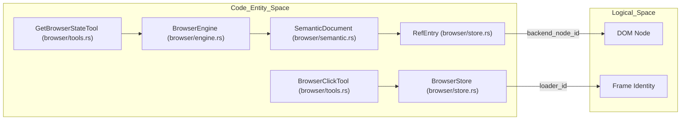

<!-- source: DeepWiki mcp.deepwiki.com · repo trycua/cua · page 6.4 Background Computer-Use and Browser Integration · fetched 2026-10-29 -->

# Background Computer-Use and Browser Integration

<details>
<summary>Relevant source files</summary>

The following files were used as context for generating this wiki page:

- [docs/content/docs/cua-driver/guides/browsers.mdx](docs/content/docs/cua-driver/guides/browsers.mdx)
- [docs/content/docs/cua-driver/guides/use-the-sdk.mdx](docs/content/docs/cua-driver/guides/use-the-sdk.mdx)
- [libs/cua-driver/docs/macos-background-input-v1-plan.md](libs/cua-driver/docs/macos-background-input-v1-plan.md)
- [libs/cua-driver/rust/Skills/cua-driver/BROWSER.md](libs/cua-driver/rust/Skills/cua-driver/BROWSER.md)
- [libs/cua-driver/rust/Skills/cua-driver/EMBEDDING.md](libs/cua-driver/rust/Skills/cua-driver/EMBEDDING.md)
- [libs/cua-driver/rust/crates/cua-driver-core/src/background_input.rs](libs/cua-driver/rust/crates/cua-driver-core/src/background_input.rs)
- [libs/cua-driver/rust/crates/cua-driver-core/src/browser/adapter_support.rs](libs/cua-driver/rust/crates/cua-driver-core/src/browser/adapter_support.rs)
- [libs/cua-driver/rust/crates/cua-driver-core/src/browser/binding.rs](libs/cua-driver/rust/crates/cua-driver-core/src/browser/binding.rs)
- [libs/cua-driver/rust/crates/cua-driver-core/src/browser/cdp_ws.rs](libs/cua-driver/rust/crates/cua-driver-core/src/browser/cdp_ws.rs)
- [libs/cua-driver/rust/crates/cua-driver-core/src/browser/engine.rs](libs/cua-driver/rust/crates/cua-driver-core/src/browser/engine.rs)
- [libs/cua-driver/rust/crates/cua-driver-core/src/browser/mod.rs](libs/cua-driver/rust/crates/cua-driver-core/src/browser/mod.rs)
- [libs/cua-driver/rust/crates/cua-driver-core/src/browser/platform.rs](libs/cua-driver/rust/crates/cua-driver-core/src/browser/platform.rs)
- [libs/cua-driver/rust/crates/cua-driver-core/src/browser/pointer.rs](libs/cua-driver/rust/crates/cua-driver-core/src/browser/pointer.rs)
- [libs/cua-driver/rust/crates/cua-driver-core/src/browser/prepare.rs](libs/cua-driver/rust/crates/cua-driver-core/src/browser/prepare.rs)
- [libs/cua-driver/rust/crates/cua-driver-core/src/browser/refusal.rs](libs/cua-driver/rust/crates/cua-driver-core/src/browser/refusal.rs)
- [libs/cua-driver/rust/crates/cua-driver-core/src/browser/semantic.rs](libs/cua-driver/rust/crates/cua-driver-core/src/browser/semantic.rs)
- [libs/cua-driver/rust/crates/cua-driver-core/src/browser/store.rs](libs/cua-driver/rust/crates/cua-driver-core/src/browser/store.rs)
- [libs/cua-driver/rust/crates/cua-driver-core/src/browser/tools.rs](libs/cua-driver/rust/crates/cua-driver-core/src/browser/tools.rs)
- [libs/cua-driver/rust/crates/cua-driver-core/src/browser/v2_tests.rs](libs/cua-driver/rust/crates/cua-driver-core/src/browser/v2_tests.rs)
- [libs/cua-driver/rust/crates/cua-driver-core/src/cdp.rs](libs/cua-driver/rust/crates/cua-driver-core/src/cdp.rs)
- [libs/cua-driver/rust/crates/cua-driver-core/src/key_pacing.rs](libs/cua-driver/rust/crates/cua-driver-core/src/key_pacing.rs)
- [libs/cua-driver/rust/crates/cua-driver-core/src/page.rs](libs/cua-driver/rust/crates/cua-driver-core/src/page.rs)
- [libs/cua-driver/rust/crates/cua-driver-sdk/src/embedded.rs](libs/cua-driver/rust/crates/cua-driver-sdk/src/embedded.rs)
- [libs/cua-driver/rust/crates/cua-driver/tests/README.md](libs/cua-driver/rust/crates/cua-driver/tests/README.md)
- [libs/cua-driver/rust/crates/platform-linux/src/browser_platform.rs](libs/cua-driver/rust/crates/platform-linux/src/browser_platform.rs)
- [libs/cua-driver/rust/crates/platform-linux/src/tools/page.rs](libs/cua-driver/rust/crates/platform-linux/src/tools/page.rs)
- [libs/cua-driver/rust/crates/platform-macos/src/ax/enablement.rs](libs/cua-driver/rust/crates/platform-macos/src/ax/enablement.rs)
- [libs/cua-driver/rust/crates/platform-macos/src/background_mutation.rs](libs/cua-driver/rust/crates/platform-macos/src/background_mutation.rs)
- [libs/cua-driver/rust/crates/platform-macos/src/browser/browser_js.rs](libs/cua-driver/rust/crates/platform-macos/src/browser/browser_js.rs)
- [libs/cua-driver/rust/crates/platform-macos/src/browser/cdp_client.rs](libs/cua-driver/rust/crates/platform-macos/src/browser/cdp_client.rs)
- [libs/cua-driver/rust/crates/platform-macos/src/browser/platform.rs](libs/cua-driver/rust/crates/platform-macos/src/browser/platform.rs)
- [libs/cua-driver/rust/crates/platform-macos/src/input/keyboard.rs](libs/cua-driver/rust/crates/platform-macos/src/input/keyboard.rs)
- [libs/cua-driver/rust/crates/platform-macos/src/tools/page.rs](libs/cua-driver/rust/crates/platform-macos/src/tools/page.rs)
- [libs/cua-driver/rust/crates/platform-macos/src/window_change_detector.rs](libs/cua-driver/rust/crates/platform-macos/src/window_change_detector.rs)
- [libs/cua-driver/rust/crates/platform-windows/src/browser_platform.rs](libs/cua-driver/rust/crates/platform-windows/src/browser_platform.rs)
- [libs/cua-driver/rust/crates/platform-windows/src/tools/page.rs](libs/cua-driver/rust/crates/platform-windows/src/tools/page.rs)
- [libs/cua-driver/scripts/tests/test_macos_lume_runner.py](libs/cua-driver/scripts/tests/test_macos_lume_runner.py)
- [libs/cua-driver/tests/runners/macos-lume/README.md](libs/cua-driver/tests/runners/macos-lume/README.md)
- [libs/cua-driver/tests/runners/macos-lume/run-all.sh](libs/cua-driver/tests/runners/macos-lume/run-all.sh)
- [libs/cua-driver/tests/runners/macos-lume/seed-tcc-guest.sh](libs/cua-driver/tests/runners/macos-lume/seed-tcc-guest.sh)
- [libs/cua-driver/tests/runners/macos-lume/seed-tcc.sh](libs/cua-driver/tests/runners/macos-lume/seed-tcc.sh)
- [libs/cua/skills/cua-driver/EMBEDDING.md](libs/cua/skills/cua-driver/EMBEDDING.md)
- [scripts/ci/linux/run-rust-e2e-desktop.sh](scripts/ci/linux/run-rust-e2e-desktop.sh)

</details>


The `cua-driver` framework enables "Background Computer-Use," allowing an agent to drive applications, interact with UI elements, and execute browser logic without stealing the user's focus or moving the physical cursor. This is achieved through a multi-layered approach involving Accessibility (AX/UIA) RPCs, targeted event injection, and deep browser integration via the Chrome DevTools Protocol (CDP).

## Background Interaction Model

Background computer-use relies on the principle of interacting with process-specific trees rather than the global screen space. The system prioritizes Accessibility-based interactions and direct browser protocol commands over synthetic global events to maintain stability and prevent "focus stealing."

### Implementation Data Flow

The following diagram illustrates how a request from an agent routes through the `cua-driver` to interact with a background application or browser tab.

**Diagram: Background Action Routing**

```mermaid
graph TD
    subgraph "Agent_Space"
        [Agent] -- "MCP Tool Call" --> CuaDriverServer["CuaDriverServer"]
    end

    subgraph "cua-driver-core"
        CuaDriverServer --> ToolRegistry["ToolRegistry"]
        ToolRegistry -- "browser_*" --> BrowserEngine["BrowserEngine (browser/engine.rs)"]
        ToolRegistry -- "click/type" --> PlatformTool["PlatformTool"]
    end

    subgraph "Browser_Subsystem"
        BrowserEngine --> BrowserStore["BrowserStore (browser/store.rs)"]
        BrowserStore -- "RefEntry" --> CDPClient["CDPClient (cdp_ws.rs)"]
        CDPClient -- "backendNodeId" --> BrowserTab["BrowserTab"]
    end

    subgraph "OS_Layer"
        PlatformTool -- "AXAction/PostMessage" --> Target_Process["Target Process"]
        BrowserTab -- "CDP/Renderer" --> Target_Process
    end
```
Sources: [libs/cua-driver/rust/crates/cua-driver-core/src/browser/tools.rs:31-41](), [libs/cua-driver/rust/crates/cua-driver-core/src/browser/engine.rs:75-86](), [libs/cua-driver/rust/crates/cua-driver-core/src/browser/store.rs:1-20]()

## Focus Management and Suppression

To ensure that background actions do not accidentally displace the user's active window, `cua-driver` employs suppression systems and targeted input routing.

### FocusGuard and Steal Prevention
*   **AXAction Path:** On macOS, using `element_index` performs an `AXAction` via RPC (e.g., `AXUIElementPerformAction`), which never requires the app to be frontmost [libs/cua-driver/rust/crates/platform-macos/src/tools/page.rs:100-109]().
*   **Pixel Activation Policy:** When falling back to raw pixels, the driver uses a `PixelActivationPolicy`. For background clicks, it defaults to `SuppressTarget` to prevent activation [libs/cua-driver/rust/crates/platform-macos/src/tools/page.rs:139-162]().
*   **Cursor Preservation:** Bounded setup flows use `click_at_xy_desktop_preserving_cursor` to warp the hardware cursor, click, and immediately restore the user's prior position [libs/cua-driver/rust/crates/platform-macos/src/input/keyboard.rs:158-163]().
*   **Window Change Detection:** The `WindowChangeDetector` [libs/cua-driver/rust/crates/platform-macos/src/window_change_detector.rs:1-12]() captures the state of visible windows before an action and detects new windows or foreground changes after the action. This allows the driver to report side-effects and arm a wildcard focus-steal suppression entry [libs/cua-driver/rust/crates/platform-macos/src/window_change_detector.rs:15-20]().

### Driver Configuration
The `DriverConfig` allows sessions to persist modes like `capture_scope="window"`, which restricts the agent's view to a specific process, ensuring it does not see or interact with other windows [libs/cua-driver/rust/crates/cua-driver-sdk/src/embedded.rs:100-105]().

Sources: [libs/cua-driver/rust/crates/platform-macos/src/tools/page.rs:100-162](), [libs/cua-driver/rust/crates/platform-macos/src/input/keyboard.rs:158-163](), [libs/cua-driver/rust/crates/cua-driver-sdk/src/embedded.rs:100-105](), [libs/cua-driver/rust/crates/platform-macos/src/window_change_detector.rs:1-12](), [libs/cua-driver/rust/crates/platform-macos/src/window_change_detector.rs:15-20]()

## Browser Integration

`cua-driver` provides deep integration with Chromium-family browsers and Electron via a session-scoped capability store managed by the `BrowserEngine`.

### Capability-Based Addressing
Unlike native windows, browser interaction uses opaque, session-scoped IDs to prevent cross-session leaks:
*   **Target IDs:** Represent a bound browser process [libs/cua-driver/rust/crates/cua-driver-core/src/browser/tools.rs:88-94]().
*   **Tab IDs:** Represent specific browser tabs [libs/cua-driver/rust/crates/cua-driver-core/src/browser/tools.rs:96-101]().
*   **Page Element Refs (`p<snapshot>:<index>`):** Opaque handles to DOM elements. These are invalidated by navigation or by newer snapshots of the same tab to prevent stale interactions [libs/cua-driver/rust/crates/cua-driver-core/src/browser/tools.rs:103-110]().

### Semantic Snapshots
The `SemanticDocument` collector joins Chrome's accessibility tree with pierced DOM metadata and layout evidence. It filters nodes based on `BrowserVisibility` to ensure the agent only interacts with active, visible content [libs/cua-driver/rust/crates/cua-driver-core/src/browser/engine.rs:50-54]().

**Diagram: Browser Integration Entity Mapping**


Sources: [libs/cua-driver/rust/crates/cua-driver-core/src/browser/tools.rs:31-40](), [libs/cua-driver/rust/crates/cua-driver-core/src/browser/engine.rs:1-25](), [libs/cua-driver/rust/crates/cua-driver-core/src/browser/store.rs:55-58]()

## Browser Profile Attachment

Cua Driver supports attaching to existing authenticated profiles through a strategy-based `browser_prepare` flow, which validates the browser executable and profile ownership.

### Preparation Strategies
1.  **Isolated Profile (`isolated_new`/`isolated_named`):** Launches a fresh Chromium instance with a driver-owned directory. This is the preferred secure route [libs/cua-driver/rust/crates/cua-driver-core/src/browser/prepare.rs:31-59]().
2.  **Existing Profile:** Attaches to a running browser. This requires explicit authorization via `--grant existing-profile` or a `bounded` manifest [libs/cua-driver/rust/Skills/cua-driver/BROWSER.md:107-110]().

### Setup Side Effects
If remote debugging is not enabled, the driver may perform a "bounded setup" to enable it without user intervention:
*   **Temporary Navigation:** Opens a temporary `chrome://inspect` or `edge://inspect` tab [libs/cua-driver/rust/Skills/cua-driver/BROWSER.md:171-175]().
*   **Verification:** Proves that the new listener is loopback-only and owned by the approved process before closing the tab [libs/cua-driver/rust/Skills/cua-driver/BROWSER.md:176-178]().
*   **Reporting:** Side effects like `opened_setup_page` or `enabled_remote_debugging` are reported in the tool output [libs/cua-driver/rust/crates/cua-driver-core/src/browser/prepare.rs:132-146]().

Sources: [libs/cua-driver/rust/crates/cua-driver-core/src/browser/prepare.rs:31-146](), [libs/cua-driver/rust/Skills/cua-driver/BROWSER.md:107-178]()

## Input Synthesis

### Background Keyboard (`type_text`)
The driver prioritizes background-safe input methods. For browser tabs, this uses CDP `Input.dispatchKeyEvent`. For native windows on macOS, `type_text` prioritizes `AXSelectedText` attribute writes for atomic insertion without keystrokes [libs/cua-driver/rust/crates/platform-macos/src/tools/page.rs:20-29](). On macOS, `SLEventPostToPid` is used for keyboard events, attaching an `SLSEventAuthenticationMessage` for Chromium-based apps to accept synthetic keystrokes as trusted live input [libs/cua-driver/rust/crates/platform-macos/src/input/keyboard.rs:1-7]().

### Background Mouse (`click`)
The driver uses targeted event delivery:
*   **Browser:** CDP `Input.dispatchMouseEvent` targeting the exact renderer coordinates [libs/cua-driver/rust/crates/cua-driver-core/src/browser/tools.rs:34]().
*   **macOS Native:** `SLEventPostToPid` (SkyLight SPI), which triggers activity monitoring required for Chromium/Catalyst while maintaining background delivery [libs/cua-driver/rust/crates/platform-macos/src/tools/page.rs:100-109]().

| Tool | Background Mechanism | Fallback |
| :--- | :--- | :--- |
| `browser_click` | CDP `Input.dispatchMouseEvent` | N/A (Renderer-level) |
| `click` | `AXUIElementPerformAction` | `SLEventPostToPid` [libs/cua-driver/rust/crates/platform-macos/src/tools/page.rs:100-109]() |
| `type_text` | `AXSelectedText` write | `CGEvent` keystrokes [libs/cua-driver/rust/crates/platform-macos/src/tools/page.rs:20-29]() |

Sources: [libs/cua-driver/rust/crates/cua-driver-core/src/browser/tools.rs:31-40](), [libs/cua-driver/rust/crates/platform-macos/src/tools/page.rs:20-29](), [libs/cua-driver/rust/crates/platform-macos/src/tools/page.rs:100-109](), [libs/cua-driver/rust/crates/platform-macos/src/input/keyboard.rs:1-7]()

---

