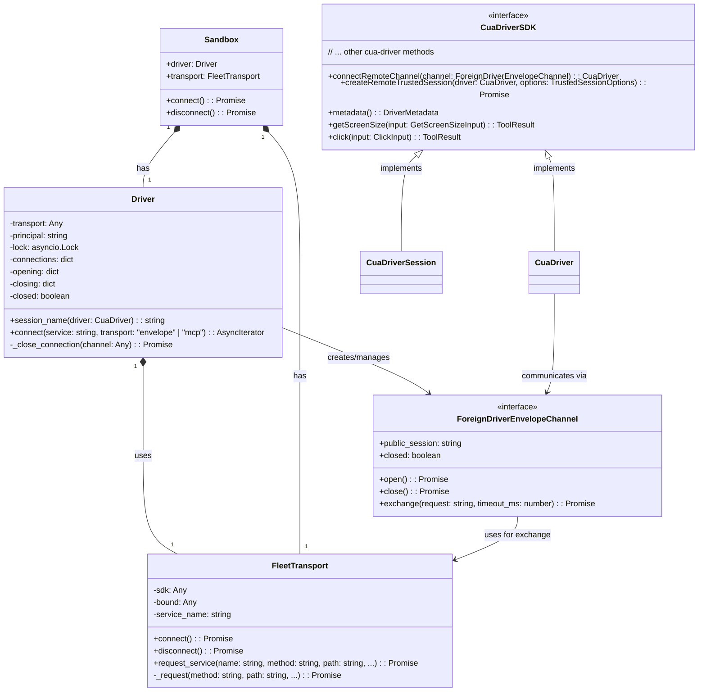

<!-- source: DeepWiki mcp.deepwiki.com · repo trycua/cua · page 6.5 cua-driver SDKs and Language Bindings · fetched 2026-10-29 -->

# cua-driver SDKs and Language Bindings

Relevant source files

The following files were used as context for generating this wiki page:

- [.github/workflows/cd-py-cua-driver.yml](.github/workflows/cd-py-cua-driver.yml)
- [libs/cua-driver/python/README.md](libs/cua-driver/python/README.md)
- [libs/cua-driver/python/build_wheel.py](libs/cua-driver/python/build_wheel.py)
- [libs/cua-driver/python/src/cua_driver/_native.py](libs/cua-driver/python/src/cua_driver/_native.py)
- [libs/cua-driver/python/tests/test_build_wheel.py](libs/cua-driver/python/tests/test_build_wheel.py)
- [libs/cua-driver/python/tests/test_uniffi_loader.py](libs/cua-driver/python/tests/test_uniffi_loader.py)
- [libs/cua-driver/rust/crates/cua-driver-core/src/authorization.rs](libs/cua-driver/rust/crates/cua-driver-core/src/authorization.rs)
- [libs/cua-driver/rust/crates/cua-driver-core/src/session_authorization.rs](libs/cua-driver/rust/crates/cua-driver-core/src/session_authorization.rs)
- [libs/cua-driver/rust/crates/cua-driver-core/src/tool.rs](libs/cua-driver/rust/crates/cua-driver-core/src/tool.rs)
- [libs/cua-driver/rust/crates/cua-driver-sdk/build.rs](libs/cua-driver/rust/crates/cua-driver-sdk/build.rs)
- [libs/cua-driver/rust/crates/cua-driver-sdk/src/abi.rs](libs/cua-driver/rust/crates/cua-driver-sdk/src/abi.rs)
- [libs/cua-driver/rust/crates/cua-driver-sdk/src/lib.rs](libs/cua-driver/rust/crates/cua-driver-sdk/src/lib.rs)
- [libs/cua-driver/rust/crates/cua-driver-sdk/src/runtime.rs](libs/cua-driver/rust/crates/cua-driver-sdk/src/runtime.rs)
- [libs/cua-driver/scripts/build-node-runtime.mjs](libs/cua-driver/scripts/build-node-runtime.mjs)
- [libs/cua-driver/scripts/build-npm-packages.mjs](libs/cua-driver/scripts/build-npm-packages.mjs)
- [libs/cua-driver/scripts/generate-uniffi-bindings.mjs](libs/cua-driver/scripts/generate-uniffi-bindings.mjs)
- [libs/cua-driver/scripts/node-runtime-NOTICE.md](libs/cua-driver/scripts/node-runtime-NOTICE.md)
- [libs/cua-driver/scripts/stage-uniffi-library.mjs](libs/cua-driver/scripts/stage-uniffi-library.mjs)
- [libs/cua-driver/typescript/README.md](libs/cua-driver/typescript/README.md)
- [libs/cua-driver/typescript/src/native/cua_driver_contract-ffi.ts](libs/cua-driver/typescript/src/native/cua_driver_contract-ffi.ts)
- [libs/cua-driver/typescript/src/native/cua_driver_sdk-ffi.ts](libs/cua-driver/typescript/src/native/cua_driver_sdk-ffi.ts)
- [libs/cua-driver/typescript/src/native/cua_driver_sdk.ts](libs/cua-driver/typescript/src/native/cua_driver_sdk.ts)

The `cua-driver` is a Rust-based cross-platform daemon that provides low-level operating system control to Computer-Use Agents (CUAs). To enable agents written in various languages to interact with `cua-driver`, a set of SDKs and language bindings are generated using UniFFI. This page details the Python and TypeScript SDKs, their generation process, packaging, and integration with the `cua-sandbox`.

## UniFFI-Generated SDKs

The `cua-driver` Rust core defines a canonical typed interface for interacting with the operating system. UniFFI (Universal Foreign Function Interface) is used to automatically generate language bindings for this Rust interface, ensuring type safety and consistency across different programming languages. This process creates:
*   A Python package `cua_driver`.
*   A TypeScript package `@trycua/cua-driver`.

These SDKs allow developers to call `cua-driver` functions directly from their Python or TypeScript applications, abstracting away the complexities of inter-process communication and platform-specific FFI.

Sources:
*   [libs/cua-driver/rust/crates/cua-driver-sdk/src/lib.rs:1-4]()
*   [libs/cua-driver/typescript/src/native/cua_driver_sdk.ts:1-16]()
*   [libs/cua-driver/python/src/cua_driver/_native.py:1-3]()

### UniFFI Binding Generation

The UniFFI binding generation process is orchestrated by several scripts:
1.  `generate-uniffi-bindings.mjs`: This script is responsible for invoking the UniFFI toolchain to generate the raw FFI bindings for Python and TypeScript from the Rust `cua-driver-sdk` crate. [libs/cua-driver/scripts/generate-uniffi-bindings.mjs]()
2.  `stage-uniffi-library.mjs`: After generation, this script stages the generated FFI libraries and headers into the respective language binding directories. [libs/cua-driver/scripts/stage-uniffi-library.mjs]()
3.  `build-npm-packages.mjs`: For TypeScript, this script compiles the generated TypeScript files and prepares the `@trycua/cua-driver` package for distribution. [libs/cua-driver/scripts/build-npm-packages.mjs]()

The generated Python bindings reside in `libs/cua-driver/python/src/cua_driver/_native.py` [libs/cua-driver/python/src/cua_driver/_native.py:1-8360](). Similarly, the TypeScript bindings are found in `libs/cua-driver/typescript/src/native/cua_driver_sdk.ts` [libs/cua-driver/typescript/src/native/cua_driver_sdk.ts:1-7986](). These files contain the low-level FFI calls and type definitions that mirror the Rust `cua-driver-sdk` interface.

Sources:
*   [libs/cua-driver/scripts/generate-uniffi-bindings.mjs]()
*   [libs/cua-driver/scripts/stage-uniffi-library.mjs]()
*   [libs/cua-driver/scripts/build-npm-packages.mjs]()
*   [libs/cua-driver/python/src/cua_driver/_native.py:1-8360]()
*   [libs/cua-driver/typescript/src/native/cua_driver_sdk.ts:1-7986]()

## Python `cua_driver` Package

The `cua_driver` Python package provides a high-level interface to the `cua-driver` functionality. It bundles the `cua-driver` binary and its UniFFI-generated Python bindings.

### Wheel Packaging

The `cua_driver` package is distributed as platform-specific Python wheels. The `build_wheel.py` script handles the packaging process:
1.  **Platform Detection**: It identifies the current operating system (macOS, Linux, Windows) and architecture (x86_64, arm64, universal). [libs/cua-driver/python/build_wheel.py:38-75]()
2.  **Binary Download**: It downloads the appropriate `cua-driver-rs` binary and its associated shared library (e.g., `.dylib`, `.so`, `.dll`) from GitHub releases. [libs/cua-driver/python/build_wheel.py:98-118]()
3.  **SHA256 Verification**: The downloaded binaries are verified against checksums published in `checksums.txt` to ensure integrity. [libs/cua-driver/python/build_wheel.py:136-160]()
4.  **Bundling**: The downloaded binaries are placed into `src/cua_driver/bin/` within the package structure. [libs/cua-driver/python/build_wheel.py:7]()
5.  **Wheel Building**: `hatchling` is used to build the Python wheel, which includes the bundled binaries and the UniFFI-generated Python code. [libs/cua-driver/python/build_wheel.py:8]()

The `cd-py-cua-driver.yml` GitHub Actions workflow automates the building and publishing of these wheels for various platforms (macOS, Ubuntu x86_64/arm64, Windows x86_64/arm64). [cd-py-cua-driver.yml:121-144]()

Sources:
*   [libs/cua-driver/python/build_wheel.py:1-368]()
*   [.github/workflows/cd-py-cua-driver.yml:1-385]()
*   [libs/cua-driver/python/src/cua_driver/_native.py:1-8360]()

### Native Loader

The `cua_driver` Python package includes a native loader (`_uniffi_loader.py` and `wrapper.py`) that dynamically loads the appropriate `cua-driver` shared library at runtime. This loader handles platform-specific details and ensures that the Python bindings can correctly interface with the Rust library.

The `cua_driver.wrapper.py` provides a Pythonic wrapper around the raw UniFFI-generated functions, offering a more convenient and idiomatic API for developers.

Sources:
*   [libs/cua-driver/python/tests/test_uniffi_loader.py:1-24]()
*   [libs/cua-driver/python/src/cua_driver/_native.py:1-8360]()

## TypeScript `@trycua/cua-driver` Package

The `@trycua/cua-driver` TypeScript package provides similar functionality for JavaScript/TypeScript environments. It leverages the UniFFI-generated TypeScript bindings.

### Node Runtime Builds

For Node.js environments, the `@trycua/cua-driver` package includes pre-built native modules for various platforms. The `build-node-runtime.mjs` script is responsible for compiling the Rust `cua-driver-sdk` into Node.js-compatible native add-ons. [libs/cua-driver/scripts/build-node-runtime.mjs]()

These native modules are then bundled into the `@trycua/cua-driver` npm package, allowing Node.js applications to directly load and use the `cua-driver` functionality. The `cua_driver_sdk-ffi.ts` file [libs/cua-driver/typescript/src/native/cua_driver_sdk-ffi.ts:1-201]() imports `node-runtime.js` to load the native library.

Sources:
*   [libs/cua-driver/typescript/src/native/cua_driver_sdk.ts:1-16]()
*   [libs/cua-driver/scripts/build-node-runtime.mjs]()
*   [libs/cua-driver/typescript/README.md]()
*   [libs/cua-driver/typescript/src/native/cua_driver_sdk-ffi.ts:1-201]()

## Remote Channel and `cua-sandbox` Integration

The `cua-driver` SDKs support both direct (embedded) and remote connections to the `cua-driver` daemon. The remote channel mechanism is particularly important for `cua-sandbox` integration, where the `cua-driver` might be running in a separate VM or container.

### Remote Channel Mechanism

The `cua-driver-sdk` in Rust defines a `remote` module [libs/cua-driver/rust/crates/cua-driver-sdk/src/remote.rs]() that facilitates communication over a remote channel. This channel typically uses HTTP for request/response exchanges.

The Python SDK's `connect_remote_channel` function [libs/cua-driver/python/src/cua_driver/_native.py:7900-7902]() (generated by UniFFI) allows connecting to a `cua-driver` instance via this remote channel. This function takes a `ForeignDriverEnvelopeChannel` object, which acts as the communication bridge.

### `cua-sandbox` Driver Interface

The `cua-sandbox` Python package provides a `Driver` interface that leverages the `cua_driver` Python SDK to interact with a `cua-driver` instance running within a sandbox.

The `Driver.connect()` method establishes a connection to the `cua-driver` service within the sandbox. It can operate in two transport modes:
*   **`envelope` (default)**: Uses a private HTTP envelope carrier for communication.
*   **`mcp`**: Uses the MCP (Multi-Agent Communication Protocol) service, provided it advertises the typed envelope extension.

The `FleetTransport` in `cua-sandbox` is crucial for this remote communication. It routes `cua-driver` requests through the Cyclops client's `service_request` method, allowing the sandbox to proxy commands to the `cua-driver` running inside the VM.

#### Typed Driver Interface in `cua-sandbox`

The `cua-sandbox`'s `Driver` interface exposes the canonical typed `cua-driver` operations. This means that when an agent calls a method like `driver.get_screen_size()`, the Python SDK translates this into a structured request that is sent over the remote channel to the `cua-driver` daemon. The response is then parsed back into a typed Python object.

The `test_typed_driver_native.py` and `test_driver_mcp_native.py` tests demonstrate this typed interaction, showing how `CuaDriver` objects and `GetScreenSizeInput` are used, and how the `ToolResult` is received.

```mermaid
graph TD
    subgraph "Agent Application (Python/TypeScript)"
        A[Python Code] --> B{cua_driver SDK}
        C[TypeScript Code] --> D{&#64;trycua/cua-driver SDK}
    end

    subgraph "cua-driver SDK (Python)"
        B --> BP["Python Wrapper (cua_driver.wrapper)"]
        BP --> BN["UniFFI-generated Python Bindings (_native.py)"]
        BN --> BL["Native Loader"]
        BL --> BR["Bundled cua-driver Binary"]
    end

    subgraph "cua-driver SDK (TypeScript)"
        D --> TS["TypeScript Wrapper"]
        TS --> TN["UniFFI-generated TypeScript Bindings (cua_driver_sdk.ts)"]
        TN --> TL["Node.js Native Module"]
        TL --> TR["Bundled cua-driver Binary"]
    end

    subgraph "cua-sandbox (Python)"
        S["Sandbox Instance"] --> SI["Driver Interface (cua_sandbox.interfaces.driver)"]
        SI --> SF["FleetTransport (cua_sandbox.transport.fleet)"]
    end

    subgraph "cua-driver Daemon (Rust)"
        RD["cua-driver Daemon"]
    end

    subgraph "UniFFI Generation"
        UG["Rust cua-driver-sdk Crate"] --> |"generate-uniffi-bindings.mjs"| UG_PY["Python FFI"]
        UG --> |"generate-uniffi-bindings.mjs"| UG_TS["TypeScript FFI"]
    end

    UG_PY --> BN
    UG_TS --> TN

    SF --> |"HTTP/MCP"| RD

    style A fill:#f9f,stroke:#333,stroke-width:2px
    style C fill:#f9f,stroke:#333,stroke-width:2px
    style B fill:#ccf,stroke:#333,stroke-width:2px
    style D fill:#ccf,stroke:#333,stroke-width:2px
    style BP fill:#bbf,stroke:#333,stroke-width:2px
    style BN fill:#aae,stroke:#333,stroke-width:2px
    style BL fill:#99d,stroke:#333,stroke-width:2px
    style BR fill:#88c,stroke:#333,stroke-width:2px
    style TS fill:#bbf,stroke:#333,stroke-width:2px
    style TN fill:#aae,stroke:#333,stroke-width:2px
    style TL fill:#99d,stroke:#333,stroke-width:2px
    style TR fill:#88c,stroke:#333,stroke-width:2px
    style S fill:#cfc,stroke:#333,stroke-width:2px
    style SI fill:#bfb,stroke:#333,stroke-width:2px
    style SF fill:#afa,stroke:#333,stroke-width:2px
    style RD fill:#fcc,stroke:#333,stroke-width:2px
    style UG fill:#eee,stroke:#333,stroke-width:2px
    style UG_PY fill:#ddd,stroke:#333,stroke-width:2px
    style UG_TS fill:#ddd,stroke:#333,stroke-width:2px
```

**Diagram: cua-driver SDK Architecture and Data Flow**

Sources:
*   [libs/cua-driver/rust/crates/cua-driver-sdk/src/remote.rs]()
*   [libs/cua-driver/python/src/cua_driver/_native.py:7900-7902]()
*   [libs/cua-driver/typescript/src/native/cua_driver_sdk.ts:28-39]()
*   [libs/cua-driver/typescript/src/native/cua_driver_sdk.ts:44-73]()

### `DriverConnectionError` and `cua_driver` Dependency

The `cua-sandbox` package explicitly treats `cua_driver` as an optional dependency. If `cua_driver` is not installed or does not provide the necessary `connect_remote_channel` function, a `DriverConnectionError` is raised. This ensures that users are aware of the dependency and can install it if they intend to use the typed `cua-driver` interface.

The `pyproject.toml` for `cua-sandbox` confirms that `cua-driver` is an optional dependency, specified with an exact version.

Sources:
*   [libs/cua-driver/python/tests/test_uniffi_loader.py:28-36]()

## Typed Driver Interface in `cua-sandbox`

The `cua-sandbox` package provides a `Driver` class that acts as an accessor for optional typed `cua-driver` sessions. This class does not replace the core `Sandbox` transport but rather provides a dedicated, type-safe way to interact with the `cua-driver` daemon.

Key aspects of the `Driver` interface:
*   **Session Management**: Each connection established via `Driver.connect()` represents a host-bound session with the `cua-driver`. The `session_name()` method allows retrieving the public session label for use in `cua-driver` inputs.
*   **Permission Modes**: The `cua-driver` operates with launcher-selected permission modes (e.g., `STANDARD`, `BOUNDED`). Remote clients cannot directly select the authority mode. The `PermissionMode` enum [libs/cua-driver/rust/crates/cua-driver-core/src/authorization.rs:50-58]() and `SessionModeCeiling` [libs/cua-driver/rust/crates/cua-driver-core/src/session_authorization.rs]() are central to this.
*   **Best-Effort Cleanup**: Remote session cleanup is handled with a bounded timeout, ensuring that failures do not block sandbox claim release.
*   **Error Handling**: `DriverConnectionError` is used to sanitize failures related to establishing or using the `cua-driver` service.

**Diagram: `cua-sandbox` Driver Interface and Dependencies**

Sources:
*   [libs/cua-driver/rust/crates/cua-driver-core/src/authorization.rs:50-58]()
*   [libs/cua-driver/rust/crates/cua-driver-core/src/session_authorization.rs]()
*   [libs/cua-driver/rust/crates/cua-driver-sdk/src/runtime.rs:58-60]()
*   [libs/cua-driver/rust/crates/cua-driver-sdk/src/runtime.rs:85-99]()
*   [libs/cua-driver/rust/crates/cua-driver-sdk/src/runtime.rs:102-109]()
*   [libs/cua-driver/rust/crates/cua-driver-sdk/src/runtime.rs:111-146]()
*   [libs/cua-driver/rust/crates/cua-driver-sdk/src/runtime.rs:148-155]()

---

