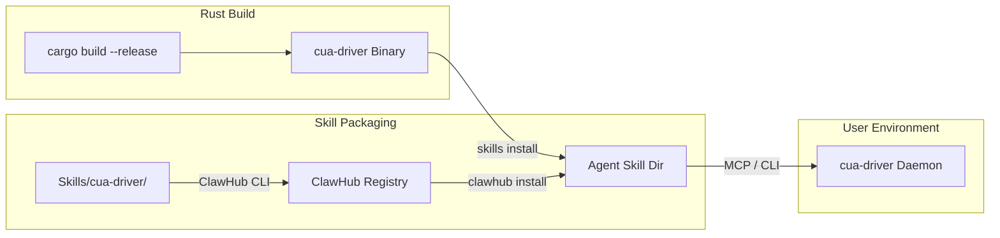
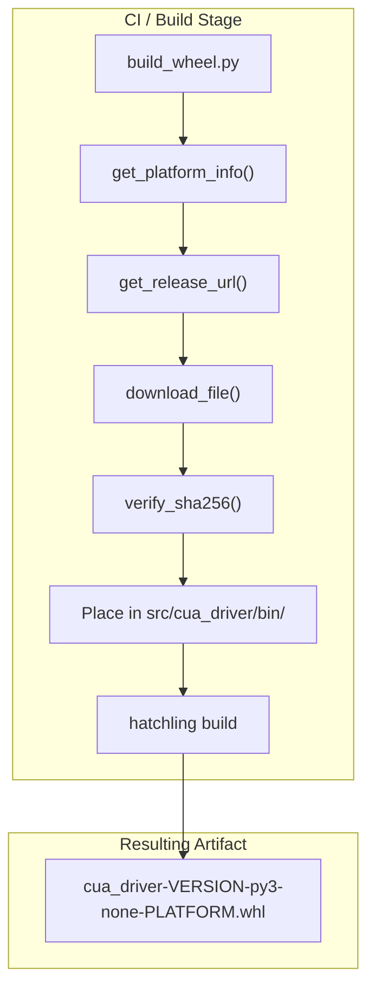

<!-- source: DeepWiki mcp.deepwiki.com · repo trycua/cua · page 6.6 cua-driver Demos and Examples · fetched 2026-10-29 -->

# cua-driver Demos and Examples

<details>
<summary>Relevant source files</summary>

The following files were used as context for generating this wiki page:

- [.github/scripts/tests/test_ci_jev_use_workflow.py](.github/scripts/tests/test_ci_jev_use_workflow.py)
- [.github/workflows/ci-jev-use.yml](.github/workflows/ci-jev-use.yml)
- [libs/cua-driver/examples/jev-use/README.md](libs/cua-driver/examples/jev-use/README.md)
- [libs/cua-driver/examples/jev-use/fixtures/native/native-density-candidates-v1.json](libs/cua-driver/examples/jev-use/fixtures/native/native-density-candidates-v1.json)
- [libs/cua-driver/examples/jev-use/fixtures/native/winui3-window-state-density-12-v1.json](libs/cua-driver/examples/jev-use/fixtures/native/winui3-window-state-density-12-v1.json)
- [libs/cua-driver/examples/jev-use/fixtures/native/winui3-window-state-density-24-v1.json](libs/cua-driver/examples/jev-use/fixtures/native/winui3-window-state-density-24-v1.json)
- [libs/cua-driver/examples/jev-use/fixtures/native/wpf-window-state-density-12-v1.json](libs/cua-driver/examples/jev-use/fixtures/native/wpf-window-state-density-12-v1.json)
- [libs/cua-driver/examples/jev-use/fixtures/native/wpf-window-state-density-24-v1.json](libs/cua-driver/examples/jev-use/fixtures/native/wpf-window-state-density-24-v1.json)
- [libs/cua-driver/examples/jev-use/fixtures/parse-visual-regions-submit-v1.json](libs/cua-driver/examples/jev-use/fixtures/parse-visual-regions-submit-v1.json)
- [libs/cua-driver/examples/jev-use/python/action_policy.py](libs/cua-driver/examples/jev-use/python/action_policy.py)
- [libs/cua-driver/examples/jev-use/python/capture_window_state.py](libs/cua-driver/examples/jev-use/python/capture_window_state.py)
- [libs/cua-driver/examples/jev-use/python/core.py](libs/cua-driver/examples/jev-use/python/core.py)
- [libs/cua-driver/examples/jev-use/python/jev_adapter.py](libs/cua-driver/examples/jev-use/python/jev_adapter.py)
- [libs/cua-driver/examples/jev-use/python/native.py](libs/cua-driver/examples/jev-use/python/native.py)
- [libs/cua-driver/examples/jev-use/python/native_tasks.py](libs/cua-driver/examples/jev-use/python/native_tasks.py)
- [libs/cua-driver/examples/jev-use/python/run.py](libs/cua-driver/examples/jev-use/python/run.py)
- [libs/cua-driver/examples/jev-use/python/run_native.py](libs/cua-driver/examples/jev-use/python/run_native.py)
- [libs/cua-driver/examples/jev-use/python/tests/test_core.py](libs/cua-driver/examples/jev-use/python/tests/test_core.py)
- [libs/cua-driver/examples/jev-use/python/tests/test_decision_state.py](libs/cua-driver/examples/jev-use/python/tests/test_decision_state.py)
- [libs/cua-driver/examples/jev-use/python/tests/test_native_canvas.py](libs/cua-driver/examples/jev-use/python/tests/test_native_canvas.py)
- [libs/cua-driver/examples/jev-use/python/tests/test_native_density.py](libs/cua-driver/examples/jev-use/python/tests/test_native_density.py)
- [libs/cua-driver/examples/jev-use/python/tests/test_native_platforms.py](libs/cua-driver/examples/jev-use/python/tests/test_native_platforms.py)
- [libs/cua-driver/examples/jev-use/python/tests/test_verify_session_isolation.py](libs/cua-driver/examples/jev-use/python/tests/test_verify_session_isolation.py)
- [libs/cua-driver/examples/jev-use/typescript/core.test.ts](libs/cua-driver/examples/jev-use/typescript/core.test.ts)
- [libs/cua-driver/examples/jev-use/typescript/core.ts](libs/cua-driver/examples/jev-use/typescript/core.ts)
- [libs/cua-driver/examples/jev-use/typescript/decision_state.test.ts](libs/cua-driver/examples/jev-use/typescript/decision_state.test.ts)
- [libs/cua-driver/examples/jev-use/typescript/jev_adapter.ts](libs/cua-driver/examples/jev-use/typescript/jev_adapter.ts)
- [libs/cua-driver/examples/jev-use/typescript/native.ts](libs/cua-driver/examples/jev-use/typescript/native.ts)
- [libs/cua-driver/examples/jev-use/typescript/native_canvas.test.ts](libs/cua-driver/examples/jev-use/typescript/native_canvas.test.ts)
- [libs/cua-driver/examples/jev-use/typescript/native_density.test.ts](libs/cua-driver/examples/jev-use/typescript/native_density.test.ts)
- [libs/cua-driver/examples/jev-use/typescript/native_platforms.test.ts](libs/cua-driver/examples/jev-use/typescript/native_platforms.test.ts)
- [libs/cua-driver/examples/jev-use/typescript/native_tasks.ts](libs/cua-driver/examples/jev-use/typescript/native_tasks.ts)
- [libs/cua-driver/examples/jev-use/typescript/run.ts](libs/cua-driver/examples/jev-use/typescript/run.ts)
- [libs/cua-driver/examples/jev-use/typescript/run_native.ts](libs/cua-driver/examples/jev-use/typescript/run_native.ts)
- [libs/cua-driver/examples/jev-use/verify_native.py](libs/cua-driver/examples/jev-use/verify_native.py)
- [libs/cua-driver/examples/jev-use/verify_session_isolation.py](libs/cua-driver/examples/jev-use/verify_session_isolation.py)
- [libs/cua-driver/tests/fixtures/apps/windows/winui3/App.xaml.cs](libs/cua-driver/tests/fixtures/apps/windows/winui3/App.xaml.cs)
- [libs/cua-driver/tests/fixtures/apps/windows/winui3/TaskWindow.cs](libs/cua-driver/tests/fixtures/apps/windows/winui3/TaskWindow.cs)
- [libs/cua-driver/tests/fixtures/apps/windows/wpf/App.xaml.cs](libs/cua-driver/tests/fixtures/apps/windows/wpf/App.xaml.cs)
- [libs/cua-driver/tests/fixtures/apps/windows/wpf/TaskWindow.cs](libs/cua-driver/tests/fixtures/apps/windows/wpf/TaskWindow.cs)
- [rfcs/4268-jev-use-native-candidates.md](rfcs/4268-jev-use-native-candidates.md)

</details>


This page showcases the demonstration applications and distribution mechanisms for `cua-driver`, specifically focusing on multi-cursor capabilities, the Jukebox demo, and the platform-agnostic distribution system for the Rust-based driver binary and its associated agent skills via PyPI.

## Overview of Demo Applications

The `cua-driver` ecosystem includes sophisticated demos designed to prove the efficacy of background computer-use (BCU). Unlike standard automation, these demos highlight the driver's ability to manage multiple concurrent agent sessions on a single desktop without focus theft.

### 1. National Records System (Multi-Cursor Demo)
This demo simulates a high-concurrency environment where four background agent sessions interact with five different UI frameworks simultaneously. It leverages the `RenderMap` architecture which maintains independent cursor states for every active session.

**Key Features:**
*   **Concurrent Sessions:** Four background agents running in parallel, each identified by a unique `CursorKey`.
*   **Visual Isolation:** Each agent is assigned a unique session label that appears in a badge below the pointer [libs/cua-driver/typescript/README.md:79-85]().
*   **Independent Theming:** Cursors can be visually distinguished using different themes or colors, managed by `setAgentCursorTheme` [libs/cua-driver/typescript/README.md:49-55]().

### 2. CUA Jukebox
The Jukebox is a MIDI-driven background computer-use demo. It uses timing-synchronized cursor pools to perform complex UI tasks in rhythm with audio or external triggers.

**Implementation Details:**
*   **Timing Synchronization:** Uses the `glide_duration_ms` override in `MotionConfig` to lock cursor travel times to specific MIDI clock intervals.
*   **Cursor Pools:** Employs multiple cursors managed by the `RenderMap` to simulate "orchestrated" UI interactions.
*   **Physics Overrides:** Fine-tunes `spring` and `dwell_after_click_ms` to match the tempo of the interaction.

Sources: [libs/cua-driver/typescript/README.md:49-55](), [libs/cua-driver/typescript/README.md:79-85]()

---

## Technical Implementation: Multi-Cursor Overlay

The core of these demos is the cross-platform overlay system that allows multiple "Agent Cursors" to exist on screen.

### Data Flow: From Tool Call to Visual Animation

The following diagram illustrates how a tool call like `set_agent_cursor_theme` or a movement command travels through the system to be rendered as an independent cursor.

**Multi-Cursor Command Flow**

```mermaid
graph TD
    subgraph "Agent / MCP Space"
        A["Agent Tool Call (e.g. move_cursor)"] -- "includes session_id" --> B["resolve_cursor_key()"]
    end

    subgraph "cua-driver Core"
        C["OverlayMsg::Cmd"] <-- "Every Frame" --- D["CMD_RX (Receiver)"]
        B --> C
        C --> D
    end

    subgraph "Platform Render Loop (Main Thread)"
        D --> E["apply_msg()"]
        E --> F["RenderMap"]
        F -- "Update Keyed State" --> G["RenderStateCore"]
        G --> H["tiny_skia::Pixmap"]
        H --> I["OS Surface (NSWindow/HWND/X11)"]
    end
```

Sources: [libs/cua-driver/typescript/README.md:79-86]()

---

## Skill Management and Distribution

To facilitate agent onboarding, `cua-driver` includes a skill management system that distributes platform-specific documentation and capabilities to various AI agents.

### Skill Pack Installation
The `cua-driver skills` command manages the lifecycle of agent skill packs. It detects installed agents like Claude Code, Codex, and Hermes, and symlinks versioned documentation into their respective skill directories.

**Supported Agents and Paths:**
*   **Claude Code:** `~/.claude/skills/`
*   **Codex:** `~/.agents/skills/`
*   **Hermes:** `~/.hermes/skills/`
*   **Antigravity:** `~/.gemini/skills/`

### Distribution Pipeline
The skill pack is versioned and published to **ClawHub**. A GitHub Action automates the validation and publishing of the `@cua/driver` skill.

**Skill Distribution Architecture**



---

## Python SDK and PyPI Distribution

The `cua-driver` Rust binary is distributed to Python environments via a wrapper package on PyPI. This allows users to `pip install cua-driver` and get a platform-specific binary and UniFFI-backed SDK.

### Build and Packaging Flow
The `build_wheel.py` script automates the retrieval of pre-compiled Rust binaries from GitHub releases and bundles them into a Python wheel [libs/cua-driver/python/build_wheel.py:2-9]().

**Python Wheel Assembly**



Sources: [libs/cua-driver/python/build_wheel.py:2-9](), [libs/cua-driver/python/build_wheel.py:37-75](), [libs/cua-driver/python/build_wheel.py:98-120](), [libs/cua-driver/python/build_wheel.py:162-188]()

### Key Packaging Metadata
The system ensures that the Python package version matches the underlying Rust binary version to prevent API drift [libs/cua-driver/python/build_wheel.py:27-34]().

| Platform | Wheel Tag | Binary Included |
| :--- | :--- | :--- |
| macOS | `macosx_13_0_universal2` | `cua-driver`, `libcua_driver_sdk.dylib` |
| Linux (x86_64) | `manylinux_2_31_x86_64` | `cua-driver`, `libcua_driver_sdk.so` |
| Windows (x64) | `win_amd64` | `cua-driver.exe`, `cua-driver-uia.exe`, `cua_driver_sdk.dll` |

Sources: [libs/cua-driver/python/build_wheel.py:27-34](), [libs/cua-driver/python/build_wheel.py:78-95](), [libs/cua-driver/python/tests/test_build_wheel.py:26-39](), [.github/workflows/cd-py-cua-driver.yml:107-129]()

---

## `jev-use` Example and Decision Models

The `jev-use` example demonstrates how to integrate `cua-driver` with an agent for bounded, mock, or live execution, focusing on security and verification. This example is rigorously tested in CI workflows to ensure its integrity and credential-free operation. The example supports both browser-based tasks and native desktop applications, leveraging different candidate sources and decision models.

### Workflow Overview
The `jev-use` example is validated through a series of GitHub Actions workflows:
*   `ci-jev-use.yml`: Runs unit tests for Python and TypeScript components, and a mock end-to-end (E2E) test on Linux [libs/cua-driver/examples/jev-use/python/tests/test_authorized_workflow.py:1-44](), [libs/cua-driver/examples/jev-use/python/tests/test_authorized_workflow.py:28-36](), [.github/workflows/ci-jev-use.yml:1-260]().
*   `authorized-live-jev-use.yml`: Performs deterministic mock Jev tests, ensuring no live credentials are used and actions are pinned to specific commits [libs/cua-driver/examples/jev-use/python/tests/test_authorized_workflow.py:1-44](), [.github/workflows/authorized-live-jev-use.yml:1-146]().
*   `authorized-live-jev-use-demo.yml`: A review-gated workflow for the visual demo, with strict security contracts to prevent credential exposure and ensure artifact integrity [libs/cua-driver/tests/perception-demo/README.md:1-115](), [.github/scripts/tests/test_authorized_live_jev_use_demo.py:1-140]().

### `jev-use` Implementation Details

The `jev-use` recipe uses TypeSafe Jev to select the next browser or native application action. `cua-driver` observes the page/window, performs the action, and verifies the result [libs/cua-driver/examples/jev-use/README.md:1-5]().

**Key Components:**
*   **Bounded Loop:** Both Python and TypeScript programs run the same bounded loop [libs/cua-driver/examples/jev-use/README.md:5]().
*   **Candidate Sources:**
    *   `BrowserSemanticSource`: Reads `get_browser_state` snapshots and acts through page references [libs/cua-driver/examples/jev-use/README.md:60-61]().
    *   `VisualRegionSource`: Reads validated `parse_visual_regions` and acts through capture-bound clicks [libs/cua-driver/examples/jev-use/README.md:61-62]().
    *   `NativeAccessibilitySource`: Builds candidates from native accessibility elements returned by `get_window_state` [libs/cua-driver/examples/jev-use/README.md:77-79](), [rfcs/4268-jev-use-native-candidates.md:41-42](). This source maps platform-specific roles (macOS AX, Windows UIA, Linux AT-SPI) to a closed set of role classes (e.g., `button`, `text_input`) [libs/cua-driver/examples/jev-use/README.md:82-85](), [rfcs/4268-jev-use-native-candidates.md:46-48]().
*   **Task Specification:** A `Task` object (e.g., `FixtureFormTask`, `NativeTask`) defines the goal, parameters, step budget, allowed `cua-driver` action kinds, and a success oracle [libs/cua-driver/examples/jev-use/README.md:66-70](), [libs/cua-driver/examples/jev-use/python/native_tasks.py:2-8]().
*   **Observation and Action Cycle:**
    1.  Open a persistent `cua-driver mcp` connection [libs/cua-driver/examples/jev-use/README.md:45]().
    2.  Prepare an isolated Chromium profile (`browser_prepare`) or attach to a native application process (`--pid`) [libs/cua-driver/examples/jev-use/README.md:46](), [libs/cua-driver/examples/jev-use/python/run_native.py:3]().
    3.  Navigate to a fixture or find the target window [libs/cua-driver/examples/jev-use/README.md:47](), [libs/cua-driver/examples/jev-use/python/run_native.py:78-89]().
    4.  Capture a browser snapshot (`get_browser_state`) or window state (`get_window_state`) [libs/cua-driver/examples/jev-use/README.md:48](), [libs/cua-driver/examples/jev-use/python/run_native.py:91-107]().
    5.  Construct immutable candidates, including `reobserve` and `abstain` choices [libs/cua-driver/examples/jev-use/README.md:50-51]().
    6.  Ask the selected provider (mock, live Jev, or S1) for a typed choice [libs/cua-driver/examples/jev-use/README.md:52-53]().
    7.  Perform the action using fresh page references, semantic clicking, or validated visual regions [libs/cua-driver/examples/jev-use/README.md:53-55]().
    8.  Verify the result against an independent oracle (e.g., fixture's `/state` endpoint or app's state file) [libs/cua-driver/examples/jev-use/README.md:56-57](), [libs/cua-driver/examples/jev-use/python/native_tasks.py:123-146]().

**Decision Model Integration:**
The `jev-use` example can operate with different decision models:
*   **Mock Provider:** Used for deterministic testing without credentials or network access [libs/cua-driver/examples/jev-use/README.md:34-35](), [libs/cua-driver/examples/jev-use/python/jev_adapter.py](), [libs/cua-driver/examples/jev-use/typescript/jev_adapter.ts]().
*   **Live TypeSafe Jev Service:** Can be used with an API key for live verification [libs/cua-driver/examples/jev-use/README.md:35-36]().
*   **S1 Service:** Integration with the S1 service for decision making [libs/cua-driver/examples/jev-use/python/s1_service.py]().

**Visual Region Parsing:**
The `parse_visual_regions` function processes the output from `cua.visual_regions_v1` to extract interactive regions. It validates the schema, capture provenance, and coordinate mapping [libs/cua-driver/examples/jev-use/python/core.py:120-161](), [libs/cua-driver/examples/jev-use/typescript/core.ts:156-204]().

**Native Desktop Tasks:**
The `verify_native.py` script is used to test native `jev-use` tasks against harness applications (AppKit, WPF, WinUI3, GTK3) [libs/cua-driver/examples/jev-use/verify_native.py:1-25](). It launches a fresh harness, runs the native runner, and checks the harness's state file for verification [libs/cua-driver/examples/jev-use/verify_native.py:8-11]().
*   **Visual Fallback:** Visual regions from OmniParser are used as a fallback only when the native accessibility tree offers no actionable elements (e.g., `ax_tree_empty`, `no_application_elements`) [libs/cua-driver/examples/jev-use/README.md:102-110](), [libs/cua-driver/examples/jev-use/python/run_native.py:165-170]().

### `jev-use` Data Flow for Native Tasks

**Native `jev-use` Decision Loop**

```mermaid
graph TD
    A[Start Task] --> B{Find Window (pid, title)}
    B --> C[Observe Window (get_window_state)]
    C -- "NativeObservation" --> D{Build Candidates}
    D -- "TaskSources (ax, visual)" --> E[Compose Candidates]
    E -- "Candidate List" --> F{Choose Action (mock/live Jev/S1)}
    F -- "Selected Candidate ID" --> G[Validate Choice]
    G --> H[Dispatch Action (driver.call)]
    H -- "Action Result" --> I{Check Oracle (app state file)}
    I -- "Success?" --> J{Task Complete?}
    J -- "No" --> C
    J -- "Yes" --> K[End Task]

    subgraph "Candidate Building (D)"
        D1[NativeAccessibilitySource] -- "from NativeObservation" --> D2[Native AX Candidates]
        D3[VisualRegionSource] -- "if AX fallback needed" --> D4[Visual Regions Candidates]
        D2 & D4 --> D
    end

    subgraph "Action Dispatch (H)"
        H1[Driver.call("click", ...)]
        H2[Driver.call("set_value", ...)]
        H3[Driver.call("type_text", ...)]
        H1 & H2 & H3 --> H
    end

    subgraph "Oracle Check (I)"
        I1[AppStateOracle.read()] -- "path, schema, expected_pid" --> I2[App State]
        I2 -- "Check against expected end state" --> I
    end
```

Sources: [libs/cua-driver/examples/jev-use/README.md:1-113](), [libs/cua-driver/examples/jev-use/python/run_native.py:1-155](), [libs/cua-driver/examples/jev-use/typescript/run_native.ts:1-164](), [libs/cua-driver/examples/jev-use/python/native_tasks.py:1-190](), [libs/cua-driver/examples/jev-use/typescript/native_tasks.ts:1-193](), [libs/cua-driver/examples/jev-use/python/core.py:1-197](), [libs/cua-driver/examples/jev-use/typescript/core.ts:1-205](), [rfcs/4268-jev-use-native-candidates.md:1-147](), [libs/cua-driver/examples/jev-use/verify_native.py:1-160]()

### Security and Verification
The `jev-use` example emphasizes a "credential-free" approach for its mock and demo runs.
*   **No Live Credentials:** Workflows explicitly assert that `TYPESAFE_API_KEY` and other secrets are not present in the workflow definitions or logs [libs/cua-driver/examples/jev-use/python/tests/test_authorized_workflow.py:22-25](), [.github/scripts/tests/test_authorized_live_jev_use_demo.py:34-43]().
*   **Pinned Actions:** All GitHub Actions used in the workflows are pinned to specific commit SHAs for reproducibility and security [libs/cua-driver/examples/jev-use/python/tests/test_authorized_workflow.py:16-20]().
*   **Mock Execution:** The example includes a `verify_setup.py` script that runs the agent in a bounded mock mode, auditing the mock rows and ensuring no live requests are made [libs/cua-driver/examples/jev-use/python/tests/test_authorized_workflow.py:27-36](), [.github/workflows/authorized-live-jev-use.yml:102-112]().
*   **Evidence Redaction:** For visual demos, evidence is sanitized and redacted to remove sensitive information before being encrypted and uploaded as artifacts [libs/cua-driver/tests/perception-demo/README.md:66-74](), [.github/workflows/authorized-live-jev-use.yml:115-137]().

### `cua-driver` SDKs and Agent Integration
The `cua-driver` provides both Python and TypeScript SDKs for interacting with the driver.
*   **Python SDK:** The `cua_driver` package allows Python applications to create `CuaDriver` instances, start sessions, set cursor themes, and get desktop state [libs/cua-driver/python/README.md:39-75](). It supports both in-process execution (`CuaDriver.create()`) and connecting to a daemon (`CuaDriver.connect(socket_path)`) [libs/cua-driver/python/README.md:34-37](), [libs/cua-driver/python/README.md:133-136]().
*   **TypeScript SDK:** The `@trycua/cua-driver` package offers similar functionality for Node.js and Electron applications, including `CuaDriver.create()` and `CuaDriver.connect(socketPath)` [libs/cua-driver/typescript/README.md:10-11](), [libs/cua-driver/typescript/README.md:40-69](), [libs/cua-driver/typescript/README.md:133-136]().
*   **Daemon-backed MCP Host:** Both SDKs provide mechanisms to embed and manage a `cua-driver` daemon as a child process, allowing external agents to connect via MCP while the application retains SDK control [libs/cua-driver/python/README.md:149-172](), [libs/cua-driver/typescript/README.md:148-169]().

Sources: [libs/cua-driver/examples/jev-use/python/tests/test_authorized_workflow.py:1-44](), [libs/cua-driver/tests/perception-demo/README.md:1-115](), [.github/scripts/tests/test_authorized_live_jev_use_demo.py:1-140](), [.github/workflows/ci-jev-use.yml:1-260](), [.github/workflows/authorized-live-jev-use.yml:1-146](), [libs/cua-driver/python/README.md:34-37](), [libs/cua-driver/python/README.md:39-75](), [libs/cua-driver/python/README.md:133-136](), [libs/cua-driver/python/README.md:149-172](), [libs/cua-driver/typescript/README.md:10-11](), [libs/cua-driver/typescript/README.md:40-69](), [libs/cua-driver/typescript/README.md:133-136](), [libs/cua-driver/typescript/README.md:148-169]()

---

## Demo Configuration Examples

The visual appearance of cursors in these demos is highly configurable via the SDK.

| Parameter | Description | SDK Reference |
| :--- | :--- | :--- |
| `themeId` | Selects a compiled `.cua-theme` artifact | [libs/cua-driver/typescript/README.md:52-52]() |
| `reducedMotion` | Toggles accessibility motion preferences | [libs/cua-driver/typescript/README.md:53-53]() |
| `session` | Names the session for badge labeling | [libs/cua-driver/typescript/README.md:44-44]() |

Sources: [libs/cua-driver/typescript/README.md:31-65]()

---

