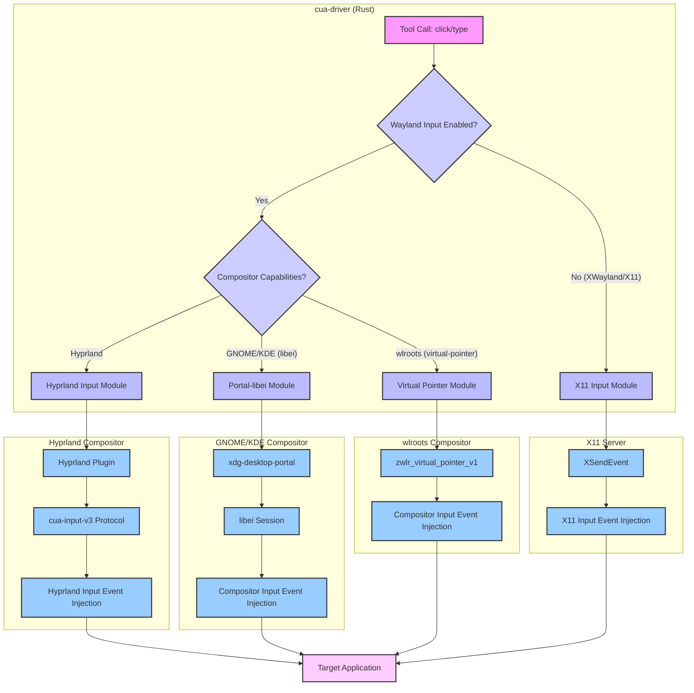

<!-- source: DeepWiki mcp.deepwiki.com · repo trycua/cua · page 6.7 Hyprland Plugin and Compositor Integration · fetched 2026-10-29 -->

# Hyprland Plugin and Compositor Integration

Relevant source files

The following files were used as context for generating this wiki page:

- [libs/cua-driver/docs/cursor-modifier-badge-restructuring-plan.md](libs/cua-driver/docs/cursor-modifier-badge-restructuring-plan.md)
- [libs/cua-driver/hyprland-plugin/CMakeLists.txt](libs/cua-driver/hyprland-plugin/CMakeLists.txt)
- [libs/cua-driver/hyprland-plugin/README.md](libs/cua-driver/hyprland-plugin/README.md)
- [libs/cua-driver/hyprland-plugin/packaging/release/USAGE.md](libs/cua-driver/hyprland-plugin/packaging/release/USAGE.md)
- [libs/cua-driver/hyprland-plugin/packaging/release/bundle.py](libs/cua-driver/hyprland-plugin/packaging/release/bundle.py)
- [libs/cua-driver/hyprland-plugin/packaging/release/test_release.py](libs/cua-driver/hyprland-plugin/packaging/release/test_release.py)
- [libs/cua-driver/hyprland-plugin/protocol/cua-input-v3.md](libs/cua-driver/hyprland-plugin/protocol/cua-input-v3.md)
- [libs/cua-driver/hyprland-plugin/src/foreground_route.hpp](libs/cua-driver/hyprland-plugin/src/foreground_route.hpp)
- [libs/cua-driver/hyprland-plugin/src/input_experiment.cpp](libs/cua-driver/hyprland-plugin/src/input_experiment.cpp)
- [libs/cua-driver/hyprland-plugin/src/keymap_equivalence.hpp](libs/cua-driver/hyprland-plugin/src/keymap_equivalence.hpp)
- [libs/cua-driver/hyprland-plugin/src/plugin.cpp](libs/cua-driver/hyprland-plugin/src/plugin.cpp)
- [libs/cua-driver/hyprland-plugin/tests/agent_key_repeat_test.py](libs/cua-driver/hyprland-plugin/tests/agent_key_repeat_test.py)
- [libs/cua-driver/hyprland-plugin/tests/desktop_fault_policy_fixture.cpp](libs/cua-driver/hyprland-plugin/tests/desktop_fault_policy_fixture.cpp)
- [libs/cua-driver/hyprland-plugin/tests/desktop_fault_policy_test.py](libs/cua-driver/hyprland-plugin/tests/desktop_fault_policy_test.py)
- [libs/cua-driver/hyprland-plugin/tests/foreground_modifiers_test.py](libs/cua-driver/hyprland-plugin/tests/foreground_modifiers_test.py)
- [libs/cua-driver/hyprland-plugin/tests/foreground_route_test.cpp](libs/cua-driver/hyprland-plugin/tests/foreground_route_test.cpp)
- [libs/cua-driver/hyprland-plugin/tests/keyboard_layout_test.cpp](libs/cua-driver/hyprland-plugin/tests/keyboard_layout_test.cpp)
- [libs/cua-driver/hyprland-plugin/tests/keymap_equivalence_test.cpp](libs/cua-driver/hyprland-plugin/tests/keymap_equivalence_test.cpp)
- [libs/cua-driver/hyprland-plugin/tests/plugin_api_test.cpp](libs/cua-driver/hyprland-plugin/tests/plugin_api_test.cpp)
- [libs/cua-driver/rust/crates/cursor-overlay/examples/export_gallery_frames.rs](libs/cua-driver/rust/crates/cursor-overlay/examples/export_gallery_frames.rs)
- [libs/cua-driver/rust/crates/cursor-overlay/src/session_badge.rs](libs/cua-driver/rust/crates/cursor-overlay/src/session_badge.rs)
- [libs/cua-driver/rust/crates/cursor-overlay/src/theme.rs](libs/cua-driver/rust/crates/cursor-overlay/src/theme.rs)
- [libs/cua-driver/rust/crates/cursor-overlay/src/theme_artifact.rs](libs/cua-driver/rust/crates/cursor-overlay/src/theme_artifact.rs)
- [libs/cua-driver/rust/crates/cursor-theme-cli/src/main.rs](libs/cua-driver/rust/crates/cursor-theme-cli/src/main.rs)
- [libs/cua-driver/rust/crates/platform-linux/src/wayland/shell_helper.rs](libs/cua-driver/rust/crates/platform-linux/src/wayland/shell_helper.rs)
- [libs/cua-driver/scripts/cursor-gallery.sh](libs/cua-driver/scripts/cursor-gallery.sh)
- [libs/cua-driver/tools/cursor-gallery/README.md](libs/cua-driver/tools/cursor-gallery/README.md)
- [libs/cua-driver/tools/cursor-gallery/app.js](libs/cua-driver/tools/cursor-gallery/app.js)
- [libs/cua-driver/tools/cursor-gallery/capture-gallery.mjs](libs/cua-driver/tools/cursor-gallery/capture-gallery.mjs)
- [libs/cua-driver/tools/cursor-gallery/index.html](libs/cua-driver/tools/cursor-gallery/index.html)
- [libs/cua-driver/tools/cursor-gallery/styles.css](libs/cua-driver/tools/cursor-gallery/styles.css)
- [libs/cua-driver/wayland-helper/winrects@cua/extension.js](libs/cua-driver/wayland-helper/winrects@cua/extension.js)
- [libs/cua-driver/wayland-helper/winrects@cua/metadata.json](libs/cua-driver/wayland-helper/winrects@cua/metadata.json)

This page details the experimental Hyprland plugin for `cua-driver` on Wayland, focusing on its architecture, input isolation mechanisms, and integration with Wayland compositors. It covers the ABI fingerprint gating, the discovery-only default build, the `cua-input-v3` protocol candidate, desktop fault policy tests, and the roles of `kwin-target-helper` and `wayland-helper`, as well as the `portal-libei` path for input.

## Wayland Backend Overview

The `cua-driver` on Linux primarily uses X11 for background automation, but it also includes an experimental native Wayland backend. This backend is designed for pure Wayland sessions where an X11 `DISPLAY` is not available. It handles toplevel enumeration, per-output capture, and virtual pointer/keyboard input via Wayland protocols [libs/cua-driver/rust/crates/platform-linux/src/wayland/mod.rs:1-11]().

The Wayland backend is opt-in and disabled by default. Users must set the `CUA_DRIVER_RS_ENABLE_WAYLAND=1` environment variable to enable it [libs/cua-driver/rust/crates/platform-linux/src/wayland/mod.rs:101-113](). This is because per-window image capture still relies on the staging `ext-image-copy-capture-v1` protocol, which is not broadly available [libs/cua-driver/rust/crates/platform-linux/src/wayland/mod.rs:10-11, 106-109]().

The `platform-linux` crate defines the `is_wayland()` function to determine if the driver is running in an opted-in Wayland desktop session [libs/cua-driver/rust/crates/platform-linux/src/wayland/mod.rs:130-132](). It also provides `wayland_input_enabled()` to explicitly check if Wayland input is active [libs/cua-driver/rust/crates/platform-linux/src/wayland/mod.rs:137-142](). If a pure Wayland session is detected without the backend enabled, `wayland_input_unavailable_reason()` will return a detailed error message [libs/cua-driver/rust/crates/platform-linux/src/wayland/mod.rs:144-166]().

Sources:
- [libs/cua-driver/rust/crates/platform-linux/src/wayland/mod.rs:1-11]()
- [libs/cua-driver/rust/crates/platform-linux/src/wayland/mod.rs:101-113]()
- [libs/cua-driver/rust/crates/platform-linux/src/wayland/mod.rs:130-132]()
- [libs/cua-driver/rust/crates/platform-linux/src/wayland/mod.rs:137-142]()
- [libs/cua-driver/rust/crates/platform-linux/src/wayland/mod.rs:144-166]()

### Wayland Overlay Backend Selection

The `cua-driver` supports different Wayland overlay backends for displaying the agent cursor. The selection logic prioritizes `SemanticShellHelper`, then `LayerShell`, then `LegacyShellHelper`, and finally `None` if no suitable backend is found [libs/cua-driver/rust/crates/platform-linux/src/overlay.rs:136-145]().

The `wayland_overlay_backend()` function determines which backend is active by checking the availability of `semantic_cursor_available()`, `overlay::available()`, and `shell_helper::available()` from the `crate::wayland` module [libs/cua-driver/rust/crates/platform-linux/src/overlay.rs:149-157]().

Sources:
- [libs/cua-driver/rust/crates/platform-linux/src/overlay.rs:136-145]()
- [libs/cua-driver/rust/crates/platform-linux/src/overlay.rs:149-157]()

## Hyprland Plugin

The Hyprland plugin provides specific integration for the Hyprland Wayland compositor. It includes modules for capture (`hyprland_capture`), input (`hyprland_input`), and compatibility (`hyprland_compatibility`) [libs/cua-driver/rust/crates/platform-linux/src/wayland/mod.rs:14-16]().

### ABI Fingerprint Gating

The Hyprland plugin uses ABI fingerprinting to ensure compatibility with the running Hyprland compositor. This mechanism helps prevent issues arising from API changes between Hyprland versions. The `cmake/DetectHyprlandAPI.cmake` script is used to detect the Hyprland API version during the build process [libs/cua-driver/hyprland-plugin/CMakeLists.txt:20-21](). The `bundle.py` script, used for creating deterministic plugin source releases, verifies the Hyprland version and compiler details in its metadata [libs/cua-driver/hyprland-plugin/packaging/release/bundle.py:129-133]().

Sources:
- [libs/cua-driver/hyprland-plugin/CMakeLists.txt:20-21]()
- [libs/cua-driver/hyprland-plugin/packaging/release/bundle.py:129-133]()

### `cua-input-v3` Protocol Candidate

The `cua-input-v3` protocol is a candidate for isolated input on Wayland, specifically designed for `cua-driver`'s needs. This protocol aims to provide a robust and isolated input mechanism that does not interfere with the user's primary input. The specification for this protocol is documented in `protocol/cua-input-v3.md` [libs/cua-driver/hyprland-plugin/protocol/cua-input-v3.md]() and is implemented in `src/input_experiment.cpp` [libs/cua-driver/hyprland-plugin/src/input_experiment.cpp]().

The protocol defines two independent compositor seats, `Cua-Agent` and `Cua-Agent-2`, and supports both background and foreground input routes [libs/cua-driver/hyprland-plugin/protocol/cua-input-v3.md:39-40](). It uses Linux `SOCK_SEQPACKET` sockets (`cua-input-v3.sock` and `cua-input-v3-2.sock`) with `SO_PEERCRED` checks to ensure the compositor UID matches [libs/cua-driver/hyprland-plugin/protocol/cua-input-v3.md:17-20]().

Key commands include `HELLO`, `CLAIM`, `TARGET`, `FOREGROUND_TARGET`, `ACTIVATE`, `CLICK`, `KEY`, `SCROLL`, and `DRAG` [libs/cua-driver/hyprland-plugin/protocol/cua-input-v3.md:48-87](). Each action requires a fresh route-specific target selection and is bounded by a technical lifetime [libs/cua-driver/hyprland-plugin/protocol/cua-input-v3.md:60-61](). The plugin performs target, geometry, desktop, keymap, and conflict checks on the compositor thread at dispatch [libs/cua-driver/hyprland-plugin/protocol/cua-input-v3.md:93-95]().

The `InputExperiment` class in `src/input_experiment.cpp` manages the client connections, seats, pointers, keyboards, and touch devices for the `cua-input-v3` protocol [libs/cua-driver/hyprland-plugin/src/input_experiment.cpp:155-181](). It handles packet parsing, nonce generation, and refusal responses [libs/cua-driver/hyprland-plugin/src/input_experiment.cpp:84-152]().

Sources:
- [libs/cua-driver/hyprland-plugin/protocol/cua-input-v3.md]()
- [libs/cua-driver/hyprland-plugin/src/input_experiment.cpp]()
- [libs/cua-driver/hyprland-plugin/protocol/cua-input-v3.md:39-40]()
- [libs/cua-driver/hyprland-plugin/protocol/cua-input-v3.md:17-20]()
- [libs/cua-driver/hyprland-plugin/protocol/cua-input-v3.md:48-87]()
- [libs/cua-driver/hyprland-plugin/protocol/cua-input-v3.md:60-61]()
- [libs/cua-driver/hyprland-plugin/protocol/cua-input-v3.md:93-95]()
- [libs/cua-driver/hyprland-plugin/src/input_experiment.cpp:155-181]()
- [libs/cua-driver/hyprland-plugin/src/input_experiment.cpp:84-152]()

### Desktop Fault Policy Tests

To ensure the reliability and safety of the Hyprland plugin, a suite of desktop fault policy tests has been developed. These tests verify that the plugin behaves correctly under various fault conditions and adheres to the "no-foreground" contract, meaning it should not steal focus or interfere with the user's active applications.

The `desktop_fault_policy_test.py` and `production_desktop_fault_proof.py` scripts are used to run these tests [libs/cua-driver/hyprland-plugin/tests/desktop_fault_policy_test.py](). The `desktop_fault_policy_fixture.cpp` provides the necessary test fixtures for these scenarios [libs/cua-driver/hyprland-plugin/tests/desktop_fault_policy_fixture.cpp](). Additional tests like `foreground_route_test.cpp`, `keymap_equivalence_test.cpp`, `keyboard_layout_test.cpp`, `foreground_modifiers_test.py`, `agent_key_repeat_test.py`, `passive_pointer_target_test.cpp`, `input_client_deadline_test.cpp`, `input_grant_test.cpp`, `drag_geometry_test.cpp`, and `protocol_test.cpp` cover various aspects of input handling and protocol compliance [libs/cua-driver/hyprland-plugin/CMakeLists.txt:44-120]().

Sources:
- [libs/cua-driver/hyprland-plugin/tests/desktop_fault_policy_test.py]()
- [libs/cua-driver/hyprland-plugin/tests/desktop_fault_policy_fixture.cpp]()
- [libs/cua-driver/hyprland-plugin/CMakeLists.txt:44-120]()

### `kwin-target-helper` and `wayland-helper`

The `kwin-target-helper` and `wayland-helper` components are auxiliary tools that facilitate interaction with Wayland compositors like KWin (KDE Plasma) and generic Wayland environments. These helpers likely provide a standardized interface for `cua-driver` to discover windows, capture screenshots, and inject input, abstracting away compositor-specific details.

The `wayland-helper` is part of the `cua-driver` project [libs/cua-driver/wayland-helper]() and is involved in the Linux CI process [libs/cua-driver/.github/workflows/ci-rust-linux.yml:17, 38](). Specifically, the `winrects@cua` GNOME Shell extension (`extension.js`) acts as a `wayland-helper` for GNOME Mutter, exposing D-Bus methods for window geometry (`GetRects`), cursor control (`MoveCursor`, `ClickPulse`, `HideCursor`, `SetCursorColor`, `SetCursorState`), and session labeling (`SetSessionLabel`) [libs/cua-driver/wayland-helper/winrects@cua/extension.js:12-22](). This extension runs in the shell's privileged context to overcome Wayland limitations on client access to global coordinates and overlay surfaces [libs/cua-driver/rust/crates/platform-linux/src/wayland/shell_helper.rs:5-10]().

Sources:
- [libs/cua-driver/wayland-helper]()
- [libs/cua-driver/.github/workflows/ci-rust-linux.yml:17, 38]()
- [libs/cua-driver/wayland-helper/winrects@cua/extension.js:12-22]()
- [libs/cua-driver/rust/crates/platform-linux/src/wayland/shell_helper.rs:5-10]()

## Portal-libei Path

For input on GNOME and KDE Plasma, `cua-driver` leverages the `xdg-desktop-portal` and `libei` (Extensible Input Interface) through the `portal-input` feature [libs/cua-driver/rust/crates/platform-linux/Cargo.toml:128-134](). This path provides a standardized and secure way to inject input events into Wayland compositors.

The `portal-input` feature enables the `reis` (Rust Extensible Input Interface), `calloop`, `enumflags2`, and `xkbcommon` crates [libs/cua-driver/rust/crates/platform-linux/Cargo.toml:128-134](). `reis` provides pure-Rust bindings for `libei/libeis`, handling the handshake, seat, device, and various input events like pointer, button, scroll, keyboard, and text [libs/cua-driver/rust/crates/platform-linux/Cargo.toml:93-96](). `calloop` is used for the event loop that drives the EIS worker thread [libs/cua-driver/rust/crates/platform-linux/Cargo.toml:98-100](). `xkbcommon` is used as a fallback for keyboard input when the EIS server does not advertise `ei_text` (e.g., older GNOME/KDE versions) [libs/cua-driver/rust/crates/platform-linux/Cargo.toml:106-109]().

The `libei.rs` module within `platform-linux/src/wayland` implements the `RemoteDesktop` portal for input [libs/cua-driver/rust/crates/platform-linux/src/wayland/libei.rs](). This allows `cua-driver` to request input sessions from the compositor, ensuring proper authorization and isolation.

Sources:
- [libs/cua-driver/rust/crates/platform-linux/Cargo.toml:128-134]()
- [libs/cua-driver/rust/crates/platform-linux/Cargo.toml:93-96]()
- [libs/cua-driver/rust/crates/platform-linux/Cargo.toml:98-100]()
- [libs/cua-driver/rust/crates/platform-linux/Cargo.toml:106-109]()
- [libs/cua-driver/rust/crates/platform-linux/src/wayland/libei.rs]()

## Input Delivery Mechanisms

`cua-driver` employs different input delivery mechanisms depending on the operating system and windowing environment.

### Linux Input

On Linux, `cua-driver` primarily uses X11's `XSendEvent` for background input injection, which sends synthetic events directly to a window without changing input focus [libs/cua-driver/rust/crates/platform-linux/src/input/mod.rs:1-5](). This mechanism is crucial for the "no focus steal" contract. For terminal emulators that ignore synthetic events, input is handled out of band by writing to the PTY master [libs/cua-driver/rust/crates/platform-linux/src/input/mod.rs:7-10]().

For Wayland, the `platform-linux` crate provides a `delivery` module for shared `delivery_mode` contract (background|foreground) [libs/cua-driver/rust/crates/platform-linux/src/input/delivery.rs]().

Sources:
- [libs/cua-driver/rust/crates/platform-linux/src/input/mod.rs:1-5]()
- [libs/cua-driver/rust/crates/platform-linux/src/input/mod.rs:7-10]()
- [libs/cua-driver/rust/crates/platform-linux/src/input/delivery.rs]()

### macOS Input

On macOS, input is delivered via Accessibility (AX) and HID events. The `cursor_overlay` module handles the visual representation of the agent cursor [libs/cua-driver/rust/crates/platform-macos/src/cursor/overlay.rs:1-31](). The `tools::DeliveryMode` enum defines the delivery contract [libs/cua-driver/rust/crates/platform-linux/src/input/mod.rs:14-15]().

Sources:
- [libs/cua-driver/rust/crates/platform-macos/src/cursor/overlay.rs:1-31]()
- [libs/cua-driver/rust/crates/platform-linux/src/input/mod.rs:14-15]()

### Windows Input

On Windows, `cua-driver` uses `PostMessage` for background mouse and keyboard injection, and UI Automation (UIA) for accessibility tree walking [libs/cua-driver/rust/crates/platform-windows/src/lib.rs:4-6](). The `input::delivery` module defines the delivery contract [libs/cua-driver/rust/crates/platform-linux/src/input/mod.rs:14-15]().

Sources:
- [libs/cua-driver/rust/crates/platform-windows/src/lib.rs:4-6]()
- [libs/cua-driver/rust/crates/platform-linux/src/input/mod.rs:14-15]()

## Agent Cursor Overlay

The agent cursor overlay provides visual feedback for the agent's actions. It is implemented differently across platforms but shares a common `cursor_overlay` crate for animation state and rendering pipeline [libs/cua-driver/rust/crates/cursor-overlay/src/lib.rs](), [libs/cua-driver/rust/crates/cursor-overlay/src/render_state.rs]().

The `cursor-overlay` crate defines the canonical cursor-theme semantics and `cua.default` runtime parameters [libs/cua-driver/rust/crates/cursor-overlay/src/theme.rs:1-3](). It includes `CursorAction`, `DeliveryModifier`, `PlaybackKind`, `ReducedMotion`, and `TargetModifier` enums to describe the visual state of the cursor [libs/cua-driver/rust/crates/cursor-overlay/src/theme.rs:10-13](). The `CursorVisualState` struct tracks the requested and resolved actions, delivery, target, elapsed time, and other rendering parameters [libs/cua-driver/rust/crates/cursor-overlay/src/theme.rs:81-93](). The `session_fill_rgba` function provides stable colors for session-owned cursors [libs/cua-driver/rust/crates/cursor-overlay/src/theme.rs:41-46]().

The `session_badge.rs` module handles the rendering of the public session label shown below an active agent cursor [libs/cua-driver/rust/crates/cursor-overlay/src/session_badge.rs:4-6](). It sanitizes the session label and lays out the text and badge chips (delivery and target modifiers) [libs/cua-driver/rust/crates/cursor-overlay/src/session_badge.rs:174-203]().

The `theme_artifact.rs` module manages bounded compiled cursor-theme artifacts, which are zstd-compressed postcard data [libs/cua-driver/rust/crates/cursor-overlay/src/theme_artifact.rs:1-3](). The `CompiledTheme` struct contains metadata and a map of `CompiledAnimation`s for different `CursorAction`s [libs/cua-driver/rust/crates/cursor-overlay/src/theme_artifact.rs:104-115](). The `cursor-theme-cli` tool is used to validate, build, inspect, preview, install, list, and uninstall these themes [libs/cua-driver/rust/crates/cursor-theme-cli/src/main.rs:87-94]().

Sources:
- [libs/cua-driver/rust/crates/cursor-overlay/src/lib.rs]()
- [libs/cua-driver/rust/crates/cursor-overlay/src/render_state.rs]()
- [libs/cua-driver/rust/crates/cursor-overlay/src/theme.rs:1-3]()
- [libs/cua-driver/rust/crates/cursor-overlay/src/theme.rs:10-13]()
- [libs/cua-driver/rust/crates/cursor-overlay/src/theme.rs:81-93]()
- [libs/cua-driver/rust/crates/cursor-overlay/src/theme.rs:41-46]()
- [libs/cua-driver/rust/crates/cursor-overlay/src/session_badge.rs:4-6]()
- [libs/cua-driver/rust/crates/cursor-overlay/src/session_badge.rs:174-203]()
- [libs/cua-driver/rust/crates/cursor-overlay/src/theme_artifact.rs:1-3]()
- [libs/cua-driver/rust/crates/cursor-overlay/src/theme_artifact.rs:104-115]()
- [libs/cua-driver/rust/crates/cursor-theme-cli/src/main.rs:87-94]()

### Linux Overlay

On Linux, the X11 overlay creates an override-redirect X11 window with a 32-bit ARGB visual that covers the full display area [libs/cua-driver/rust/crates/platform-linux/src/overlay.rs:4-5](). A background thread renders cursor-local tiles and uploads them with `XPutImage` and `XShape` clipping [libs/cua-driver/rust/crates/platform-linux/src/overlay.rs:6-7](). The overlay handles software compositing and Z-ordering by raising its window every 80ms [libs/cua-driver/rust/crates/platform-linux/src/overlay.rs:27]().

For Wayland, the `platform-linux` crate includes a `wayland::overlay` module [libs/cua-driver/rust/crates/platform-linux/src/wayland/overlay.rs]() which is configured via `wayland::overlay::set_config()` [libs/cua-driver/rust/crates/platform-linux/src/lib.rs:156](). The `winrects@cua` GNOME Shell extension also draws the agent cursor as a Clutter actor on the compositor stage and updates its state and color [libs/cua-driver/rust/crates/platform-linux/src/wayland/shell_helper.rs:15-18]().

Sources:
- [libs/cua-driver/rust/crates/platform-linux/src/overlay.rs:4-5]()
- [libs/cua-driver/rust/crates/platform-linux/src/overlay.rs:6-7]()
- [libs/cua-driver/rust/crates/platform-linux/src/overlay.rs:27]()
- [libs/cua-driver/rust/crates/platform-linux/src/wayland/overlay.rs]()
- [libs/cua-driver/rust/crates/platform-linux/src/lib.rs:156]()
- [libs/cua-driver/rust/crates/platform-linux/src/wayland/shell_helper.rs:15-18]()

### macOS Overlay

On macOS, the agent cursor overlay is a transparent, click-through `NSWindow`. The MCP/tokio server runs on a background thread, while AppKit (which handles the window) runs on the main thread. Communication occurs via a global lock-free channel [libs/cua-driver/rust/crates/platform-macos/src/cursor/overlay.rs:5-10](). The render loop uses a GCD background thread to render animation states into a `tiny_skia::Pixmap`, which is then converted to a `CGImage` and dispatched to `CALayer.setContents` [libs/cua-driver/rust/crates/platform-macos/src/cursor/overlay.rs:12-15]().

Sources:
- [libs/cua-driver/rust/crates/platform-macos/src/cursor/overlay.rs:5-10]()
- [libs/cua-driver/rust/crates/platform-macos/src/cursor/overlay.rs:12-15]()

### Windows Overlay

On Windows, the overlay is a transparent, click-through layered window that spans the virtual screen. It uses `WS_EX_TRANSPARENT | WS_EX_LAYERED | WS_EX_NOACTIVATE | WS_EX_TOOLWINDOW` extended styles [libs/cua-driver/rust/crates/platform-windows/src/overlay.rs:5](). A dedicated STA thread runs the render loop at ~125 Hz, using `tiny-skia` to render into a BGRA DIB, which is then updated via `UpdateLayeredWindow` [libs/cua-driver/rust/crates/platform-windows/src/overlay.rs:7-8](). Z-ordering is maintained by calling `SetWindowPos` every 80ms [libs/cua-driver/rust/crates/platform-windows/src/overlay.rs:9]().

Sources:
- [libs/cua-driver/rust/crates/platform-windows/src/overlay.rs:5]()
- [libs/cua-driver/rust/crates/platform-windows/src/overlay.rs:7-8]()
- [libs/cua-driver/rust/crates/platform-windows/src/overlay.rs:9]()

## Architecture Diagram: Wayland Input Flow

Title: Wayland Input Flow in cua-driver

This diagram illustrates the decision-making process and various paths for input injection within `cua-driver` on Linux, particularly highlighting the Wayland-specific integrations.

Sources:
- [libs/cua-driver/rust/crates/platform-linux/src/wayland/mod.rs:1-11]()
- [libs/cua-driver/rust/crates/platform-linux/src/wayland/mod.rs:137-142]()
- [libs/cua-driver/rust/crates/platform-linux/src/input/mod.rs:1-5]()
- [libs/cua-driver/rust/crates/platform-linux/Cargo.toml:128-134]()
- [libs/cua-driver/hyprland-plugin/protocol/cua-input-v3.md]()
- [libs/cua-driver/hyprland-plugin/src/input_experiment.cpp]()

## Code Entity Diagram: Linux Platform Backend

```mermaid
graph TD
    subgraph "cua-driver (Rust)"
        A[cua-driver-core::tool::ToolRegistry] --> B[platform-linux::register_tools]
        B --> C[platform-linux::tools::build_registry]
        B --> D[platform-linux::overlay::init]
        B --> E[platform-linux::overlay::run_on_thread]
    end

    subgraph "platform-linux Crate"
        subgraph "Input"
            F[platform-linux::input::mod.rs] --> G[platform-linux::input::delivery]
            F --> H[platform-linux::input::mpx_owner]
            F --> I[platform-linux::input::reap_orphaned_master_pointers]
        end

        subgraph "Wayland"
            J[platform-linux::wayland::mod.rs] --> K[platform-linux::wayland::ext_toplevel]
            J --> L[platform-linux::wayland::ext_screencopy]
            J --> M[platform-linux::wayland::hyprland]
            J --> N[platform-linux::wayland::hyprland_input]
            J --> O[platform-linux::wayland::overlay]
            J --> P[platform-linux::wayland::portal]
            J --> Q[platform-linux::wayland::libei]
            J --> R[platform-linux::wayland::portal_screenshot]
            J --> S[platform-linux::wayland::shell_helper]
            J --> T[platform-linux::wayland::is_wayland]
            J --> U[platform-linux::wayland::wayland_enabled]
            J --> V[platform-linux::wayland::wayland_input_enabled]
            J --> W[platform-linux::wayland::wayland_input_unavailable_reason]
            J --> X[platform-linux::wayland::ensure_nested_session]
        end

        subgraph "Overlay"
            Y[platform-linux::overlay::mod.rs] --> Z[cursor-overlay::RenderStateCore]
            Y --> AA[cursor-overlay::OverlayCommand]
            Y --> BB[platform-linux::overlay::init]
            Y --> CC[platform-linux::overlay::run_on_thread]
            Y --> DD[platform-linux::overlay::wayland_overlay_backend]
        end

        subgraph "Capture"
            EE[platform-linux::capture::mod.rs] --> FF[platform-linux::capture_action_frame]
        end

        subgraph "Health Report"
            GG[platform-linux::health_report::mod.rs] --> HH[LinuxHealthProvider]
            HH --> II[NAME_WAYLAND_BACKEND]
            HH --> JJ[check_wayland_backend]
        end

        subgraph "Hyprland Plugin (C++)"
            KK[hyprland-plugin::src::input_experiment.cpp] --> LL[cua-input-v3 Protocol]
            KK --> MM[hyprland-plugin::src::foreground_route.hpp]
        end
    end

    B -- registers --> F
    B -- registers --> J
    B -- registers --> Y
    B -- registers --> EE
    B -- registers --> GG
    J -- uses --> M
    J -- uses --> N
    J -- uses --> O
    J -- uses --> Q
    J -- uses --> R
    J -- uses --> S
    Y -- uses --> Z
    Y -- uses --> AA
    DD -- calls --> T
    DD -- calls --> U
    DD -- calls --> V
    DD -- calls --> W
    JJ -- probes --> T
    JJ -- probes --> U
    JJ -- probes --> V
    N -- implements --> LL
    KK -- uses --> LL
    KK -- uses --> MM
```

Title: Linux Platform Backend Code Entities

This diagram illustrates the key modules and functions within the `platform-linux` crate and its interaction with `cua-driver-core` and the Hyprland plugin. It highlights the input, Wayland, overlay, capture, and health report components.

Sources:
- [libs/cua-driver/rust/crates/platform-linux/src/lib.rs:134-169]()
- [libs/cua-driver/rust/crates/platform-linux/src/input/mod.rs]()
- [libs/cua-driver/rust/crates/platform-linux/src/input/delivery.rs]()
- [libs/cua-driver/rust/crates/platform-linux/src/input/mpx_owner.rs]()
- [libs/cua-driver/rust/crates/platform-linux/src/wayland/mod.rs]()
- [libs/cua-driver/rust/crates/platform-linux/src/wayland/ext_toplevel.rs]()
- [libs/cua-driver/rust/crates/platform-linux/src/wayland/ext_screencopy.rs]()
- [libs/cua-driver/rust/crates/platform-linux/src/wayland/hyprland.rs]()
- [libs/cua-driver/rust/crates/platform-linux/src/wayland/hyprland_input.rs]()
- [libs/cua-driver/rust/crates/platform-linux/src/wayland/overlay.rs]()
- [libs/cua-driver/rust/crates/platform-linux/src/wayland/portal.rs]()
- [libs/cua-driver/rust/crates/platform-linux/src/wayland/libei.rs]()
- [libs/cua-driver/rust/crates/platform-linux/src/wayland/portal_screenshot.rs]()
- [libs/cua-driver/rust/crates/platform-linux/src/wayland/shell_helper.rs]()
- [libs/cua-driver/rust/crates/platform-linux/src/overlay.rs]()
- [libs/cua-driver/rust/crates/platform-linux/src/capture.rs]()
- [libs/cua-driver/rust/crates/platform-linux/src/health_report.rs]()
- [libs/cua-driver/rust/crates/cursor-overlay/src/lib.rs]()
- [libs/cua-driver/rust/crates/cursor-overlay/src/render_state.rs]()
- [libs/cua-driver/hyprland-plugin/src/input_experiment.cpp]()
- [libs/cua-driver/hyprland-plugin/protocol/cua-input-v3.md]()
- [libs/cua-driver/hyprland-plugin/src/foreground_route.hpp]()

---

