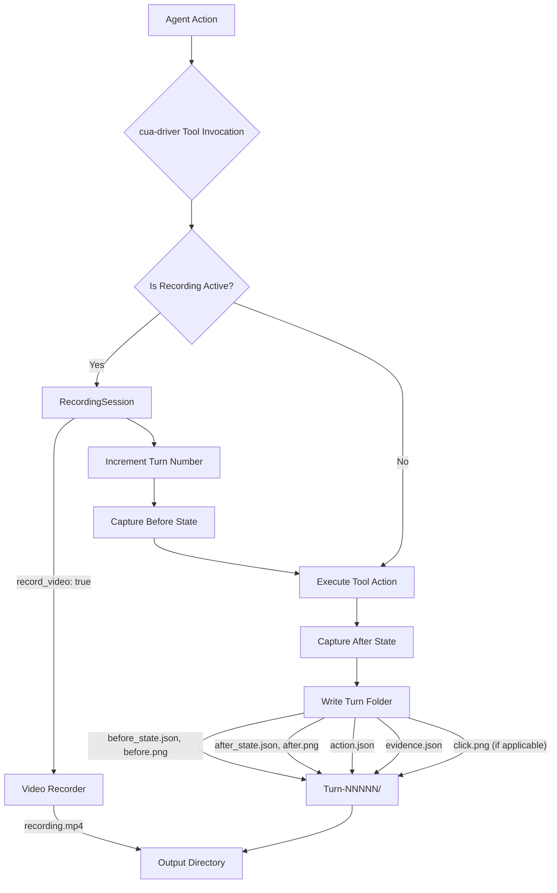
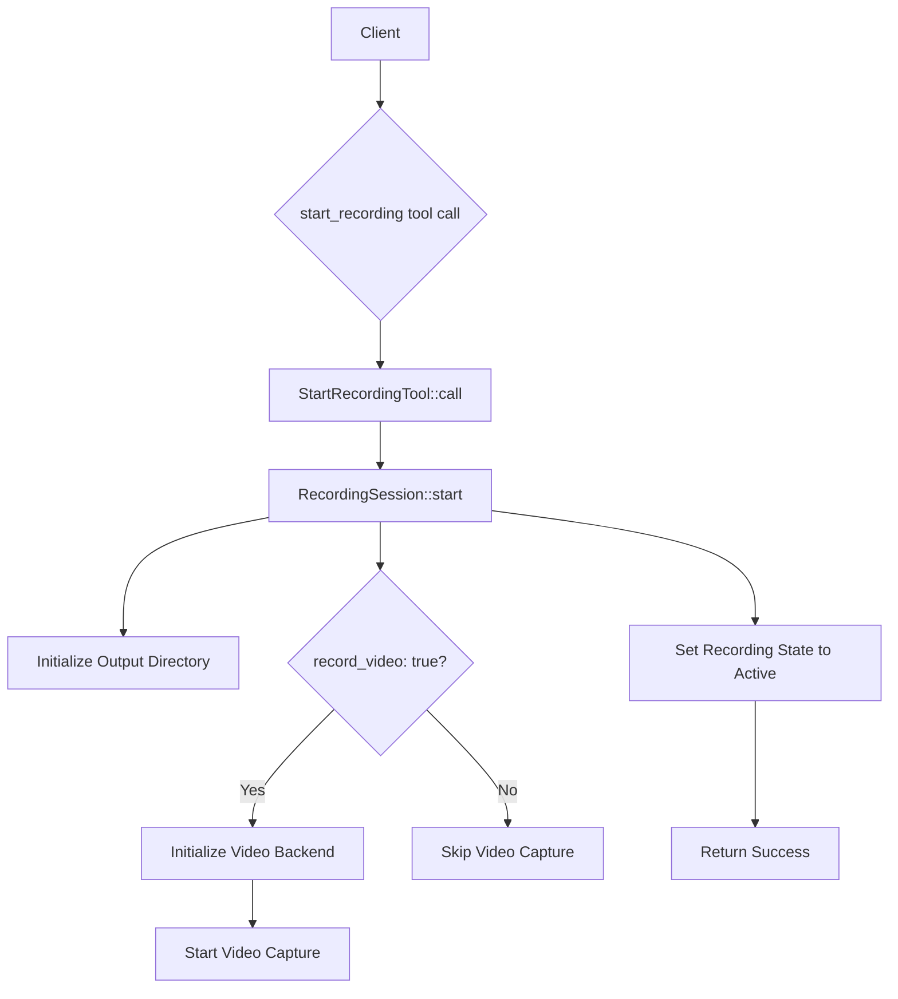
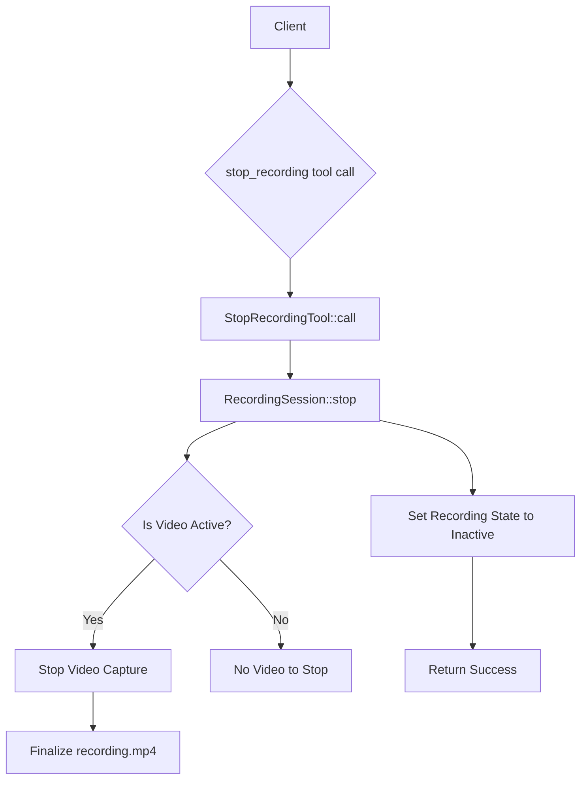

<!-- source: DeepWiki mcp.deepwiki.com · repo trycua/cua · page 6.8 Recording and Trajectory Capture in cua-driver · fetched 2026-10-29 -->

# Recording and Trajectory Capture in cua-driver

<details>
<summary>Relevant source files</summary>

The following files were used as context for generating this wiki page:

- [libs/cua-driver/rust/Skills/cua-driver/RECORDING.md](libs/cua-driver/rust/Skills/cua-driver/RECORDING.md)
- [libs/cua-driver/rust/crates/cua-driver-core/src/recording.rs](libs/cua-driver/rust/crates/cua-driver-core/src/recording.rs)
- [libs/cua-driver/rust/crates/cua-driver-core/src/recording_tools.rs](libs/cua-driver/rust/crates/cua-driver-core/src/recording_tools.rs)
- [libs/cua-driver/rust/crates/cua-driver-testkit/src/e2e.rs](libs/cua-driver/rust/crates/cua-driver-testkit/src/e2e.rs)
- [libs/cua-driver/rust/crates/cua-driver-testkit/src/sentinel.rs](libs/cua-driver/rust/crates/cua-driver-testkit/src/sentinel.rs)
- [libs/cua-driver/rust/crates/platform-linux/src/recording_hooks.rs](libs/cua-driver/rust/crates/platform-linux/src/recording_hooks.rs)
- [libs/cua-driver/rust/crates/platform-macos/src/recording_hooks.rs](libs/cua-driver/rust/crates/platform-macos/src/recording_hooks.rs)
- [libs/cua-driver/rust/crates/platform-windows/src/recording_hooks.rs](libs/cua-driver/rust/crates/platform-windows/src/recording_hooks.rs)

</details>


This page details the recording and trajectory capture subsystem within `cua-driver`. It covers the `start_recording` and `stop_recording` tools, platform-specific frame capture hooks, integration with the `cua-driver-testkit` for end-to-end (E2E) testing, and the contract defined in `RECORDING.md`. The recording subsystem is crucial for generating detailed logs and visual evidence of agent interactions with the desktop environment, which is vital for debugging, evaluation, and training.

## Recording Subsystem Overview

The `cua-driver` recording subsystem allows for the capture of agent actions and the corresponding desktop state. When enabled, it generates a structured trajectory of interactions, including application state snapshots, screenshots, and action metadata. This data is organized into "turn folders" for easy analysis. The system also supports optional video recording of the main display.

The core components of the recording subsystem are:
*   **`RecordingSession`**: Manages the state of an active recording, including output directory, video status, and turn numbering. [libs/cua-driver/rust/crates/cua-driver-core/src/recording.rs:21-24]()
*   **Platform-specific hooks**: Functions registered by each platform (`macos`, `windows`, `linux`) to capture screenshots, accessibility tree snapshots, and mark click points. [libs/cua-driver/rust/crates/cua-driver-core/src/recording.rs:24-167]()
*   **Recording Tools**: `start_recording`, `stop_recording`, and `get_recording_state` are `cua-driver` tools that control the recording process. [libs/cua-driver/rust/crates/cua-driver-core/src/recording_tools.rs:1-15]()
*   **`RECORDING.md` Contract**: Defines the structure and content of the recorded trajectory data. [libs/cua-driver/rust/Skills/cua-driver/RECORDING.md:1-129]()

### Recording Data Flow

The following diagram illustrates the high-level data flow when recording is active:



Sources:
* [libs/cua-driver/rust/crates/cua-driver-core/src/recording.rs:21-24]()
* [libs/cua-driver/rust/crates/cua-driver-core/src/recording_tools.rs:48-104]()
* [libs/cua-driver/rust/Skills/cua-driver/RECORDING.md:60-93]()

## Recording Tools

The `cua-driver` exposes several tools to manage the recording process. These tools are registered on all platforms via `ToolRegistry::register_recording_tools()`. [libs/cua-driver/rust/crates/cua-driver-core/src/recording_tools.rs:3-4]()

### `start_recording`

The `start_recording` tool initiates a trajectory recording session. It takes an `output_dir` and an optional `record_video` flag.

*   **`output_dir`**: An absolute or `~`-rooted directory where turn folders and the video file (if enabled) are written. [libs/cua-driver/rust/crates/cua-driver-core/src/recording_tools.rs:110-114]()
*   **`record_video`**: A boolean flag to enable video capture of the main display to `<output_dir>/recording.mp4`. Defaults to `false`. [libs/cua-driver/rust/crates/cua-driver-core/src/recording_tools.rs:115-123]()

Each turn folder is named `turn-NNNNN/` (five-digit zero-padded counter), and numbering restarts at 1 each time recording is started. [libs/cua-driver/rust/crates/cua-driver-core/src/recording_tools.rs:81-82]()

The `StartRecordingTool` struct encapsulates the logic for this tool. [libs/cua-driver/rust/crates/cua-driver-core/src/recording_tools.rs:31-32]()



Sources:
* [libs/cua-driver/rust/crates/cua-driver-core/src/recording_tools.rs:31-32]()
* [libs/cua-driver/rust/crates/cua-driver-core/src/recording_tools.rs:48-104]()
* [libs/cua-driver/rust/crates/cua-driver-core/src/recording_tools.rs:107-123]()

### `stop_recording`

The `stop_recording` tool disables trajectory recording and finalizes any active video recording.

The `StopRecordingTool` struct handles this functionality. [libs/cua-driver/rust/crates/cua-driver-core/src/recording_tools.rs:200-201]()



Sources:
* [libs/cua-driver/rust/crates/cua-driver-core/src/recording_tools.rs:200-201]()
* [libs/cua-driver/rust/crates/cua-driver-core/src/recording_tools.rs:210-229]()

### `get_recording_state`

The `get_recording_state` tool queries the current recording status, returning information such as whether recording is active, the output directory, and any `last_error`.

The `GetRecordingStateTool` struct provides this functionality. [libs/cua-driver/rust/crates/cua-driver-core/src/recording_tools.rs:260-261]()

Sources:
* [libs/cua-driver/rust/crates/cua-driver-core/src/recording_tools.rs:260-261]()
* [libs/cua-driver/rust/crates/cua-driver-core/src/recording_tools.rs:271-280]()

## Frame Capture Hooks per Platform

`cua-driver` utilizes platform-specific hooks to capture screenshots, accessibility tree snapshots, and mark click points. These hooks are registered once at startup.

### Screenshot Capture

The `SCREENSHOT_FN` `OnceLock` stores a boxed function that captures a screenshot. [libs/cua-driver/rust/crates/cua-driver-core/src/recording.rs:51]()
*   `set_screenshot_fn`: Registers a simple screenshot function. [libs/cua-driver/rust/crates/cua-driver-core/src/recording.rs:56-64]()
*   `set_classified_screenshot_fn`: Registers a screenshot function that can classify capture failures. [libs/cua-driver/rust/crates/cua-driver-core/src/recording.rs:68-72]()
*   `screenshot_for`: Invokes the registered screenshot callback. [libs/cua-driver/rust/crates/cua-driver-core/src/recording.rs:77-82]()

#### macOS Screenshot Capture

On macOS, `screenshot_for_recording` is implemented in `platform-macos`. It uses `crate::capture::screenshot_display_bytes()` for full display capture or `crate::capture::screenshot_window_bytes()` for window-specific capture.

Sources:
* [libs/cua-driver/rust/crates/platform-macos/src/capture.rs]() (not provided, but inferred from usage)

#### Windows Screenshot Capture

On Windows, `screenshot_for_recording` in `platform-windows` resolves the target window using `resolve_window_for_recording` and then captures it using `crate::capture::screenshot_window_bytes_with_occlusion`. It also handles cases where the window is minimized or occluded. [libs/cua-driver/rust/crates/platform-windows/src/recording_hooks.rs:70-87]()

#### Linux Screenshot Capture

On Linux, `screenshot_for_recording` in `platform-linux` handles Wayland and X11. For Wayland, it captures the entire display or a specific window using `crate::wayland::screenshot_display_dispatch()` or `crate::wayland::screenshot_dispatch()`. For X11, it uses `crate::capture::screenshot_display_bytes()`. [libs/cua-driver/rust/crates/platform-linux/src/recording_hooks.rs:75-91]()

### Click Marker

The `CLICK_MARKER_FN` `OnceLock` stores a function to draw a red crosshair on a PNG image at a specified `(cx, cy)` coordinate. This is used to produce `click.png`. [libs/cua-driver/rust/crates/cua-driver-core/src/recording.rs:91]()
*   `set_click_marker_fn`: Registers the platform-specific click-marker callback. [libs/cua-driver/rust/crates/cua-driver-core/src/recording.rs:94-96]()

### Accessibility Tree (AX/UIA/AT-SPI) Snapshot

The `AX_SNAPSHOT_FN` `OnceLock` stores a function to capture the application's accessibility tree state as JSON bytes. [libs/cua-driver/rust/crates/cua-driver-core/src/recording.rs:142-143]()
*   `StateCaptureBudget`: Defines the timeout for the accessibility tree walk. [libs/cua-driver/rust/crates/cua-driver-core/src/recording.rs:121-124]()
*   `set_ax_snapshot_fn`: Registers an AX snapshot callback that ignores the per-turn budget. [libs/cua-driver/rust/crates/cua-driver-core/src/recording.rs:148-152]()
*   `set_budgeted_ax_snapshot_fn`: Registers a callback that respects the `StateCaptureBudget`. [libs/cua-driver/rust/crates/cua-driver-core/src/recording.rs:157-160]()

#### macOS AX Snapshot

On macOS, `app_state_json_for` in `platform-macos` uses `crate::ax::tree::walk_tree_budgeted` to capture the accessibility tree. It respects the `StateCaptureBudget` and reports walk fields like `truncated` and `nodes_visited`. [libs/cua-driver/rust/crates/platform-macos/src/recording_hooks.rs:16-49]()

#### Windows UIA Snapshot

On Windows, `app_state_json_for` in `platform-windows` uses `crate::uia::walk_tree_budgeted` to capture the UIA tree. It also respects the `StateCaptureBudget` and reports walk fields. [libs/cua-driver/rust/crates/platform-windows/src/recording_hooks.rs:99-134]()

#### Linux AT-SPI Snapshot

On Linux, `app_state_json_for` in `platform-linux` uses `crate::atspi::walk_tree_budgeted_within` or `crate::atspi::walk_tree_for_recording` to capture the AT-SPI tree, respecting the budget. [libs/cua-driver/rust/crates/platform-linux/src/recording_hooks.rs:7-72]()

### Element Coordinate Resolution

For click-family actions, the system needs to resolve an element token or pixel coordinates to a window-local point for `click.png`.
*   `element_window_local_xy` (macOS): Resolves an `element_token` to screen coordinates and then converts to window-local pixel coordinates. [libs/cua-driver/rust/crates/platform-macos/src/recording_hooks.rs:54-78]()
*   `element_window_local_xy` (Linux): Resolves an element index to screen coordinates and then converts to window-local pixel coordinates. Handles Hyprland-specific coordinate mapping. [libs/cua-driver/rust/crates/platform-linux/src/recording_hooks.rs:95-117]()
*   `element_window_local_xy` (Windows): Resolves an element to its center screen coordinates and converts to window-local pixel coordinates. [libs/cua-driver/rust/crates/platform-windows/src/recording_hooks.rs:138-166]()

## `RECORDING.md` Contract

The `RECORDING.md` file defines the contract for trajectory recording, detailing the contents of each turn folder and the behavior of recording tools. [libs/cua-driver/rust/Skills/cua-driver/RECORDING.md:1-129]()

### Turn Folder Contents

Each `turn-NNNNN/` folder contains:
*   `before_state.json` / `after_state.json`: Application AX/UIA/AT-SPI state before and after the action. [libs/cua-driver/rust/Skills/cua-driver/RECORDING.md:63-75]()
*   `before.png` / `after.png`: Target-window screenshots before and after the action. [libs/cua-driver/rust/Skills/cua-driver/RECORDING.md:76-79]()
*   `evidence.json`: Capture status for each phase, including classifications for missing artifacts. [libs/cua-driver/rust/Skills/cua-driver/RECORDING.md:80-81]()
*   `app_state.json` / `screenshot.png`: Compatibility aliases for `after_state.json` and `after.png`. [libs/cua-driver/rust/Skills/cua-driver/RECORDING.md:82-83]()
*   `action.json`: Tool name, input arguments, result summary, error flag, PID, click point, and timestamp. [libs/cua-driver/rust/Skills/cua-driver/RECORDING.md:84-87]()
*   `click.png`: For click-family actions, a copy of `before.png` with a red marker at the click point. [libs/cua-driver/rust/Skills/cua-driver/RECORDING.md:88-113]()

### Video Recording Details

*   **macOS**: Uses native ScreenCaptureKit (daemon-owned SCStream + SCRecordingOutput) for video capture. Requires macOS 15.0+. [libs/cua-driver/rust/crates/cua-driver-core/src/recording_tools.rs:87-93]()
*   **Windows + Linux**: Use an `ffmpeg` subprocess (`gdigrab` / `x11grab` + libx264). Requires `ffmpeg` on PATH. [libs/cua-driver/rust/crates/cua-driver-core/src/recording_tools.rs:96-101]()

## Sentinel/E2E Testkit Integration

The `cua-driver-testkit` provides utilities for end-to-end (E2E) testing, including a `ForegroundSentinel` that journals focus and input. [libs/cua-driver/rust/crates/cua-driver-testkit/src/sentinel.rs:1-24]() This sentinel can be used to verify that background actions do not leak input or focus to unintended targets.

The `e2e.rs` module defines typed contracts and result reporting for desktop E2E cells, including `Platform`, `DisplayServer`, `Targeting`, `Delivery`, and `DriverRoute` enums. [libs/cua-driver/rust/crates/cua-driver-testkit/src/e2e.rs:18-141]() These enums help categorize and validate the behavior of driver actions across different environments.

The `shared_web_route` function determines the appropriate `DriverRoute` for a given action based on platform, display server, targeting, and delivery mode. [libs/cua-driver/rust/crates/cua-driver-testkit/src/e2e.rs:143-158]() This is crucial for ensuring that E2E tests correctly map desired actions to the underlying driver capabilities.

```mermaid
graph TD
    A[E2E Test Case] --> B{Call cua-driver action};
    B --> C[Determine Platform, DisplayServer, Targeting, Delivery];
    C --> D[shared_web_route];
    D --> E[Select DriverRoute];
    E --> F[Execute Driver Action];
    F --> G[ForegroundSentinel];
    G --> H[Journal Focus/Input Events];
    H --> I[Verify No Leaks/Correct Behavior];
    F --> J[RecordingSession (if active)];
    J --> K[Generate Turn Folder];
    K --> L[Analyze Trajectory for correctness];
```

Sources:
* [libs/cua-driver/rust/crates/cua-driver-testkit/src/e2e.rs:18-141]()
* [libs/cua-driver/rust/crates/cua-driver-testkit/src/e2e.rs:143-158]()
* [libs/cua-driver/rust/crates/cua-driver-testkit/src/sentinel.rs:1-24]()

---

