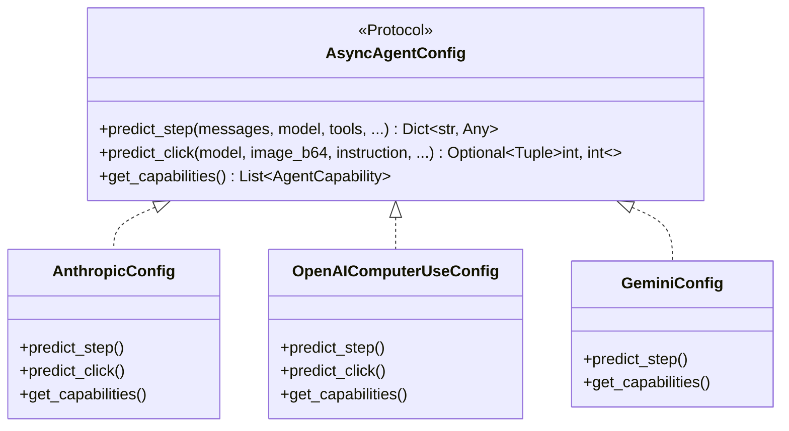
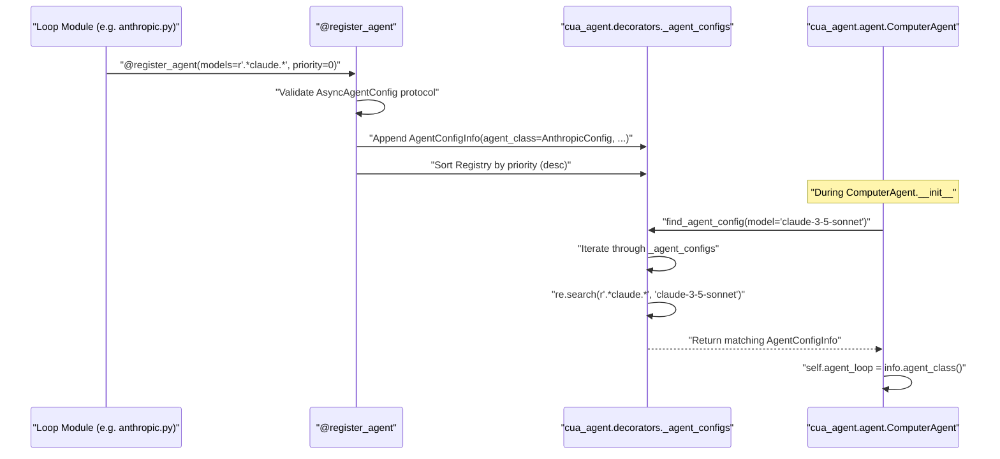

<!-- source: DeepWiki mcp.deepwiki.com · repo trycua/cua · page 7.1 Agent Loop Architecture · fetched 2026-10-29 -->

# Agent Loop Architecture

<details>
<summary>Relevant source files</summary>

The following files were used as context for generating this wiki page:

- [Makefile](Makefile)
- [libs/python/agent/.bumpversion.cfg](libs/python/agent/.bumpversion.cfg)
- [libs/python/agent/README.md](libs/python/agent/README.md)
- [libs/python/agent/pyproject.toml](libs/python/agent/pyproject.toml)
- [libs/python/core/.bumpversion.cfg](libs/python/core/.bumpversion.cfg)
- [libs/python/core/README.md](libs/python/core/README.md)
- [libs/python/core/pyproject.toml](libs/python/core/pyproject.toml)
- [libs/python/som/.bumpversion.cfg](libs/python/som/.bumpversion.cfg)
- [libs/python/som/README.md](libs/python/som/README.md)
- [libs/python/som/pyproject.toml](libs/python/som/pyproject.toml)

</details>


## Purpose and Scope

The agent loop architecture provides a pluggable system for integrating different AI models with the Cua agent framework. Each model (Anthropic Claude, OpenAI, Gemini, local models, grounding models) requires specific prompt formatting, tool schemas, and response parsing. The agent loop system abstracts these differences behind a unified protocol, allowing `ComputerAgent` to automatically select and execute the appropriate implementation based on the model string.

This document covers the agent loop protocol, registration mechanism, selection logic, and execution lifecycle.

## Agent Loop Protocol

All agent loops implement the `AsyncAgentConfig` protocol. This protocol specifies required methods for step prediction and capability reporting.

### AsyncAgentConfig Interface

The `AsyncAgentConfig` protocol ensures that different model providers can be swapped interchangeably within the `ComputerAgent` runtime.



**Sources:** `AsyncAgentConfig` protocol definition [libs/python/agent/cua_agent/loops/base.py:11-80](); `AnthropicConfig` implementation [libs/python/agent/cua_agent/loops/anthropic.py:274](); `OpenAIComputerUseConfig` implementation [libs/python/agent/cua_agent/loops/openai.py:59](); `GeminiConfig` implementation [libs/python/agent/cua_agent/loops/gemini.py:34]().

### Method Signatures

| Method | Purpose | Return Type |
|--------|---------|-------------|
| `predict_step()` | Execute one agent loop iteration with LLM call | `Dict[str, Any]` with `output` and `usage` |
| `predict_click()` | Predict click coordinates for grounding models | `Optional[Tuple[int, int]]` (x, y coordinates) |
| `get_capabilities()` | List supported capabilities | `List[AgentCapability]` (`"step"` and/or `"click"`) |

The `predict_step()` method is the core execution hook. It accepts:
- `messages`: List of message dictionaries in Responses API format.
- `model`: Model name string.
- `tools`: Tool schemas (computer handlers and functions).
- `computer_handler`: `AsyncComputerHandler` instance for computer actions.
- Callback hooks: `_on_api_start`, `_on_api_end`, `_on_usage`, `_on_screenshot`.

**Sources:** [libs/python/agent/cua_agent/loops/base.py:14-50]().

## Registration System

Agent loops register themselves using the `@register_agent` decorator, which associates a regex pattern and a priority with a configuration class.

### Registration Mechanism

The registration system uses a global registry `_agent_configs` to store `AgentConfigInfo` objects.

```python
@register_agent(models=r".*claude.*", priority=0)
class AnthropicConfig(AsyncAgentConfig):
    async def predict_step(self, ...):
        ...
```

The decorator parameters:
- `models`: Regex pattern to match model strings (e.g., `r".*claude.*"`, `r".*/computer-use-preview"`).
- `priority`: Selection priority when multiple patterns match (higher = preferred).

**Sources:** [libs/python/agent/cua_agent/decorators.py:13-48]().

### Registration and Selection Flow

This diagram bridges the "Natural Language Space" (model names) to the "Code Entity Space" (Config classes and Registry).



**Sources:** [libs/python/agent/cua_agent/decorators.py:13-62](), [libs/python/agent/cua_agent/agent.py:290-300]().

## Execution Flow

When `ComputerAgent.run()` is called, it enters a loop that delegates the "intelligence" part to the selected agent loop's `predict_step()` method.

### predict_step Lifecycle

The `predict_step` method handles the specificities of the provider's API (e.g., Anthropic's Beta headers or OpenAI's preview format).

```mermaid
sequenceDiagram
    participant CA as "ComputerAgent.run()"
    participant Callbacks as "AsyncCallbackHandler"
    participant Loop as "agent_loop.predict_step()"
    participant LLM as "LLM Provider API"
    
    CA->>Callbacks: "on_llm_start(messages)"
    CA->>Loop: "predict_step(messages, model, tools, callbacks...)"
    
    Loop->>Callbacks: "_on_api_start(payload)"
    Loop->>LLM: "Provider-specific Request (e.g. httpx.post)"
    LLM-->>Loop: "Provider-specific Response"
    Loop->>Callbacks: "_on_api_end(payload, response)"
    Loop->>Callbacks: "_on_usage(usage_data)"
    
    Loop->>Loop: "Parse Response to Responses API format"
    Loop-->>CA: "{\"output\": [...], \"usage\": {...}}"
    
    CA->>Callbacks: "on_llm_end(output)"
    CA->>CA: "Execute Computer Calls / Function Calls"
```

**Sources:** [libs/python/agent/cua_agent/agent.py:601-720](), [libs/python/agent/cua_agent/loops/anthropic.py:367-387]().

### Return Format

All `predict_step()` implementations must return a standardized dictionary containing `output` (list of items) and `usage` (token and cost metrics).

```python
{
    "output": [
        {"type": "message", "role": "assistant", "content": [{"type": "text", "text": "I will click the button"}]},
        {"type": "computer_call", "action": {"action": "left_click"}, "call_id": "call_123"}
    ],
    "usage": {
        "prompt_tokens": 1500,
        "completion_tokens": 100,
        "total_tokens": 1600,
        "response_cost": 0.005
    }
}
```

**Sources:** [libs/python/agent/cua_agent/loops/base.py:28-50](), [libs/python/agent/cua_agent/agent.py:679-698]().

## Capabilities System

Agent loops declare their supported features via `get_capabilities()`. This allows the `ComputerAgent` to verify if a model can handle specific tasks like "grounding-only" clicks or full "step-by-step" loops.

| Capability | Description |
|------------|-------------|
| `"step"` | Full agent loop capable of reasoning and generating actions. |
| `"click"` | Specialized grounding capability to predict (x, y) coordinates from an image. |

Example implementation in `AnthropicConfig`:
```python
def get_capabilities(self) -> List[AgentCapability]:
    return ["step", "click"]
```

**Sources:** [libs/python/agent/cua_agent/loops/anthropic.py:888-891](), [libs/python/agent/cua_agent/agent.py:622-629]().

## Core Agent Loops and Dependencies

The agent loop system relies on several optional dependencies defined in `pyproject.toml` to support various providers.

| Provider | Model Pattern | Priority | Required Extra |
|----------|---------------|----------|----------------|
| Anthropic | `r".*claude.*"` | 0 | `anthropic` |
| OpenAI | `r".*/computer-use-preview"` | 0 | `openai` |
| Gemini | `r".*gemini.*"` | 0 | `gemini` |
| Qwen | `r"(?i).*qwen.*"` | -1 | `qwen` |
| UI-TARS | `r".*UI-TARS.*"` | 0 | `uitars` |

**Sources:** [libs/python/agent/pyproject.toml:29-124](), [libs/python/agent/cua_agent/loops/anthropic.py:274](), [libs/python/agent/cua_agent/loops/gemini.py:108]().

## Callback Integration

The agent loop receives internal hooks (`_on_api_start`, `_on_api_end`, etc.) that it must call during its execution. These hooks are passed by the `ComputerAgent` and are used to bridge the provider-specific loop back to the central telemetry and logging systems.

- **Telemetry:** Tracks `agent_run_start` and `agent_usage` via `PostHog` [libs/python/core/cua_core/telemetry/posthog.py:1-50](). The `cua-core` package, which includes telemetry, is a dependency of `cua-agent` [libs/python/agent/pyproject.toml:22]().
- **Trajectory:** Saves screenshots and actions for later playback via `TrajectorySaverCallback`.
- **Budget:** Monitors token and cost usage to prevent overruns.

**Sources:** [libs/python/agent/cua_agent/agent.py:446-468](), [libs/python/core/cua_core/telemetry/posthog.py:1-50](), [libs/python/agent/pyproject.toml:22]().

---

