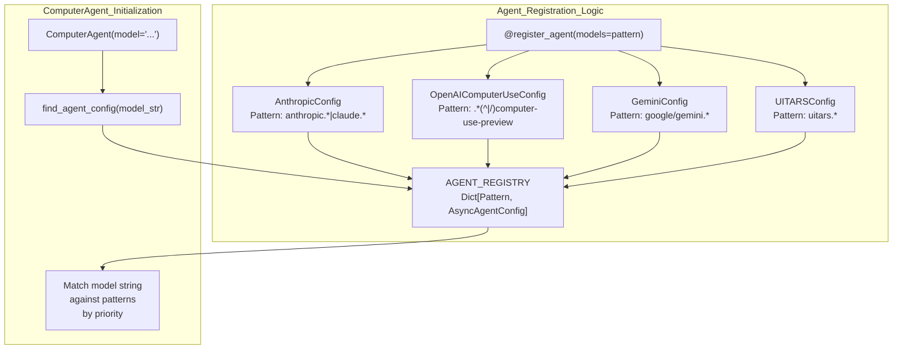
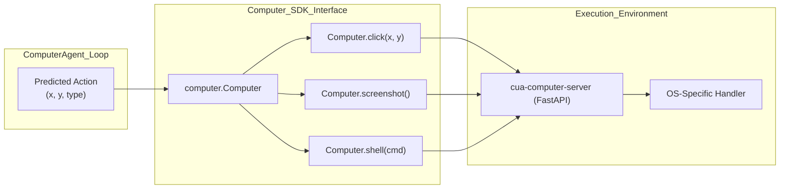

<!-- source: DeepWiki mcp.deepwiki.com · repo trycua/cua · page 7.2 Native Computer-Use Models · fetched 2026-10-29 -->

# Native Computer-Use Models

Relevant source files

The following files were used as context for generating this wiki page:

- [.github/release-attribution-config.json](.github/release-attribution-config.json)
- [.github/release-notes/cua-driver-rs.md](.github/release-notes/cua-driver-rs.md)
- [.github/release-notes/lume.md](.github/release-notes/lume.md)
- [.github/scripts/release_attribution.py](.github/scripts/release_attribution.py)
- [.github/scripts/tests/test_pr_attribution.py](.github/scripts/tests/test_pr_attribution.py)
- [.github/scripts/tests/test_pr_attribution_command.py](.github/scripts/tests/test_pr_attribution_command.py)
- [.github/scripts/tests/test_release_attribution.py](.github/scripts/tests/test_release_attribution.py)
- [.github/workflows/ci-release-metadata.yml](.github/workflows/ci-release-metadata.yml)
- [Makefile](Makefile)
- [libs/cua-driver/rust/crates/cua-driver-contract/src/session.rs](libs/cua-driver/rust/crates/cua-driver-contract/src/session.rs)
- [libs/cua-driver/rust/crates/cua-driver-core/src/capture_scope.rs](libs/cua-driver/rust/crates/cua-driver-core/src/capture_scope.rs)
- [libs/cua-driver/rust/crates/cua-driver/tests/session_capture_scope_test.rs](libs/cua-driver/rust/crates/cua-driver/tests/session_capture_scope_test.rs)
- [libs/python/agent/.bumpversion.cfg](libs/python/agent/.bumpversion.cfg)
- [libs/python/agent/README.md](libs/python/agent/README.md)
- [libs/python/agent/cua_agent/loops/uitars.py](libs/python/agent/cua_agent/loops/uitars.py)
- [libs/python/agent/pyproject.toml](libs/python/agent/pyproject.toml)
- [libs/python/agent/tests/test_uitars_coordinate_security.py](libs/python/agent/tests/test_uitars_coordinate_security.py)
- [libs/python/core/.bumpversion.cfg](libs/python/core/.bumpversion.cfg)
- [libs/python/core/README.md](libs/python/core/README.md)
- [libs/python/core/pyproject.toml](libs/python/core/pyproject.toml)
- [libs/python/som/.bumpversion.cfg](libs/python/som/.bumpversion.cfg)
- [libs/python/som/README.md](libs/python/som/README.md)
- [libs/python/som/pyproject.toml](libs/python/som/pyproject.toml)

## Purpose and Scope

This page documents the integration of native computer-use models that have built-in computer control capabilities. These models, including offerings from Anthropic, OpenAI, Google (Gemini), and specialized UI models like UI-TARS, Qwen VL, and InternVL, can directly output structured computer actions (clicks, keystrokes, scrolls) without requiring separate grounding models for UI element localization.

For composed agent patterns that combine grounding and planning models, see [7.3 Composed and Grounding Models](). For local model adapters using HuggingFace or MLX, see [7.4 Local Model Adapters](). For the general agent loop framework, see [7.1 Agent Loop Architecture]().

---

## Native vs Composed Models

Native computer-use models differ from composed models in several key ways:

| Aspect | Native Models | Composed Models |
|--------|--------------|-----------------|
| **Architecture** | Single model handles vision, reasoning, and action generation | Separate grounding model + planning model |
| **Action Format** | Direct pixel coordinates in output | Element descriptions → coordinate mapping |
| **API Integration** | Provider-specific tool schemas | Generic function calling + coordinate resolution |
| **Latency** | Single API call per step | Two API calls per step (grounding + planning) |
| **Examples** | `anthropic/claude-3-5-sonnet`, `openai/computer-use-preview`, `google/gemini-2.5-computer-use-preview` | `omniparser+openai/gpt-4o`, `gta1+anthropic/claude-3-5-sonnet` |

Sources: [libs/python/agent/pyproject.toml:29-125]()

---

## Agent Loop Registration

Native computer-use models register themselves using the `@register_agent` decorator with regex patterns matching their model identifiers. This allows the `ComputerAgent` to automatically select the correct loop logic based on the `model` string provided during initialization.

### Model-to-Loop Resolution

Sources: [libs/python/agent/pyproject.toml:33-124]()

---

## Supported Native Models and Capabilities

The Cua framework supports a wide range of native computer-use models, each with specific requirements defined in `pyproject.toml`.

### 1. Anthropic Claude
Claude models (Sonnet 3.5, etc.) are the primary computer-use models. They support a specialized "computer" tool that takes display dimensions and returns pixel-based coordinates.
*   **Key Features**: High reliability and native vision-to-action mapping.
*   **Models**: `anthropic/claude-3-5-sonnet-20241022`.
*   **Integration**: Supported via the `anthropic` extra in `cua-agent`.

Sources: [libs/python/agent/pyproject.toml:33-33]()

### 2. OpenAI Computer-Use-Preview
OpenAI's specialized preview model uses a native action format. It focuses on computer interaction and is integrated into the `ComputerAgent` via specific loop logic.
*   **Models**: `openai/computer-use-preview`.
*   **Requirement**: `cua-agent[openai]`.

Sources: [libs/python/agent/pyproject.toml:32-32]()

### 3. Google Gemini
Gemini models support computer-use through the `google-genai` SDK.
*   **Models**: `google/gemini-2.0-flash-exp`.
*   **Requirement**: `google-genai>=1.41.0`.

Sources: [libs/python/agent/pyproject.toml:86-88]()

### 4. UI-TARS and UI-TARS-2
Specialized UI models designed for GUI interaction. UI-TARS can be run via API or locally.
*   **Local Requirements**: `mlx-vlm` for Apple Silicon or `torch/transformers` for Linux/Windows.

Sources: [libs/python/agent/pyproject.toml:42-50]()

### 5. Qwen VL (Qwen2/3)
Qwen models are supported through the `qwen-agent` and `qwen-vl-utils` packages.
*   **Requirements**: `qwen-vl-utils`, `qwen-agent`, `Pillow`.

Sources: [libs/python/agent/pyproject.toml:34-38](), [libs/python/agent/pyproject.toml:120-123]()

### 6. GLM-4.5V
GLM-4.5V is supported via its HuggingFace implementation.
*   **Requirements**: `accelerate`, `torch`, `transformers>=5.0.0rc3`.

Sources: [libs/python/agent/pyproject.toml:51-54]()

### 7. InternVL
High-performance open-source vision-language models.
*   **Requirements**: `einops`, `timm`, `transformers`.

Sources: [libs/python/agent/pyproject.toml:63-69]()

---

## Implementation Details: Computer SDK Interaction

Native models eventually trigger actions through the `Computer` interface in the SDK which interacts with the execution environment.

### Interface-to-Code Mapping

| Component | Purpose | File Pointer |
|-----------|---------|--------------|
| **Computer** | Unified interface for screenshots and actions | [libs/python/agent/pyproject.toml:30-32]() |
| **cua-agent** | Python package for Cua agents | [libs/python/agent/pyproject.toml:6-8]() |
| **cua-core** | Core functionality including telemetry | [libs/python/core/pyproject.toml:6-8]() |
| **litellm** | Integration for various LLM APIs | [libs/python/agent/pyproject.toml:24-24]() |

Sources: [libs/python/agent/pyproject.toml:6-8](), [libs/python/agent/pyproject.toml:24-24](), [libs/python/agent/pyproject.toml:30-32](), [libs/python/core/pyproject.toml:6-8]()

---

## Summary of Native Model Requirements

The `cua-agent` package uses optional dependencies to manage the various SDKs and runtimes required for different native models.

| Model Category | Extra Dependency (pip install) | Purpose |
|----------------|--------------------------------|---------|
| **Anthropic** | `cua-agent[anthropic]` | Claude API support |
| **OpenAI** | `cua-agent[openai]` | OpenAI Computer Use support |
| **Gemini** | `cua-agent[gemini]` | `google-genai` SDK |
| **Qwen** | `cua-agent[qwen]` | `qwen-agent` and `qwen-vl-utils` |
| **UI-TARS (Local)** | `cua-agent[uitars-mlx]` (macOS) | Local inference via `mlx-vlm` |
| **UI-TARS (HF)** | `cua-agent[uitars-hf]` | Local inference via `transformers` |
| **GLM-4.5V** | `cua-agent[glm45v-hf]` | Local inference via `transformers` |
| **InternVL** | `cua-agent[internvl-hf]` | `einops`, `timm`, `transformers` |
| **Cloud (Unified)** | `cua-agent[cloud]` | API-only access for cloud models |

Sources: [libs/python/agent/pyproject.toml:29-125]()

---

