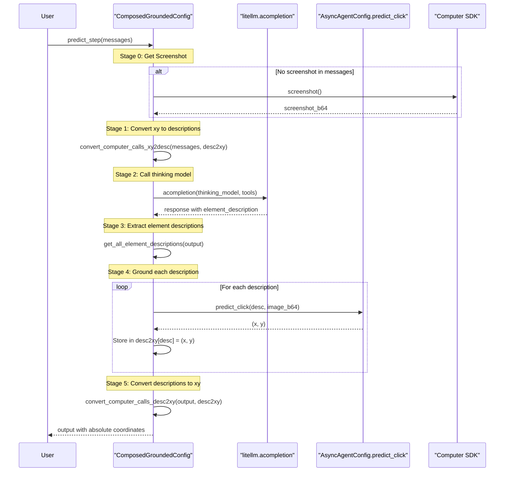

<!-- source: DeepWiki mcp.deepwiki.com · repo trycua/cua · page 7.3 Composed and Grounding Models · fetched 2026-10-29 -->

# Composed and Grounding Models

<details>
<summary>Relevant source files</summary>

The following files were used as context for generating this wiki page:

- [Makefile](Makefile)
- [libs/python/agent/.bumpversion.cfg](libs/python/agent/.bumpversion.cfg)
- [libs/python/agent/README.md](libs/python/agent/README.md)
- [libs/python/agent/pyproject.toml](libs/python/agent/pyproject.toml)
- [libs/python/core/.bumpversion.cfg](libs/python/core/.bumpversion.cfg)
- [libs/python/core/README.md](libs/python/core/README.md)
- [libs/python/core/pyproject.toml](libs/python/core/pyproject.toml)
- [libs/python/som/.bumpversion.cfg](libs/python/som/.bumpversion.cfg)
- [libs/python/som/README.md](libs/python/som/README.md)
- [libs/python/som/pyproject.toml](libs/python/som/pyproject.toml)

</details>


This page documents the grounding model architecture and composed agent patterns in Cua. Grounding models specialize in UI element localization by predicting pixel coordinates from natural language descriptions. Composed models combine a grounding model with a separate planning/reasoning model to enable computer-use capabilities for models that lack native tool-calling support.

For information about native computer-use models (Anthropic, OpenAI), see page 7.2 (Native Computer-Use Models). For local model adapters and fine-tuned models, see page 7.4 (Local Model Adapters).

## Grounding Models Overview

Grounding models are vision-language models that excel at localizing UI elements on screenshots. Unlike native computer-use models that directly output tool calls with pixel coordinates, grounding models focus solely on the `predict_click` capability: given an image and an element description, they return `(x, y)` coordinates.

**Key Characteristics:**
- Implement the `predict_click` method of `AsyncAgentConfig` [libs/python/agent/agent/loops/base.py:16-20]()
- Return `["click"]` from `get_capabilities()` [libs/python/agent/agent/loops/gta1.py:91-93]()
- Do not support full `predict_step` agent loops on their own.
- Used as components in composed models [libs/python/agent/agent/loops/composed_grounded.py:135-140]()

**Supported Grounding Models:**
| Model | Implementation | Registration Pattern | Primary Use |
|-------|---------------|---------------------|-------------|
| OmniParser | `OmniparserConfig` | `r"omniparser\+.*\|omni\+.*"` | Element ID-based grounding with SOM |
| GTA1 | `GTA1Config` | `r".*GTA1.*"` | Direct coordinate prediction |
| Moondream3 | `Moondream3PlusConfig` | `r"moondream3\+.*"` | Local detection with UI labeling |
| Holo | `HoloConfig` | `r"(?i).*(Holo1\.5\|Hcompany/Holo1\.5).*"` | JSON-based absolute positioning |
| OpenCUA | `OpenCUAConfig` | `r".*opencua.*"` | Open-source grounding |

Sources: [libs/python/agent/agent/loops/omniparser.py:274-501](), [libs/python/agent/agent/loops/gta1.py:75-176](), [libs/python/agent/agent/loops/moondream3.py:283-317](), [libs/python/agent/agent/loops/holo.py:118-219](), [libs/python/agent/agent/loops/opencua.py:1-50](), [libs/python/agent/pyproject.toml:39-74]()

## Grounding Model Architecture

### AsyncAgentConfig Protocol for Grounding

Grounding models implement a subset of the `AsyncAgentConfig` protocol. This allows the `ComputerAgent` to dispatch `predict_click` calls to specialized local or remote models.

**Grounding Architecture Diagram**
```mermaid
graph TB
    subgraph "AsyncAgentConfig Protocol"
        "predict_step(messages, model, tools)"
        "predict_click(model, image_b64, instruction)"
        "get_capabilities()"
    end
    
    subgraph "Full Agent Loops"
        "AnthropicConfig"
        "OpenAIComputerUseConfig"
        
        "AnthropicConfig" --> "predict_step(messages, model, tools)"
        "AnthropicConfig" --> "predict_click(model, image_b64, instruction)"
        "AnthropicConfig" --> "get_capabilities()"
        "OpenAIComputerUseConfig" --> "predict_step(messages, model, tools)"
        "OpenAIComputerUseConfig" --> "predict_click(model, image_b64, instruction)"
        "OpenAIComputerUseConfig" --> "get_capabilities()"
    end
    
    subgraph "Grounding-Only Models"
        "GTA1Config"
        "OmniparserConfig"
        "OpenCUAConfig"
        "HoloConfig"
        
        "GTA1Config" --> "predict_click(model, image_b64, instruction)"
        "GTA1Config" --> "get_capabilities()"
        "OmniparserConfig" --> "predict_click(model, image_b64, instruction)"
        "id2xy mapping"
        "OpenCUAConfig" --> "predict_click(model, image_b64, instruction)"
        "HoloConfig" --> "predict_click(model, image_b64, instruction)"
    end
    
    subgraph "Composed Models"
        "ComposedGroundedConfig"
        "Moondream3PlusConfig"
        
        "ComposedGroundedConfig" --> "predict_step(messages, model, tools)"
        "ComposedGroundedConfig" --> "predict_click(model, image_b64, instruction)"
        "Moondream3PlusConfig" --> "predict_step(messages, model, tools)"
        "Moondream3PlusConfig" --> "predict_click(model, image_b64, instruction)"
    end
```

Sources: [libs/python/agent/agent/loops/base.py:5-22](), [libs/python/agent/agent/loops/omniparser.py:274-276](), [libs/python/agent/agent/loops/gta1.py:75-77](), [libs/python/agent/agent/loops/moondream3.py:283-285](), [libs/python/agent/agent/loops/holo.py:118-120]()

### predict_click Method Signature

All grounding models implement the signature defined in `AsyncAgentConfig`:

```python
async def predict_click(
    self,
    model: str,
    image_b64: str,
    instruction: str,
    **kwargs
) -> Optional[Tuple[int, int]]
```
[libs/python/agent/agent/loops/base.py:16-20]()

**Parameters:**
- `model`: Model identifier (e.g., `"huggingface-local/HelloKKMe/GTA1-7B"`) [libs/python/agent/agent/loops/gta1.py:99-105]()
- `image_b64`: Base64-encoded PNG screenshot.
- `instruction`: Natural language element description (e.g., `"red submit button"`).
- `**kwargs`: Additional model-specific parameters.

**Returns:**
- `(x, y)` tuple of pixel coordinates, or `None` if localization fails [libs/python/agent/agent/loops/gta1.py:168-171]()

Sources: [libs/python/agent/agent/loops/base.py:16-20](), [libs/python/agent/agent/loops/gta1.py:99-171]()

## Element Description System

### Coordinate Systems

Cua uses two coordinate systems for UI interactions:

| System | Format | Example | Usage |
|--------|--------|---------|-------|
| **Absolute Pixels** | `{"x": int, "y": int}` | `{"x": 450, "y": 320}` | Direct computer actions, native models |
| **Element Descriptions** | `{"element_description": str}` | `{"element_description": "blue login button"}` | Composed models, grounding stage |

### Message Conversion Pipeline

The `responses.py` module provides bidirectional conversion between these systems to support "Thinking" models that don't natively understand coordinates.

**Natural Language to Code Entity Space Mapping**
```mermaid
graph LR
    subgraph "Input Messages"
        "computer_call with x,y"
    end
    
    subgraph "Conversion Functions (responses.py)"
        "convert_computer_calls_xy2desc"
        "convert_computer_calls_desc2xy"
        "get_all_element_descriptions"
    end
    
    subgraph "Thinking Model (Planning Stage)"
        "thinkingInput"
        "litellm.acompletion"
        "thinkingOutput"
    end
    
    subgraph "Grounding Model (Localization Stage)"
        "grounding_agent.predict_click"
        "mapping: Dict[str, Tuple]"
    end
    
    subgraph "Output Messages"
        "computer_call with final x,y"
    end
    
    "computer_call with x,y" --> "convert_computer_calls_xy2desc"
    "convert_computer_calls_xy2desc" --> "thinkingInput"
    "thinkingInput" --> "litellm.acompletion"
    "litellm.acompletion" --> "thinkingOutput"
    "thinkingOutput" --> "get_all_element_descriptions"
    "get_all_element_descriptions" --> "grounding_agent.predict_click"
    "grounding_agent.predict_click" --> "mapping: Dict[str, Tuple]"
    "mapping: Dict[str, Tuple]" --> "convert_computer_calls_desc2xy"
    "thinkingOutput" --> "convert_computer_calls_desc2xy"
    "convert_computer_calls_desc2xy" --> "computer_call with final x,y"
```

**Key Functions:**

- `convert_computer_calls_xy2desc(responses_items, desc2xy)` - Replaces `x,y` with `element_description` using reverse mapping [libs/python/agent/agent/responses.py:304-335]()
- `convert_computer_calls_desc2xy(responses_items, desc2xy)` - Replaces `element_description` with `x,y` from mapping [libs/python/agent/agent/responses.py:337-370]()
- `get_all_element_descriptions(responses_items)` - Extracts unique descriptions for grounding [libs/python/agent/agent/responses.py:414-441]()

Sources: [libs/python/agent/agent/responses.py:304-441]()

## Composed Model Pattern

### Model String Format

Composed models use the pattern: `"grounding_model+thinking_model"`. The `ComposedGroundedConfig` class is registered with priority `1` to match these compound strings [libs/python/agent/agent/loops/composed_grounded.py:123-130]().

### ComposedGroundedConfig Implementation

The composed agent implements a two-stage pipeline where planning and localization are decoupled.

**Composed Model Execution Flow**


Sources: [libs/python/agent/agent/loops/composed_grounded.py:135-287]()

## OmniParser Grounding Model

### Set-of-Mark (SOM) System

OmniParser uses the SOM library to annotate screenshots with numbered element IDs. The `OmniparserConfig` manages the conversion between these visual IDs and pixel coordinates. This requires the `cua-som` package [libs/python/agent/pyproject.toml:41]().

The `cua-som` package is deprecated and no longer maintained [libs/python/som/README.md:19-21](). It is licensed under AGPL-3.0, separate from the MIT-licensed Cua packages [libs/python/som/README.md:83-84](). While the `omniparser` loop still functions if `cua-som` is installed separately, it will not receive updates or fixes [libs/python/agent/README.md:7-8]().

```mermaid
graph TB
    subgraph "OmniParser Pipeline"
        "Original Screenshot"
        "OmniParser.parse"
        "ParseResult"
        
        "Original Screenshot" --> "OmniParser.parse"
        "OmniParser.parse" --> "ParseResult"
        
        subgraph "ParseResult Contents"
            "annotated_image_base64"
            "elements: List[Element]"
            
            "ParseResult" --> "annotated_image_base64"
            "ParseResult" --> "elements: List[Element]"
        end
    end
    
    subgraph "ID To Coordinate Mapping"
        "id2xy: Dict[int, Tuple]"
        "xy2id: Dict[Tuple, int]"
        
        "elements: List[Element]" --> "id2xy: Dict[int, Tuple]"
        "id2xy: Dict[int, Tuple]" --> "xy2id: Dict[Tuple, int]"
    end
```

Sources: [libs/python/agent/agent/loops/omniparser.py:23-85](), [libs/python/agent/agent/loops/omniparser.py:139-272](), [libs/python/agent/agent/loops/omniparser.py:278-427](), [libs/python/som/pyproject.toml:6-26](), [libs/python/som/README.md:19-21](), [libs/python/som/README.md:83-84](), [libs/python/agent/README.md:7-8]()

## GTA1 Grounding Model

GTA1 (Grounded Task Automation) is a vision-language model trained for direct UI grounding. It predicts pixel coordinates from an image and element description without intermediate representations.

### Smart Resize Strategy

GTA1 uses a `smart_resize` function to optimize image dimensions for the model while maintaining aspect ratio and ensuring dimensions are divisible by the model's patch factor [libs/python/agent/agent/loops/gta1.py:40-73]().

### GTA1 Click Prediction

The `predict_click` method builds a system prompt containing the image dimensions and requests a coordinate pair in `(x,y)` format [libs/python/agent/agent/loops/gta1.py:99-171]().

Sources: [libs/python/agent/agent/loops/gta1.py:23-172](), [libs/python/computer/computer/utils.py:40-55]()

## Moondream3 Grounding Model

Moondream3 is a local vision-language model that combines element detection with captioning. It's used in the pattern `moondream3+<thinking_model>` where Moondream3 handles grounding and a separate model handles planning.

### UI Detection and Labeling

Moondream3 provides a unique capability: automatic UI element detection and labeling. The `_annotate_detect_and_label_ui` function detects elements, crops them, and generates captions for each to create a labeled view for the thinking model [libs/python/agent/agent/loops/moondream3.py:101-210]().

Sources: [libs/python/agent/agent/loops/moondream3.py:101-210](), [libs/python/agent/agent/loops/moondream3.py:288-380](), [libs/python/agent/pyproject.toml:70-74]()

## Model Capabilities Summary

| Model | Pattern | predict_step | predict_click | Element System | Notes |
|-------|---------|-------------|---------------|----------------|-------|
| **OmniParser** | `omniparser+.*` | ❌ | ✅ | Element IDs (SOM) | Requires `cua-som` [libs/python/agent/pyproject.toml:41](). `cua-som` is deprecated. |
| **GTA1** | `.*GTA1.*` | ❌ | ✅ | Direct coordinates | Rescaling logic [libs/python/agent/agent/loops/gta1.py:165]() |
| **Moondream3** | `moondream3+.*` | ✅ (composed) | ✅ | Element descriptions | Local detection [libs/python/agent/agent/loops/moondream3.py:101]() |
| **Holo** | `.*Holo1\.5.*` | ❌ | ✅ | JSON coordinates | Preprocessing logic [libs/python/agent/agent/loops/holo.py:35]() |
| **ComposedGrounded** | `.*\+.*` | ✅ (composed) | ✅ (delegates) | Element descriptions | Universal composed pattern |

Sources: [libs/python/agent/agent/loops/composed_grounded.py:123-130](), [libs/python/agent/pyproject.toml:40-75](), [libs/python/som/README.md:19-21]()

---

